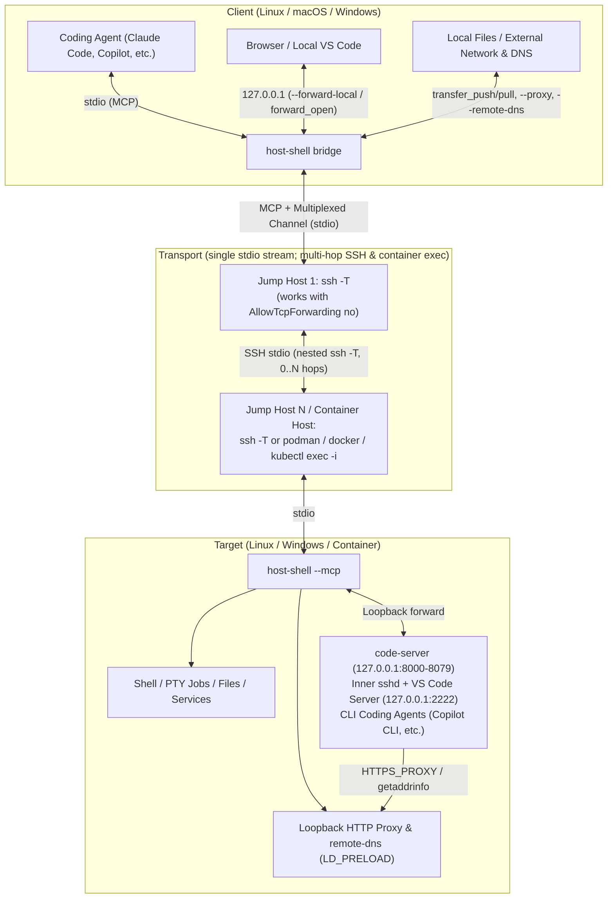
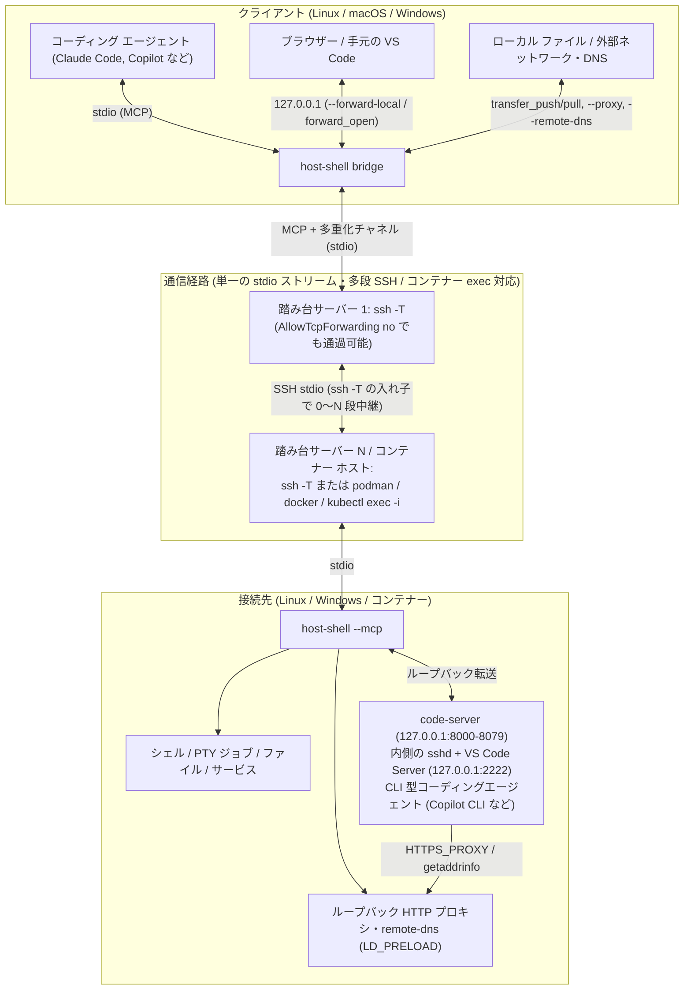

# host-shell-mcp

[English](#english) | [日本語](#日本語)

## English

`host-shell` is an MCP server **deployed on the target machine (Windows / Linux) and accessed over the standard input and output of SSH or a similar channel**.  
Even where port forwarding and SFTP are unavailable, coding agents such as Claude Code and GitHub Copilot can inspect and operate remote machines over a plain SSH session.

```text
agent --stdio(MCP)--> ssh -T hop1 ssh -T target host-shell --mcp
```

Unlike typical SSH MCP servers that invoke `ssh` per operation on the client side, `host-shell` runs directly on the target machine.

| | Client-side SSH MCP | host-shell |
|---|---|---|
| Where it runs | On the machine that runs the agent | On the target machine |
| SFTP | Usually used for file transfer | Not used |
| Port forwarding | Often required for tunnels and some transfers | Not required |
| `AllowTcpForwarding no` | Routes that depend on forwarding stop there | Nested `ssh -T` still reaches the target |
| Windows and encodings | Quoting and encodings stay with the caller | Normalized on the target (PowerShell quoting, Shift_JIS, EUC-JP) |
| Session | Often opens a new SSH connection per call | Keeps one SSH connection for the whole MCP session |

Table: Comparison with client-side SSH MCP servers

### Supported configurations

`host-shell` operates over any command that provides a clean 8-bit standard input/output stream to the target. Placing `host-shell bridge` on the client side multiplexes file transfers, TCP/SOCKS5 port forwarding, an HTTP/HTTPS proxy, and glibc name resolution over that single stdio stream—enabling remote IDEs and CLI coding agents even on isolated targets without internet access, SFTP, or `sshd` port forwarding.



| Configuration | Route / Mechanism | Documentation |
|---|---|---|
| Direct or multi-hop SSH | `ssh -T [hop1 ssh -T ...] target host-shell --mcp` (works even with `AllowTcpForwarding no` and no SFTP) | [User Guide](docs/en/user-guide.md) |
| Running containers | `[ssh -T host] podman\|docker\|kubectl exec -i <container> host-shell --mcp` | [Connecting into containers](docs/en/container.md) |
| Direct file transfer & TCP forwarding | `host-shell bridge` (`transfer_push`, `transfer_pull`, `--forward-local`, `--forward-remote`, `--forward-socks`, `forward_open`) | [Reference](docs/en/reference.md#transfer-with-the-local-machine-bridge), [Port forwarding](docs/en/port-forward.md) |
| Outbound HTTP/HTTPS & DNS from isolated targets | Loopback HTTP proxy (`--proxy`, `--client-proxy`, `proxy_rules_update`) and client-side name resolution (`--remote-dns`: Linux/glibc `getaddrinfo` relay, or a loopback DNS server on Windows) | [HTTP proxy through the client](docs/en/client-proxy.md), [Remote DNS](docs/en/remote-dns.md) |
| Browser VS Code on closed-network targets | Offline `code-server` injection (`127.0.0.1:8000-8079`) accessed via local port forwarding (Linux & Windows targets) | [Injecting code-server](docs/en/code-server.md) |
| Local desktop VS Code on closed-network targets | Offline VS Code Server + user-mode `sshd` (`127.0.0.1:2222`) accessed from local VS Code (Remote - SSH) via local port forwarding (Linux glibc targets) | [VS Code Remote - SSH](docs/en/vscode-remote-ssh.md) |
| CLI coding agents on isolated targets | CLI agent (such as Copilot CLI) running in the target terminal and reaching authentication/inference APIs via the client HTTP proxy and `remote-dns` | [CLI coding agents](docs/en/coding-agents.md) |

Table: Supported configurations

### Features

- **No port forwarding or SFTP required**: Operates solely over the standard input and output of an SSH or container `exec -i` session. Multi-hop routes work via nested `ssh` even when jump hosts set `AllowTcpForwarding no`.
- **Persistent single session**: Maintains one SSH connection for the entire MCP session, avoiding per-call connection overhead even across multi-hop routes.
- **Holds target resources only while connected**: When the connection ends, terminates the commands and jobs it started together with their descendants and closes forwarding, proxy, and `remote-dns` listeners and temporary files, leaving no resident process or listening port on the target (keeping services running after disconnection is out of scope).
- **Cross-platform abstraction**: Normalizes shell, quoting, and path differences between Windows and Linux. PowerShell commands can be passed without extra quote escaping.
- **Built-in agent primitives**: Provides string replacement (`fs_edit`), `**` globs, grep with context lines and match counts, file move/copy/delete, and input to interactive jobs.
- **Pseudo-terminal (PTY) support**: Runs terminal-dependent programs (such as password-prompting `sudo`/`ssh` and REPLs) as `pty` jobs (Linux pty / Windows ConPTY), supporting regex match (`until`) and output-idle (`idle_ms`) waits, plus virtual screen snapshots (`screen: true`).
- **Network diagnostics and requests**: Supports HTTP requests from the target (`net_request_http`, including the Docker API over Unix sockets), TCP send/receive (`net_exchange`), DNS/connectivity/certificate checks (`net_check`), and listening port inspection (`net_list_listeners`).
- **Unified OS administration**: Manages services (systemd / Windows services), system logs (journald / Event Log), process termination, disk usage, and the Windows registry through a consistent interface.
- **Direct file transfer**: With local `host-shell bridge`, transfers files and directories directly without passing through the agent context (`transfer_push`, `transfer_pull`), checking free disk space beforehand, verifying SHA-256 hashes, and skipping unchanged files.
- **Port forwarding, HTTP proxy, and remote DNS without SSH forwarding**: When enabled on both ends, `host-shell bridge` multiplexes bidirectional TCP port forwarding, a SOCKS5 proxy, an authenticated HTTP/HTTPS proxy through the client network (with optional live rule updates via `proxy_rules_update`), and client-side name resolution (`--remote-dns`: Linux/glibc `getaddrinfo`, or a loopback DNS server on Windows) over the same SSH session.
- **Closed-network IDE and coding agent workflows**: Bundled agent skills automate offline deployment of `code-server`, `VS Code Remote - SSH` (via a user-mode `sshd`), and CLI coding agents onto targets without direct internet access.
- **Progress notifications and cancellation**: Reports progress for long commands, downloads, and file transfers via MCP notifications, and terminates execution when the agent cancels a request.
- **Policy restrictions via startup options**: Runs with the connecting user's permissions by default; startup options can restrict published tool groups, enforce read-only mode, limit allowed paths/commands/hosts, require user confirmation, and mask secrets.
- **Self-describing agent guidance**: Initialize instructions, tool descriptions, and the `help_get` tool allow agents to choose appropriate tools without user instructions.
- **Automatic encoding and newline conversion**: Converts Shift_JIS, EUC-JP, and other encodings to UTF-8 on the target, and supports specifying encoding, BOM, and line endings when writing.
- **Single-binary deployment**: Deploys as a single static executable with no external dependencies.
- **Output limits, timeouts, and audit logging**: Truncates large outputs while preserving head and tail, and logs every tool call on the target.

### Tools

| Category | Tools |
|---|---|
| Usage guidance | `help_get` |
| Command execution | `exec_run` |
| Long-running jobs | `job_start`, `job_read`, `job_write`, `job_stop`, `job_list` |
| File operations | `fs_list`, `fs_stat`, `fs_read`, `fs_edit`, `fs_write`, `fs_mkdir`, `fs_move`, `fs_copy`, `fs_remove` |
| Search | `search_grep`, `search_find` |
| Diff inspection | `fs_manifest` |
| Privileged execution | `exec_sudo` (Linux only) |
| Environment info | `sys_get_info` |
| Network | `net_request_http`, `net_exchange`, `net_check`, `net_list_listeners`, `net_list_interfaces` |
| Administration | `proc_list`, `proc_kill`, `svc_list`, `svc_control`, `log_query`, `disk_list` |
| Windows registry | `reg_read`, `reg_write`, `reg_delete` (Windows only) |
| File transfer | `transfer_push`, `transfer_pull` (via `host-shell bridge`) |
| Client network | `proxy_status`, `proxy_rules_update`, `forward_status`, `forward_open`, `forward_close` (via `host-shell bridge`, when enabled) |

Table: Tools provided

### Bundled agent skills

The repository includes skills under `.agents/skills/` so coding agents can automate deployment and remote development setup:

| Skill | Purpose |
|---|---|
| [`host-shell-connect`](.agents/skills/host-shell-connect/SKILL.md) | Verifies the SSH or container `exec -i` route, detects the target OS/architecture/libc, deploys the `host-shell` binary (and optional `remote-dns` adapter), and outputs the MCP registration command |
| [`host-shell-code-server`](.agents/skills/host-shell-code-server/SKILL.md) | Downloads `code-server` and default extensions on the client, transfers and installs them offline on the target (including display locale setup and optional `remote-dns` patched-copy mode), starts `code-server` on `127.0.0.1`, and opens a local port forward |
| [`host-shell-vscode-remote-ssh`](.agents/skills/host-shell-vscode-remote-ssh/SKILL.md) | Fetches the VS Code Server matching the local VS Code commit, places and pins it offline on a Linux target, starts a user-mode `sshd` on `127.0.0.1:2222`, and configures local `VS Code Remote - SSH` through a local port forward |
| [`host-shell-coding-agents`](.agents/skills/host-shell-coding-agents/SKILL.md) | Guides deployment and step-by-step validation of CLI coding agents (Copilot CLI, agy, Claude Code, Codex, Grok) on isolated targets using the client HTTP proxy and `remote-dns` |

Table: Bundled agent skills

### Quick start

1. Build the binaries (requires Go 1.26 or later).

    ```bash
    make dist
    ```

2. Deploy the executable to the target. It can be transferred over SSH standard input without SFTP. To avoid modifying system directories, place it under `/tmp/host-shell-<uid>/` by default (`1000` is the UID returned by `id -u` on the target).

    ```bash
    ssh target 'mkdir -m 700 /tmp/host-shell-1000 && cat > /tmp/host-shell-1000/host-shell && chmod 755 /tmp/host-shell-1000/host-shell' \
        < dist/host-shell-linux-amd64
    ssh -T target /tmp/host-shell-1000/host-shell --version
    ```

3. Register the server with your agent. Placing the local binary in front as `bridge` enables the file transfer tools (`transfer_push`, `transfer_pull`).

    ```bash
    claude mcp add host-shell -- /path/to/host-shell bridge -- ssh -T hop1 ssh -T target /tmp/host-shell-1000/host-shell --mcp
    ```

    Without `bridge`, register the `ssh` command directly.

    ```bash
    claude mcp add host-shell -- ssh -T hop1 ssh -T target /tmp/host-shell-1000/host-shell --mcp
    ```

4. Ask the agent to "check the target's OS with sys_get_info of host-shell".

Pass `-T` to every SSH hop to disable pseudo-terminal allocation. To get the most out of the agent, organize the SSH connection route (jump hosts, network topology, and authentication methods) as well as the target's file system layout, any target-side diagnostic commands/scripts, and the relevant source code in your local client workspace (see [Preparing target information and sources on the client](docs/en/user-guide.md#preparing-target-information-and-sources-on-the-client) in the [User Guide](docs/en/user-guide.md)).

Steps 2 and 3 can also be automated with the `.agents/skills/host-shell-connect` skill, which verifies the route, detects the target OS and architecture, deploys the binary, checks startup, and outputs the registration command. `make dist` copies the binaries into the skill's `bin/` directory.  
GitHub Releases include archives named with the tag, including the leading `v` (`host-shell-mcp-<tag>-bin.zip` and `.tar.gz`, for example `host-shell-mcp-v20261031.1.0-bin.zip`). Each archive contains the source tree along with prebuilt binaries and remote DNS adapters in `dist/` and `.agents/skills/host-shell-connect/bin/`.

### Documentation

See [`docs/`](docs/README.md). **The Japanese documents (`docs/ja/`) are the single source of truth (SSOT)**, and `docs/en/` contains English translations.

| Document | Contents |
|---|---|
| [User Guide](docs/en/user-guide.md) | Architecture, binary deployment, SSH route checks, agent registration, usage examples, troubleshooting |
| [Operations Guide](docs/en/operations.md) | Security model, restriction options, dedicated user and key, pinning the startup command, sudo configuration, audit log management |
| [Reference](docs/en/reference.md) | Startup options, policy restrictions, MCP specification, tool inputs and outputs, bridge, process management, audit log format, limitations |
| [Development Guide](docs/en/development.md) | Building, source layout, design rules, adding tools, testing, releases |
| [HTTP proxy through the client](docs/en/client-proxy.md) | Routing target HTTP/HTTPS traffic through the bridge's network |
| [Port forwarding](docs/en/port-forward.md) | Local forwards, remote forwards, and SOCKS5 over SSH stdio |
| [Remote DNS](docs/en/remote-dns.md) | Optional client-side name resolution over the existing MCP connection (Linux/glibc `getaddrinfo` relay, or a loopback DNS server on Windows) |
| [CLI coding agents](docs/en/coding-agents.md) | Deploying CLI coding agents and validating authentication and API access through the client proxy |
| [Injecting code-server](docs/en/code-server.md) | Installing code-server with default settings and extensions on a closed-network target and opening it via a local forward |
| [VS Code Remote - SSH](docs/en/vscode-remote-ssh.md) | Connecting local VS Code to a target through a user-mode sshd and a local forward, with the VS Code Server placed offline and pinned to the client version |
| [Connecting into containers](docs/en/container.md) | Deploying and registering `host-shell` inside a running Podman, Docker, or Kubernetes container via `exec -i` |

Table: Documentation

### Security

When used over SSH, `host-shell` operates with the same user permissions as a regular SSH session; it does not grant additional OS privileges or require an externally reachable listening port. Existing SSH authentication, OS file permissions, and `sudoers` rules continue to apply.  
Beyond these SSH and OS controls, `host-shell` provides startup options to narrow the operations available to an agent: read-only access (`--read-only`), tool selection (`--tools`), file access restrictions (`--allow-path`), and per-call user confirmation (`--confirm`). Dedicated OS users and SSH keys can be combined with these options to tailor access to your workflow.  
Optional [client HTTP proxy](docs/en/client-proxy.md), [port forwarding](docs/en/port-forward.md), and [remote DNS](docs/en/remote-dns.md) run over the MCP channel rather than `sshd` forwarding, so `no-port-forwarding` and `AllowTcpForwarding no` in `sshd` do not block them. All three features are disabled by default and require explicit target flags (`--client-proxy`, `--allow-forward-local`, `--allow-forward-remote`, `--remote-dns`); omit those flags from `command=` in `authorized_keys` when you want to prohibit them.  
See the [Operations Guide](docs/en/operations.md) for details.

## 日本語

`host-shell` は、**接続先マシン (Windows / Linux) に配置し、SSH などの標準入出力経由で中継して使用する** MCP サーバーです。  
ポート転送や SFTP が使えない環境でも、Claude Code や GitHub Copilot などのコーディング エージェントから、プレーンな SSH セッションだけで遠隔マシンを調査・操作できます。

```text
エージェント --stdio(MCP)--> ssh -T hop1 ssh -T target host-shell --mcp
```

クライアント側で `ssh` を起動する一般的な SSH 系 MCP サーバーとは異なり、`host-shell` 自体は接続先マシン上で動作します。

| | クライアント側の SSH 系 MCP | host-shell |
|---|---|---|
| 実行場所 | エージェントと同じマシン | 接続先マシン |
| SFTP | ファイル転送に使うことが多い | 使わない |
| ポート転送 | トンネルや一部の転送に必要になることが多い | 不要 |
| `AllowTcpForwarding no` | 転送に依存する経路はそこで止まる | `ssh -T` の入れ子で接続先まで届く |
| Windows と文字コード | 引用符と文字コードの差は呼び側に残る | 接続先で吸収する (PowerShell の引用符、Shift_JIS、EUC-JP) |
| セッション | 呼び出しのたびに SSH 接続を開くことが多い | MCP セッションの間、SSH は 1 本のまま |

Table: クライアント側の SSH 系 MCP との違い

### サポートされる構成

`host-shell` は、接続先との間で 8 ビット透過の標準入出力を確保できる任意のコマンド経路で動作します。手元に `host-shell bridge` を挟むと、単一の標準入出力ストリーム上にファイル転送、TCP / SOCKS5 ポート転送、クライアント経由 HTTP/HTTPS プロキシ、および Linux/glibc の名前解決 (`remote-dns`) を多重化でき、インターネット接続や SFTP、`sshd` のポート転送が使えない閉鎖環境の接続先でもリモート IDE や CLI 型コーディングエージェントを利用できます。



| 構成 | 経路・仕組み | 参照文書 |
|---|---|---|
| 直接または多段の SSH 接続 | `ssh -T [hop1 ssh -T ...] target host-shell --mcp` (`AllowTcpForwarding no` や SFTP 無効環境でも動作) | [利用ガイド](docs/ja/user-guide.md) |
| 稼働中のコンテナーへの接続 | `[ssh -T host] podman\|docker\|kubectl exec -i <container> host-shell --mcp` | [コンテナーへの接続](docs/ja/container.md) |
| ファイル直接転送・TCP ポート転送 | `host-shell bridge` (`transfer_push`、`transfer_pull`、`--forward-local`、`--forward-remote`、`--forward-socks`、`forward_open`) | [リファレンス](docs/ja/reference.md#手元との転送-bridge)、[ポート転送](docs/ja/port-forward.md) |
| 閉鎖環境からの HTTP/HTTPS 通信・名前解決 | ループバック HTTP プロキシ (`--proxy`、`--client-proxy`、`proxy_rules_update`) と接続元を使う名前解決 (`--remote-dns`。Linux/glibc の `getaddrinfo` 中継、Windows ではループバックの DNS サーバー) | [クライアント経由 HTTP プロキシ](docs/ja/client-proxy.md)、[接続元を使う名前解決](docs/ja/remote-dns.md) |
| 閉鎖環境でのブラウザー版 VS Code | `code-server` (`127.0.0.1:8000-8079`) をオフライン導入し、ローカル転送経由で手元のブラウザーから利用 (Linux / Windows 接続先) | [code-server の導入](docs/ja/code-server.md) |
| 閉鎖環境でのデスクトップ版 VS Code | VS Code Server と利用者権限の `sshd` (`127.0.0.1:2222`) をオフライン配置し、ローカル転送経由で手元の VS Code (Remote - SSH) から接続 (Linux glibc 接続先) | [VS Code Remote - SSH での利用](docs/ja/vscode-remote-ssh.md) |
| 隔離環境での CLI 型 AI コーディングエージェント | 接続先ターミナル内の CLI (Copilot CLI など) からクライアント経由 HTTP プロキシと `remote-dns` を通じて認証・推論 API を利用 | [CLI 型 AI コーディングエージェントの導入](docs/ja/coding-agents.md) |

Table: サポートされる構成

### 特長

- **ポート転送・SFTP 不要**: SSH セッションやコンテナー `exec -i` の標準入出力だけで動作します。中継サーバーが `AllowTcpForwarding no` でも、`ssh` の入れ子で多段接続できます。
- **単一セッションの維持**: MCP セッション中は 1 本の SSH 接続を維持するため、多段接続でもツール呼び出しごとの接続遅延が発生しません。
- **接続中だけリソースを占有**: 接続が切れると、起動したコマンドやジョブを子孫プロセスごと終了し、ポート転送・プロキシ・`remote-dns` の待ち受けや一時ファイルも閉じます。常駐プロセスや待ち受けポートを接続先に残しません (切断後もサービスを動かし続ける使い方は対象外です)。
- **Windows / Linux の差異吸収**: シェル、引用符、パスの違いを `host-shell` が吸収します。PowerShell コマンドも引用符の解釈を意識せずに渡せます。
- **エージェント向け基本操作の網羅**: 文字列置換 (`fs_edit`)、`**` 対応 glob、前後行・件数付き grep、ファイル移動・コピー・削除、対話ジョブへの入力を備えます。
- **疑似端末 (PTY) 対応**: パスワード入力を求める `sudo` や `ssh`、REPL など端末を要するプログラムを `pty` ジョブで実行できます (Linux pty / Windows ConPTY)。正規表現の一致 (`until`) や出力鎮静 (`idle_ms`) による待機、仮想端末の画面取得 (`screen: true`) にも対応します。
- **ネットワーク診断・通信ツール**: 接続先からの HTTP リクエスト (`net_request_http`、Unix ソケットの Docker API を含む)、TCP 送受信 (`net_exchange`)、名前解決・疎通・証明書確認 (`net_check`)、待ち受けポート一覧 (`net_list_listeners`) を提供します。
- **OS 管理の統一インターフェイス**: サービス (systemd / Windows サービス)、システム ログ (journald / イベント ログ)、プロセス停止、ディスク使用量、Windows レジストリを共通の形式で操作できます。
- **ローカル・接続先間のファイル転送**: ローカル側に `host-shell bridge` を挟むと、エージェントのコンテキストを経由せずにファイルやディレクトリを直接転送できます (`transfer_push`、`transfer_pull`)。事前に空き容量を確認し、SHA-256 で照合して同一内容のファイルは転送を省略します。
- **SSH 転送に依存しないポート転送・HTTP プロキシ・名前解決**: 両端で明示的に有効化すると、`host-shell bridge` が同じ SSH セッション上で双方向の TCP ポート転送、SOCKS5、クライアント側ネットワーク経由の認証付き HTTP/HTTPS プロキシ (`proxy_rules_update` によるセッション中の規則更新に対応)、および接続元を使う名前解決 (`--remote-dns`。Linux/glibc の `getaddrinfo` 中継、Windows ではループバックの DNS サーバー) を提供します。
- **閉鎖環境への IDE・コーディングエージェント導入**: 同梱のエージェント スキルにより、インターネットに出られない接続先への `code-server` の導入、`VS Code Remote - SSH` (利用者権限の `sshd` 経由) の接続、CLI 型 AI コーディングエージェントの導入・検証を行えます。
- **進捗通知とキャンセル**: 長時間コマンド、ダウンロード、ファイル転送の進捗を MCP 通知で送り、エージェントが要求をキャンセルすると処理を停止します。
- **起動オプションによるポリシー制限**: 既定では接続ユーザーの全権限で動作し、必要に応じて公開ツール グループ、読み取り専用、許可パス、許可コマンド、接続先ホスト、事前確認、機密情報の伏せ字化を起動オプションで制限できます。
- **エージェント向けの自己記述案内**: 初期化応答、ツール説明、`help_get` ツールにより、利用者が手順を指示しなくてもエージェント自身が適切なツールを選択できます。
- **文字コードと改行の自動変換**: Shift_JIS や EUC-JP などのコマンド出力やファイルを接続先側で UTF-8 に変換します。書き込み時の文字コード、BOM、改行コードも指定できます。
- **単一バイナリ配布**: 外部依存のない単一の実行ファイルを接続先に配置するだけで動作します。
- **出力上限・タイムアウト・操作ログ**: 大きな出力は先頭と末尾を残して切り詰め、全ツール呼び出しを接続先のログに記録します。

### ツール

| 分類 | ツール |
|---|---|
| 使い方の案内 | `help_get` |
| コマンド実行 | `exec_run` |
| 長時間ジョブ | `job_start`、`job_read`、`job_write`、`job_stop`、`job_list` |
| ファイル操作 | `fs_list`、`fs_stat`、`fs_read`、`fs_edit`、`fs_write`、`fs_mkdir`、`fs_move`、`fs_copy`、`fs_remove` |
| 検索 | `search_grep`、`search_find` |
| 差分確認 | `fs_manifest` |
| 特権実行 | `exec_sudo` (Linux のみ) |
| 環境情報 | `sys_get_info` |
| ネットワーク | `net_request_http`、`net_exchange`、`net_check`、`net_list_listeners`、`net_list_interfaces` |
| 管理 | `proc_list`、`proc_kill`、`svc_list`、`svc_control`、`log_query`、`disk_list` |
| Windows レジストリ | `reg_read`、`reg_write`、`reg_delete` (Windows のみ) |
| ファイル転送 | `transfer_push`、`transfer_pull` (`host-shell bridge` 経由時) |
| クライアント側の通信 | `proxy_status`、`proxy_rules_update`、`forward_status`、`forward_open`、`forward_close` (`host-shell bridge` で有効にした場合) |

Table: 提供するツール

### 同梱スキル

`.agents/skills/` に次のエージェント スキルを同梱しており、バイナリ配置や閉鎖環境向け開発環境の構築を自動化できます。

| スキル | 内容 |
|---|---|
| [`host-shell-connect`](.agents/skills/host-shell-connect/SKILL.md) | SSH またはコンテナー `exec -i` の経路確認、接続先の OS・アーキテクチャー・libc 判定、`host-shell` バイナリ (および任意の `remote-dns` アダプター) の配置、MCP 登録コマンドの生成を行う |
| [`host-shell-code-server`](.agents/skills/host-shell-code-server/SKILL.md) | クライアントで `code-server` と既定拡張機能を取得し、接続先へ転送してオフライン導入 (表示言語の設定や `remote-dns` 専用コピーモードを含む)、`127.0.0.1` で起動してローカル転送を開く |
| [`host-shell-vscode-remote-ssh`](.agents/skills/host-shell-vscode-remote-ssh/SKILL.md) | 手元の VS Code の commit に対応する VS Code Server を取得して Linux 接続先へオフライン配置・固定し、利用者権限の `sshd` (`127.0.0.1:2222`) とローカル転送で手元の `VS Code Remote - SSH` を接続する |
| [`host-shell-coding-agents`](.agents/skills/host-shell-coding-agents/SKILL.md) | 隔離環境の接続先へ CLI 型 AI コーディングエージェント (Copilot CLI、agy、Claude Code、Codex、Grok) を配置し、クライアント経由 HTTP プロキシと `remote-dns` を使った認証・動作を段階的に確認する |

Table: 同梱スキル

### クイック スタート

1. ビルドします (Go 1.26 以降)。

    ```bash
    make dist
    ```

2. 接続先に実行ファイルを配置します。SFTP がなくても SSH の標準入力経由で転送できます。システム領域を変更しないよう、既定では自分専用の `/tmp/host-shell-<uid>/` に配置します (`1000` は接続先で `id -u` が返す UID)。

    ```bash
    ssh target 'mkdir -m 700 /tmp/host-shell-1000 && cat > /tmp/host-shell-1000/host-shell && chmod 755 /tmp/host-shell-1000/host-shell' \
        < dist/host-shell-linux-amd64
    ssh -T target /tmp/host-shell-1000/host-shell --version
    ```

3. エージェントに登録します。ローカルの実行ファイルを `bridge` として挟むと、ファイル転送ツール (`transfer_push`、`transfer_pull`) も利用できます。

    ```bash
    claude mcp add host-shell -- /path/to/host-shell bridge -- ssh -T hop1 ssh -T target /tmp/host-shell-1000/host-shell --mcp
    ```

    `bridge` を使わない場合は、`ssh` から始まるコマンドを直接登録します。

    ```bash
    claude mcp add host-shell -- ssh -T hop1 ssh -T target /tmp/host-shell-1000/host-shell --mcp
    ```

4. エージェントに「host-shell の sys_get_info で接続先の OS を確認して」と指示します。

SSH の各段には `-T` を指定し、疑似端末を割り当てないでください。また、SSH 接続経路 (踏み台サーバーやネットワーク構成、認証方法) に加え、接続先のファイルシステム構成、接続先に用意された調査用コマンド、および調査対象のソースコードを接続元 (手元のワークスペース) に整理・用意しておくと、導入から調査までより効果的に活用できます (詳細は [利用ガイド](docs/ja/user-guide.md) の [手元に用意しておくと効果的な情報と資材](docs/ja/user-guide.md#手元に用意しておくと効果的な情報と資材) を参照してください)。

手順 2〜3 は `.agents/skills/host-shell-connect` スキルでエージェントに任せることもできます。このスキルは経路確認、接続先の OS・アーキテクチャー判定、バイナリ配置、起動確認を行い、登録コマンドを提示します。`make dist` を実行すると、スキルの `bin/` に実行ファイルが複製されます。  
GitHub Release には、タグ名の先頭の `v` を残したアーカイブ (`host-shell-mcp-<tag>-bin.zip`、`.tar.gz`。例: `host-shell-mcp-v20261031.1.0-bin.zip`) を添付しています。中身はソース ツリーに、実行ファイルと名前解決アダプター (`dist/` とスキルの `bin/`) を同梱したものです。

### ドキュメント

文書は [`docs/`](docs/README.md) にあります。**日本語版 (`docs/ja/`) が正本** であり、`docs/en/` に英訳を配置しています。

| 文書 | 内容 |
|---|---|
| [利用ガイド](docs/ja/user-guide.md) | 仕組み、バイナリ配置、SSH 経路の確認、エージェントへの登録、利用例、トラブルシューティング |
| [運用ガイド](docs/ja/operations.md) | セキュリティ設計、制限オプション、専用ユーザーと鍵、起動コマンドの固定、sudo 設定、操作ログ管理 |
| [リファレンス](docs/ja/reference.md) | 起動オプション、制限 (方針)、MCP 仕様、各ツールの入出力、bridge、プロセス管理、操作ログ形式、制限事項 |
| [開発ガイド](docs/ja/development.md) | ビルド、ソース構成、設計規約、ツールの追加手順、テスト、リリース |
| [クライアント経由 HTTP プロキシ](docs/ja/client-proxy.md) | 接続先の HTTP/HTTPS 通信を bridge のネットワークで中継 |
| [ポート転送](docs/ja/port-forward.md) | SSH stdio 経由のローカル転送・リモート転送・SOCKS5 |
| [接続元を使う名前解決](docs/ja/remote-dns.md) | 名前解決を既存の MCP 接続で接続元へ中継する任意機能 (Linux/glibc の `getaddrinfo`、Windows ではループバックの DNS サーバー) |
| [CLI 型 AI コーディングエージェントの導入](docs/ja/coding-agents.md) | CLI 型 AI コーディングエージェントの配置とクライアント経由プロキシによる認証・API 通信の検証 |
| [code-server の導入](docs/ja/code-server.md) | 閉鎖環境の接続先への code-server・既定設定・拡張機能の導入とローカル転送での利用 |
| [VS Code Remote - SSH での利用](docs/ja/vscode-remote-ssh.md) | 利用者権限の sshd とローカル転送による手元の VS Code からの接続、VS Code Server のオフライン配置とクライアントの版への固定 |
| [コンテナーへの接続](docs/ja/container.md) | 稼働中の Podman、Docker、Kubernetes コンテナー内への `exec -i` による `host-shell` の配置と登録 |

Table: ドキュメント

### 安全性

SSH 経由で使用する `host-shell` は、通常の SSH 接続と同じユーザー権限で動作し、追加の OS 権限や外部から接続可能な待ち受けポートを必要としません。既存の SSH 認証、OS のファイル権限、sudoers による制御がそのまま適用されます。  
さらに、SSH と OS による制御に加え、エージェントに許可する操作を絞り込む機能を備えています。起動オプションで、読み取り専用化 (`--read-only`)、公開ツールの選択 (`--tools`)、ファイルのアクセス範囲の制限 (`--allow-path`)、呼び出しごとのユーザー確認 (`--confirm`) を設定できます。専用ユーザーや専用 SSH 鍵と組み合わせ、用途に応じた操作範囲を設定できます。  
また、[クライアント経由 HTTP プロキシ](docs/ja/client-proxy.md)、[ポート転送](docs/ja/port-forward.md)、[接続元を使う名前解決](docs/ja/remote-dns.md) は `sshd` の転送機能ではなく MCP の通信路を使用するため、`sshd` の `no-port-forwarding` や `AllowTcpForwarding no` では制限されません。いずれも既定では無効であり、接続先で `--client-proxy`、`--allow-forward-local`、`--allow-forward-remote`、`--remote-dns` を指定した場合にのみ有効になります。禁止する場合は、`authorized_keys` の `command=` にこれらのオプションを指定しないでください。  
詳細は [運用ガイド](docs/ja/operations.md) を参照してください。
