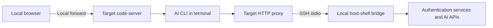

# Using AI CLIs from code-server in an isolated environment

> [!NOTE]
> This is an English translation. The Japanese version ([../ja/ai-cli.md](../ja/ai-cli.md)) is the single source of truth (SSOT) and takes precedence if they differ.

This guide describes deploying Copilot, agy, Claude Code, Codex, and Grok CLIs into a target user's directories and running them from the [code-server](code-server.md) terminal. This use case is under validation. The code-server skill does not automatically install or authenticate AI CLIs.

## Connection architecture

The target must be reachable over SSH stdio, and the local client must be able to reach the authentication services and AI APIs. Direct internet access from the target and changes to its service configuration are not required. Required traffic must be relayable over SSH; this does not provide fully offline inference.



Use `transfer_push` for CLI binaries, dependencies, and configuration. [Port forwarding](port-forward.md) provides browser access, while the [client HTTP proxy](client-proxy.md) provides outbound CLI traffic.

## Registration and network routing

Combine the code-server registration options with the proxy options. The following `api.vendor.example` and `auth.vendor.example` are placeholders; replace them with destinations required by the CLI version and authentication method.

```bash
host-shell bridge --proxy \
    --proxy-allow-host 'api.vendor.example:443' \
    --proxy-allow-host 'auth.vendor.example:443' \
    --forward-allow-local '127.0.0.1:80[0-7]?' -- \
    ssh -T target /path/to/host-shell --mcp \
    --client-proxy --allow-forward-local
```

code-server launched through `job_start` receives `HTTP_PROXY`, `HTTPS_PROXY`, and their lowercase variants, which terminal children normally inherit. Enable the proxy before starting code-server. Check that the CLI supports an authenticated HTTP proxy and that shell configuration does not override these variables. Proxy URLs contain credentials: do not print them with `env` or `printenv`.

`NO_PROXY` is inherited. An excluded external API causes direct connection attempts, so configure it for the target. Allow destinations for login, token refresh, and required additional features as well as inference. Use `proxy_status` to investigate denials. TLS traffic after HTTP CONNECT is not decrypted. Custom networking implementations and plain HTTP Upgrade require separate compatibility checks.

## Deploying CLIs

1. Check the target OS, CPU, libc, and free space. A Linux x86_64 startup check does not validate Windows or arm64.
2. Fetch target-compatible distributions on the client and record versions, sources, and SHA-256 hashes. Verify official signatures or hashes when available.
3. Use `transfer_push` to place files in a dedicated directory, such as `~/.local/share/host-shell-ai-cli/<CLI>/<version>/`, and verify SHA-256 again on the target. Check executable permissions, runtimes, and shared libraries.
4. Run `--version` and `--help` using absolute paths first, without changing the user's PATH or shell startup files.
5. Launch interactively in the code-server terminal. After authentication, verify inference, editing, and command execution in a small test directory.

If a local command is a symbolic link, transfer its actual executable and required companion files. An npm entry point alone is insufficient: include target-compatible dependencies and a supported Node.js runtime. Do not assume code-server's bundled Node.js is suitable. Self-updates and automatic tool downloads introduce additional network and dependency requirements; use pinned versions for initial validation.

## Authentication and CLI-specific checks

| CLI | Installation and authentication checks |
| --- | --- |
| Copilot | Distinguish native and npm distributions. npm requires Node.js 22 or later. Consider device code authentication or supported tokens for remote environments |
| agy | Record the distributor and version to distinguish similarly named commands. Verify authentication, runtime requirements, and proxy support in the selected version |
| Claude Code | Check native distributions and OS requirements. HTTP/HTTPS proxies are supported. Configure destinations for the authentication method and model provider |
| Codex | Check target-specific distributions and companion helpers. Select ChatGPT or API key authentication and verify headless login and sandbox requirements |
| Grok | Pin the distributor and version because multiple CLIs use this name. Verify login, API access, proxy support, and helper processes in the selected version |

Table: CLI-specific checks

Device code authentication can use the local browser, but the remote CLI must also reach the authentication server. With browser login returning to `localhost`, the browser's localhost and the target's localhost are different machines. Use a supported device flow or a separate local forward for the callback port.

The user performs authentication. Keep API keys and tokens out of documentation, tool arguments, conversations, and validation logs. Avoid copying an entire home directory containing credentials. CLIs running as the same target user may share credentials and conversation history. For separate accounts, check the CLI's supported configuration isolation mechanism.

Official references: [Copilot installation](https://docs.github.com/en/copilot/how-tos/copilot-cli/set-up-copilot-cli/install-copilot-cli), [Copilot authentication](https://docs.github.com/en/copilot/how-tos/copilot-cli/set-up-copilot-cli/authenticate-copilot-cli), [Claude Code setup](https://code.claude.com/docs/en/setup), [Claude Code networking](https://code.claude.com/docs/en/network-config), and [Codex authentication](https://learn.chatgpt.com/docs/auth?surface=cli). Add agy and Grok distribution sources once the validation targets are confirmed.

## Isolation and shutdown

The isolation boundary is the target OS, container, and file permissions. File operations and commands executed inside code-server do not pass through host-shell's MCP tool path restrictions, command restrictions, or approval handling, and are not recorded as MCP operations. Proxy logs record destinations and outcomes; they do not audit CLI actions.

Prompts and code may be sent to external services. Execution inside an isolated environment does not imply that data stays there. A CLI's own sandbox may also depend on kernel features or container configuration unavailable on the target.

When the MCP connection ends, code-server, the proxy, and forwards are stopped. Verify CLI and helper process termination on the target. Unix descendants that enter separate process groups or sessions may survive; do not assume every terminal process is reclaimed. Installed binaries, credentials, and history are not deleted on disconnect.

## Validation status

Results as of 2026-11-02: the following installed Linux x86_64 executables returned exit code 0 for `--version`, both directly and through a local host-shell `job_start` with a PTY. This does not validate distribution provenance, deployment to a remote target, authentication, or inference.

| CLI | Local version | Direct / host-shell PTY startup |
| --- | --- | --- |
| Copilot | 1.0.83 | Passed / Passed |
| agy | 1.4.12 | Passed / Passed |
| Claude Code | 2.1.316 | Passed / Passed |
| Codex | 0.166.0 | Passed / Passed |
| Grok | 1.0.70 | Passed / Passed |

Table: Initial checks

Codex printed a warning that it could not create PATH aliases on a read-only file system; version reporting still succeeded. This environment-specific warning is not evidence that normal CLI operations work.

Existing tests for `internal/clientproxy`, `internal/jobs`, and `internal/bridge` also passed. They validate the relay and job management foundation, not each AI CLI's API compatibility.

Record these stages in target validation:

| Stage | Pass criteria | Status |
| --- | --- | --- |
| Deployment | Transfer, hash verification, and dependency checks on the target | Awaiting SSH route |
| Startup | Target `--version` and `--help` succeed | Not tested |
| Terminal | Rendering, input, Ctrl-C, and resizing work inside code-server | Not tested |
| Authentication | Login and token refresh succeed using the selected method | Not tested |
| Inference | Obtain a response through bridge while direct target egress is blocked | Not tested |
| Operations | Edit a test file and execute a small command | Not tested |
| Shutdown | Check code-server, CLI, helpers, and listeners after MCP disconnect | Not tested |
| Multiple connections | Check startup, authentication state, and disconnect effects across connections | Not tested |

Table: Target validation stages

Record OS, CPU, libc, CLI/code-server/host-shell versions, distribution sources and hashes, authentication method without secrets, allowed destinations, completed stages, and failure reasons.
