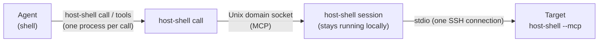

# Using host-shell from agents without MCP

> [!NOTE]
> This is a translation. The Japanese version [../ja/cli-without-mcp.md](../ja/cli-without-mcp.md) is authoritative; if the two differ, the Japanese version takes precedence.

This document explains how an agent that cannot register MCP servers uses the `host-shell` tools through shell commands only. With `host-shell session start` running on the local machine, the agent calls the same tools as through MCP (`exec_run`, `job_*`, `fs_*`, `transfer_*`, `forward_*` and so on) with `host-shell call TOOL ...` and `host-shell tools`.

```bash
host-shell session start --detach -- ssh -T target /tmp/host-shell-1000/host-shell --mcp
host-shell tools
host-shell call exec_run command='uname -a'
host-shell session stop
```

> [!IMPORTANT]
> Before using it, confirm that your organization's policy allows operating the target through shell commands. A rule that forbids MCP may mean "agents must not operate other machines" rather than just "no MCP servers". In that case this method also goes against the rule.

## Use cases

- An organization policy or the agent's settings disable MCP server registration, but the agent can run shell commands.
- Agents and scripts without MCP support use the `host-shell` tools.

Agents that cannot use a shell and can only read and write files are out of scope.

## Architecture



- **Session** (`host-shell session start`): stays running on the local machine and keeps the connection to the target. It is the same relay as `host-shell bridge`, so file transfers, port forwarding, the HTTP proxy through the client and remote DNS work the same way.
- **CLI** (`host-shell call`, `host-shell tools`): each time the agent runs one from the shell, it connects to the session through the socket, calls a tool once and exits.
- Inside `host-shell` (between the CLI and the session, and between the session and the target) the communication is MCP. The target runs the same `host-shell --mcp` as with MCP registration.

When the session ends, the connection to the target closes. As with MCP registration, the target then cleans up the commands and jobs it started, its port forwards and its proxy.

## Procedure

### Preparing the target

Deployment and route checks are the same as for MCP registration ([User Guide](user-guide.md)). With the `host-shell-connect` skill, choose "use through shell commands" at the last step to continue with the `host-shell-cli` skill.

Locally, use the executable for the local OS from `dist/` (`make dist`) or from the release archive.

### Starting a session

Take the `host-shell bridge` registration command and replace `bridge` with `session start`. `bridge` options go before `--`, target options after `--mcp`.

In the foreground (occupies the terminal; Ctrl+C ends it):

```bash
host-shell session start -- ssh -T hop1 ssh -T target /tmp/host-shell-1000/host-shell --mcp
```

Detached (prints the state as JSON and returns once connected):

```bash
host-shell session start --detach -- ssh -T -o BatchMode=yes target /tmp/host-shell-1000/host-shell --mcp
```

| Form | When to use |
| --- | --- |
| Foreground | Routes that ask for an SSH password or a second factor in the terminal. Targets started with `--confirm` ([Tools that need confirmation](#tools-that-need-confirmation)) |
| `--detach` | Routes that connect with key authentication or with passwords stored by [`host-shell ssh-pass`](ssh-password.md). The agent starts the session itself |

Table: Forms of starting a session

A detached session has no terminal, so it cannot ask for a password. If it fails to connect, `session start --detach` prints the session log to standard error and exits with code 1.

If the agent's shell ends every process that a command started when the command returns, a session that the agent starts with `--detach` ends with that command. Codex in its sandbox (`workspace-write`) works this way. In that case, the user starts the session in their own terminal.

### Listing the tools and how to use them

```bash
host-shell tools                        # tool names and the first sentence of each description
host-shell tools --instructions         # target OS, shell, encodings, limits and enabled features
host-shell tools --schema exec_run      # full description and input schema (JSON)
host-shell call help_get topic=commands # detailed help from the target
```

### Calling tools

Write the tool name right after `host-shell call`, followed by options and arguments.

```bash
host-shell call exec_run command='ls -la /var/log'
host-shell call exec_run argv=sh argv=-c argv='echo "$HOME"'
host-shell call fs_write path=/tmp/app.conf content=@app.conf
host-shell call exec_run --json - <<'EOF'
{"command": "Get-ChildItem 'C:\\Program Files' | Select-Object -First 5", "shell": "powershell"}
EOF
```

| Form | Meaning |
| --- | --- |
| `KEY=VALUE` | Converted to the type in the input schema: strings as they are, integers, numbers and booleans (`true`, `false`) to their types, arrays and objects as JSON. For an array of strings, repeating the key adds one element each time |
| `KEY=@FILE` | The contents of a local file. If the key takes a string, the contents are used as they are; otherwise they are read as JSON. Write `@@` for a string that starts with `@` |
| `--json FILE` | All arguments as a JSON object read from a file; `-` is standard input. `KEY=VALUE` takes precedence for the same key |

Table: Passing arguments

Keys that are not in the input schema and values that cannot be converted fail without calling the tool (the message lists the valid keys). Pass values that contain quotes (PowerShell commands, JSON, scripts) as JSON on standard input with `--json -`, so that the quoting rules of the local shell do not break them.

| Option | Meaning |
| --- | --- |
| `--session NAME` | The session to use. Defaults to the environment variable `HOST_SHELL_SESSION`, then `default` |
| `--json FILE` | See above |
| `--quiet` | Do not print progress and log messages to standard error |

Table: Options of host-shell call

The tool's JSON result is printed as one line to standard output. It is the same content an agent receives through MCP. Progress goes to standard error.

| Exit code | Meaning |
| --- | --- |
| 0 | Success. For `exec_run`, the exit code of the command itself is `exit_code` in the result |
| 1 | The tool reported an error (printed to standard error) |
| 2 | Wrong usage (including unknown tools and arguments) |
| 3 | No session to connect to, or the session or target connection was lost during the call |
| 130 | Interrupted (the call is cancelled on the target) |

Table: Exit codes of host-shell call

- When `host-shell call` is interrupted with Ctrl+C, or ended by the time limit of the agent's shell, the call is cancelled on the target too. For long work, start it with `job_start` and wait with `job_read` and its `wait_sec` (and `until`), which wait on the target, or give `exec_run` a `timeout_sec` shorter than the shell's limit.
- Several `host-shell call` commands can run at the same time. Progress reaches only the `host-shell call` that made the request.
- Local paths of `transfer_push` and `transfer_pull` are relative to the directory where `host-shell call` runs.

### Several sessions

Give each target a name and select it with `--session` or `HOST_SHELL_SESSION`.

```bash
host-shell session start --detach --name web -- ssh -T web /tmp/host-shell-1000/host-shell --mcp
host-shell session start --detach --name db -- ssh -T db /tmp/host-shell-1000/host-shell --mcp
host-shell call fs_read --session web path=/etc/hosts
HOST_SHELL_SESSION=db host-shell call exec_run command=uptime
```

Names consist of 1 to 32 letters, digits, `.`, `_` or `-`.

### Session state and ending a session

```bash
host-shell session status [--name NAME]   # print the state as JSON
host-shell session list                   # print one line of JSON per running session
host-shell session stop [--name NAME]     # ask the session to end and wait until it has
```

Stop the session when the work is done. A session ends on any of the following:

- `host-shell session stop`
- Ctrl+C in a foreground session, or SIGTERM
- With `--idle-timeout DURATION`, when no `host-shell call` or other client has been connected for that long (port forwarding and proxy traffic do not count)
- Disconnection from the target (exit code 1)

## Tools that need confirmation

Tools that the target's `--confirm` requires the user to approve are handled as follows.

- A session started in the foreground, with a terminal on standard input and standard error, shows the question in that terminal. `y` (or `yes`) runs the tool; anything else declines it (`host-shell call` exits with code 1). When the call is cancelled, the question is withdrawn.

  ```text
  [host-shell session default] host-shell on target: allow fs_remove with {"path":"/tmp/x"}?
  Allow? [y/N]:
  ```

- A detached session, or a session without a terminal, fails such tools without running them.
- Answers are accepted only from the session's terminal. Answers sent from `host-shell call` or through the socket are not passed to the target.

The agent itself runs `host-shell call`. If the CLI asked for confirmation, the agent could approve its own calls, so confirmation happens in the terminal the user watches.

## Agent permission settings

Because the tool name comes right after `host-shell call`, agent permission rules can allow tools one by one. Example for Claude Code:

```json
{
  "permissions": {
    "allow": [
      "Bash(host-shell call fs_read:*)",
      "Bash(host-shell call search_grep:*)",
      "Bash(host-shell tools:*)"
    ]
  }
}
```

Permission rules that match command names may not match when the agent puts the executable in a variable or combines several commands in one shell call. Ask the agent to run one `host-shell` command per shell call.

## Where sessions are kept

The socket (`NAME.sock`), the state (`NAME.json`) and the log of a detached session (`NAME.log`) are kept in the following directory. The environment variable `HOST_SHELL_SESSION_DIR` changes it.

| OS | Directory |
| --- | --- |
| Linux | `$XDG_RUNTIME_DIR/host-shell/sessions`. Without `XDG_RUNTIME_DIR`, `host-shell-UID/sessions` in the temporary directory |
| macOS | `/tmp/host-shell-UID/sessions` (without `XDG_RUNTIME_DIR`) |
| Windows | `%LOCALAPPDATA%\host-shell\sessions` |

Table: Where sessions are kept

- The directory is created so that only the current user can use it (mode 0700 on Linux and macOS, a protected DACL for the user alone on Windows). On Linux and macOS, an existing directory owned by another user, or one that other users can access, is rejected.
- Only the user's own processes can connect to the socket. Any process of the user can call the tools; that is the same reach as the user's own `ssh` to the target.
- The path of a Unix domain socket must be 103 bytes or shorter. If it is too long, set `HOST_SHELL_SESSION_DIR` to a shorter directory.

## Troubleshooting

| Symptom | Action |
| --- | --- |
| `no session "NAME" is running` (exit code 3) | Check the running sessions with `host-shell session list`, then start the session or pass the right `--session` |
| `session start --detach` prints a log and exits with code 1 | The log is the output of the route (`ssh`) and of the target. Check the route and the deployment as in the [User Guide](user-guide.md) |
| A detached session ended later | Read `NAME.log` in the session directory |
| `this tool needs the user's confirmation, but this session cannot ask` | The target uses `--confirm`. The user starts the session in the foreground in a terminal |
| `socket path ... is too long` | Set `HOST_SHELL_SESSION_DIR` to a shorter directory |
| `... is accessible to other users` | Change the session directory to mode 0700, or choose another directory with `HOST_SHELL_SESSION_DIR` |

Table: Troubleshooting

## Verified scope

| Item | Method and environment | Status |
| --- | --- | --- |
| Argument conversion, starting a session, status, list and stop, rejecting a second session with the same name, cleaning up a leftover socket, checking directory permissions, `--idle-timeout`, `--detach` (including the log on failure), confirmation (approval, decline and withdrawal in the terminal, refusal without a terminal, not passing answers from clients), concurrent calls and progress routing, cancellation (interrupt and process end), target disconnection, `--finish-on-eof`, exit codes | Automated tests. CI (GitHub Actions ubuntu-latest, windows-latest, macos-latest) and Linux (WSL, Oracle Linux 8.10, go1.27.4, including `-race`) | Verified |
| Use by agents (no MCP, `host-shell-cli` skill): starting with `--detach`, `tools`, `exec_run`, `fs_write` and `fs_read`, `job_start` and `job_read`, `transfer_push`, `session stop` | Local machine: Linux (WSL, Oracle Linux 8.10, OpenSSH 8.0p1); target: an Oracle Linux 10.2 container (Podman 4.9.4, OpenSSH 9.9p1, `ssh -T`). Claude Code 2.1.326, GitHub Copilot CLI 1.0.112, Codex CLI 0.169.0 (sandbox `workspace-write`; all steps in one shell call), Grok 1.0.77, each allowed to run `host-shell` only | Verified |
| Use by agy | None | Unverified |
| Running the steps of the code-server, VS Code Remote - SSH and CLI coding agent skills with `host-shell call` (including an HTTP request to the forwarded port, an `ssh` connection to the forwarded port, and the HTTP proxy through the client and remote DNS) | The Linux (WSL) machine and container above. Claude Code 2.1.326 (no MCP). code-server 4.144.0, VS Code Server 1.146.0, grok 1.0.77 | Verified |
| code-server in a browser, connecting from local VS Code, authentication and inference of CLI coding agents (when used from the shell) | None | Unverified |
| Confirmation in the terminal of a foreground session (approve and decline) | A pseudo-terminal on Linux (WSL). A terminal on Windows 11 Pro for Workstations (build 26300, PowerShell 7.7.0) operated by the user | Verified |
| Windows as the local machine: `--detach` (used across shell calls of the agent), `tools`, `call` (PowerShell commands, `@FILE`, `--json -`, exit codes), `status`, `list` and `stop`, the ACL of the session directory, ending with Ctrl+C | Windows 11 Pro for Workstations (build 26300, amd64). Target: `host-shell.exe --mcp` on the same machine | Verified |
| A target reached over ssh from a Windows machine | None | Unverified |
| macOS as the local machine (other than automated tests) | None | Unverified |

Table: Verification status

## Limitations

- Agents that cannot use a shell are out of scope.
- `host-shell` communicates over MCP internally. It cannot be used where MCP communication itself is forbidden.
- Tools that need confirmation work only in a session started in the foreground.
- Confirmation (`--confirm`) covers operations that go through `host-shell`. It does not stop an agent with a shell from operating the target directly with `ssh` (the same applies with MCP registration).
- A detached session cannot use interactive authentication (typing a password, a second factor).
