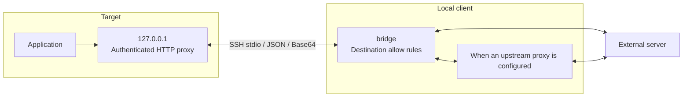

# HTTP proxy through the client

> [!NOTE]
> This is an English translation. The Japanese version ([../ja/client-proxy.md](../ja/client-proxy.md)) is the single source of truth (SSOT) and takes precedence if they differ.

When a target machine cannot reach external networks directly, HTTP proxy-aware applications on the target can route HTTP and HTTPS traffic through the client-side `bridge` network. Traffic shares the existing SSH standard input/output session without requiring SSH port forwarding. This feature is disabled by default. For non-HTTP TCP traffic or connections in the opposite direction, use [port forwarding](port-forward.md).

Because this feature does not use `sshd` forwarding, `sshd` settings such as `no-port-forwarding` and `AllowTcpForwarding no` do not block it. It is available only when the target is started with `--client-proxy`.

## Startup

Enable the feature explicitly on both ends and specify destination allow rules on `bridge`:

```bash
host-shell bridge --proxy --proxy-allow-host 'packages.example.com:443' -- \
    ssh -T target /path/to/host-shell --mcp --client-proxy
```

- Pass `--proxy` and one or more `--proxy-allow-host` flags on `bridge`, and `--client-proxy` on the target.
- `--proxy` requires at least one `--proxy-allow-host` rule.
- Enabling only one side, running mismatched versions on the two ends, or passing an invalid allow rule causes startup to fail.
- `--no-transfer` can be used alongside `--proxy`.
- Repeatable `--proxy-deny-host HOST[:PORT]` supplies explicit deny rules. Deny takes precedence when both lists match.
- Add `--proxy-allow-rule-updates` to permit session-local changes over MCP. Without it, the update tool is not exposed.



Both standard HTTP proxy requests and `CONNECT` tunnels are supported. TLS traffic is neither decrypted nor re-signed. Targets are supported on Linux and Windows; `bridge` is supported on Linux, Windows, and macOS.

## Routing and restrictions

- **Destination allow rules**: `--proxy-allow-host` accepts a host name glob with an optional port (for example, `packages.example.com:443` or `*.example.com:443`). CIDR ranges and Unix domain socket rules are not supported. Rules match the requested host name rather than resolved IP addresses, and private IP addresses are not blocked automatically.
- **Client environment variables**: `bridge` honors the client's `HTTP_PROXY`, `HTTPS_PROXY`, and `NO_PROXY` environment variables (and their lowercase variants) at startup, so upstream corporate proxies are supported. Target environment variables are never copied to the client. Failed relay connections do not fall back to direct connections or retry automatically.
- **Target child process environment**: Processes started on the target via `exec_run` and `job_start` have `HTTP_PROXY` and `HTTPS_PROXY` (and their lowercase variants) set to the local relay proxy URL while keeping `NO_PROXY`. `--unset-env` is applied after this automatic injection, and per-call `env` arguments are applied last (environment variable names on Windows are case-insensitive).
- **Precedence in tools**: An explicit `proxy` argument (a proxy URL or `none`) in `net_request_http` takes precedence; when omitted, the session relay proxy and `NO_PROXY` apply (`unix_socket` requests always connect directly). `exec_sudo` follows `sudo`'s own environment preservation rules, so proxy variables are not guaranteed to propagate automatically.
- **Scope of restrictions**: This feature does not isolate all OS-level networking. Because `CONNECT` can carry arbitrary TCP streams to allowed ports, permit only the specific hosts and ports required. Any `--allow-host` rules on the target continue to apply to the `net_*` tools.

### Distinguishing DNS failures from denied destinations

This is an HTTP proxy, not a relay for the target OS's DNS queries. When an application sends a hostname to the proxy, resolution happens on the client side or through the configured upstream proxy route. Thus HTTP/HTTPS can work through the proxy even when `getaddrinfo` or `nslookup` fails in a container without networking. Applications that perform their own lookup before connecting to the proxy require separate handling.

`destination not allowed` in `proxy_status` means the destination allowlist rejected the request; it is not a DNS error. HTTP returns 403, and HTTPS receives 403 for CONNECT. Compare requests to allowed hosts, denied hosts and ports, and application errors. Adding external networking to the container is not necessary merely to make proxy-based name resolution work.

## Authentication and diagnostics

The target proxy listener binds only to an ephemeral port on IPv4 loopback (`127.0.0.1`) and requires a session-specific proxy authentication token.

- Other processes running under the same OS user can read the authenticated proxy URL from the file path reported in `proxy_url_file` of `sys_get_info`. Do not paste the contents of that file into conversations or general logs.
- The URL file is created with user-only permissions and removed on normal exit or disconnection (startup fails if user-only permissions cannot be set). Even if a file remains after a forced termination, its token is invalid in subsequent sessions.
- Session tokens are masked automatically in tool results, audit logs, and progress notifications.

### proxy_status (bridge)

Use the read-only `proxy_status` tool on `bridge` to inspect the proxy state and any denied destinations or failure reasons:

```json
{"after_seq": 0, "limit": 20}
```

- **Inputs**: `after_seq` (non-negative integer, default `0`) and `limit` (1–100, default `20`).
- **Outputs**: `enabled`, `state`, `allow_hosts`, `deny_hosts`, `rules_revision`, `active_connections`, `events`, `next_seq`, and `truncated`.
- Each entry in `events` contains `seq`, `time`, `connection_id`, `host`, `port`, `result` (`allowed` / `denied` / `failed`), `reason`, and `count` (when consecutive identical events are aggregated). Up to the latest 100 events are kept and returned in ascending `seq` order. Pass `next_seq` as `after_seq` on subsequent calls to read new events. `truncated` indicates that older events were dropped or more events remain after the returned page.
- The same metadata is written to `bridge` standard error. Request bodies, URL paths and query strings, and credentials are never included in diagnostics.
- When a destination is denied, inspect `host`, `port`, and `reason` and allow only destinations authorized by the user. With the update tool enabled, use the procedure below without reconnecting. Otherwise change startup options and reconnect. The agent must not widen access on its own.

### proxy_rules_update (bridge)

Starting `bridge` with `--proxy --proxy-allow-rule-updates` exposes `proxy_rules_update` to change destination allow and deny rules during the session. No additional target option is needed. This does not enable a proxy that was disabled at startup.

1. Read `allow_hosts`, `deny_hosts`, and `rules_revision` from `proxy_status` (initial revision `1`).
2. Submit **both complete replacement lists**, including existing rules to retain, with the observed revision. This is not a patch/add API. Only make user-authorized changes.

```json
{
  "expected_revision": 1,
  "allow_hosts": ["api.github.com:443", "hondarer-soft.com:443"],
  "deny_hosts": []
}
```

- Returns the new `allow_hosts`, `deny_hosts`, and `rules_revision`. This example replaces the allowlist with only the API and specified website; derive real updates from the existing rules returned by `proxy_status`.
- All input rules are validated before atomic replacement. Invalid rules and stale revisions leave state unchanged. On a conflict, read the current state and reconsider the intended change.
- Deny takes precedence. Empty `allow_hosts` rejects all new destinations.
- Applies to new relay connections checked after the update. In-flight requests and established CONNECT tunnels are not forcibly disconnected. SSH, code-server, proxy URLs, and browser port forwards remain running.
- Changes live only in session memory. Registration and configuration files are not modified; subsequent sessions start from their startup rules. The bridge logs the revision and both lists to stderr.
- A supporting bridge started with mutation enabled is required. Older binaries and sessions started without this option cannot acquire the tool dynamically. After initial deployment/enabling, individual rule changes require no restart.
- This covers only the client HTTP/HTTPS proxy. It does not change target `--allow-host`, forwarding permissions, or DNS relay settings.

### Target audit log

The target's audit log records the following entries:

- `proxy_connect`: Recorded for each HTTP request or `CONNECT` tunnel with the request kind (`http` / `connect`), destination host and port, result (`allowed` / `denied` / `failed`), and reason. URL paths and queries, headers, bodies, and credentials are omitted. Because the result reflects opening the relay stream to `bridge`, an HTTP request whose upstream connection later fails on `bridge` (returning HTTP 502) is still logged as `allowed`.
- `proxy_auth_failed`: Counts proxy authentication failures (HTTP 407). The first failure is logged immediately with count 1; subsequent failures are aggregated and logged once per minute, with any remaining count flushed when the session ends. Destination hosts of unauthenticated requests are not logged.

## Limits and shutdown

- **Concurrency and flow control**: A session supports up to 64 concurrent streams (shared with [port forwarding](port-forward.md)), up to 16 KiB of decoded payload per frame, and a 64 KiB per-direction flow-control window. Ordinary MCP messages and channel control frames take priority over data frames, and bounded send queues cap memory usage.
- **Timeouts**: Upstream connection establishment and HTTP header reads time out after 30 seconds, idle streams time out after 5 minutes, and graceful shutdown waits up to 5 seconds.
- **HTTP error status codes**: Denied destinations return `403`, authentication failures return `407`, reaching the stream limit returns `503`, upstream connection failures return `502`, and connection timeouts return `504`. Errors after a `CONNECT` tunnel is established close the stream. Disconnecting the MCP session closes the loopback listener and all active relay connections.
- **Relationship to MCP restriction flags**: `--tools` and `--read-only` on the target govern which MCP tools are published; they do not restrict traffic passing through the HTTP proxy. Control proxy access via explicit enablement on both ends and `--proxy-allow-host` rules on `bridge`.

Optional name resolution relay: [remote-dns](remote-dns.md). See `--remote-dns` on both ends and target `--remote-dns-library PATH` for a prebuilt adapter.
