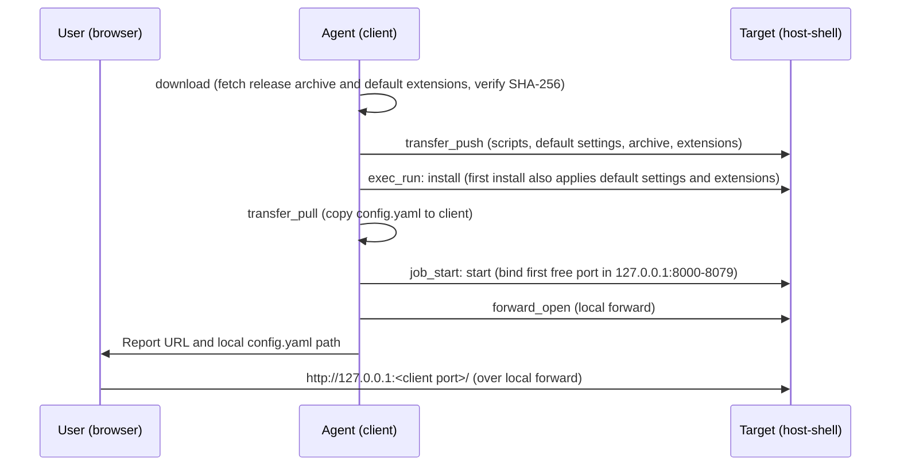

# Injecting code-server into a target

> [!NOTE]
> This is an English translation. The Japanese version ([../ja/code-server.md](../ja/code-server.md)) is the single source of truth (SSOT) and takes precedence if they differ.

This guide explains how to install and start [code-server](https://github.com/coder/code-server) (VS Code in the browser) on a target machine in a closed network without internet access through `host-shell`, and open it in a local browser via [port forwarding](port-forward.md). On the initial installation, default settings and extensions are also applied.

The workflow is packaged in the `host-shell-code-server` skill (`.agents/skills/host-shell-code-server/`), which the agent executes automatically using MCP tools. This document covers the required preparation, what gets installed, and operational caveats.

## Overview



- The target never connects to the internet. Release archives and extensions are downloaded on the client, verified by SHA-256, and transferred to the target, where the same SHA-256 hashes are verified again before extraction and installation.
- code-server listens only on `127.0.0.1` on the target, selecting the first free port in the range 8000–8079 ([Listening port](#listening-port)), and is accessed from the client through a local port forward. The client listening port is assigned automatically.
- Both code-server and the port forward terminate when the MCP session ends.

## Supported targets

| Target | Verification status |
| --- | --- |
| Linux x86_64 | Verified on a target machine |
| Linux arm64 (aarch64) | Verified archive download, hash check, and selection only (not tested on a physical/VM arm64 target) |
| Windows amd64 | Verified on a target machine |

Table: Supported targets

Windows arm64 is not supported because upstream code-server releases do not provide a Windows arm64 build. The bundled code-server version is 4.144.0 (based on VS Code 1.144.0).

- **Linux targets**: Require `bash`, `tar`, `gzip`, `sha256sum`, and `od` (`python3` and `curl` are not required on the target). Because the Node.js runtime bundled with code-server requires glibc, musl-based distributions such as Alpine Linux are not supported. The `install` script stops before extracting the archive if glibc is absent or `HOME` is not writable.
- **Windows targets**: Use Windows PowerShell 5.1 or later and the built-in OS `tar.exe`.
- **Clients**: Supported on Linux, macOS, and Windows. Linux and macOS clients use `curl` and `python3` during the download step.
- **Containers**: code-server can also be injected into a running Linux container connected via `podman exec -i` or similar. See [Connecting into containers](container.md) for container-specific requirements.

## Preparation (registration command)

Because code-server is accessed through a local port forward, include the following options in the MCP server registration command. After updating the registration, reconnect to the MCP server in your agent.

| Side | Option | Description |
| --- | --- | --- |
| Target | `--allow-forward-local` | Permits local port forwarding. If `--allow-host` is also set on the target, include `127.0.0.1:80[0-7]?` |
| `bridge` | `--forward-allow-local '127.0.0.1:80[0-7]?'` | Restricts destinations that the agent can open with `forward_open` to code-server's port range (8000–8079) on the target |

Table: Required options

```bash
host-shell bridge --forward-allow-local '127.0.0.1:80[0-7]?' \
    -- ssh -T target /path/to/host-shell --mcp --allow-forward-local
```

- `80[0-7]?` is a port glob matching ports 8000–8079. Quote the argument so the shell does not expand it.
- Because scripts and packages are uploaded using `transfer_push` on `bridge`, targets running with `--read-only` or bridges started with `--no-transfer` cannot be used.
- If a required option is missing, the agent stops and tells you which option to add.

## Listening port

The `start` script checks ports 8000 through 8079 on the target's `127.0.0.1` in order and launches code-server on the first free port. The agent parses the bound port from code-server's `HTTP server listening on http://127.0.0.1:<port>/` log line and opens a local forward to that port.

- If all ports in 8000–8079 are in use, `start` exits with `no free port in 8000-8079 on 127.0.0.1`.
- Setting the `CODE_SERVER_PORT` environment variable pins a single port (and fails if that port is already in use).
- If another process binds the chosen port between the availability check and startup, code-server exits with `EADDRINUSE` and the agent runs `start` again.
- If `bridge` was registered with an allow rule for `127.0.0.1:8000` only and port 8000 is already in use, forwarding to the fallback port is rejected. In that case, the agent stops code-server and asks you to update the rule to `'127.0.0.1:80[0-7]?'` and reconnect.

## Password

code-server runs with password authentication enabled. A random 48-digit hexadecimal password is generated on the target during the first installation and saved in `config.yaml`.

- Because the password is never printed in tool output, it does not enter the agent conversation history.
- The agent copies `config.yaml` via `transfer_pull` to `~/.config/host-shell-code-server/<target name>/config.yaml` on the client (`%USERPROFILE%\.config\host-shell-code-server\<target name>\config.yaml` on Windows clients) and reports only that file path. Use the value on the `password:` line to log in.
- On the target, `config.yaml` is created with permissions readable only by its owner.
- Browser login cookies are scoped to the client port. If reopening a forward assigns a different client port, log in again.

## Default settings and extensions

Files under `defaults/` in the skill directory are applied to code-server on the target during the first installation. You can customize these files before running the skill.

| File | Target location (under code-server user data) | Condition |
| --- | --- | --- |
| `defaults/User/settings.json` | `User/settings.json` | Applied only if the target file does not exist |
| `defaults/Machine/settings.json` | `Machine/settings.json` | Applied only if the target file does not exist |
| `defaults/extensions.txt` | Extensions directory | Applied only if the marker file `.host-shell-code-server-defaults` does not exist |

Table: Default settings and extensions

The main bundled settings and their prerequisites are listed below (if a prerequisite is absent, the setting simply has no effect and causes no error):

| Setting | Prerequisite |
| --- | --- |
| Color theme `Visual Studio Dark - C++` | The `ms-vscode.cpptools-themes` extension (included in the default extensions) |
| Font `UDEV Gothic HSRFJPDOCEM` (15px) | The font is installed on the client machine running the browser |
| PlantUML JAR paths (`plantuml.jar`, `markdown-preview-enhanced.plantumlJarPath`) | The JAR file exists at that path on the target |
| Workspace trust disabled, Git auto-fetch, visible whitespace, trailing whitespace in diffs | None |

Table: Bundled settings

### Fetching extensions

`extensions.txt` lists one extension per line as `publisher.name` or `publisher.name@version` (text after `#` is treated as a comment). On the client, the `download` script fetches extensions from Open VSX for the target platform:

1. It looks for a build matching the target platform (`linux-x64`, `linux-arm64`, `win32-x64`) and falls back to the platform-independent (`universal`) build if none exists.
2. Excluding pre-release versions, it selects the specified `@version` or the latest version compatible with VS Code 1.144.0.
3. It verifies the package against the SHA-256 digest published by Open VSX before saving, and records the resolved version and SHA-256 in `packages/extensions/<type>/resolved-extensions.txt`.
4. Extensions that cannot be found are skipped with a warning and noted as a comment in `resolved-extensions.txt`.

On the target, `install` verifies each recorded SHA-256 hash and installs the extensions offline. It creates the `.host-shell-code-server-defaults` marker file only after all extensions succeed; if installation fails partway, no marker is created and the next `install` run retries.

### Restoring defaults

Settings modified in code-server and extensions uninstalled by the user are not overwritten or restored when `install` runs again. To restore the defaults, delete whichever of `User/settings.json`, `Machine/settings.json`, or `.host-shell-code-server-defaults` you want to reset in the target's user data directory, then re-run `install`.

## Installing additional extensions

In a closed network, code-server cannot reach the Open VSX marketplace directly. Use either of the following approaches to install additional extensions:

- **Uploading a `.vsix` file**: Have the agent upload a `.vsix` file from the client and install it with `install --extension <file>`.
- **Using the [HTTP proxy through the client](client-proxy.md)**: Enable `--client-proxy` on the target and `--proxy` on `bridge` with `--proxy-allow-host open-vsx.org:443` and `--proxy-allow-host openvsx.eclipsecontent.org:443` (pass `--proxy-allow-host` once per host; comma-separated values are not supported). Because code-server uses `HTTPS_PROXY` to reach the marketplace, both `install --extension <ID>` and installing from the Extensions view in the browser work (both verified).

When using the Extensions view in the browser, different operations originate from different sides:

| Operation | Origin | Required connectivity |
| --- | --- | --- |
| Searching and viewing extension details | Client browser | Direct access from the browser to `open-vsx.org` and `openvsx.eclipsecontent.org` (does not pass through the `bridge` proxy) |
| Installing an extension | Target code-server | The two `--proxy-allow-host` rules above on `bridge` |

Table: Connectivity for the Extensions view

- Installing an extension from a publisher for the first time prompts you to trust the publisher.
- `proxy_status` on `bridge` may report `mobile.events.data.microsoft.com` (telemetry) as denied; extension search and installation work without it.

## Stopping and uninstalling

- **Stopping**: The agent calls `forward_close` and `job_stop` (both also stop automatically when the MCP session ends).
- **Uninstalling**: Run `uninstall` after `job_stop`. By default, `uninstall` removes only the code-server binary directory while keeping configuration, user data, extensions, and the uploaded kit. Pass `--purge` (`-Purge` on Windows) to remove all of them.

File locations on the target are listed below. Because `host-shell-code-server` uses its own directory names separate from [code-server-launcher](https://github.com/Hondarer/code-server-launcher), it does not conflict with a launcher-installed instance on the same machine.

| Purpose | Linux | Windows |
| --- | --- | --- |
| Uploaded kit | `~/.local/share/host-shell-code-server/kit/` | `%LOCALAPPDATA%\host-shell-code-server\kit\` |
| code-server binary | `~/.local/lib/host-shell-code-server/code-server-<version>/` | `%LOCALAPPDATA%\host-shell-code-server\code-server-<version>\` |
| Configuration file | `~/.config/host-shell-code-server/config.yaml` | `%USERPROFILE%\.config\host-shell-code-server\config.yaml` |
| User data | `~/.local/share/host-shell-code-server/user-data/` | `%LOCALAPPDATA%\host-shell-code-server\user-data\` |
| Extensions | `~/.local/share/host-shell-code-server/extensions/` | `%LOCALAPPDATA%\host-shell-code-server\extensions\` |
| Session socket | `code-server-ipc.sock` inside user data; if that path exceeds the Unix domain socket limit (107 bytes), `$XDG_RUNTIME_DIR/host-shell-code-server-ipc.sock`, or `/tmp/host-shell-code-server-<uid>/ipc.sock` when `XDG_RUNTIME_DIR` is unset | Named pipe (no file created) |

Table: File locations on the target

In addition to the paths above, code-server and its extensions may create small files (a few tens of kilobytes in total) in directories shared with other VS Code-based tools (`~/.vscode-oss-shared/`, `~/.copilot/logs/`, `~/.cache/Microsoft/`, `~/.local/state/crossnote/`, etc.; under `%USERPROFILE%` on Windows). Because those directories are shared, `--purge` leaves them intact, while removing `coder-logs` and `heartbeat` written by code-server.

## Transfer size and time

The table below shows reference measurements taken in a development environment (WSL) with `bridge` connected directly to `host-shell` without SSH. Actual transfer times depend on the bandwidth of your SSH route (`transfer_push` encodes chunks in base64, so wire traffic is approximately 1.33× the raw file size).

| Step | Linux x86_64 | Windows amd64 |
| --- | --- | --- |
| Release archive | 231 MB, 16 s | 212 MB, 17 s |
| Default extensions (20) | 144 MB, 3 s | 144 MB, 4 s |
| `install` (extraction and extension setup) | 43 s | 82 s |

Table: Transfer size and time (measured)

On subsequent runs, unchanged files with matching SHA-256 hashes are skipped.

## Security considerations

- Operations performed inside code-server's built-in terminal and file explorer bypass `host-shell` policy restrictions (`--allow-command`, `--allow-path`, `--deny-command`, etc.) and are not logged in `host-shell`'s audit log (only the port-forward connection `forward_connect` is logged on the target). When policy restrictions are active on the target, the agent explains this and asks for explicit user approval before proceeding. Target administrators control whether this path is available via `--allow-forward-local`.
- Because the local listening port on the client does not authenticate callers, other local users on the client machine can connect to it. Do not disable code-server's password authentication.
- code-server binds exclusively to `127.0.0.1` on the target and is not reachable from the target's external network interfaces.

## Maintenance

The skill scripts are adapted from `download`, `install`, `start`, and `uninstall` in [code-server-launcher](https://github.com/Hondarer/code-server-launcher), and the default settings and extension list match `code-server-container`. For instructions on updating the bundled code-server version, see the [Development Guide](development.md#maintaining-the-code-server-injection-skill).
