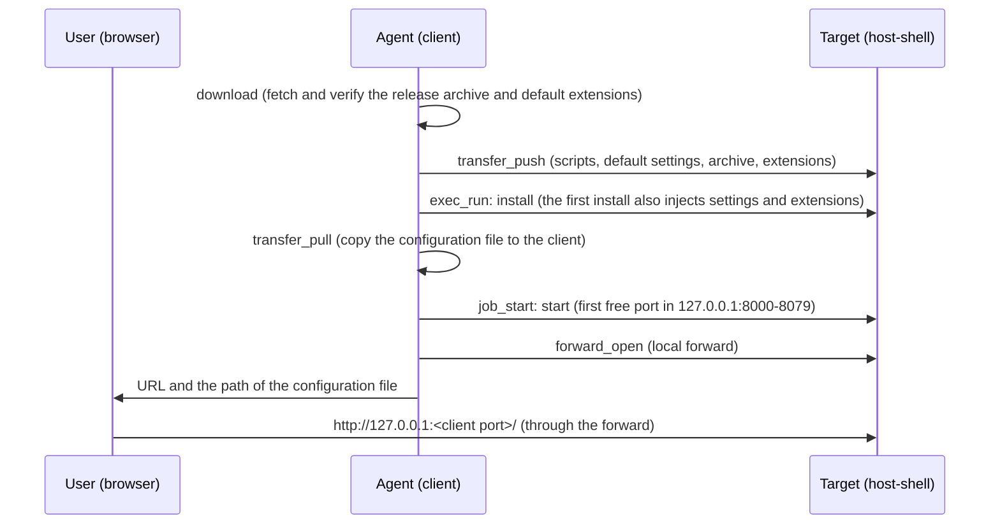

# Injecting code-server into a target

> [!NOTE]
> This is an English translation. The Japanese version ([../ja/code-server.md](../ja/code-server.md)) is the master and takes precedence if they differ.

host-shell can install and start [code-server](https://github.com/coder/code-server) (VS Code in the browser) on a target in a closed network without internet access, and open it in the local browser through [port forwarding](port-forward.md). The first install also injects default settings and extensions.

The procedure is the `host-shell-code-server` skill (`.agents/skills/host-shell-code-server/`), which the agent runs with MCP tools. This document describes what the user prepares, what is injected, and what to watch out for.

## Overview



- The target never connects to the internet. The release archive and extensions are fetched on the client, verified by SHA-256 and then sent. The target verifies the same SHA-256 again.
- code-server listens only on the first free port in 8000-8079 on `127.0.0.1` of the target ([Listening port](#listening-port)) and is reached from the client through a local forward. The client port is assigned automatically.
- code-server and the forward stop when the MCP session ends.

## Targets

| Target | Verification |
| --- | --- |
| Linux x86_64 | Verified on a real machine |
| Linux arm64 (aarch64) | Only fetching, verifying and selecting the release archive (not verified on a real machine) |
| Windows amd64 | Verified on a real machine |

Table: Supported targets

Windows arm64 is not supported (code-server's official releases have no build for it). The code-server version is 4.144.0 (VS Code 1.144.0).

A Linux target needs `bash`, `tar`, `gzip`, `sha256sum` and `od`; `python3` and `curl` are not needed. code-server's node needs glibc, so musl-based systems such as Alpine are not supported. install stops before extracting when glibc is missing or HOME is not writable. A Windows target uses Windows PowerShell 5.1 or later and the OS `tar.exe`.

Clients can be Linux, macOS or Windows. Linux and macOS clients use `curl` and `python3`.

code-server can also be injected into a running container (connected with `podman exec -i` and similar). See [Connecting into containers](container.md) for the container-specific conditions.

## Preparation (registration command)

The local forward requires these options in the MCP server registration command. After changing the registration, reconnect the MCP server in the agent.

| Side | Option | Description |
| --- | --- | --- |
| Target | `--allow-forward-local` | Permits local forwards. If the target uses `--allow-host`, also allow `127.0.0.1:80[0-7]?` |
| bridge | `--forward-allow-local '127.0.0.1:80[0-7]?'` | Limits what the agent can open with forward_open to code-server's ports (8000-8079) on the target |

Table: Required options

```sh
host-shell bridge --forward-allow-local '127.0.0.1:80[0-7]?' \
  -- ssh -T target /path/to/host-shell --mcp --allow-forward-local
```

- `80[0-7]?` is a port glob in the allow rule that matches 8000-8079. Quote it so that the shell does not expand it.
- The scripts and archives are sent with the bridge's transfer_push, so targets with `--read-only` and bridges with `--no-transfer` cannot be used.
- If an option is missing, the agent stops and tells the user which option to add.

## Listening port

start checks ports 8000 to 8079 on the target's `127.0.0.1` in order and starts code-server on the first free one. The agent reads the port from code-server's `HTTP server listening on http://127.0.0.1:<port>/` line and opens the forward to it.

- If all of 8000-8079 are in use, start stops with `no free port in 8000-8079 on 127.0.0.1`.
- The environment variable `CODE_SERVER_PORT` pins a single port; start stops if it is in use.
- If another process takes the port between the check and the bind, code-server exits with `EADDRINUSE`. The agent runs start again.
- With a registration whose bridge rule allows only `127.0.0.1:8000`, the forward is refused when 8000 was in use. The agent stops code-server and asks the user to change the rule to `'127.0.0.1:80[0-7]?'` and reconnect.

## Password

code-server starts with password authentication. The password is generated on the target on the first install (48 hexadecimal digits) and stored in the configuration file `config.yaml`.

- The password does not appear in tool results, so it never enters the conversation with the agent.
- The agent copies the configuration file with transfer_pull to `~/.config/host-shell-code-server/<target name>/config.yaml` on the client (`%USERPROFILE%\.config\host-shell-code-server\<target name>\config.yaml` on a Windows client) and gives only its path. The `password:` line of the file is the login password.
- The configuration file on the target is readable only by the user who created it.
- The browser keeps the login per client port. Reopening the forward changes the port, so you may need to log in again.

## Default settings and extensions

The files in the skill's `defaults/` are injected into code-server on the target on the first install. Users can edit them.

| File | Injected into (code-server user data) | When |
| --- | --- | --- |
| `defaults/User/settings.json` | `User/settings.json` | Only if no file exists there |
| `defaults/Machine/settings.json` | `Machine/settings.json` | Only if no file exists there |
| `defaults/extensions.txt` | The extensions folder | Only while the marker file `.host-shell-code-server-defaults` is absent |

Table: Default settings and extensions

The bundled settings and what they rely on are listed below. Without the prerequisite, the setting simply has no effect; it causes no error.

| Setting | Prerequisite |
| --- | --- |
| Color theme `Visual Studio Dark - C++` | The `ms-vscode.cpptools-themes` extension (included in the default extensions) |
| Font `UDEV Gothic HSRFJPDOCEM` (15px) | The font is available in the client's browser |
| PlantUML JAR paths (`plantuml.jar`, `markdown-preview-enhanced.plantumlJarPath`) | The JAR exists on the target |
| Disabled workspace trust, git auto fetch, visible whitespace, trailing whitespace in diffs | None |

Table: Bundled settings

### Fetching extensions

`extensions.txt` lists one `publisher.name` or `publisher.name@version` per line (text after `#` is a comment). The client's download fetches the extensions from Open VSX for each target type.

1. It looks for versions for the target platform (`linux-x64`, `linux-arm64`, `win32-x64`) and uses the platform-independent (`universal`) versions if there are none.
2. Excluding pre-releases, it takes the `@version` given, or else the newest version that runs on VS Code 1.144.0.
3. It verifies the SHA-256 published by Open VSX before saving, and records the chosen versions and SHA-256 in `packages/extensions/<type>/resolved-extensions.txt`.
4. Extensions that cannot be found are skipped with a warning, and the reason is recorded as a comment.

The target's install verifies the recorded SHA-256 and installs without connecting to the network. It creates the marker file only after everything is installed. If it fails, no marker is created, so the next install tries again.

### Restoring the defaults

Settings changed in code-server are not overwritten by running install again, and extensions the user removed do not come back. To restore defaults, delete the files you want restored among `User/settings.json`, `Machine/settings.json` and the marker `.host-shell-code-server-defaults` in the target's user data, then run install again.

## Installing other extensions

code-server in a closed network cannot reach the extension marketplace (Open VSX) by itself. Use either of these:

- A `.vsix` file: the agent sends a `.vsix` prepared on the client and installs it with `install --extension <file>`.
- The [HTTP proxy through the client](client-proxy.md): enable `--client-proxy` on the target and `--proxy` on the bridge, with `--proxy-allow-host open-vsx.org:443` and `--proxy-allow-host openvsx.eclipsecontent.org:443`. `--proxy-allow-host` does not accept commas, so give one per destination. code-server connects to the marketplace through HTTPS_PROXY, so both `install --extension <ID>` and the extensions view in the browser work (both verified).

In the extensions view, which side communicates depends on the operation.

| Operation | Communicating side | Required connection |
| --- | --- | --- |
| Searching, showing details | The client's browser | The browser connects directly to `open-vsx.org` and `openvsx.eclipsecontent.org` (not through the proxy) |
| Installing | code-server on the target | The two `--proxy-allow-host` rules above |

Table: Communication of the extensions view

- The first install from a publisher asks whether to trust the publisher.
- bridge's `proxy_status` may list `mobile.events.data.microsoft.com` (telemetry) as denied; searching and installing do not need it.

## Stopping and removing

- Stop: the agent calls forward_close and job_stop. Both also stop when the MCP session ends.
- Remove: after job_stop, run uninstall. By default it removes only code-server itself and keeps the configuration, user data, extensions and the sent files. With `--purge` (`-Purge` on Windows) it removes all of them.

Locations on the target are listed below. They use a different name from [code-server-launcher](https://github.com/Hondarer/code-server-launcher), so a code-server installed with the launcher on the same target is not affected.

| Purpose | Linux | Windows |
| --- | --- | --- |
| Sent files (kit) | `~/.local/share/host-shell-code-server/kit/` | `%LOCALAPPDATA%\host-shell-code-server\kit\` |
| code-server | `~/.local/lib/host-shell-code-server/code-server-<version>/` | `%LOCALAPPDATA%\host-shell-code-server\code-server-<version>\` |
| Configuration file | `~/.config/host-shell-code-server/config.yaml` | `%USERPROFILE%\.config\host-shell-code-server\config.yaml` |
| User data | `~/.local/share/host-shell-code-server/user-data/` | `%LOCALAPPDATA%\host-shell-code-server\user-data\` |
| Extensions | `~/.local/share/host-shell-code-server/extensions/` | `%LOCALAPPDATA%\host-shell-code-server\extensions\` |
| Session socket | `code-server-ipc.sock` in the user data. If that path exceeds the Unix domain socket limit (107 bytes), `$XDG_RUNTIME_DIR/host-shell-code-server-ipc.sock`, or `/tmp/host-shell-code-server-<uid>/ipc.sock` without `XDG_RUNTIME_DIR` | A named pipe (no file) |

Table: Locations on the target

Besides these, code-server and its extensions create small files (a few tens of KB in total) in locations shared with other VS Code based products (such as `~/.vscode-oss-shared/`, `~/.copilot/logs/`, `~/.cache/Microsoft/` and `~/.local/state/crossnote/`; under `%USERPROFILE%` on Windows). Because these are shared, `--purge` does not remove them. It does remove `coder-logs` and `heartbeat`, which code-server writes to its default location.

## Transfer size and time

Measured in the development environment (WSL) by connecting the bridge directly to the target host-shell, without SSH. Actual times depend on the bandwidth of the SSH route (transfer_push sends base64, so the traffic is about 1.33 times the size).

| Item | Linux x86_64 | Windows amd64 |
| --- | --- | --- |
| Release archive | 231 MB, 16 s | 212 MB, 17 s |
| Default extensions (20) | 144 MB, 3 s | 144 MB, 4 s |
| install (extraction and extension installation) | 43 s | 82 s |

Table: Transfer size and time (measured)

Later transfers skip files whose contents are unchanged.

## Security

- code-server's built-in terminal and file operations do not go through host-shell's restrictions (such as `--allow-command`, `--allow-path`, `--deny-command`) and are not recorded in host-shell's audit log. Only the forwarded connections (`forward_connect`) appear in the target's audit log. When the target has restrictions, the agent explains this and continues only with the user's approval. Target administrators control this path by whether they permit `--allow-forward-local`.
- The client's listening port does not authenticate connections, so other users on the client can connect. Do not disable code-server's password authentication.
- code-server listens only on the target's `127.0.0.1`, so it cannot be reached from the target's network.

## Maintenance

The skill's scripts are copies of code-server-launcher's download, install, start and uninstall, with extensions for this purpose. The default settings and extension list match the defaults of code-server-container. See the [development guide](development.md) for updating the version.
