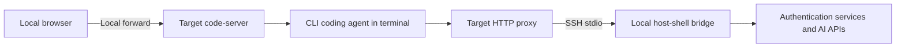
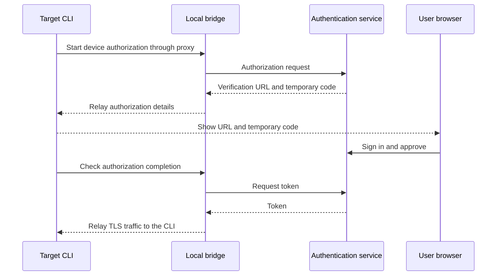

# Deploying CLI coding agents in an isolated environment

> [!NOTE]
> This is an English translation. The Japanese version ([../ja/coding-agents.md](../ja/coding-agents.md)) is the single source of truth (SSOT) and takes precedence if they differ.

This guide describes deploying Copilot, agy, Claude Code, Codex, and Grok CLIs into a target user's directories and running them from the [code-server](code-server.md) terminal. The goal is to use the CLIs through SSH relays even in isolated environments where the target cannot reach the internet directly. Only Copilot CLI has been checked end to end on a target ([Verified scope](#verified-scope)). With [BYOK](#byok-models-the-user-provides) (a model the user provides), Copilot CLI and the in-editor Copilot Chat work without a GitHub sign-in. The code-server skill does not automatically install or authenticate CLI coding agents.

An agent workflow scaffold is available in the [host-shell-coding-agents skill](../../.agents/skills/host-shell-coding-agents/SKILL.md). It does not yet include verified installers for individual CLIs.

## Connection architecture

The target must be reachable over SSH stdio, and the local client must be able to reach the authentication services and AI APIs. Direct internet access from the target and changes to its service configuration are not required. Required traffic must be relayable over SSH; this does not provide fully offline inference.



Use `transfer_push` for CLI binaries, dependencies, and configuration. [Port forwarding](port-forward.md) provides browser access, while the [client HTTP proxy](client-proxy.md) provides outbound CLI traffic.

## Registration and network routing

Combine the code-server registration options with the proxy options. The following `api.vendor.example` and `auth.vendor.example` are placeholders; replace them with destinations required by the CLI version and authentication method.

```bash
host-shell bridge --proxy \
    --proxy-allow-host 'api.vendor.example:443' \
    --proxy-allow-host 'auth.vendor.example:443' \
    --forward-allow-local '127.0.0.1:80[0-7]?' -- \
    ssh -T target /path/to/host-shell --mcp \
    --client-proxy --allow-forward-local
```

code-server launched through `job_start` receives `HTTP_PROXY`, `HTTPS_PROXY`, and their lowercase variants, which terminal children normally inherit. Enable the proxy before starting code-server. Check that the CLI supports an authenticated HTTP proxy and that shell configuration does not override these variables. Proxy URLs contain credentials: do not print them with `env` or `printenv`.

`NO_PROXY` is inherited as is. If an external API matches `NO_PROXY`, the CLI attempts a direct connection without using the proxy, so review `NO_PROXY` for the target. Allow destinations for login, token refresh, and required additional features as well as inference. Use `proxy_status` to investigate denials. TLS traffic after HTTP CONNECT is not decrypted. Custom networking implementations and plain HTTP Upgrade require separate compatibility checks.

## Deploying CLIs

1. Check the target OS, CPU, libc, and free space. A Linux x86_64 startup check does not validate Windows or arm64.
2. Fetch target-compatible distributions on the client and record versions, sources, and SHA-256 hashes. Verify official signatures or hashes when available.
3. Use `transfer_push` to place files in a dedicated directory, such as `~/.local/share/host-shell-coding-agents/<CLI>/<version>/`, and verify SHA-256 again on the target. Check executable permissions, runtimes, and shared libraries.
4. Run `--version` and `--help` using absolute paths first, without changing the user's PATH or shell startup files.
5. Launch interactively in the code-server terminal. After authentication, verify inference, editing, and command execution in a small test directory.

If a local command is a symbolic link, transfer its actual executable and required companion files. An npm entry point alone is insufficient: include target-compatible dependencies and a supported Node.js runtime. Do not assume code-server's bundled Node.js is suitable. Self-updates and automatic tool downloads introduce additional network and dependency requirements; use pinned versions for initial validation.

## Authentication and CLI-specific checks

| CLI | Installation and authentication checks |
| --- | --- |
| Copilot | Distinguish native and npm distributions. npm requires Node.js 22 or later. Consider device code authentication or supported tokens for remote environments |
| agy | Record the distributor and version to distinguish similarly named commands. Verify authentication, runtime requirements, and proxy support in the selected version |
| Claude Code | Check native distributions and OS requirements. HTTP/HTTPS proxies are supported. Configure destinations for the authentication method and model provider |
| Codex | Check target-specific distributions and companion helpers. Select ChatGPT or API key authentication and verify headless login and sandbox requirements |
| Grok | Pin the distributor and version because multiple CLIs use this name. Verify login, API access, proxy support, and helper processes in the selected version |

Table: CLI-specific checks

This example applies to CLIs supporting device code authentication. The bridge relays TLS traffic without decrypting it.



Device code authentication can use the local browser, but the remote CLI must also reach the authentication server. With browser login returning to `localhost`, the browser's localhost and the target's localhost are different machines. Use a supported device flow or a separate local forward for the callback port.

For Copilot CLI, run `/login`, choose the account (`GitHub.com`), and choose `Sign in with a device code`. Do not use `Sign in with your browser`, which returns to the target's localhost.

On targets without secure storage such as a keychain (containers and minimal Linux), the CLI shows `System vault not available` after authentication and asks whether to store the token in plain text in `~/.copilot/config.json` (mode 600; declining cancels sign-in). In disposable validation environments you can choose `1. Yes, store in plain text (insecure)`, whereas on shared or long-lived targets you should confirm with the user whether plain-text storage is acceptable (GitHub authorization can be revoked separately under Applications in GitHub settings).

The user performs authentication. Keep API keys and tokens out of documentation, tool arguments, conversations, and validation logs. Avoid copying an entire home directory containing credentials. CLIs running as the same target user may share credentials and conversation history. For separate accounts, check the CLI's supported configuration isolation mechanism.

Official references: [Copilot installation](https://docs.github.com/en/copilot/how-tos/copilot-cli/set-up-copilot-cli/install-copilot-cli), [Copilot authentication](https://docs.github.com/en/copilot/how-tos/copilot-cli/set-up-copilot-cli/authenticate-copilot-cli), [Claude Code setup](https://code.claude.com/docs/en/setup), [Claude Code networking](https://code.claude.com/docs/en/network-config), and [Codex authentication](https://learn.chatgpt.com/docs/auth?surface=cli). Add agy and Grok distribution sources once the validation targets are confirmed.

## Isolation and shutdown

The isolation boundary is the target OS, container, and file permissions. File operations and commands executed inside code-server do not pass through host-shell's MCP tool path restrictions, command restrictions, or approval handling, and are not recorded as MCP operations. Proxy logs record destinations and outcomes; they do not audit CLI actions.

Prompts and code may be sent to external services. Execution inside an isolated environment does not imply that data stays there. A CLI's own sandbox may also depend on kernel features or container configuration unavailable on the target.

When the MCP connection ends, code-server, the proxy, and forwards are stopped. A CLI running interactively in a code-server terminal ends when the terminal closes, even though the terminal shell runs in a session separate from host-shell (see the verified scope). Descendants detached from the terminal, for example with `nohup` or `setsid`, may survive; do not assume every process is reclaimed. Installed binaries, credentials, history, and work files are not deleted on disconnect.

## Built-in tools that need name resolution

The HTTP proxy does not relay DNS itself. Proxy-aware programs pass the hostname to the proxy, and it is resolved on the client side. Built-in tools that resolve names on the target before connecting fail on targets without DNS.

Copilot CLI's built-in Web Fetch also resolves names before connecting, failing with `WebFetchBlockedUrlError: failed to lookup address information: Name or service not known`. Adding destination rules does not fix it. Enable [remote-dns](remote-dns.md) on both ends before starting code-server. The host-shell-connect skill deploys the adapter and gives the `--remote-dns-library` path.

- A denial (HTTP 403, `CONNECT tunnel failed, response 403`) is not a DNS failure. Check the reason with `proxy_status`.
- Work running in VS Code extension or agent hosts, such as the in-editor Copilot Chat, needs the code-server [patched-copy mode](remote-dns.md#extension-and-agent-hosts-in-code-server).
- Proxy-aware alternatives such as `curl` still need explicit rules for the required hosts and ports.

## Copilot destinations

| Purpose | Destinations | Status |
| --- | --- | --- |
| Login, API, and inference | `github.com:443`, `api.github.com:443`, `*.githubcopilot.com:443`, `copilot-proxy.githubusercontent.com:443` | Authentication and conversational responses verified with this set |
| Copilot Chat BYOK model catalog (`https://main.vscode-cdn.net/extensions/copilotChat.json`) | `main.vscode-cdn.net:443` | Retrieval verified after allowing it |
| Copilot CLI auto-update | `release-assets.githubusercontent.com:443` | When not allowed, the CLI shows `Error auto updating: TypeError: fetch failed` at startup and the proxy history records a denial of this destination. CLI use is unaffected |

Table: Copilot destinations

At startup, the in-editor Copilot Chat fetches the known-model catalog for BYOK (external models using the user's own API keys) from `main.vscode-cdn.net` ([fetching implementation](https://github.com/microsoft/vscode/blob/main/extensions/copilot/src/extension/byok/vscode-node/byokContribution.ts)). When not allowed, `Failed to update known models list` is logged. To allow fetching the catalog, add `--proxy-allow-host main.vscode-cdn.net:443` (or apply it in a running session via [`proxy_rules_update`](client-proxy.md#proxy_rules_update-bridge)). Telemetry and experimentation hosts (such as `mobile.events.data.microsoft.com` and `default.exp-tas.com`) are not needed.

## BYOK (models the user provides)

BYOK (Bring Your Own Key) runs inference on a model endpoint and API key the user provides. Both Copilot CLI and the in-editor Copilot Chat can use BYOK models without signing in to GitHub. Features that need GitHub authentication (Copilot CLI `/delegate`, the GitHub MCP server, inline completions in Chat, and so on) are unavailable. Inference requests and prompts go to the configured endpoint.

As with other traffic, `bridge` relays the target's route to the endpoint. Use a [remote forward](port-forward.md) for an endpoint on the client or inside the closed network, and an allowed destination of the [HTTP proxy through the client](client-proxy.md) (for example `<resource>.openai.azure.com:443`) for an external one.

### Copilot CLI

Write the endpoint in `providers.json` and point the `COPILOT_PROVIDERS_CONFIG` environment variable at it. With `COPILOT_OFFLINE=true`, the CLI does not contact GitHub's servers (telemetry included). An Azure OpenAI example (replace `apiKey` with the real key and restrict the file to the user):

```json
{
  "providers": [
    {
      "name": "myazure",
      "type": "azure",
      "baseUrl": "https://<resource>.openai.azure.com/openai",
      "apiKey": "<API key>",
      "azure": { "apiVersion": "2024-10-21" }
    }
  ],
  "models": [
    { "id": "gpt", "provider": "myazure", "wireModel": "<deployment>", "modelId": "gpt-4.1" }
  ]
}
```

Select the model with `--model myazure/gpt` at startup (`/model` during a session). With `type: azure`, the CLI sends the key in the `api-key` header to `<baseUrl>/deployments/<wireModel>/chat/completions?api-version=<apiVersion>`. Adding `"wireApi": "responses"` to the provider switches to the Responses API (`<baseUrl>/responses?api-version=...`). The model and endpoint must support tool calling and streaming ([Using BYOK models](https://docs.github.com/en/copilot/how-tos/copilot-cli/customize-copilot/use-byok-models)).

### In-editor Copilot Chat

From the chat model picker, choose "+", then "Add Models" in the language models view, and pick a provider (Azure, OpenAI, Custom Endpoint, and so on). After a group name and the API key, `User/chatLanguageModels.json` in the user data opens. The key is stored as a secret; the file holds only a reference (`${input:chat.lm.secret...}`). Fill in `id`, `name`, and `url` of `models` (for Azure, the deployment's Chat Completions URL such as `https://<resource>.openai.azure.com/openai/deployments/<deployment>/chat/completions?api-version=2024-10-21`), save, and reload the page in the browser; the model then appears in the picker. In validation, Chat sent the key in an `Authorization: Bearer` header (the `url` was a dummy endpoint, not `*.openai.azure.com`).

Without a sign-in, the chat box shows "Set BYOK utility models". According to the VS Code documentation, choosing BYOK models for the utility tasks enables them as well (Unverified).

## Clipboard copying fails only inside Copilot CLI

Use this when copying works in an ordinary terminal, but inside Copilot CLI's interactive screen `Copied` appears without updating the clipboard. Verified with Copilot CLI 1.0.83, code-server 4.144.0, and Microsoft Edge. The copied range was verified by copying from Chrome for Testing 148 (WSLg) to the Windows clipboard.

While mouse support is enabled, Copilot receives mouse input, so dragging cannot create a code-server selection. Shift+drag or `Ctrl+Shift+C` does not copy either.

| Method | Steps | Limitations |
| --- | --- | --- |
| Copy the visible area from the Command Palette (recommended) | Press `Ctrl+Shift+P`, run `Terminal: Select All`, then `Terminal: Copy Selection`. Paste into an editor outside the browser and trim it | In Copilot CLI, only the area currently shown on screen (including frames and status lines) is copied; conversation outside the screen is not. Scroll with the wheel first to copy that view. Partial selection is impossible. Bind keys to both commands for frequent use |
| Save with `/share` | Save the conversation to a file, open it in the editor, and copy | Suits partial selection and long output that does not fit on the screen |
| Disable mouse handling | Resume with `copilot --continue --no-mouse` and select with the mouse | Wheel scrolling and other interactions degrade |

Table: Copy methods

The recommended method keeps Copilot's mouse interactions such as wheel scrolling. Do not treat the `Copied` notification as success; verify by pasting outside the browser. Which internal step fails is not determined. Related reports are [Copilot CLI issue #2082](https://github.com/github/copilot-cli/issues/2082) (the `mouse: false` workaround, and the clipboard staying unchanged after `Copied`) and [code-server issue #7938](https://github.com/coder/code-server/issues/7938) (selection and copy problems caused by TUI mouse handling).

If copying also fails in an ordinary terminal, the cause is different; check the browser's clipboard permission and access URL. See the [Copilot CLI reference](https://docs.github.com/en/copilot/reference/copilot-cli-reference/cli-command-reference) for related commands and settings.

## Verified scope

### Copilot CLI

Verified with Copilot CLI 1.0.83 (`copilot-linux-x64.tar.gz` from [github/copilot-cli v1.0.83](https://github.com/github/copilot-cli/releases/tag/v1.0.83), SHA-256 `ffbe1c429664b8a05efed67ecdb467123e40fcaa3c6c14ef9a98ba74da4687b7`) and code-server 4.144.0. The target is an Oracle Linux 10.2 / x86_64 / glibc 2.39 Podman container started with `--network none` and no external route. SSH reaches an in-container sshd through `ProxyCommand` (`podman exec -i` stdio relay); SSH connections over ordinary TCP are not covered. The operations stage was verified in a container with the same configuration, connected directly from the bridge through `podman exec -i`, in the terminal of code-server started in the [remote-dns](remote-dns.md) patched-copy mode.

| Stage | Pass criterion | Status |
| --- | --- | --- |
| Deployment | Transfer, hash verification, and dependency checks on the target | Verified |
| Startup | `--version` and `--help` succeed on the target | Verified |
| Terminal | Rendering, input, Ctrl-C, and resizing work in code-server | Verified |
| Clipboard | Copy from the terminal to outside the browser | Verified with the [Command Palette method](#clipboard-copying-fails-only-inside-copilot-cli) |
| Authentication | Login succeeds with the chosen method | Verified with device code (entering the displayed code in a separate browser). Behavior after credential expiry is unverified |
| Inference | Responses arrive only through the bridge with direct target egress blocked | Verified |
| Built-in Web Fetch | Fetching succeeds on a target without DNS | Verified together with [remote-dns](remote-dns.md) |
| Operations | Editing a test file and running a small command succeed | Verified (confirmed file creation and editing after approval, and execution of read-only commands) |
| Shutdown | After MCP disconnect, check code-server, CLI, helper processes, and listeners | Verified (confirmed that on MCP disconnect, the target `host-shell`, the code-server process tree, terminal shells and Copilot CLI, listening ports, and DNS/proxy temporary directories are all terminated and removed; installed files, credentials, and work files remain) |
| Multiple connections | Startup, authentication state, and disconnect effects across connections | Unverified |

Table: Copilot CLI validation stages

### BYOK

The inference endpoint was a dummy Azure OpenAI-style endpoint on the host (a test server that returns a fixed text for Chat Completions and the Responses API, and tool calls on request). The target reached it through a remote forward (the target's `127.0.0.1:18443` to the dummy on the client). No GitHub sign-in was done. Traffic with a real Azure OpenAI endpoint is not covered.

| Subject | Checked | Method and environment | Status |
| --- | --- | --- | --- |
| Copilot CLI 1.0.105 (`copilot-win32-x64.zip`, SHA-256 `34e16e9cf47de0e1534920171d6f39fa246638bddbb6ece820870b382bcc061a`) | With and without `COPILOT_OFFLINE=true`, `-p` prompts get answers from the BYOK model, over both Chat Completions and the Responses API. With `--allow-all-tools`, `create` creates a file and `powershell` runs a command on the target, and the results go back to the model | Windows 11 Enterprise (build 26300, amd64) Hyper-V virtual machine, run through `exec_run` | Verified |
| In-editor Copilot Chat (GitHub Copilot Chat 0.72.0 in code-server 4.144.0) | A BYOK model registered under the Azure provider answers; the agent's `create_file` and `read_file` run on the target and their results go back to the model | Same, operated from Chrome on the host | Verified |
| A real Azure OpenAI endpoint, reaching it through the client HTTP proxy | Traffic and answers | None | Unverified |

Table: BYOK verification status

### Other CLIs

Only `--version` has been checked, both standalone and through a local host-shell PTY `job_start` on a local Linux x86_64 machine. Source verification, target deployment, authentication, and inference are unverified.

| CLI | Checked version |
| --- | --- |
| agy | 1.4.12 |
| Claude Code | 2.1.316 |
| Codex | 0.166.0 |
| Grok | 1.0.70 |

Table: CLIs checked for startup

On a read-only file system, Codex warns that it cannot create its PATH alias. Version output is unaffected.

### Recording validation

For new validation, record OS, CPU, and libc; CLI, code-server, and host-shell versions; source and hash; authentication method (without secrets); allowed destinations; and verified stages with failure causes. Keep the history in `docs/prompts/past/` (Japanese only) and reflect only the results here. Past history is in [261102-coding-agents-validation.md](../prompts/past/261102-coding-agents-validation.md), [261103-copilot-cli-operation-validation.md](../prompts/past/261103-copilot-cli-operation-validation.md), [261103-copilot-cli-copy-scope-validation.md](../prompts/past/261103-copilot-cli-copy-scope-validation.md), [261103-coding-agents-shutdown-validation.md](../prompts/past/261103-coding-agents-shutdown-validation.md), and [261105-copilot-byok-validation.md](../prompts/past/261105-copilot-byok-validation.md).
