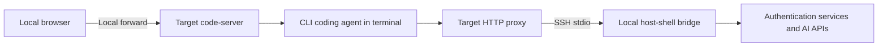
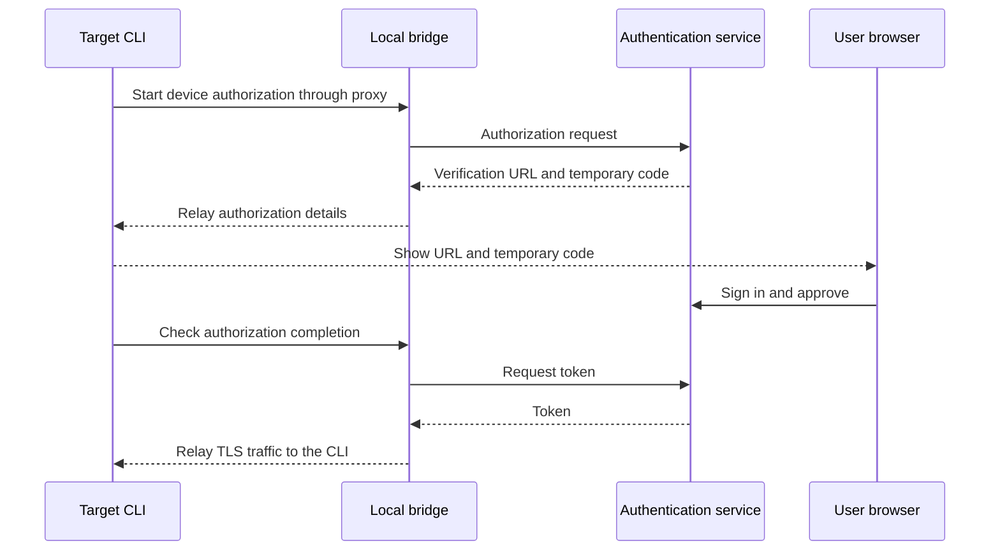

# Deploying CLI coding agents in an isolated environment

> [!NOTE]
> This is an English translation. The Japanese version ([../ja/coding-agents.md](../ja/coding-agents.md)) is the single source of truth (SSOT) and takes precedence if they differ.

This guide describes deploying Copilot, agy, Claude Code, Codex, and Grok CLIs into a target user's directories and running them from the [code-server](code-server.md) terminal. This use case is under validation. The code-server skill does not automatically install or authenticate CLI coding agents.

An agent workflow scaffold is available in the [host-shell-coding-agents skill](../../.agents/skills/host-shell-coding-agents/SKILL.md). It does not yet include verified installers for individual CLIs.

## Connection architecture

The target must be reachable over SSH stdio, and the local client must be able to reach the authentication services and AI APIs. Direct internet access from the target and changes to its service configuration are not required. Required traffic must be relayable over SSH; this does not provide fully offline inference.



Use `transfer_push` for CLI binaries, dependencies, and configuration. [Port forwarding](port-forward.md) provides browser access, while the [client HTTP proxy](client-proxy.md) provides outbound CLI traffic.

## Registration and network routing

Combine the code-server registration options with the proxy options. The following `api.vendor.example` and `auth.vendor.example` are placeholders; replace them with destinations required by the CLI version and authentication method.

```bash
host-shell bridge --proxy \
    --proxy-allow-host 'api.vendor.example:443' \
    --proxy-allow-host 'auth.vendor.example:443' \
    --forward-allow-local '127.0.0.1:80[0-7]?' -- \
    ssh -T target /path/to/host-shell --mcp \
    --client-proxy --allow-forward-local
```

code-server launched through `job_start` receives `HTTP_PROXY`, `HTTPS_PROXY`, and their lowercase variants, which terminal children normally inherit. Enable the proxy before starting code-server. Check that the CLI supports an authenticated HTTP proxy and that shell configuration does not override these variables. Proxy URLs contain credentials: do not print them with `env` or `printenv`.

`NO_PROXY` is inherited. An excluded external API causes direct connection attempts, so configure it for the target. Allow destinations for login, token refresh, and required additional features as well as inference. Use `proxy_status` to investigate denials. TLS traffic after HTTP CONNECT is not decrypted. Custom networking implementations and plain HTTP Upgrade require separate compatibility checks.

## Deploying CLIs

1. Check the target OS, CPU, libc, and free space. A Linux x86_64 startup check does not validate Windows or arm64.
2. Fetch target-compatible distributions on the client and record versions, sources, and SHA-256 hashes. Verify official signatures or hashes when available.
3. Use `transfer_push` to place files in a dedicated directory, such as `~/.local/share/host-shell-coding-agents/<CLI>/<version>/`, and verify SHA-256 again on the target. Check executable permissions, runtimes, and shared libraries.
4. Run `--version` and `--help` using absolute paths first, without changing the user's PATH or shell startup files.
5. Launch interactively in the code-server terminal. After authentication, verify inference, editing, and command execution in a small test directory.

If a local command is a symbolic link, transfer its actual executable and required companion files. An npm entry point alone is insufficient: include target-compatible dependencies and a supported Node.js runtime. Do not assume code-server's bundled Node.js is suitable. Self-updates and automatic tool downloads introduce additional network and dependency requirements; use pinned versions for initial validation.

## Authentication and CLI-specific checks

| CLI | Installation and authentication checks |
| --- | --- |
| Copilot | Distinguish native and npm distributions. npm requires Node.js 22 or later. Consider device code authentication or supported tokens for remote environments |
| agy | Record the distributor and version to distinguish similarly named commands. Verify authentication, runtime requirements, and proxy support in the selected version |
| Claude Code | Check native distributions and OS requirements. HTTP/HTTPS proxies are supported. Configure destinations for the authentication method and model provider |
| Codex | Check target-specific distributions and companion helpers. Select ChatGPT or API key authentication and verify headless login and sandbox requirements |
| Grok | Pin the distributor and version because multiple CLIs use this name. Verify login, API access, proxy support, and helper processes in the selected version |

Table: CLI-specific checks

This example applies to CLIs supporting device code authentication. The bridge relays TLS traffic without decrypting it.



Device code authentication can use the local browser, but the remote CLI must also reach the authentication server. With browser login returning to `localhost`, the browser's localhost and the target's localhost are different machines. Use a supported device flow or a separate local forward for the callback port.

The user performs authentication. Keep API keys and tokens out of documentation, tool arguments, conversations, and validation logs. Avoid copying an entire home directory containing credentials. CLIs running as the same target user may share credentials and conversation history. For separate accounts, check the CLI's supported configuration isolation mechanism.

Official references: [Copilot installation](https://docs.github.com/en/copilot/how-tos/copilot-cli/set-up-copilot-cli/install-copilot-cli), [Copilot authentication](https://docs.github.com/en/copilot/how-tos/copilot-cli/set-up-copilot-cli/authenticate-copilot-cli), [Claude Code setup](https://code.claude.com/docs/en/setup), [Claude Code networking](https://code.claude.com/docs/en/network-config), and [Codex authentication](https://learn.chatgpt.com/docs/auth?surface=cli). Add agy and Grok distribution sources once the validation targets are confirmed.

## Isolation and shutdown

The isolation boundary is the target OS, container, and file permissions. File operations and commands executed inside code-server do not pass through host-shell's MCP tool path restrictions, command restrictions, or approval handling, and are not recorded as MCP operations. Proxy logs record destinations and outcomes; they do not audit CLI actions.

Prompts and code may be sent to external services. Execution inside an isolated environment does not imply that data stays there. A CLI's own sandbox may also depend on kernel features or container configuration unavailable on the target.

When the MCP connection ends, code-server, the proxy, and forwards are stopped. Verify CLI and helper process termination on the target. Unix descendants that enter separate process groups or sessions may survive; do not assume every terminal process is reclaimed. Installed binaries, credentials, and history are not deleted on disconnect.

## Clipboard copying fails only inside Copilot CLI

During validation on 2026-11-02, code-server 4.144.0 in Microsoft Edge could copy from an ordinary terminal, but copying failed inside Copilot CLI 1.0.83's interactive UI. Pressing `Ctrl+C` displayed `Copied` without updating the Windows clipboard. Pasting from the editor into the terminal still worked.

While mouse support is enabled, Copilot receives mouse input, so dragging cannot create a code-server selection. Holding `Shift` while dragging and then pressing `Ctrl+Shift+C` was also tried and did not copy anything while mouse support was enabled.

The user confirmed that copying works with mouse support still enabled by selecting and copying on the code-server side without the mouse:

1. Press `Ctrl+Shift+P` to open the Command Palette and run `Terminal: Select All`.
2. Then run `Terminal: Copy Selection`.
3. Paste into an editor outside the browser and trim it to the part you need.

The entire terminal content is selected; partial selection is not possible. Whether the selection includes output above the visible area was not individually verified. If you use this often, assign keys to the two commands. This method preserves Copilot's mouse interactions, including wheel scrolling. Try this method first.

As an alternative, resuming with `copilot --continue --no-mouse` restores mouse selection and copying. However, the user reported that wheel scrolling stopped working and other interactions were impaired. Treat disabling mouse support as a fallback with usability limitations.

Exporting the conversation to a file with `/share`, opening it in the editor, and copying from there was also confirmed to work. It suits partial selections and long output.

[Copilot CLI Issue #2082](https://github.com/github/copilot-cli/issues/2082) includes the `mouse: false` workaround, reports that it restored copying, and reports of a Copied notification without clipboard updates. [code-server Issue #7938](https://github.com/coder/code-server/issues/7938) also describes TUI mouse handling interfering with selection and copying. The observed improvement is consistent with bypassing Copilot's own clipboard path, but the exact failing internal operation has not been identified. Verify by pasting into an editor outside the browser; a `Copied` notification alone is insufficient.

If copying also fails in an ordinary terminal, investigate browser clipboard permissions and the access URL separately. See the [official Copilot command reference](https://docs.github.com/en/copilot/reference/copilot-cli-reference/cli-command-reference) for related options and settings.

## Validation status

Results as of 2026-11-02: the following installed Linux x86_64 executables returned exit code 0 for `--version`, both directly and through a local host-shell `job_start` with a PTY. This does not validate distribution provenance, deployment to a remote target, authentication, or inference.

| CLI | Local version | Direct / host-shell PTY startup |
| --- | --- | --- |
| Copilot | 1.0.83 | Passed / Passed |
| agy | 1.4.12 | Passed / Passed |
| Claude Code | 2.1.316 | Passed / Passed |
| Codex | 0.166.0 | Passed / Passed |
| Grok | 1.0.70 | Passed / Passed |

Table: Initial checks

Codex printed a warning that it could not create PATH aliases on a read-only file system; version reporting still succeeded. This environment-specific warning is not evidence that normal CLI operations work.

Existing tests for `internal/clientproxy`, `internal/jobs`, and `internal/bridge` also passed. They validate the relay and job management foundation, not each coding agent's API compatibility.

### Copilot CLI in an isolated container

On 2026-11-02, code-server 4.144.0 and Copilot CLI 1.0.83 were deployed to a Podman container running Oracle Linux 10.2 / x86_64 / glibc 2.39. host-shell was built from commit `fa2c855`. The container uses `--network none`, has only loopback, and has no external route. SSH uses a `ProxyCommand` relaying stdio through `podman exec -i` to sshd listening on the container's loopback. This does not validate ordinary TCP-based SSH reachability.

- Official code-server and Copilot archive SHA-256 hashes were verified, then files were deployed and verified again using `transfer_push` over SSH. Copilot came from [github/copilot-cli v1.0.83](https://github.com/github/copilot-cli/releases/tag/v1.0.83), archive `copilot-linux-x64.tar.gz`, SHA-256 `ffbe1c429664b8a05efed67ecdb467123e40fcaa3c6c14ef9a98ba74da4687b7`.
- Copilot `--version`, `--help`, and version reporting with a PTY succeeded on the target.
- The code-server login page was reachable, and the user successfully authenticated Copilot by entering the CLI-displayed code in a separate browser (device code flow). Login validation is complete. Long-term authentication behavior, such as what happens after credentials expire, has not been tested.
- Direct TCP access to an external IP failed, while `https://api.github.com` returned HTTP 200 through the client proxy. This HTTP check alone does not establish successful Copilot inference. A subsequent user screenshot showed Copilot conversational responses and tool execution.
- The allowlist was `github.com:443`, `api.github.com:443`, `*.githubcopilot.com:443`, and `copilot-proxy.githubusercontent.com:443`. Arbitrary websites were not allowed.

Direct name resolution inside the container fails. The HTTP proxy does not relay DNS queries: it receives hostnames and resolves them on the client side, or through the configured upstream proxy route. Allowed hosts worked, while unlisted hosts returned HTTP 403. HTTPS reports `CONNECT tunnel failed, response 403`. The additional artifact destination `release-assets.githubusercontent.com:443` was also recorded as denied; required destinations still need to be checked for each feature. The user screenshot showed Copilot's built-in Web Fetch failing with `WebFetchBlockedUrlError: failed to lookup address information: Name or service not known`, followed by a `curl` request receiving proxy HTTP 403. This suggests the built-in Web Fetch performs target-side name resolution separately from connecting through the proxy; its internal implementation has not been inspected. Adding an allowed destination alone must not be treated as sufficient to enable this tool.

Distinguish proxy-compatible commands from built-in tools that require a preliminary DNS lookup. The latter can use the optional [remote-dns feature](remote-dns.md). Independent resolver-hook testing showed Copilot CLI Web Fetch failing on DNS without the hook and succeeding with it for the same URL. See that document for scope and diagnostics, including environment sanitization in the bundled VS Code SDK. A proxy-compatible command such as `curl` remains an alternative after explicit authorization of the required host and port.

### Required destination for Copilot Chat's BYOK model catalog

code-server's Copilot Chat retrieves its known-model catalog for BYOK (external models using the user's own API keys or similar credentials) from `https://main.vscode-cdn.net/extensions/copilotChat.json`. GitHub and Copilot API allow rules do not cover this destination: **this feature requires additionally allowing `main.vscode-cdn.net:443`**. The [retrieval implementation](https://github.com/microsoft/vscode/blob/main/extensions/copilot/src/extension/byok/vscode-node/byokContribution.ts) confirms the URL.

Add the following to existing startup allow rules:

```text
--proxy-allow-host main.vscode-cdn.net:443
```

When `proxy_rules_update` is available, read the current `rules_revision` and both complete rule lists, then add this single destination to the allowlist. Runtime updates need no restart but end with the session; also include the destination in the next startup configuration.

On 2026-11-03, CONNECT to the same URL returned 403 before authorization. After the update, a version-1 catalog containing five providers (19,535 bytes) was retrieved as valid JSON. This direct retrieval does not establish that the extension itself has retried successfully. Check normal Copilot API destinations and the BYOK catalog destination separately for their respective features.

The following statuses apply only to Copilot CLI. Other CLIs have only the local startup checks above.

| Stage | Pass criteria | Status |
| --- | --- | --- |
| Deployment | Transfer, hash verification, and dependency checks on the target | Passed (Copilot) |
| Startup | Target `--version` and `--help` succeed | Passed (Copilot) |
| Terminal | Rendering, input, Ctrl-C, and resizing work inside code-server | Passed; user confirmed all items worked on 2026-11-02 |
| Clipboard | Copy terminal text outside the browser | Passed with mouse enabled using `Terminal: Select All` and `Terminal: Copy Selection` (Shift+drag fails); `--no-mouse` also works but impairs wheel scrolling |
| Authentication | Login succeeds using the selected method | Passed; user entered the displayed code in a separate browser |
| Inference | Obtain a response through bridge while direct target egress is blocked | Conversational responses observed in user screenshot; built-in Web Fetch fails on DNS |
| Operations | Edit a test file and execute a small command | Not tested |
| Shutdown | Check code-server, CLI, helpers, and listeners after MCP disconnect | Not tested |
| Multiple connections | Check startup, authentication state, and disconnect effects across connections | Not tested |

Table: Target validation stages

Record OS, CPU, libc, CLI/code-server/host-shell versions, distribution sources and hashes, authentication method without secrets, allowed destinations, completed stages, and failure reasons.

Optional name resolution relay: [remote-dns](remote-dns.md). See `--remote-dns` on both ends and target `--remote-dns-library PATH` for a prebuilt adapter.
