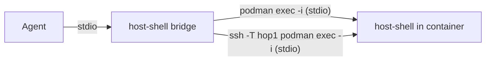

# Connecting into containers

> [!NOTE]
> This is an English translation. The Japanese version ([../ja/container.md](../ja/container.md)) is the single source of truth (SSOT) and takes precedence if they differ.

`host-shell` runs not only on SSH targets, but also inside running Linux containers (Podman, Docker, and Kubernetes Pods). Because `bridge` simply uses the standard input and output of the command after `--` as its transport channel, passing `podman exec -i` or a similar command instead of `ssh` connects directly to `host-shell` inside the container.



This guide covers binary deployment, agent registration, and caveats specific to containers. For features shared with SSH targets, see the [User Guide](user-guide.md).

## Supported runtimes and verification status

| Runtime | Verification status |
| --- | --- |
| Podman | Verified (Podman 4.9.4, rootless) |
| Docker | Verified via Podman's Docker-compatible CLI (`docker`); not tested against Docker Engine directly |
| `kubectl` (Kubernetes) | Not tested against a cluster (verified generated command syntax only) |

Table: Supported container runtimes

- Only Linux containers are supported (Windows containers are not supported).
- Because `host-shell` is statically linked, it runs on both glibc-based and musl-based images (such as Alpine Linux).
- The deployment and verification scripts (`.agents/skills/host-shell-connect/scripts/`) require `sh` along with `uname`, `id`, `dirname`, `ls`, `sha256sum`, `mkdir`, `chmod`, `mv`, `cat`, and `rm` inside the container. For minimal images without a shell, see [Containers without a shell](#containers-without-a-shell).

## Specifying the route

The scripts in the `host-shell-connect` skill accept a container as the final element of the comma-separated `ROUTE` argument (after any SSH jump hosts).

| Final route element | Executed command | Environment variable for extra flags |
| --- | --- | --- |
| `podman:<container>` | `podman exec -i ... <container> sh -c <command>` | `HOST_SHELL_PODMAN_OPTS` (e.g., `--user dev`) |
| `docker:<container>` | `docker exec -i ... <container> sh -c <command>` | `HOST_SHELL_DOCKER_OPTS` (e.g., `--user dev`) |
| `kubectl:<pod>` | `kubectl exec -i ... <pod> -- sh -c <command>` | `HOST_SHELL_KUBECTL_OPTS` (e.g., `-n app -c web --context prod`) |

Table: Container route elements

- For example, `podman:web` targets a local container, while `hop1,podman:web` connects to `hop1` over SSH and runs `podman exec -i` there.
- A container element may appear only at the end of `ROUTE`.
- Values in the `HOST_SHELL_*_OPTS` environment variables are split on whitespace, just like `HOST_SHELL_SSH_OPTS`.

```bash
scripts/detect.sh podman:web
scripts/deploy.sh podman:web linux-amd64
scripts/probe.sh podman:web /tmp/host-shell-0/host-shell
HOST_SHELL_KUBECTL_OPTS='-n app -c web' scripts/deploy.sh kubectl:web-0 linux-amd64
```

## Deployment

As on SSH targets, `deploy.sh` tries `/tmp/host-shell-<uid>/host-shell` first and falls back to `.local/bin/host-shell` (relative to the home directory). When the container's default user is `root`, the binary is placed at `/tmp/host-shell-0/host-shell`.

- If the container's root file system is read-only or `/tmp` is mounted `noexec`, pass a writable, executable volume path as the third argument to `deploy.sh`.
- Recreating a container removes any files not stored on a persistent volume (restarting a container with `podman restart` or `docker restart` preserves them). Redeploy `host-shell` after recreating the container.

## Registration commands

After `--` on `bridge`, specify the `exec -i` command that launches `host-shell --mcp` inside the container, including any user or namespace flags used in the route:

```bash
claude mcp add host-shell-web -- ~/.local/bin/host-shell bridge -- podman exec -i web /tmp/host-shell-0/host-shell --mcp
claude mcp add host-shell-web -- ~/.local/bin/host-shell bridge -- docker exec -i --user dev web /tmp/host-shell-1000/host-shell --mcp
claude mcp add host-shell-web -- ~/.local/bin/host-shell bridge -- kubectl exec -i -n app -c web web-0 -- /tmp/host-shell-1000/host-shell --mcp
claude mcp add host-shell-web -- ~/.local/bin/host-shell bridge -- ssh -T -o BatchMode=yes hop1 podman exec -i web /tmp/host-shell-0/host-shell --mcp
```

> [!IMPORTANT]
> Always pass `-i` to `exec`, and never pass `-t`. Allocating a pseudo-terminal corrupts the MCP JSON-RPC stream.

Append policy restriction options (`--read-only`, `--allow-path`, etc.) after `--mcp`, just as on SSH targets.

## Caveats

- **Container user**: `host-shell` runs as the default user of `exec` (the image's `USER`, which is often `root`). To run with reduced privileges, pass `--user` (or configure `securityContext` in Kubernetes).
- **Process lifetime**: When the MCP session closes, `host-shell` and any background jobs started via `job_start` terminate and leave no lingering processes in the container.
- **Pod networking and namespaces**: Containers in the same Pod share a network namespace, so opening a local forward to `127.0.0.1:<port>` with `forward_open` can reach services running in sibling containers in the same Pod (verified with Podman Pods). Because PID namespaces are not shared by default, processes in sibling containers do not appear in `proc_list`.
- **Audit log**: By default, the audit log is written inside the container (`~/.local/state/host-shell/`) and is lost when the container is recreated. Pass `--log-file` pointing to a mounted volume to persist audit logs across container recreations.
- **Privilege model**: Anyone who can run `podman exec` or `docker exec` can already execute arbitrary commands inside the container; `host-shell` does not grant additional privileges.

## Containers without a shell

In minimal images without `/bin/sh` (such as distroless images), the automated deployment scripts cannot run. Copy the binary into the container and register it manually:

```bash
podman cp .agents/skills/host-shell-connect/bin/host-shell-linux-amd64 web:/tmp/host-shell
podman exec web /tmp/host-shell --version
claude mcp add host-shell-web -- ~/.local/bin/host-shell bridge -- podman exec -i web /tmp/host-shell --mcp
```

- For Docker, use `docker cp`. Note that `kubectl cp` requires `tar` inside the container and therefore cannot copy binaries into distroless Pods.
- File (`fs_*`) and search (`search_*`) tools work normally without a shell, whereas shell commands in `exec_run` (`command`) and code-server injection require a shell.

## Using code-server

You can also [inject code-server](code-server.md) into a running container using the `host-shell-code-server` skill. The procedure is identical to SSH targets, subject to the following container-specific requirements:

| Requirement | Details |
| --- | --- |
| glibc | The Node.js runtime bundled with code-server requires glibc. Musl-based images such as Alpine Linux are unsupported (`install` stops before extraction) |
| Required commands | `bash`, `tar`, `gzip`, `sha256sum`, and `od` must be present in the container (Alpine does not include `bash` by default) |
| `HOME` | Configuration, user data, and extensions are stored under `HOME`, which must be set and point to a writable directory |
| Persistence | Mount a volume at `HOME` if you want settings and extensions to survive container recreation |

Table: Requirements for running code-server in a container

| Container image | Verification result |
| --- | --- |
| Oracle Linux 9 | Verified installation, startup, port forwarding, login, and default settings and extensions |
| `debian:stable-slim` | Includes all required utilities by default; verified end to end |
| `alpine:3.22` | `install` cannot start without `bash`; even with `bash` installed, `install` stops before extraction because glibc is absent |

Table: Verified container images

code-server binds to the first free port in 8000–8079 on `127.0.0.1` inside the container. Because each container has its own network namespace, port 8000 is typically selected.
