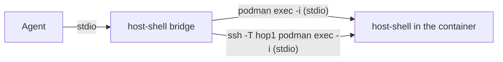

# Connecting into containers

> [!NOTE]
> This is an English translation. The Japanese version ([../ja/container.md](../ja/container.md)) is the single source of truth (SSOT) and takes precedence if they differ.

host-shell runs not only on SSH targets but also inside running Linux containers (podman, docker, Kubernetes pods). The bridge only uses the command after `--` as a standard input/output channel, so writing `podman exec -i` or similar instead of ssh connects to host-shell inside the container.



This document covers deployment, registration and caveats specific to containers. For what is shared with SSH targets, see the [User Guide](user-guide.md).

## Targets and verification

| Runtime | Verification |
| --- | --- |
| podman | Verified (podman 4.9.4, rootless) |
| docker | Verified with podman's compatible command (`docker`); not verified with Docker Engine |
| kubectl (Kubernetes) | Not verified (only the composed commands were checked) |

Table: Supported runtimes

- Linux containers are supported. Windows containers are not.
- host-shell is statically linked, so it runs on both glibc and musl images (such as Alpine).
- The deployment and check scripts (`.agents/skills/host-shell-connect/scripts/`) need `sh` and `uname`, `id`, `dirname`, `ls`, `sha256sum`, `mkdir`, `chmod`, `mv`, `cat` and `rm` inside the container. For containers without a shell, see [Containers without a shell](#containers-without-a-shell).

## Specifying the route

The scripts of the host-shell-connect skill accept one container as the last element of the route `ROUTE` (jump hosts and the target separated by commas).

| Last element | Command run | Extra options (environment variable) |
| --- | --- | --- |
| `podman:<container>` | `podman exec -i ... <container> sh -c <command>` | `HOST_SHELL_PODMAN_OPTS` (e.g. `--user dev`) |
| `docker:<container>` | `docker exec -i ... <container> sh -c <command>` | `HOST_SHELL_DOCKER_OPTS` (e.g. `--user dev`) |
| `kubectl:<pod>` | `kubectl exec -i ... <pod> -- sh -c <command>` | `HOST_SHELL_KUBECTL_OPTS` (e.g. `-n app -c web --context prod`) |

Table: Container elements

- `podman:web` is a container on this machine, and `hop1,podman:web` is a container on hop1: SSH reaches hop1, which then runs `podman exec -i`.
- A container element is allowed only at the end of the route.
- The environment variable values are split on spaces, like `HOST_SHELL_SSH_OPTS`.

```sh
scripts/detect.sh podman:web
scripts/deploy.sh podman:web linux-amd64
scripts/probe.sh podman:web /tmp/host-shell-0/host-shell
HOST_SHELL_KUBECTL_OPTS='-n app -c web' scripts/deploy.sh kubectl:web-0 linux-amd64
```

## Deployment

As on SSH targets, `deploy.sh` tries `/tmp/host-shell-<uid>/host-shell`, then `.local/bin/host-shell` (relative to the home directory). If the container's default user is root, the path is `/tmp/host-shell-0/host-shell`.

- If the root file system is read-only or `/tmp` is `noexec`, give a writable and executable path on a volume as the third argument.
- Recreating the container removes files not on a volume (restarting it, such as with `podman restart`, does not). Deploy again after recreating it.

## Registration commands

After the bridge's `--`, write a command that starts host-shell inside the container directly with `exec -i`. Include the same extra options (user, namespace and so on) as the route.

```sh
claude mcp add host-shell-web -- ~/.local/bin/host-shell bridge -- podman exec -i web /tmp/host-shell-0/host-shell --mcp
claude mcp add host-shell-web -- ~/.local/bin/host-shell bridge -- docker exec -i --user dev web /tmp/host-shell-1000/host-shell --mcp
claude mcp add host-shell-web -- ~/.local/bin/host-shell bridge -- kubectl exec -i -n app -c web web-0 -- /tmp/host-shell-1000/host-shell --mcp
claude mcp add host-shell-web -- ~/.local/bin/host-shell bridge -- ssh -T -o BatchMode=yes hop1 podman exec -i web /tmp/host-shell-0/host-shell --mcp
```

> [!IMPORTANT]
> `exec` needs `-i`. Never add `-t`: a terminal's control processing corrupts the MCP (JSON-RPC) stream.

Restriction options (`--read-only`, `--allow-path` and so on) go after `--mcp`, as on SSH targets.

## Caveats

- **User**: host-shell runs as `exec`'s default user (the image's `USER`, often root). To lower privileges, use `--user` (for kubectl, the container's `securityContext`).
- **Process lifetime**: when the MCP session ends, host-shell and the processes started with job_start end. Nothing remains in the container.
- **Pod network**: containers in a pod share the network. A `forward_open` to `127.0.0.1:<port>` also reaches services of other containers in the same pod (verified with a podman pod). The PID namespace is not shared, so processes of other containers do not appear in `proc_list`.
- **Audit log**: the default audit log is written inside the container (`~/.local/state/host-shell/`) and is lost when the container is recreated. To keep it, give a path on a volume with `--log-file`.
- **Scope of privileges**: anyone who can run `podman exec` and similar can already run any command in the container. host-shell grants no new privileges.

## Containers without a shell

In containers without `sh`, such as distroless images, the deployment and check scripts do not work. Deploy and register by hand:

```sh
podman cp .agents/skills/host-shell-connect/bin/host-shell-linux-amd64 web:/tmp/host-shell
podman exec web /tmp/host-shell --version
claude mcp add host-shell-web -- ~/.local/bin/host-shell bridge -- podman exec -i web /tmp/host-shell --mcp
```

- With docker, use `docker cp`. `kubectl cp` needs `tar` inside the container, so kubectl cannot deploy there.
- File and search tools work, but `exec_run` cannot run shell commands, and code-server cannot be used.

## Using code-server

The host-shell-code-server skill can also [inject code-server](code-server.md) into a container, with the same procedure as on SSH targets. Container-specific conditions are:

| Condition | Details |
| --- | --- |
| glibc | code-server's node needs glibc. Musl images such as Alpine are not supported (install stops before extracting) |
| Commands | `bash`, `tar`, `gzip`, `sha256sum` and `od` are needed. Alpine does not even include `bash` by default |
| HOME | Settings, user data and extensions are placed under HOME, which must be set and be a writable directory |
| Keeping them | To keep them across container recreation, put HOME on a volume |

Table: Conditions for code-server in a container

| Image | Result |
| --- | --- |
| Oracle Linux 9 | Verified install, start, forward, login, and default settings and extensions |
| debian:stable-slim | Has the required commands; verified the same way |
| alpine:3.22 | install cannot start because `bash` is missing. With `bash` added, it stops before extracting because glibc is missing |

Table: Verified images

code-server listens on the first free port in 8000-8079 on `127.0.0.1` inside the container. Each container has its own network, so this is usually 8000.
