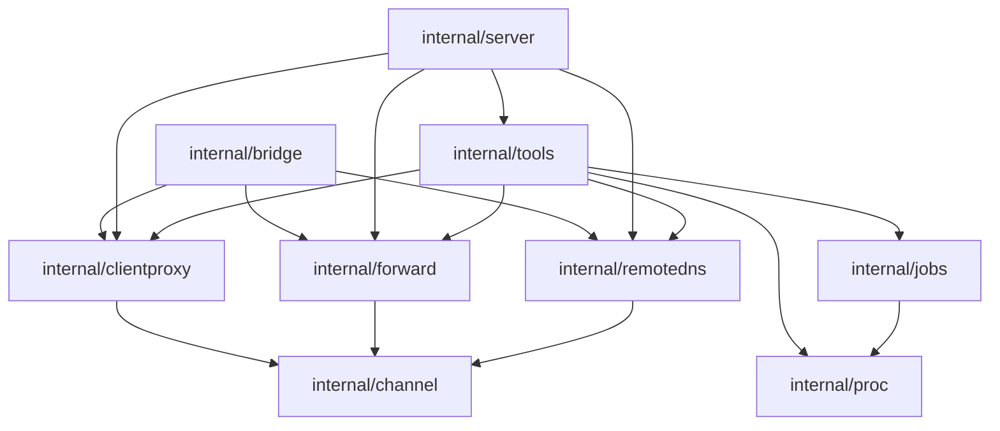

# host-shell Development Guide

> [!NOTE]
> This is an English translation. The Japanese version ([../ja/development.md](../ja/development.md)) is the single source of truth (SSOT) and takes precedence if they differ.

This guide covers building `host-shell`, the source layout, design rules, adding tools, testing, and releases.

## Development environment

| Item | Requirement |
|---|---|
| Go | 1.26 or later (`go` directive in `go.mod`) |
| make | GNU make |
| OS | Linux, macOS, or Windows (cross-compilation builds all targets on a single machine) |

Table: Development environment

Builds have no external C library dependencies and are always statically linked with `CGO_ENABLED=0`.

## Building

| Command | Description |
|---|---|
| `make` | Runs `vet`, `test`, and `build` in order |
| `make build` | Builds `dist/host-shell` for the host OS and architecture |
| `make dist` | Builds the six distribution binaries (`dist/host-shell-{linux,windows,darwin}-{amd64,arm64}[.exe]`) and copies them to `bin/` of the `host-shell-connect` skill (macOS binaries are for local `host-shell bridge` only) |
| `make dns-lib` | Builds the remote DNS adapter `dist/libhostshell_dns-linux-<arch>.so` for the host architecture (Linux only; fails if it requires glibc symbols newer than 2.17) |
| `make release` | Builds Release archives in `dist/release/` ([Releases](#releases)) |
| `make test` | Runs tests across all packages |
| `make vet` | Runs `go vet` for Linux, Windows, and macOS |
| `make clean` | Removes `dist/` and the skill's `bin/` |

Table: make targets

The version is embedded from `git describe --tags --always --dirty` (`dev` when Git metadata is unavailable).  
To specify a version explicitly, run `make dist VERSION=1.0.0`.

## Source layout

```text
cmd/host-shell/        Entry point (flag parsing, audit log init, stdio server startup, bridge subcommand dispatch)
internal/server/       MCP server construction (policy resolution, passing runtime components (Session), tool registration, initialization guidance)
internal/policy/       Policy parsing and checks (tool selection, allowed paths, allowed/denied commands, destination hosts, env var filtering, confirmation, redaction), remote forward listen port ranges
internal/tools/        Tool implementations
  tools.go             Tool groups, registration, and common wrapper for policy checks, confirmation, redaction, and audit logging
  args.go              Shared argument handling (charsets, text / base64, until, output limits)
  policy.go            Per-input path extraction (PathArgs), confirmation (multi round-trip), redaction
  progress.go          Progress notifications
  ansi.go              Terminal output cleanup (escape sequence stripping and CR handling)
  help.go              help_get tool, help resources, and initialize instructions generation
  help/*.md            Help topic content (embedded in the binary)
  exec.go              exec_run, job_*
  files.go             fs_list, fs_stat, fs_read, fs_write
  edit.go              fs_edit
  fsops.go             fs_mkdir, fs_move, fs_copy, fs_remove
  search.go            search_grep, search_find, fs_manifest
  glob.go              Glob matching (**, {a,b})
  system.go            exec_sudo, sys_get_info, proc_list
  processes_*.go       OS-specific proc_list implementations (/proc, Windows API)
  net*.go              net_request_http, net_exchange, net_check, net_list_listeners, net_list_interfaces
  listen_*.go          OS-specific net_list_listeners implementations (/proc/net, netstat)
  admin.go             Input/output types and shared logic for proc_kill, svc_*, log_query, disk_list
  admin_*.go           OS-specific administration (systemd / journald, Service Control Manager / Event Log)
  registry*.go         reg_read, reg_write, reg_delete (Windows)
internal/bridge/       host-shell bridge (local relay, transfer_push, transfer_pull, proxy and forward tools)
internal/channel/      Multiplexed channel over SSH stdio (feature negotiation, bidirectional streams, flow control) and parts shared by the features on top of it (answering and relaying connections, mapping failure codes to reasons, status-tool history and output types)
internal/clientproxy/  HTTP proxy through the client (bridge-side destination checks and connections from the bridge, target-side authenticated proxy)
internal/forward/      Port forwarding (persistent forward syntax, bridge listeners, SOCKS5 and forward_*, target-side connections and listeners)
internal/routeproxy/   host-shell connect (ProxyCommand for the SSH route proxy: CONNECT with Basic authentication, password file permission check)
internal/remotedns/    Name resolution through the client (bridge-side resolver, target-side UNIX socket listener and adapter placement, loopback DNS server)
  assets/preload.c     LD_PRELOAD remote DNS adapter (source for libhostshell_dns-linux-<arch>.so)
internal/proc/         Child process spawning, OS shell execution, process tree termination, signal delivery, liveness checks
  proc_unix.go         Linux (process groups, SIGKILL, signal name table)
  proc_windows.go      Windows (cmd command lines, taskkill /T)
internal/pty/          Pseudo-terminals (creack/pty on Linux, ConPTY API on Windows)
internal/jobs/         Background job management (pipes/PTYs, signals, pruning finished jobs)
internal/limit/        Output size limits (head/tail Buffer, offset-addressable Ring)
internal/textenc/      Character encoding conversion (name resolution, detection, I/O conversion, OS default encodings)
  system_unix.go       Linux (detected from locale environment variables)
  system_windows.go    Windows (GetOEMCP, GetACP)
internal/audit/        Audit log (JSON Lines)
internal/config/       Startup option values and defaults (no components created at runtime)
internal/askpass/      Askpass helper that passes the exec_sudo password to sudo -A
internal/wire/         Names and transfer payloads shared by the bridge and target tools
internal/bytesize/     Byte count formatting for people (shared by the target tools and bridge)
internal/testutil/     Test helpers shared across packages
internal/version/      Version metadata
.agents/skills/host-shell-connect/
                       Skill for binary deployment and startup verification (bin/ is generated by make dist and ignored by Git)
.agents/skills/host-shell-code-server/
                       Skill for injecting code-server into a target (packages/ is fetched by download and ignored by Git)
.agents/skills/host-shell-vscode-remote-ssh/
                       Skill for connecting VS Code Remote - SSH to a target (packages/ is fetched by fetch and ignored by Git)
.agents/skills/host-shell-coding-agents/
                       Skill for deploying and validating CLI coding agents on a target
docs/ja/               Japanese documentation (SSOT)
docs/en/               English documentation (translations of docs/ja/)
```

## Design rules

Follow these rules when modifying the codebase.

- **Never write to standard output**: Standard output is reserved for MCP JSON-RPC messages. Write diagnostic logs to standard error (`log` package) and operation records to the `audit` package.
- **Never inherit standard I/O in child processes**: Do not pass `os.Stdin` or `os.Stdout` to `Stdin`, `Stdout`, or `Stderr` of `exec.Cmd`. Always spawn child processes via `proc.Command` or `proc.Run`.
- **Enforce output size limits**: Cap tool output around `--max-output` using the `limit` package or entry count limits, and indicate truncation via fields such as `truncated`.
- **Redact sensitive arguments in audit logs**: For arguments that must not be logged in full (such as written file content or standard input), implement `AuditArgs() any` (`audit.Redactor`) on the input type.
- **Convert encodings inside tools**: Tool inputs and outputs are always UTF-8. Use the `textenc` package for target encoding conversion and `textenc.ParseAuto` (arguments that allow detection) or `textenc.ParseFixed` (arguments with a default encoding) for encoding arguments, and avoid splitting multibyte characters across chunk boundaries.
- **Reuse shared helpers**: Do not reimplement the same processing in each tool. Use `internal/tools/args.go` (`readCharset`, `writeCharset`, `decodeData`, `compileUntil`, `clampMax`) for arguments, `textenc.Choice.Detect` for BOM and UTF-16 detection, `Encoding.DecodeUnlessUTF8` for decoding non-UTF-8 data, `d.redact` and `d.mask` for output redaction and masking the proxy credential, and `proc.Alive` for process liveness.
- **Separate settings from runtime components**: `config.Config` holds startup option values only. Components created at runtime (the target side of the client proxy, port forwarding, and remote DNS) reach `tools.Deps` through `server.Session`. Build the policy once with `server.NewPolicy` and share it between the tools and port forwarding.
- **Keep the bridge independent of the target tools**: `internal/bridge` does not import `internal/tools`. The client name, transfer chunk size and manifest types both use live in `internal/wire`.
- **Avoid flag parameters in APIs**: Do not add bool parameters that switch behavior. Split the function (`CheckRead` and `CheckWrite`, `Signal` and `SignalGroup`, `ParseAuto` and `ParseFixed`) or take a struct with named fields (`forward.TargetOptions`, `policy.Tool`).
- **Use consistent names**: Name error variables `err` and options struct parameters `opt`, and do not name variables after builtins (`max`, `min`, ...). Use the same name for the same kind of value (`connID` for connection IDs, `conn` for a `*channel.Conn`), write HTTP statuses with the `net/http` constants, call the outcome of one attempt (connection events, per-file transfer results) `result` and an ongoing condition (session, process, service) `state` in output fields (`status` is reserved for job status snapshots and HTTP status codes), and do not export identifiers that are not used outside their package.
- **Keep MCP guidance self-contained**: Write tool descriptions, argument descriptions, `help_get` topics, and error messages concretely enough for agents to determine their next action without external docs.
- **Isolate OS differences internally**: Place OS-specific logic behind `runtime.GOOS` checks or in `_unix.go` and `_windows.go` files.
- **Unrestricted by default, restricted only when specified**: Apply only policies explicitly passed via startup flags. To prevent new tools from bypassing restrictions, implement `PathArgs` on input types taking paths, implement `CommandArgs` on input types spawning programs, and validate network destinations with `d.Policy.CheckHost`.
- **Check free space before placing large files**: Operations that write large files on the target (transfers, downloads, extraction) check the free space before writing and fail without writing anything when it is short. Tools use `checkSpace`, `bridge` uses `checkRemoteSpace` (`available_bytes` of `fs_stat`), and skill scripts use `df` or `DriveInfo`.
- **Support cancellation of long-running operations**: The handler's `ctx` is cancelled when the client cancels a request; bind all child processes and network operations to `ctx`.
- **Keep code comments in English**: Write comments in Go files, shell scripts, Makefiles, workflows, and `SKILL.md` in English (preserve Japanese strings in test data).
- **Maintain Japanese documentation as the single source of truth (SSOT)**: `docs/ja/` is the SSOT and `docs/en/` contains English translations. Update `docs/ja/` first and reflect changes in `docs/en/` in the same change. If they differ, the Japanese version takes precedence. `README.md` and `docs/README.md` include both English and Japanese in that order.
- **Write documents as the final specification**: Documents describe use cases, procedures, verified scope, and limitations. Work history (dates, who confirmed what, investigation steps, log excerpts) goes to `docs/prompts/past/` instead. See [AGENTS.md](../../AGENTS.md#documentation-policy) for details.

## Adding a tool

1. Define input and output structs with `json` tags for field names and `jsonschema` tags for descriptions. Mark optional arguments with `omitempty` (fields without `omitempty` are required).
2. Implement the handler with signature `func (d *Deps) xxx(ctx context.Context, req *mcp.CallToolRequest, in XxxInput) (*mcp.CallToolResult, XxxOutput, error)`. Returning a non-nil `error` produces a tool result with `isError: true`.
3. Register the tool via `add` in `definitions` (or a group helper such as `registerNet` or `registerAdmin`) with a tool group (`groupFiles`, etc.) and annotations (`readOnly()`, `destructive()`, `network()`). Annotations also govern `--read-only` and `--confirm destructive`.
4. If the input struct takes file paths, implement `PathArgs() (read, write []string)` (`internal/tools/policy.go`).
5. Add integration tests in `internal/server`. Use `testutil.Call` and `testutil.CallErr` to call tools and check results.
6. Update the relevant topic in `internal/tools/help/*.md` and `Instructions` if needed.
7. Document the tool specification and group table in the [Reference](reference.md).

```go
add(r, groupFiles, &mcp.Tool{
    Name:        "fs_example",
    Description: "One-line description for agents.",
    Annotations: readOnly(),
}, d.fsExample)
```

Write `Description` and argument descriptions concisely in English for agents, covering purpose, usage scenarios, and related tools.  
Set `Title` to a short label displayed in user approval prompts.  
Format error messages as a single sentence stating both cause and remedy (for example, `old_string occurs 3 times ... Include more surrounding lines to make it unique, or set replace_all`).

## Testing

Tests in `internal/server` connect a server and client over in-memory transports (`mcp.NewInMemoryTransports`) to exercise each tool. Use `connectWith` to configure policies and client capabilities (elicitation and progress notifications).  
Test helpers used across packages (`Call` for tool calls, `ToolNames` and `ToolSet` for tool lists, `FreePort` for unused ports, `WaitFor` for polling, `Main` for test binaries that run `exec_sudo`, and more) live in `internal/testutil`; do not reimplement them in individual tests.  
Tests in `internal/bridge` connect an agent, `bridge`, and target `host-shell` over in-memory transports to verify relaying and file transfers.  
For tools with OS-dependent behavior, branch test commands on `runtime.GOOS`, and skip (rather than fail) tests when required system services are absent (such as `svc_list` in a container without systemd).

On Linux, Windows-specific code can be checked statically via `make vet` (`GOOS=windows go vet`). After modifying files such as `proc_windows.go`, run `go test ./...` on Windows or in CI.  
For manual verification over standard I/O, see [Verifying the setup in the User Guide](user-guide.md#verifying-the-setup).

## CI

GitHub Actions (`.github/workflows/ci.yml`) runs the following jobs on every push to `main` and every pull request.

| Job | Description |
|---|---|
| `test (ubuntu-latest)` | `go vet` (Linux, Windows, macOS), `go test`, and `sudo` password authentication tests |
| `test (windows-latest)` | `go vet` and `go test` on Windows (including ConPTY, services, Event Log, and registry) |
| `test (macos-latest)` | `go vet` and `go test` (verifying local `bridge` operation) |
| `dns-lib (amd64)`, `dns-lib (arm64)` | Runs `make dns-lib` in an AlmaLinux 8 (glibc 2.28) container and tests the result both there and on the runner's newer glibc (`.github/workflows/dns-lib.yml`) |
| `build` | Places the `dns-lib` outputs in `dist/`, runs `make release`, and retains `dist/release/` as an artifact for 14 days |

Table: CI jobs

Test output filters `go test -v` to show only result lines and indented `file.go:line:` lines, which contain failure and skip reasons as well as test log messages (including lines from non-test files such as `testing.go` for cleanup errors).

## Releases

Publishing or editing a GitHub Release, or moving an existing tag onto another commit, triggers `.github/workflows/release.yml`. The workflow builds binaries stamped with the release tag (for example `v1.0.0`) and attaches the following archives to the Release. Files with the same name are replaced, and archives left under an older name are removed.

| File | Contents |
|---|---|
| `host-shell-mcp-<version>-bin.zip`, `host-shell-mcp-<version>-bin.tar.gz` | Standard GitHub source archive layout bundled with prebuilt binaries |

Table: Files attached to a Release

`<version>` is the tag name, including the leading `v` (tag `v20261031.1.0` produces `host-shell-mcp-v20261031.1.0-bin.zip`).  
Under `host-shell-mcp-<version>/`, each archive contains the `git archive` tree plus:

| Path | Contents |
|---|---|
| `dist/` | Six executables produced by `make dist` and the remote DNS adapters `libhostshell_dns-linux-{amd64,arm64}.so` |
| `.agents/skills/host-shell-connect/bin/` | The same executables, adapters, and `VERSION` (making the skill usable immediately after extraction) |

Table: Files added to release archives

The release workflow builds and tests the adapters natively for each architecture with the same `dns-lib.yml` used by CI.

To build identical archives locally, run `make release VERSION=v1.0.0` (written to `dist/release/`). Both adapters must be in `dist/` first: build the host architecture with `make dns-lib` and take the other from a CI artifact (`dns-lib-<arch>`).

## Dependencies

| Module | Purpose |
|---|---|
| `github.com/modelcontextprotocol/go-sdk` | Official MCP Go SDK (stdio transport, JSON-RPC, schema generation and validation) |
| `golang.org/x/text` | Character encoding conversion (pure Go, preserving static linking) |
| `golang.org/x/net` | DNS message parsing and packing (`dns/dnsmessage`, for the remote-dns loopback DNS server) |
| `golang.org/x/sys` | Windows API calls (ConPTY, Service Control Manager, registry, disk usage) |
| `github.com/creack/pty` | Pseudo-terminal allocation on Linux and macOS |
| `github.com/charmbracelet/x/vt` | Virtual terminal emulator (for `job_read` `screen` mode; pure Go, MIT / BSD licenses) |

Table: Direct dependencies

After updating dependencies, run `go mod tidy` and verify with `make`.

## Supported operating systems

Following the minimum requirements of the Go runtime, `host-shell` runs on:

| OS | Requirement |
|---|---|
| Windows | Windows 10 / Windows Server 2016 or later (`pty` jobs require Windows 10 1809 / Windows Server 2019 or later) |
| Linux | Kernel 3.2 or later |
| macOS | macOS 12 or later (used locally as `bridge`) |

Table: Supported operating systems

Older OS versions are unsupported (see [Go MinimumRequirements](https://go.dev/wiki/MinimumRequirements)).  
On Windows, antivirus software may falsely flag unsigned Go binaries; consider code signing when distributing executables.

## Multiplexed channel, proxy, port forwarding, and remote DNS architecture

For user-facing specifications, see [HTTP proxy through the client](client-proxy.md), [Port forwarding over SSH stdio](port-forward.md), and [Client-side name resolution (remote-dns)](remote-dns.md).

Arrows show the main dependency directions. The bridge and target tools do not depend on each other; both use shared components built on the channel.



- **`internal/channel/`**: Wraps `mcp.Connection` on both `bridge` and the target to intercept `host-shell/channel/*` notifications before they reach the MCP layer. During startup negotiation, `hello` frames exchange the features requested by `bridge` (`http_proxy`, `forward_local`, `forward_remote`, `remote_dns`) and permitted by the target; persistent remote forward listeners are registered via `listen` frames before `ready` proceeds to standard MCP initialization. Even when no permission flags are set on the target, it inspects the first incoming message and passes standard MCP traffic through unchanged. Either peer can open data streams (`bridge` uses odd connection IDs and the target uses even IDs). Streams opened from the target side are restricted to negotiated features: port forwarding (`forward`) accepts only incoming connections for remote forwards registered by `bridge` via `listen`, proxy streams (`http`, `connect`) accept only destinations allowed by `bridge`'s `--proxy-allow-host` / `--proxy-deny-host` rules, and name resolution streams (`dns`) perform only name resolution via `bridge`'s resolver.
- **Shared parts**: `internal/channel/` also provides parts the features on top of it share. `Incoming.Answer` answers an incoming stream (dial, reject on failure, accept), `Relay` relays both directions (passing half-closes on, idle timeout, linger), and `Describe` maps failure codes to results (`allowed`, `denied`, `failed`) and fixed reason strings. Status tool outputs embed `EventHead`, `Outcome` and `Recent`, and `Snapshot` builds them from the history and the session state. Reasons are fixed strings; network error text, which can contain credentials, is never recorded.
- **`internal/clientproxy/`**: Implements the target relay proxy, connections from the bridge, and diagnostics and rule updates (`proxy_status`, `proxy_rules_update`) on top of `internal/channel/`.
- **`internal/forward/`**: Implements local forwards, remote forwards, SOCKS5, and the forwarding management tools (`forward_*`) on top of `internal/channel/`.
- **`internal/routeproxy/`**: Implements `host-shell connect`. It sends `CONNECT` to the SSH route proxy (including Basic authentication from the first request when a user name is given) and relays bytes unchanged between standard input/output and the proxy. The password file is checked against the owner and permission conditions that OpenSSH requires for `~/.ssh/config` (`perm_unix.go`, `perm_windows.go`). It does not use `internal/channel/`.
- **`internal/remotedns/`**: Implements the target-side UNIX domain socket listener, remote DNS adapter (`preload.c`) placement, the loopback DNS server (`stub.go`, used on Windows targets), adding and removing the Windows resolver settings (`osconfig_windows.go`, `--remote-dns-configure`), and `bridge`-side name resolution on top of `internal/channel/`.

## Maintaining the code-server injection skill

The scripts in `.agents/skills/host-shell-code-server/` are adapted from `download`, `install`, `start`, `uninstall`, and shared helpers in [code-server-launcher](https://github.com/Hondarer/code-server-launcher) (MIT License) with the following changes for `host-shell` (for user documentation, see [Injecting code-server](code-server.md)):

- Added Linux arm64 support and fixed the bind address to `127.0.0.1`
- Removed dependencies on `python3`, `openssl`, `ss`, and `curl` on Linux targets to support minimal closed-network environments
- Suppressed printing the password to standard output so it never enters the agent conversation history
- Renamed the installation directory to `host-shell-code-server` to avoid colliding with `code-server-launcher`
- Applied default settings and extensions on the initial install (`defaults/` matches the defaults in `code-server-container`)
- Registered installed Language Packs in the language pack list and set the display language with `install --locale` (`scripts/lib/language-packs.mjs`), so code-server shows the chosen language from the first start even offline

Keep script comments and output in English using ASCII characters only so Windows PowerShell 5.1 can read the scripts without a UTF-8 BOM.

Run the skill's automated tests with `node --test .agents/skills/host-shell-code-server/tests/*.test.mjs` (Node.js required).

To update the bundled code-server version:

1. Update `CODE_SERVER_VERSION`, `CODE_SERVER_VSCODE_VERSION` (the `Code` version in the upstream release notes), and the SHA-256 digests of the three release archives (`linux-amd64`, `linux-arm64`, `windows-amd64`) in `version.env`.
2. Verify downloading (`download`), uploading (`transfer_push`), installing (`install`), starting (`start`), port forwarding, and logging in on both Linux and Windows targets (because upstream CI does not test the Windows build of code-server automatically, verify it on Windows for every release).
3. Update the version numbers documented in `docs/ja/code-server.md` and `docs/en/code-server.md`.


### Checking the UI in a browser (Chrome for Testing on WSL)

On a WSL2 development machine, you can start Chrome for Testing through WSLg to inspect code-server while seeing the same screen as the user.

1. Start Chrome for Testing with CDP enabled, opening `http://127.0.0.1:<forwarded port>/` obtained from port forwarding (`forward_open`).

   ```bash
   chrome --ozone-platform=x11 --remote-debugging-port=9222 --remote-debugging-address=127.0.0.1 \
     --user-data-dir=<working directory>/cft-profile --no-first-run --no-default-browser-check \
     --window-size=1400,900 --window-position=40,40 http://127.0.0.1:<forwarded port>/
   ```

2. The user enters the code-server password and completes GitHub authentication directly in this window (the agent does not read the password).
3. The agent attaches with `chromium.connectOverCDP('http://127.0.0.1:9222')` from `playwright-core` and inspects the UI using page screenshots (`page.screenshot`). Do not take screenshots of the entire Windows desktop, as they can capture secrets in other open windows.
4. When finished, close Chrome and delete the profile in `--user-data-dir` so GitHub sign-in state is not retained.

When connecting to the Windows host via Remote Desktop (`mstsc`), WSLg windows may stop appearing after a reconnect (even though CDP screenshots continue to work). In that case, find the PID of the WSLg `C:\Program Files\WSL\msrdc.exe` process (with `/wslg` in its arguments) using `tasklist.exe /FI "IMAGENAME eq msrdc.exe"` and restart it with `taskkill.exe /F /PID <PID>` (run `wsl --shutdown` only if that does not recover the display).

## Maintaining the VS Code Remote - SSH skill

The scripts in `.agents/skills/host-shell-vscode-remote-ssh/` are split into client scripts (`scripts/client/`, sh and PowerShell) and target scripts (`scripts/linux/`, POSIX sh). Keep comments and output in English using ASCII characters only.

- `cleanup.sh` on the target stops processes whose command line starts with `$HOME/.vscode-server` and the terminal shells started from them. It removes `code-*` and `vscode-*` in the temporary directory (`TMPDIR`, default `/tmp`) only when none of those processes remain. Do not widen this scope, so that other VS Code installations of the same user (such as Remote - WSL) are left alone.
- Version pinning relies on the environment variable `VSCODE_CLI_INITIAL_AH_VERSION` in the wrapper `~/.vscode-server/code-<commit>` written by `place.sh`. If a VS Code update stops honoring it, `status.sh` warns.

The skill's automated tests use fake distributions and a fake sshd, without network access. Run them in a disposable container because `cleanup.sh` stops processes:

```sh
podman run --rm --network none --user 1000:1000 --entrypoint sh \
  -v "$PWD/.agents/skills/host-shell-vscode-remote-ssh:/skill:ro,Z" IMAGE /skill/tests/scripts.test.sh
```

`IMAGE` is a Linux image with `sh`, `tar`, `gzip`, `sha256sum`, `pgrep`, and `ssh-keygen`. Verified with Oracle Linux 8 and 10 images.
