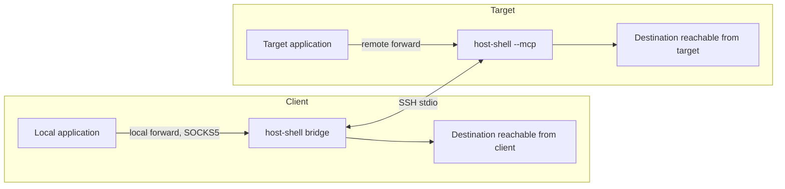

# Port forwarding over SSH stdio

> [!NOTE]
> This is an English translation. The Japanese version ([../ja/port-forward.md](../ja/port-forward.md)) is the single source of truth (SSOT) and takes precedence if they differ.

In environments where SSH port forwarding (`-L`, `-R`, `-D`) is unavailable, `host-shell` can forward TCP ports using only the standard input and output of the existing SSH session. It shares the multiplexed channel with the [HTTP proxy through the client](client-proxy.md). This feature is disabled by default.

## Kinds of forwards

| Kind | Listens on | Connects from | `ssh` equivalent | Example use case |
| --- | --- | --- | --- | --- |
| Local forward | Client (`bridge`) | Target | `-L` | Open a development server running on the target in a local browser |
| Remote forward | Target | Client (`bridge`) | `-R` | Let target applications connect to a database or Git server reachable from the client |
| SOCKS5 | Client (`bridge`) | Target (destination per connection) | `-D` | Browse the target's internal network from a local browser |

Table: Kinds of forwards

For a practical example of local forwarding, see [Injecting code-server](code-server.md), which installs code-server on a closed-network target and opens it in a local browser.



Only TCP traffic is supported (Unix domain sockets and UDP are not forwarded). Targets are supported on Linux and Windows; `bridge` is supported on Linux, Windows, and macOS.

## Startup

Forward options on `bridge` request forwarding features, and permission options on the target allow each direction:

```bash
host-shell bridge \
    --forward-local 8080:localhost:3000 \
    --forward-remote 15432:db.client.example:5432 \
    --forward-socks 1080 --forward-allow-local '*.internal.example' \
    -- ssh -T target /path/to/host-shell --mcp --allow-forward-local --allow-forward-remote
```

### Bridge options

| Option | Value | Description |
| --- | --- | --- |
| `--forward-local` | `[BIND:]PORT:HOST:HOSTPORT` | Persistent local forward: listens on local `PORT` and connects from the target to `HOST:HOSTPORT` |
| `--forward-remote` | `[BIND:]PORT:HOST:HOSTPORT` | Persistent remote forward: listens on target `PORT` and connects from the client to `HOST:HOSTPORT` |
| `--forward-socks` | `[BIND:]PORT` | Persistent SOCKS5 proxy listening on local `PORT` |
| `--forward-allow-local` | `HOST[:PORT]` | Destination allow rule for local forwards opened via `forward_open` and for SOCKS5 connections |
| `--forward-allow-remote` | `HOST[:PORT]` | Destination allow rule for remote forwards opened via `forward_open` |

Table: Bridge forward options (all repeatable)

- `BIND` may only be `127.0.0.1` (default) or `[::1]`. Connections from external hosts are not accepted.
- Setting `PORT` to `0` selects an available port automatically; check `forward_status` for the assigned port.
- Enclose IPv6 `HOST` addresses in brackets, such as `[2001:db8::1]`.
- Allow rules use the same host name glob and optional port syntax as `--proxy-allow-host` (CIDR ranges are not supported). Rules check the requested host name rather than resolved IP addresses.
- Ports are also matched as globs. For example, `'127.0.0.1:80[0-7]?'` matches ports 8000–8079 (quote the rule so the shell does not expand it).
- Persistent forwards configured via `--forward-local` and `--forward-remote` are explicitly authorized by the startup command itself and are not checked against `--forward-allow-*` rules.
- `--forward-socks` requires at least one `--forward-allow-local` rule. To allow all destinations, pass `--forward-allow-local '*'` explicitly.
- If any persistent forward fails to bind (for example, when a port is already in use on either the client or the target), startup fails.

### Target options

| Option | Description |
| --- | --- |
| `--allow-forward-local` | Permits local forwards and SOCKS5 (outbound connections from the target). Takes no value |
| `--allow-forward-remote` | Permits remote forwards (loopback listeners on the target). Takes no value |
| `--allow-forward-remote-port PORT[-PORT]` | Restricts target listening ports for remote forwards to the specified ranges (similar to `ssh` `PermitListen`). Repeatable and comma-separated; requires `--allow-forward-remote` |

Table: Target permission options

- Outbound connections from the target for local forwards and SOCKS5 are also checked against `--allow-host` on the target (when `--allow-host` is omitted, the target does not restrict outbound destinations).
- Target listening ports for remote forwards are unrestricted unless `--allow-forward-remote-port` is set. When set, listening on ports outside the allowed ranges is rejected (persistent remote forwards fail at startup; `forward_open` returns a tool error). When port `0` (automatic assignment) is requested, the target searches the configured ranges in order from the lowest port and fails if no port is free. Active port ranges are reported under `restrictions` in `sys_get_info`.

  ```bash
  host-shell --mcp --allow-forward-remote --allow-forward-remote-port 15432,20000-20099
  ```

- `--read-only` and `--tools` do not restrict port forwarding. Even on a `--read-only` target, enabling `--allow-forward-local` allows a local forward to write to target services (such as a database). Do not enable forwarding permission options when `--read-only` must act as a strict boundary.
- Forwarding permission options are independent of `--client-proxy`.

### Matching requests and permissions

| `bridge` option (request) | Required target option (permission) |
| --- | --- |
| `--forward-local`, `--forward-socks`, `--forward-allow-local` | `--allow-forward-local` |
| `--forward-remote`, `--forward-allow-remote` | `--allow-forward-remote` |
| `--proxy` | `--client-proxy` (required on both ends) |

Table: Requests and permissions

- Requesting a feature on `bridge` without the corresponding target permission fails startup and names the missing target flag in the error message.
- Enabling a permission flag on the target when `bridge` does not request that feature leaves the feature inactive and starts normally. Administrators can therefore include permission flags in `authorized_keys` `command=` entries ahead of time.
- When `bridge` requests no relay features, the session runs as standard MCP.
- Mismatched `host-shell` versions on the two ends also fail startup; deploy the same version on both ends.

## Tools (bridge)

| Tool | Published when | Description |
| --- | --- | --- |
| `forward_status` | Any persistent forward or allow rule is specified | Lists active forwards, allow rules, and recent connection events |
| `forward_open` | At least one allow rule (`--forward-allow-*`) is specified | Opens a new port forward |
| `forward_close` | At least one allow rule (`--forward-allow-*`) is specified | Closes a forward created by `forward_open` and terminates its active connections |

Table: Forward tools

### forward_open and forward_close

`forward_open` accepts `direction` (`local`, `remote`, or `socks`), `listen_address` (`127.0.0.1` or `::1`, default `127.0.0.1`), `listen_port` (default `0`), and `host` and `port` (required for `local` and `remote`, disallowed for `socks`). It returns `forward_id` and the bound listen address and port:

```json
{"direction": "local", "host": "localhost", "port": 3000}
```

- Destinations must match `--forward-allow-local` for `local` and `socks`, or `--forward-allow-remote` for `remote`. A direction without allow rules cannot be opened dynamically.
- Persistent forwards configured at startup cannot be closed with `forward_close`.

### forward_status

Like `proxy_status`, `forward_status` accepts `after_seq` and `limit` (1–100, default `20`). It returns `state`, `forwards` (`forward_id`, `direction`, `persistent`, `listen_address`, `listen_port`, `host`, `port`, `active_connections`), `allow_local`, `allow_remote`, `active_connections`, `events`, `next_seq`, and `truncated`.

Each entry in `events` contains `seq`, `time`, `forward_id`, `connection_id`, `direction`, `host`, `port`, `status` (`allowed` / `denied` / `failed`), and `reason`, retaining the latest 100 events. `reason` is one of the following fixed strings:

| `reason` | Meaning |
| --- | --- |
| `connection established` | The connection was established |
| `destination not allowed` | Blocked by `bridge` allow rules |
| `destination not allowed by target` | Blocked by the target's `--allow-host` |
| `connection limit reached` | The session concurrent connection limit was reached |
| `forward closed` | The forward was closed |
| `unsupported SOCKS request` | Received an unsupported SOCKS command or version |
| `connection refused`, `host unreachable`, `connection timeout`, `connection failed` | Outbound connection to the destination failed |

Table: forward_status reasons

The same events are written to `bridge` standard error. Forwarded payload data is never logged.

## SOCKS5

- Only the SOCKS5 `CONNECT` command is supported (`BIND`, `UDP ASSOCIATE`, and SOCKS4 / 4a receive error replies).
- Destinations may use IPv4 addresses, IPv6 addresses, or domain names. Because domain names are resolved on the target, use `socks5h://` with tools such as `curl`:

  ```bash
  curl --proxy socks5h://127.0.0.1:1080 http://intranet.internal.example/
  ```

- No authentication is required (authentication method `0x00` only).
- SOCKS5 reply codes are `0x02` when denied by allow rules, `0x04` when DNS resolution fails or the host is unreachable, `0x05` when the connection is refused, and `0x06` when the 30-second connection timeout expires.

## Security

- Listeners on both ends bind only to loopback (`127.0.0.1` or `::1`). Because loopback listeners do not authenticate callers, other OS users on the same host can connect to them, just as with `ssh` `-L`, `-R`, and `-D`.
- Because port forwarding does not use `sshd` forwarding, `sshd` settings such as `no-port-forwarding` and `AllowTcpForwarding no` do not block it. Target administrators permit forwarding with `--allow-forward-local` / `--allow-forward-remote` and prohibit it by omitting those flags from `command=` in `authorized_keys`.
- For remote forwards, `bridge` connects directly to the destination over TCP without using `HTTP_PROXY` or `HTTPS_PROXY`.
- The target's audit log records remote forward listener startups, shutdowns, and refusals (`forward_listen`, `forward_unlisten`) as well as outbound connections for local forwards and SOCKS5 (`forward_connect`, including direction, destination, and result).
- `sys_get_info` reports the permitted forwarding directions (`forward_local`, `forward_remote`) and any active remote forward listeners (`remote_forwards`) on the target.

## Limits and shutdown

- **Concurrent connections**: A session supports up to 64 concurrent connections across port forwarding and the [HTTP proxy through the client](client-proxy.md) combined.
- **Forwards (listeners)**: A session supports at most 16 active forwards (persistent forwards and `forward_open` combined).
- **Timeouts**: Establishing a connection to a destination times out after 30 seconds. Established forwarded connections have no idle timeout and stay open until either peer closes the connection, `forward_close` is called, or the MCP session ends.
- **Half-close**: TCP half-closes are propagated to the peer socket on the other end.
- **Session disconnection**: When the MCP session disconnects, all listeners and active connections on both ends close immediately without automatic reconnection.
