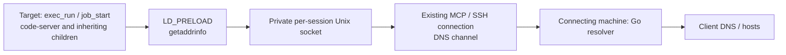

# Resolve names on the connecting machine (remote-dns)

> [!NOTE]
> This is an English translation. The [Japanese version](../ja/remote-dns.md) is authoritative.

Relay Linux/glibc target processes' `getaddrinfo` calls over the existing MCP connection to the connecting machine. This optional feature needs no root access or changes to `/etc/resolv.conf`, `/etc/hosts`, or service configuration.



## Enable

Use versions supporting this feature at both ends, and specify `--remote-dns` on both:

```bash
host-shell bridge --remote-dns -- \
  ssh -T target /path/to/host-shell --mcp --remote-dns
```

The target needs `cc` and glibc development headers to compile the embedded adapter at session startup. For targets without a compiler, build it in an environment compatible with the target CPU and glibc, then transfer it:

```bash
cc -Wall -Wextra -Werror -O2 -fPIC -shared \
  -o libhostshell_dns.so internal/remotedns/assets/preload.c -ldl -pthread

# After transferring the library:
host-shell bridge --remote-dns -- \
  ssh -T target /path/to/host-shell --mcp --remote-dns \
    --remote-dns-library /absolute/path/libhostshell_dns.so
```

`exec_run` and `job_start` receive `LD_PRELOAD` and `HOST_SHELL_DNS_SOCKET` automatically. Existing preload libraries are preserved. Policy `--unset-env` filtering and explicit call `env` overrides apply afterwards. Inspect `remote_dns`, `remote_dns_library`, and `remote_dns_socket` in `sys_get_info`. The adapter and owner-only socket live in a private per-session temporary directory removed on disconnect. A supplied original library is retained.

## Combine with the HTTP proxy

Resolution does not provide a network route. For targets without outbound access, also enable the [client proxy](client-proxy.md):

```bash
host-shell bridge --remote-dns --proxy \
  --proxy-allow-host api.github.com:443 -- \
  ssh -T target /path/to/host-shell --mcp --remote-dns --client-proxy
```

Start code-server through this session's `job_start`; existing processes do not acquire new environment variables. No Python service, second MCP session, or remote port forward is needed.

HTTP proxy allow/deny rules do not restrict DNS queries. Enabling `--remote-dns` permits resolving arbitrary names from the connecting machine. HTTP/HTTPS destinations remain subject to proxy rules: successful resolution does not prevent a 403 for an unauthorized destination.

## Scope and limitations

- Targets require Linux/glibc; the bridge supports host-shell's supported operating systems. Static binaries, privileged execution ignoring `LD_PRELOAD`, custom DNS implementations, Node.js `dns.resolve*`, reverse lookups, and `gethostbyname` are outside the adapter's scope.
- VS Code removes `LD_PRELOAD` when starting some extension/agent hosts. Setting it on code-server does not cover every child, including the bundled Copilot SDK. This feature does not disable that sanitization.
- Numeric addresses, `localhost`, and `AI_NUMERICHOST` use target libc. Other target-specific hosts entries are replaced by resolution on the connecting machine.
- The bridge uses Go's standard resolver, rather than reproducing every platform's libc/NSS behavior. IPv4/IPv6, canonical names, and service names are supported; this is not a complete libc replacement.
- Requests have an approximately three-second processing limit. An unavailable relay fails without falling back to target DNS. No cache is maintained. Other processes running as the same user can use the socket.


## Integrated feature validation

On 2026-11-02, a development build was tested over SSH into an Oracle Linux 10.2 / x86_64 / glibc 2.39 container with `--network none`.

| Check | Result |
|---|---|
| Compile embedded source on target | Passed; target GCC optimization warning corrected |
| `exec_run` lookup, canonical name, and service port | Passed |
| 24 concurrent lookups and child inheritance | Passed |
| Lookup from a `job_start` process | Passed |
| HTTPS to permitted `api.github.com:443` | Passed |
| Unauthorized `example.com:443` | Resolution succeeded; proxy returned 403 |
| Disconnect | DNS temporary directory and running validation job cleaned up |
| Two existing code-server instances | Both still returned HTTP 200; sessions preserved |

Automated tests also cover IPv4/IPv6, numeric IPs, localhost, NXDOMAIN, `AI_NUMERICHOST`, unavailable relay, prebuilt adapter copying and original preservation, invalid library rejection, environment composition, and feature negotiation. This does not claim renewed browser validation with the integrated feature or coverage of the bundled Copilot SDK.

## Diagnosing code-server and Copilot

Check name resolution, environment inheritance, and HTTP proxy destination authorization separately. Optional `HOST_SHELL_DNS_TRACE=1` logs hooked hostnames and address families to stderr.

On 2026-11-02, the resolver hook was tested independently with code-server 4.144.0 and Copilot CLI 1.0.83 in an Oracle Linux 10.2 / x86_64 / glibc 2.39 network-isolated container. These observations do not establish renewed browser or CLI validation of the integrated configuration.

| Check | Result |
|---|---|
| Standalone Copilot CLI Web Fetch → `https://api.github.com/zen` | Name resolution failed without the hook and succeeded with it; the same permitted URL and only Web Fetch were used |
| code-server browser terminal | The user confirmed successful checks of 24 concurrent lookups, child inheritance, and error handling without specifying additional environment variables |
| Node.js `dns.lookup()` | Passed |
| Node.js `dns.resolve4()` | ECONNREFUSED; its independent DNS path is outside the hook's scope |
| VS Code extension hosts, agent hosts, and bundled Copilot SDK | `LD_PRELOAD` was removed and the shared library was not loaded |

The bundled SDK executable was `lib/vscode/node_modules/@github/copilot-sdk-linux-x64/prebuilds/linux-x64/copilot-runtime`. The VS Code files `out/server-main.js`, `out/vs/workbench/api/node/extensionHostProcess.js`, and `out/vs/platform/agentHost/node/agentHostMain.js` remove `LD_PRELOAD`. Setting it on the parent process alone therefore does not cover this launch path. Distinguish this from standalone CLI success.

A failed fetch of `https://hondarer-soft.com` at 13:11:49 JST that day matched a proxy event rejecting `hondarer-soft.com:443` as `destination not allowed`. Hooked Python resolved the hostname successfully. The message `a transport-level failure (DNS, connection, or TLS handshake)` alone does not establish a DNS failure; inspect the actual rejection reason with `proxy_status`. This investigation did not authorize the destination.
