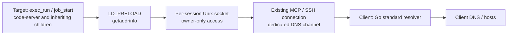
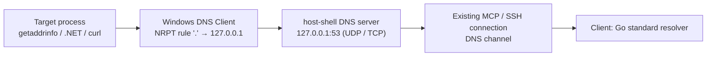
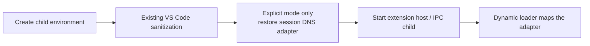

# Client-side name resolution (remote-dns)

> [!NOTE]
> This is an English translation. The Japanese version ([../ja/remote-dns.md](../ja/remote-dns.md)) is the single source of truth (SSOT) and takes precedence if they differ.

Relay Linux/glibc target processes' `getaddrinfo` calls over the existing MCP connection to the connecting machine. This optional feature needs no root access or changes to `/etc/resolv.conf`, `/etc/hosts`, or service configuration. It is disabled by default. On Windows targets, resolution goes through a DNS server on the target's loopback address instead; this requires a change to the OS resolver configuration (administrator rights) ([Windows targets](#windows-targets)).



## Use cases

| Use case | Features |
|---|---|
| The target has no DNS and a program resolves names itself before connecting (for example, Copilot CLI's built-in Web Fetch fails with `failed to lookup address information`) | remote-dns |
| Web access from a target with neither DNS nor outbound connectivity | remote-dns and the [client HTTP proxy](client-proxy.md) |
| Client-side resolution also in code-server extension and agent hosts (such as the in-editor Copilot Chat) | The above plus the [code-server patched-copy mode](#extension-and-agent-hosts-in-code-server) |

Table: Use cases

Proxy-aware programs (such as curl) pass the destination hostname to the proxy, which resolves it on the client side. remote-dns is not needed for proxy traffic alone.

## Enable

Pass `--remote-dns` on both the client (`bridge`) and the target. The target needs the name resolution adapter (a shared library).

| Adapter source | Target options | Requirement |
|---|---|---|
| Placed by the host-shell-connect skill's `deploy.sh` (recommended) | `--remote-dns --remote-dns-library <printed path>` | The adapter exists in the skill's `bin/` (included in release archives) |
| `dist/libhostshell_dns-linux-<arch>.so` from a release archive, transferred manually | `--remote-dns --remote-dns-library <absolute path>` | Matches the target CPU |
| Built on the target | `--remote-dns` only | `cc` and glibc development headers on the target |

Table: Adapter sources

### With the skill

When `deploy.sh` places the binary on a glibc Linux target, it also places the matching adapter beside it as `libhostshell_dns.so`. It checks that the target can actually `LD_PRELOAD` it and prints `dns adapter deployed: <absolute path>`. The skill presents a registration command with that path as `--remote-dns-library`. Users do not need to prepare the adapter.

```bash
host-shell bridge --remote-dns -- \
  ssh -T target /tmp/host-shell-1000/host-shell --mcp --remote-dns \
    --remote-dns-library /tmp/host-shell-1000/libhostshell_dns.so
```

### Manual preparation

Release archives include `libhostshell_dns-linux-amd64.so` and `libhostshell_dns-linux-arm64.so` in `dist/` and in the host-shell-connect skill's `bin/`. CI builds them on AlmaLinux 8 (glibc 2.28) and checks that they require only glibc 2.17 symbols or older. Transfer the one matching the target CPU and pass its absolute path to `--remote-dns-library`.

To build from source, run `make dns-lib` on a system with the same CPU architecture and a glibc version no newer than the target's.

Without `--remote-dns-library`, the target compiles the adapter from the embedded C source with `cc` at session startup.

### Behavior when enabled

- `exec_run` and `job_start` receive `LD_PRELOAD`, `HOST_SHELL_DNS_LIBRARY`, and `HOST_SHELL_DNS_SOCKET` automatically. Existing preload libraries are preserved. Policy `--unset-env` filtering and explicit call `env` overrides apply afterwards.
- Inspect `remote_dns`, `remote_dns_library`, and `remote_dns_socket` in `sys_get_info`.
- The adapter and owner-only socket live in a private per-session temporary directory removed on disconnect. The original passed with `--remote-dns-library` is retained.
- A target started with `--remote-dns` without a bridge stops with `bridge must enable --remote-dns`.

## Windows targets

Windows has no counterpart to `LD_PRELOAD` that replaces name resolution per process. Instead, the target `host-shell` runs a DNS server on a loopback address and relays A and AAAA queries over the existing MCP connection to the connecting machine. To point the OS resolver (the DNS Client service) at this server, an administrator adds a rule to the NRPT (Name Resolution Policy Table, the Windows mechanism that selects DNS servers per namespace).



### Procedure (automatic configuration)

Pass `--remote-dns` on both ends; on the target, pass the listen address with `--remote-dns-listen` and automate the OS settings with `--remote-dns-configure`. On a Windows target, omitting `--remote-dns-listen` stops startup with an error.

```bash
host-shell bridge --remote-dns -- \
  ssh -T target C:/Users/alice/AppData/Local/Temp/host-shell/host-shell.exe \
    --mcp --remote-dns --remote-dns-listen 127.0.0.1:53 --remote-dns-configure
```

`--remote-dns-configure` adds (injects) the following settings to the OS at startup and deletes (removes) them on exit. Both settings are volatile and nothing is written to disk: the NRPT rule goes into a volatile registry key (kept in memory only and gone after a restart), and the route goes into the ActiveStore (also cleared by a restart). The persistent registry and the persistent route store are not changed.

| Setting | Content | On exit |
|---|---|---|
| NRPT rule | Sends queries for the namespace `.` (every name) to the listen address. Created as a volatile key under `DnsPolicyConfig`, commented `host-shell-remote-dns pid=<process ID>`. If the `DnsPolicyConfig` key itself is missing, it is created as a volatile key too | Removed (a `DnsPolicyConfig` key it created is removed when empty) |
| Loopback default route | Only when there is no IPv4 default route: a route with the loopback interface as next hop (metric 9999) in the ActiveStore. Not added when a default route (a default gateway) exists | Removed if it was added |

Table: Settings applied by `--remote-dns-configure`

How long the settings remain depends on how the session ends.

| How it ends | What happens to the settings |
|---|---|
| Normal exit, client disconnect (including a killed client-side bridge or ssh) | Removed on exit |
| Target `host-shell` killed | Cleaned up at the next start with `--remote-dns-configure`; until then they remain until a restart or manual removal. Nothing answers the leftover rule, so lookups fail immediately meanwhile |
| Restart, power loss | All gone, because they are volatile |

Table: How a session ends and what happens to the settings

At startup, the cleanup covers rules commented `host-shell-remote-dns` (including the manual procedure's rule) or carrying the ID of a process that no longer runs, an empty volatile `DnsPolicyConfig` key, and loopback default routes with metric 9999. If another running session owns a rule, startup stops with an error. `sys_get_info` reports the applied settings as `remote_dns_configured`.

> [!IMPORTANT]
> Even though they are volatile, the settings affect name resolution for the whole machine while they exist, including every user and service on the target. Before passing `--remote-dns-configure`, show the user what changes (the NRPT rule, the loopback default route when needed, and that the settings remain until the next start or a restart if the target `host-shell` is killed) and obtain their approval. The same applies to the manual procedure. Agents must not add this option or run the manual commands without that approval.

The connecting user must be an administrator in an elevated session; Windows OpenSSH grants administrators an elevated token with public key authentication. Without elevation, startup stops with an error.

A persistent key cannot be created under a volatile key. While host-shell keeps a volatile `DnsPolicyConfig` key it created, an administrator cannot add persistent rules with `Add-DnsClientNrptRule`.

### Procedure (manual configuration)

Without `--remote-dns-configure`, an administrator applies the settings after obtaining the user's approval. `Add-DnsClientNrptRule` creates persistent rules, so this procedure creates the volatile key directly.

1. Start with the same command as the automatic procedure, without `--remote-dns-configure`.
2. From an elevated PowerShell, add a volatile NRPT rule, and a loopback default route in the ActiveStore when there is no IPv4 default route. `exec_run` can run it as well.

   ```powershell
   $base = 'SYSTEM\CurrentControlSet\Services\Dnscache\Parameters\DnsPolicyConfig'
   $rw = [Microsoft.Win32.RegistryKeyPermissionCheck]::ReadWriteSubTree
   $vol = [Microsoft.Win32.RegistryOptions]::Volatile
   $hklm = [Microsoft.Win32.Registry]::LocalMachine
   $p = $hklm.OpenSubKey($base, $true)
   if (-not $p) { $p = $hklm.CreateSubKey($base, $rw, $vol); $p.SetValue('host-shell-remote-dns', 'volatile parent') }
   $k = $p.CreateSubKey('{5f0c8b8e-6d1a-4c2e-9b7a-686f73747368}', $rw, $vol)
   $k.SetValue('Version', 2, 'DWord'); $k.SetValue('ConfigOptions', 8, 'DWord')
   $k.SetValue('GenericDNSServers', '127.0.0.1'); $k.SetValue('IPSECCARestriction', ''); $k.SetValue('DisplayName', '')
   $k.SetValue('Name', [string[]]@('.'), 'MultiString'); $k.SetValue('Comment', 'host-shell-remote-dns')
   $k.Close(); $p.Close()
   $lo = (Get-NetIPAddress -AddressFamily IPv4 -IPAddress 127.0.0.1).InterfaceIndex
   if (-not (Get-NetRoute -AddressFamily IPv4 -DestinationPrefix 0.0.0.0/0 -ErrorAction SilentlyContinue)) {
     New-NetRoute -DestinationPrefix 0.0.0.0/0 -InterfaceIndex $lo -NextHop 0.0.0.0 -RouteMetric 9999 -PolicyStore ActiveStore | Out-Null
   }
   Clear-DnsClientCache
   ```

3. Remove the rule and the added route when finished.

   ```powershell
   $base = 'SYSTEM\CurrentControlSet\Services\Dnscache\Parameters\DnsPolicyConfig'
   $hklm = [Microsoft.Win32.Registry]::LocalMachine
   $p = $hklm.OpenSubKey($base, $true)
   if ($p) {
     $p.DeleteSubKey('{5f0c8b8e-6d1a-4c2e-9b7a-686f73747368}', $false)
     $made = $p.GetValue('host-shell-remote-dns') -eq 'volatile parent'
     $empty = $p.SubKeyCount -eq 0
     $p.Close()
     if ($made -and $empty) { $hklm.DeleteSubKey($base) }
   }
   $lo = (Get-NetIPAddress -AddressFamily IPv4 -IPAddress 127.0.0.1).InterfaceIndex
   Get-NetRoute -AddressFamily IPv4 -DestinationPrefix 0.0.0.0/0 -InterfaceIndex $lo -ErrorAction SilentlyContinue |
     Where-Object RouteMetric -eq 9999 | Remove-NetRoute -Confirm:$false
   Clear-DnsClientCache
   ```

Without `--remote-dns-configure`, `host-shell` does not change OS settings.

### Results by resolution path

| Resolution path | DNS server only | With the NRPT rule |
|---|---|---|
| OS resolver (`getaddrinfo`: .NET `Dns`, Node.js `dns.lookup`, `curl.exe`, `ping`, Go `net`) | Fails | Succeeds, but needs an IPv4 default route (below) |
| `Resolve-DnsName` | Fails | Succeeds (no default route needed) |
| Programs querying DNS servers themselves (Node.js `dns.resolve4`) | Succeeds when no DNS server is set on the network adapter (127.0.0.1 is their default) | Succeeds |

Table: Resolution paths on Windows

- **Default route**: Without an IPv4 default route, Windows `getaddrinfo` returns `The requested name is valid, but no data of the requested type was found` (WSANO_DATA) even after receiving an answer. A target with a default gateway needs no added route; the NRPT rule alone is enough. Without a gateway, any next hop works for the added route: the loopback interface, the local network (on-link), or a host that does not forward packets. While the route exists, direct outbound connections no longer fail at once with "network unreachable" but time out after about 21 seconds. None of these routes reaches outside.
- **Answers**: A and AAAA are answered, with a CNAME when the canonical name differs from the query name. The TTL is 30 seconds. Other types (HTTPS, SVCB, PTR, MX, and so on) get an empty answer (NODATA). NXDOMAIN is returned only for names without addresses in any family, so the OS does not cache an IPv6-only name as missing.
- **Listening**: Only loopback addresses are accepted. If another session uses the same address, startup stops with a bind error. The server listens only while connected and closes on disconnect. `sys_get_info` reports it as `remote_dns_listen`.
- **Access control**: Unlike the private Linux socket, every user and service on the target can query it. The NRPT rule also applies to the whole machine.
- **A rule left after disconnect**: With nothing answering, lookups fail immediately without waiting. Remove it with step 3 of the manual procedure, start again with `--remote-dns-configure`, or restart.
- **Environment variables**: `exec_run` and `job_start` environments are unchanged. Because the relay is configured OS-wide, descendants such as code-server's extension host use the same path.

## Combine with the HTTP proxy

Name resolution does not create a network route. For web access from targets without outbound connectivity, also enable the [client HTTP proxy](client-proxy.md):

```bash
host-shell bridge --remote-dns --proxy \
  --proxy-allow-host api.github.com:443 -- \
  ssh -T target /path/to/host-shell --mcp --remote-dns --client-proxy
```

Start code-server with `job_start` in this session. Existing processes keep their environment. No Python service, second MCP session, or remote port forward is required.

DNS queries are not filtered by HTTP proxy allow or deny rules. `--remote-dns` permits arbitrary client-side resolution. HTTP/HTTPS destinations remain restricted by proxy rules; resolving a name does not bypass a 403 denial.

## Extension and agent hosts in code-server

VS Code removes `LD_PRELOAD` when starting extension and agent hosts. Setting the adapter on the code-server parent does not reach the in-editor Copilot Chat or the bundled Copilot SDK (`copilot-runtime`). The Linux code-server skill's `start.sh` offers an explicitly selected patched-copy mode. Normal startup uses the original distribution.

### Procedure

1. Start `host-shell` at both ends with `--remote-dns`. For web access, also enable the client HTTP proxy and the required destination rules.
2. Install code-server on the target (if code-server is already installed with an older `<kit>/scripts/linux`, transfer the skill's `scripts/linux` to update it; the installed code-server distribution can be reused as is).
3. Start `start.sh` with `job_start` and set `HOST_SHELL_CODE_SERVER_REMOTE_DNS: "1"` in `env`. `<kit>` is the absolute path of the deployed kit.

   ```json
   {
     "argv": ["bash", "<kit>/scripts/linux/start.sh"],
     "env": {
       "HOST_SHELL_CODE_SERVER_REMOTE_DNS": "1",
       "CODE_SERVER_WORKSPACE": "/absolute/path/to/workspace"
     }
   }
   ```

`start.sh` uses normal user data. To check alongside an existing instance, run the patched copy's `bin/code-server` directly with a separate port, `--user-data-dir`, and `--session-socket`, and pass the same activation variable. Do not share a running user-data directory.

Stop with `job_stop` for the job and `forward_close` for the forward. To return to the normal distribution, omit `HOST_SHELL_CODE_SERVER_REMOTE_DNS` or set it to `0` on the next `start.sh` launch. Existing processes keep their environment. The patched copy persists after the session and is removed by normal code-server uninstallation.

### How the patched copy works

The first launch creates an independent `code-server-4.144.0-remote-dns-v1` copy beside the original. Reserve about 750 MiB. Free space is checked before patching, and the copy is moved into its final directory name only after JavaScript syntax checks pass. The original distribution and running sessions are not modified. Restarts verify the manifest and patched hashes rather than recreating the copy. Any modification is rejected rather than repaired.

Supported inputs are official code-server 4.144.0 / VS Code 1.144.0 Linux amd64 and arm64 distributions. Patching requires matching the SHA-256 hashes of the three target files and the four target strings to be patched. Unknown versions, modified files, and duplicate patches are rejected.



The patch is inserted immediately before child launches in `out/server-main.js`, `out/vs/workbench/api/node/extensionHostProcess.js`, and `out/vs/platform/agentHost/node/agentHostMain.js`. It retains removal of `NODE_OPTIONS` and other variables and never restores the original `LD_PRELOAD` wholesale. It uses inherited `HOST_SHELL_DNS_LIBRARY` and `HOST_SHELL_DNS_SOCKET` and sets only the same session's adapter. Values from another session, unsafe ownership or permissions, symbolic links, and stale sockets after disconnect are rejected.

Browser Web extensions, custom DNS APIs, and extension-specific launch paths that remove the variable themselves are not covered.

## Diagnostics

Check name resolution, environment inheritance, and HTTP proxy destination rules separately.

| Symptom or check | Interpretation |
|---|---|
| `getaddrinfo` errors (`failed to lookup address information`, `ENOTFOUND`, `EAI_AGAIN`) | Name resolution failed. Check `sys_get_info.remote_dns` and that `LD_PRELOAD` reaches the process |
| HTTP 403, `CONNECT tunnel failed, response 403` | A proxy destination denial, not a DNS failure. Check the reason with `proxy_status` |
| Ambiguous messages such as `a transport-level failure (DNS, connection, or TLS handshake)` | Do not conclude DNS failure from the message alone; check the actual denial reason with `proxy_status` |
| Whether a process loaded the adapter | Check the PID's environment and whether `/proc/<pid>/maps` contains `libhostshell_dns` |
| Queries passing through the hook | Setting `HOST_SHELL_DNS_TRACE=1` at startup logs host names and address families to standard error. In code-server patched-copy mode, entries from `copilot-runtime` appear in the code-server output as `[CLI subprocess] host-shell-dns: getaddrinfo <host> family=<n>` (with the copy relayed by the agent host, one query produces two lines). Entries carry no time, so match them to an action by comparing the output before and after it |

Table: Diagnostic checks

Use the same allowed URL (for example `https://api.github.com/zen`) to separate HTTP 403 from resolution failures.

## Verified scope

"OL10 container" in the table is an Oracle Linux 10.2 / x86_64 / glibc 2.39 Podman container (`--network none`, no external route) reached over SSH.

| Area | Verified behavior | Method and environment |
|---|---|---|
| Resolution relay | IPv4/IPv6, canonical names, service names, numeric IPs, localhost, NXDOMAIN, `AI_NUMERICHOST`, relay-unavailable errors, 24 concurrent lookups, child inheritance | Automated tests, OL10 container |
| `exec_run` and `job_start` processes | Name resolution succeeds | OL10 container |
| With the HTTP proxy | HTTPS to an allowed destination succeeds; an unlisted destination resolves and is denied with 403 | OL10 container |
| Disconnect cleanup | The temporary directory and running jobs are reclaimed | Automated tests, OL10 container |
| Building on the target | Compiling and loading the embedded source | OL10 container |
| Prebuilt adapters | Loading and hook behavior succeed for amd64 and arm64 on glibc 2.28 and a newer glibc | CI (AlmaLinux 8 container and GitHub runners) |
| Adapter placement by `deploy.sh` | Placement, hash comparison on update, load check, musl exclusion, removal of unloadable adapters | Podman containers (Oracle Linux 10, Oracle Linux 8, Alpine) |
| Invalid adapters | Adapters with a wrong format, architecture, or version are rejected | Automated tests |
| Copilot CLI (terminal) | Built-in Web Fetch fails to resolve without remote-dns and succeeds with it | OL10 container, Copilot CLI 1.0.83 |
| Node.js | `dns.lookup()` succeeds; `dns.resolve4()` is out of scope (ECONNREFUSED) | OL10 container |
| code-server patched-copy mode | Original files retained, modified files rejected, cleanup after syntax errors, unchanged behavior when disabled, two-session isolation, rejection of unsafe permissions, links, and stale sockets | Automated tests |
| Patched-copy mode in operation | Adapter loaded into the extension host, agent host, and bundled `copilot-runtime`; resolution in a Chat-launched Node child; terminal Copilot CLI Web Fetch; in-editor Copilot Chat responses | OL10 container, code-server 4.144.0 |
| In-editor Copilot Chat, Copilot harness (Copilot SDK) | When the built-in `web_fetch` runs, `copilot-runtime`, a child of the agent host, resolves the destination through the hook, and HTTPS succeeds through the proxy. Each fetch adds exactly one trace entry | OL10 container, code-server 4.144.0, UI driven from Chrome for Testing 148 |
| In-editor Copilot Chat, Local harness | code-server provides no web page fetch tool (the `web` group contains only `githubRepo` and `githubTextSearch`). Extension host traffic goes through the HTTP proxy, and no queries through the hook are observed | Same as above |

Table: Verified scope

Windows targets were verified on a Windows 11 Enterprise (build 26300, amd64) Hyper-V virtual machine on an Internal switch only, with no DNS server and no route to the internet. The client was a `bridge` on Windows 11 (build 26300), through OpenSSH_for_Windows 9.5p2 `sshd`.

| Subject | Checked | Method and environment | Status |
|---|---|---|---|
| DNS server responses | UDP and TCP, CNAME, NXDOMAIN versus NODATA, NODATA for other types, rejection of invalid names and non-loopback addresses, SERVFAIL before attach, listener release on disconnect | Automated tests (Windows, Linux) | Verified |
| `Resolve-DnsName -Server 127.0.0.1` | Answers over UDP and TCP; a missing name gives `DNS name does not exist` | Windows 11 virtual machine | Verified |
| OS resolver through the NRPT rule | With the rule and a default route, .NET, Node.js `dns.lookup`, `curl.exe`, `ping`, and `net_check` (Go) succeed. Without the rule they fail; without the route they get WSANO_DATA | Windows 11 virtual machine | Verified |
| Node.js `dns.resolve4` | Succeeds even without the NRPT rule | Same (Node.js bundled with code-server 4.144.0) | Verified |
| Combined with the HTTP proxy | HTTPS to an allowed destination succeeds with `curl.exe --ssl-revoke-best-effort` | Same | Verified |
| Failure cases | A second session on the same address stops at startup; with a leftover rule, lookups fail immediately | Same | Verified |
| Next hop of the default route | With the loopback interface, on-link, or a non-forwarding host, `getaddrinfo` succeeds and nothing reaches outside. Direct outbound connections time out after about 21 seconds (about 0.1 seconds to fail without the route) | Same | Verified |
| Persistence of the settings | After a reboot, a rule from `Add-DnsClientNrptRule` remains; a rule in a volatile key, a volatile `DnsPolicyConfig` key, and the ActiveStore route are gone. The DNS Client follows rules in volatile keys right after they are added and removed | Same | Verified |
| `--remote-dns-configure` | Adding the volatile rule (with and without an existing `DnsPolicyConfig`) and the loopback default route; resolution by .NET, Node.js `dns.lookup`, `curl.exe`, and `ping`; removal on exit; removal when the client side is killed; cleanup at the next start, and disappearance on restart, of the rule, key, and route left by a killed target `host-shell`; cleanup of the manual procedure's persistent rule; no route added when a default route exists | Same | Verified |
| Manual procedure | The listed commands add and remove the volatile rule and route, and remove the `DnsPolicyConfig` key they created when it was missing | Same | Verified |
| Non-administrator connecting user (Users, Power Users) | The DNS server listens (127.0.0.1:53, UDP and TCP); `Resolve-DnsName -Server 127.0.0.1` and Node.js `dns.resolve4` succeed. `--remote-dns-configure` stops at startup with an error saying administrator rights are needed, and the manual procedure is refused; neither changes OS settings | Same (tester removed from Administrators) | Verified |
| code-server extension host, Copilot CLI and Copilot Chat | Behavior on Windows targets | None | Unverified |
| Windows Server, arm64 | Behavior | None | Unverified |
| `nslookup` | Interaction with the NRPT rule | None | Unverified |

Table: Verification status on Windows targets

Unverified:

- Name resolution by Copilot SDK internals other than `web_fetch`, and by extensions in the extension host directly
- Patched-copy mode on arm64 (archive inspection only)
- Browser Web extensions

The validation history is in [261102-remote-dns-validation.md](../prompts/past/261102-remote-dns-validation.md), [261103-copilot-chat-remote-dns-validation.md](../prompts/past/261103-copilot-chat-remote-dns-validation.md), [261104-windows-target-validation.md](../prompts/past/261104-windows-target-validation.md), [261104-windows-remote-dns-design.md](../prompts/past/261104-windows-remote-dns-design.md), [261105-windows-remote-dns-configure-design.md](../prompts/past/261105-windows-remote-dns-configure-design.md), and [261105-windows-remote-dns-volatile-design.md](../prompts/past/261105-windows-remote-dns-volatile-design.md) (Japanese only).

Development validation commands (Linux, Node.js required):

```bash
node --test .agents/skills/host-shell-code-server/tests/remote-dns.test.mjs
go test ./internal/remotedns
```

## Scope and limitations

- For the conditions and limits on Windows targets, see [Windows targets](#windows-targets). The items below apply to Linux targets.
- Targets require Linux/glibc; the bridge supports host-shell's supported operating systems. musl (such as Alpine), static binaries, privileged execution ignoring `LD_PRELOAD`, custom DNS implementations, Node.js `dns.resolve*`, reverse lookups, and `gethostbyname` are out of scope.
- Numeric IPs, `localhost`, and `AI_NUMERICHOST` use target libc. Other target-specific hosts entries are replaced by client resolution.
- The client uses Go's standard resolver, not every OS libc/NSS behavior. It supports IPv4/IPv6, canonical names, and service names, but is not a complete libc replacement.
- Each query is limited to about 3 seconds. Unavailable relays fail closed rather than falling back to target DNS. There is no cache. The socket is available to the same user.
