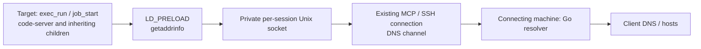
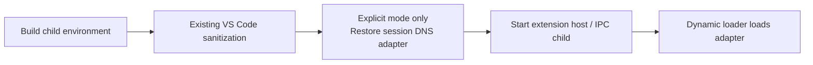

# Resolve names on the connecting machine (remote-dns)

> [!NOTE]
> This is an English translation. The [Japanese version](../ja/remote-dns.md) is authoritative.

Relay Linux/glibc target processes' `getaddrinfo` calls over the existing MCP connection to the connecting machine. This optional feature needs no root access or changes to `/etc/resolv.conf`, `/etc/hosts`, or service configuration.



## Enable

Use versions supporting this feature at both ends, and specify `--remote-dns` on both:

```bash
host-shell bridge --remote-dns -- \
  ssh -T target /path/to/host-shell --mcp --remote-dns
```

The target needs `cc` and glibc development headers to compile the embedded adapter at session startup.

For targets without a compiler, transfer a prebuilt adapter and pass it with `--remote-dns-library`. GitHub Release archives include `libhostshell_dns-linux-amd64.so` and `libhostshell_dns-linux-arm64.so` in `dist/` and in the host-shell-connect skill's `bin/`. CI builds them on AlmaLinux 8 (glibc 2.28) and checks that they require only glibc 2.17 symbols or older.

```bash
# After transferring the adapter matching the target CPU:
host-shell bridge --remote-dns -- \
  ssh -T target /path/to/host-shell --mcp --remote-dns \
    --remote-dns-library /absolute/path/libhostshell_dns-linux-amd64.so
```

To build from source, run `make dns-lib` for the target CPU on a system whose glibc is no newer than the target's.

When the host-shell-connect skill's `deploy.sh` places the binary on a glibc Linux target, it also places the matching adapter beside it as `libhostshell_dns.so`. It checks that the target can actually `LD_PRELOAD` it and prints the absolute path as `dns adapter deployed: <path>`. Users do not need to prepare the adapter; the skill presents a registration command with that path as `--remote-dns-library`.

`exec_run` and `job_start` receive `LD_PRELOAD`, `HOST_SHELL_DNS_LIBRARY`, and `HOST_SHELL_DNS_SOCKET` automatically. Existing preload libraries are preserved. Policy `--unset-env` filtering and explicit call `env` overrides apply afterwards. Inspect `remote_dns`, `remote_dns_library`, and `remote_dns_socket` in `sys_get_info`. The adapter and owner-only socket live in a private per-session temporary directory removed on disconnect. A supplied original library is retained.

## Combine with the HTTP proxy

Resolution does not provide a network route. For targets without outbound access, also enable the [client proxy](client-proxy.md):

```bash
host-shell bridge --remote-dns --proxy \
  --proxy-allow-host api.github.com:443 -- \
  ssh -T target /path/to/host-shell --mcp --remote-dns --client-proxy
```

Start code-server through this session's `job_start`; existing processes do not acquire new environment variables. No Python service, second MCP session, or remote port forward is needed.

HTTP proxy allow/deny rules do not restrict DNS queries. Enabling `--remote-dns` permits resolving arbitrary names from the connecting machine. HTTP/HTTPS destinations remain subject to proxy rules: successful resolution does not prevent a 403 for an unauthorized destination.

## Apply to code-server extension and agent hosts

The Linux code-server skill's `start.sh` supports an explicitly selected patched-copy mode. Normal startup uses the original distribution.

1. Start updated host-shell versions at both ends with `--remote-dns`. Web access also needs the HTTP proxy and authorized destinations.
2. Transfer the updated skill's `scripts/linux` into the target kit. The existing verified code-server distribution can be reused.
3. Start through `job_start` with the following arguments, replacing `<kit>` with its absolute path:

   ```json
   {
     "argv": ["bash", "<kit>/scripts/linux/start.sh"],
     "env": {
       "HOST_SHELL_CODE_SERVER_REMOTE_DNS": "1",
       "CODE_SERVER_WORKSPACE": "/absolute/path/to/workspace"
     }
   }
   ```

`start.sh` uses the normal user data directory. For validation alongside an existing instance, launch the dedicated copy's `bin/code-server` directly with a separate port, `--user-data-dir`, and `--session-socket`, passing the same enabling environment variable. Do not share an active user data directory.

On first use, an independent sibling copy named `code-server-4.144.0-remote-dns-v1` is created. Allow about 750 MiB of free space. Preparation checks available space and JavaScript syntax before publishing the directory. It does not rewrite the original installation or running sessions. Subsequent starts verify the manifest and patched hashes rather than copying again. Modified output is rejected, not overwritten or repaired.

Supported distributions are official code-server 4.144.0 / VS Code 1.144.0 for Linux amd64 and arm64. The SHA-256 hashes of three target files and all four replacement anchors must match values pinned from verified release archives. Unknown versions, modified inputs, and double application are rejected. arm64 archive contents were checked; runtime operation on arm64 remains unverified.



The changes run immediately before child creation in `out/server-main.js`, `out/vs/workbench/api/node/extensionHostProcess.js`, and `out/vs/platform/agentHost/node/agentHostMain.js`. Removal of `NODE_OPTIONS` and other variables stays intact. The original `LD_PRELOAD` list is not restored. Parent-inherited `HOST_SHELL_DNS_LIBRARY` and `HOST_SHELL_DNS_SOCKET` identify the only adapter to inject. Mismatched sessions, unsafe ownership or permissions, symbolic links, and unavailable sockets are rejected.

Browser Web extensions, custom DNS APIs, and separate sanitization implemented by extensions remain outside this mechanism. Distinguish actual Copilot SDK launch and Web Fetch verification from the automated checks below.

### Validation and user testing

Automated tests cover preservation of original files, rejection of modified output, cleanup after syntax errors, disabled behavior, two-session separation, and rejection of unsafe permissions, links, and expired sockets. A test using the real native adapter also confirms that a Node child, after environment sanitization and reinjection, loads the library and resolves names over the MCP channel.

The isolated container has passed patched-copy preparation, reuse verification, and HTTP server startup. The user confirmed successful Web Fetch from Copilot CLI launched in the test code-server terminal; proxy history also showed `api.github.com:443` permitted. Inspection of the running extension host and VS Code bundled `copilot-runtime` confirmed inherited `LD_PRELOAD` and the mapped shared library. The user confirmed successful login to the in-editor Copilot Chat and also requested retrieval, which reported that no Web Fetch tool was available and used curl instead. Built-in Web Fetch was not exercised. HTTP-proxied curl can resolve the destination on the client side, so running curl alone does not validate the SDK's own DNS hook. Environment propagation and library loading were independently confirmed by the process inspection above.

The user subsequently used Copilot Chat's terminal execution tool to run `dns.lookup("api.github.com", {all: true}, ...)` with Node.js from the dedicated copy, obtaining IPv4 `20.27.177.116`. This successful `getaddrinfo` call does not use the HTTP proxy and confirms name resolution in the Node child launched by Chat. It does not establish a direct DNS API call inside the extension host or SDK itself. Use the same authorized URL, such as `https://api.github.com/zen`, and distinguish HTTP 403 from resolution failures. Optional startup `HOST_SHELL_DNS_TRACE=1`, process environment checks, and `/proc/<pid>/maps` help confirm adapter loading.

Stop the relevant job with `job_stop` and its forward with `forward_close`. To return to the normal distribution, omit `HOST_SHELL_CODE_SERVER_REMOTE_DNS` or set it to `0` on the next `start.sh` invocation. Existing processes do not change. The patched copy survives session shutdown and is removed with the normal code-server uninstall procedure.

Development checks (Linux with Node.js):

```bash
node --test .agents/skills/host-shell-code-server/tests/remote-dns.test.mjs
go test ./internal/remotedns
```

## Scope and limitations

- Targets require Linux/glibc; the bridge supports host-shell's supported operating systems. Static binaries, privileged execution ignoring `LD_PRELOAD`, custom DNS implementations, Node.js `dns.resolve*`, reverse lookups, and `gethostbyname` are outside the adapter's scope.
- VS Code removes `LD_PRELOAD` when starting some extension/agent hosts. Setting it on code-server does not cover every child, including the bundled Copilot SDK. Normal startup preserves sanitization. The explicit mode below can restore only the DNS adapter.
- Numeric addresses, `localhost`, and `AI_NUMERICHOST` use target libc. Other target-specific hosts entries are replaced by resolution on the connecting machine.
- The bridge uses Go's standard resolver, rather than reproducing every platform's libc/NSS behavior. IPv4/IPv6, canonical names, and service names are supported; this is not a complete libc replacement.
- Requests have an approximately three-second processing limit. An unavailable relay fails without falling back to target DNS. No cache is maintained. Other processes running as the same user can use the socket.


## Integrated feature validation

On 2026-11-02, a development build was tested over SSH into an Oracle Linux 10.2 / x86_64 / glibc 2.39 container with `--network none`.

| Check | Result |
|---|---|
| Compile embedded source on target | Passed; target GCC optimization warning corrected |
| `exec_run` lookup, canonical name, and service port | Passed |
| 24 concurrent lookups and child inheritance | Passed |
| Lookup from a `job_start` process | Passed |
| HTTPS to permitted `api.github.com:443` | Passed |
| Unauthorized `example.com:443` | Resolution succeeded; proxy returned 403 |
| Disconnect | DNS temporary directory and running validation job cleaned up |
| Two existing code-server instances | Both still returned HTTP 200; sessions preserved |

Automated tests also cover IPv4/IPv6, numeric IPs, localhost, NXDOMAIN, `AI_NUMERICHOST`, unavailable relay, prebuilt adapter copying and original preservation, invalid library rejection, environment composition, and feature negotiation. This does not claim renewed browser validation with the integrated feature or coverage of the bundled Copilot SDK.

## Diagnosing code-server and Copilot

Check name resolution, environment inheritance, and HTTP proxy destination authorization separately. Optional `HOST_SHELL_DNS_TRACE=1` logs hooked hostnames and address families to stderr.

On 2026-11-02, the resolver hook was tested independently with code-server 4.144.0 and Copilot CLI 1.0.83 in an Oracle Linux 10.2 / x86_64 / glibc 2.39 network-isolated container. These observations do not establish renewed browser or CLI validation of the integrated configuration.

| Check | Result |
|---|---|
| Standalone Copilot CLI Web Fetch → `https://api.github.com/zen` | Name resolution failed without the hook and succeeded with it; the same permitted URL and only Web Fetch were used |
| code-server browser terminal | The user confirmed successful checks of 24 concurrent lookups, child inheritance, and error handling without specifying additional environment variables |
| Node.js `dns.lookup()` | Passed |
| Node.js `dns.resolve4()` | ECONNREFUSED; its independent DNS path is outside the hook's scope |
| VS Code extension hosts, agent hosts, and bundled Copilot SDK | `LD_PRELOAD` was removed and the shared library was not loaded |

The bundled SDK executable was `lib/vscode/node_modules/@github/copilot-sdk-linux-x64/prebuilds/linux-x64/copilot-runtime`. The VS Code files `out/server-main.js`, `out/vs/workbench/api/node/extensionHostProcess.js`, and `out/vs/platform/agentHost/node/agentHostMain.js` remove `LD_PRELOAD`. Setting it on the parent process alone therefore does not cover this launch path. Distinguish this from standalone CLI success.

A failed fetch of `https://hondarer-soft.com` at 13:11:49 JST that day matched a proxy event rejecting `hondarer-soft.com:443` as `destination not allowed`. Hooked Python resolved the hostname successfully. The message `a transport-level failure (DNS, connection, or TLS handshake)` alone does not establish a DNS failure; inspect the actual rejection reason with `proxy_status`. This investigation did not authorize the destination.

## Continued-use log inspection (2026-11-03)

The user confirmed that code-server opened in the browser and both the CLI and in-editor Copilot Chat responded correctly. Retained proxy events around 05:42 JST showed permitted connections to `api.individual.githubcopilot.com:443` and `api.github.com:443`. The running agent host, extension host, and bundled `copilot-runtime` all had `LD_PRELOAD` and the DNS adapter mapped. Retained code-server output contained two hooked `api.github.com` lookups, but those records lack query timestamps and cannot be attributed to each response in this test.

Startup logs included signed-out/token-source-not-ready warnings, a BYOK model-list refresh `fetch failed`, and a custom-agent fetch `Canceled`. No DNS reinjection validation errors, `ENOTFOUND`, or `EAI_AGAIN` were found in the inspected logs. Destination rules rejected `mobile.events.data.microsoft.com`, `default.exp-tas.com`, Application Insights destinations, and `169.254.169.254:80`; no destinations were added. Proxy history retains only the latest 100 events, so this inspection does not establish error-free operation over the entire period.

This browser instance uses the existing SSH session. A separate SSH session through a new client-loopback TCP entry point also passed MCP initialization, DNS relaying, and HTTPS checks, but the browser instance was not migrated to that session.

### Authorizing the BYOK catalog destination

A direct target-side check of the model catalog URL, `https://main.vscode-cdn.net/extensions/copilotChat.json`, returned CONNECT 403 before authorization. On 2026-11-03, at the user's request, `main.vscode-cdn.net:443` was added through `proxy_rules_update` to both the browser and additional TCP SSH proxy sessions, preserving all existing allow/deny rules. Retrieval then succeeded with valid catalog JSON (version 1, five providers, 19,535 bytes). This does not establish that the Copilot extension itself has retried and cleared its warning. The [Copilot deployment guide](coding-agents.md) records the startup option needed for future sessions.
