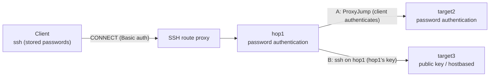

# Storing SSH passwords (ssh-pass)

> [!NOTE]
> This is a translation. The Japanese version [../ja/ssh-password.md](../ja/ssh-password.md) is authoritative; if the two differ, the Japanese version prevails.

This document explains how to connect to password-authenticated SSH servers (jump servers and targets) without typing the password. Store a password per `USER@HOST` with `host-shell ssh-pass`, and it is handed to `ssh` through OpenSSH's standard `SSH_ASKPASS` mechanism. There are three ways in, and they work the same on Linux, macOS, and Windows:

- the `ssh` started by `host-shell bridge` (MCP agents)
- `host-shell ssh` and `host-shell scp` (wrappers used in place of `ssh` and `scp`; scripts and the `host-shell-connect` skill)
- `host-shell` placed as `ssh` and `scp` in a directory of their own (`remote.SSH.path` of VS Code Remote - SSH)

The route (`ProxyJump`, `ProxyCommand`, user name, port) is written in the client's `~/.ssh/config`, as for any other use.

## Use cases

- Using jump servers or targets where public key authentication is not available (or not allowed) from an MCP agent or VS Code.
- Connecting to password-authenticated servers behind an authenticated HTTP proxy ([SSH route proxy](ssh-proxy.md)). The proxy password is stored with `--password-file` and the SSH passwords with `ssh-pass`.
- Entering only the first hop with a password, and the second hop with a key or hostbased authentication on the first hop (the client takes no part in the authentication between the first and second hops).

## Two layouts

| Layout | How the route is written | Hops the client authenticates to | Passwords to store |
| --- | --- | --- | --- |
| A: every hop uses password authentication | `ProxyJump hop1` in the second hop's Host block | First and second | `USER@HOST` of the first and second hops |
| B: the second hop uses a key or hostbased authentication on the first hop | Nested `ssh hop1 ssh target` | First only | `USER@HOST` of the first hop |

Table: Layouts



- **A**: The SSH connection to the second hop runs from the client through a forward on the first hop. The second hop's password is sent inside the encrypted SSH connection, so the first hop cannot read it. The first hop's sshd must allow port forwarding (`AllowTcpForwarding`).
- **B**: The second hop's `ssh` runs on the first hop and enters the second hop with the first hop's key (`~/.ssh/id_*`) or hostbased authentication. Passwords stored on the client are not used for the second hop. It works even when the first hop's sshd does not allow port forwarding.

## Prerequisites

- The client's OpenSSH is 8.4 or later (including Windows OpenSSH and the OpenSSH of Git for Windows). Earlier versions are disabled by default (see [OpenSSH before 8.4](#openssh-before-84)).
- Register the host key of every hop that the agent uses in `known_hosts` beforehand. The `ssh` started by the agent cannot answer host key confirmations, so connections to unregistered hosts fail.

## Procedure

### 1. Writing the route

Write the route in the client's `~/.ssh/config`. The following example goes from hop1 (password authentication) behind an SSH route proxy to target2 (layout A) and target3 (layout B).

```text
Host hop1
    HostName hop1.example.com
    User alice
    ProxyCommand /home/alice/.local/bin/host-shell connect -H alice@proxy.example.com:8080 --password-file /home/alice/.ssh/proxy.pass %h %p
    ServerAliveInterval 30

Host target2
    HostName target2.internal
    User bob
    ProxyJump hop1
    ServerAliveInterval 30
```

- target3 of layout B is not written in the client's `~/.ssh/config`. On hop1, prepare the hop1 user's key (such as `~/.ssh/id_ed25519`) and, if needed, `~/.ssh/config` (`User` and so on), and check that `ssh target3` succeeds there without interaction.
- On Windows clients, use `/` as the path separator (for example `C:/Users/alice/bin/host-shell.exe`).
- Keep `NumberOfPasswordPrompts` at its default (3). A rejected stored password is detected by the second prompt from `ssh` (see [Behavior](#behavior)). With 1, it cannot be detected and the wrong password is sent on every connection.
- If you specify `PreferredAuthentications`, include the methods the servers use (`password`, `keyboard-interactive`).

### 2. Registering host keys

Connect to every hop once in a terminal, check the host keys, and register them. Type the passwords by hand this one time.

```text
ssh hop1 true
ssh target2 true
```

### 3. Storing the passwords

For each hop, store the password under the `USER@HOST` that `ssh` shows when it asks for the password. `HOST` is the host name after `HostName` in `~/.ssh/config` is applied, or the `HostKeyAlias` value when one is set. Host names are not case-sensitive. The input is not echoed.

```text
host-shell ssh-pass set alice@hop1.example.com
host-shell ssh-pass set bob@target2.internal
```

Without a terminal, the password can be read from the first line of standard input (`--stdin`). Pass it in a way that leaves it in neither the command line nor the history.

### 4. Checking the connection

`host-shell ssh` passes its arguments to `ssh` unchanged.

```text
host-shell ssh target2 id -un
host-shell ssh -T hop1 ssh -T target3 id -un
```

### 5. Registering with the agent

The `ssh` started by `bridge` receives the stored passwords. Do not give `BatchMode=yes` to the `ssh` that runs on the client (it disables password authentication). An `ssh` that uses stored passwords never waits for terminal input, so it exits at once when authentication fails.

```bash
# Layout A
claude mcp add host-shell-target2 -- /home/alice/.local/bin/host-shell bridge -- ssh -T target2 /tmp/host-shell-1000/host-shell --mcp
# Layout B (give BatchMode=yes to the ssh on hop1)
claude mcp add host-shell-target3 -- /home/alice/.local/bin/host-shell bridge -- ssh -T hop1 ssh -T -o BatchMode=yes target3 /tmp/host-shell-1000/host-shell --mcp
```

When deploying with the `host-shell-connect` skill, set the environment variable `HOST_SHELL_SSH` to `host-shell ssh`. The route (`ROUTE`) is `target2` for layout A (the hops are left to `ProxyJump`) and `hop1,target3` for layout B.

```bash
export HOST_SHELL_SSH="/home/alice/.local/bin/host-shell ssh"
"$SKILL"/scripts/deploy.sh target2 linux-amd64
"$SKILL"/scripts/deploy.sh hop1,target3 linux-amd64
```

### 6. VS Code Remote - SSH

1. Create a directory of its own and place `host-shell` in it as `ssh` and `scp` (VS Code copies the server with the `scp` in the same directory as `remote.SSH.path`). Do not add this directory to `PATH`. Recreate hard links and copies after updating `host-shell`.

    ```text
    mkdir -p ~/.local/share/host-shell/vscode-ssh                                  (Linux, macOS)
    ln -s ~/.local/bin/host-shell ~/.local/share/host-shell/vscode-ssh/ssh
    ln -s ~/.local/bin/host-shell ~/.local/share/host-shell/vscode-ssh/scp
    ```

    ```powershell
    # Windows (PowerShell). Hard links must be on the same drive
    New-Item -ItemType Directory C:\Users\alice\bin\vscode-ssh
    New-Item -ItemType HardLink -Path C:\Users\alice\bin\vscode-ssh\ssh.exe -Target C:\Users\alice\bin\host-shell.exe
    New-Item -ItemType HardLink -Path C:\Users\alice\bin\vscode-ssh\scp.exe -Target C:\Users\alice\bin\host-shell.exe
    ```

    These `ssh` and `scp` run the real `ssh` and `scp` in `PATH` (excluding themselves). To use other versions, set the environment variables `HOST_SHELL_SSH_PATH` and `HOST_SHELL_SCP_PATH`.

2. In the VS Code settings, set `remote.SSH.path` to the absolute path of `ssh` in that directory. Also set `remote.SSH.remotePlatform` so that VS Code does not ask for the target's OS.

    ```json
    "remote.SSH.path": "C:\\Users\\alice\\bin\\vscode-ssh\\ssh.exe",
    "remote.SSH.remotePlatform": { "target2": "linux" }
    ```

    When setting `remote.SSH.configFile` on Windows, use `/` as the separator (for example `C:/Users/alice/.ssh/config`). Git for Windows `ssh` starts the second `ssh` of `ProxyJump` through `sh`, which drops `\`.

3. Connect to `target2` with "Remote-SSH: Connect to Host...". Stored passwords are supplied automatically; passwords of `USER@HOST` that are not stored, rejected passwords, and host key confirmations are asked in VS Code's input box.

VS Code Remote - SSH cannot connect to target3 of layout B directly (VS Code's `ssh` runs on the client and cannot use hop1's key). Use the layout of [Using a target from VS Code Remote - SSH](vscode-remote-ssh.md) (port forwarding over the agent's MCP connection). There VS Code connects with a dedicated key, and only `bridge` uses the passwords.

## Subcommands and environment variables

| Command | Action |
| --- | --- |
| `host-shell ssh-pass set [--stdin] USER@HOST` | Reads the password from the terminal (no echo) or from the first line of standard input and stores it, replacing any earlier one and its rejection record |
| `host-shell ssh-pass delete USER@HOST` | Deletes the stored password |
| `host-shell ssh-pass list` | Lists the `USER@HOST` that have a stored password (not the passwords), marking rejected ones with `rejected` |
| `host-shell ssh-pass dir` | Shows the directory that holds the passwords |
| `host-shell ssh [SSH ARGS...]` | Runs `ssh` set up to use the stored passwords; the exit code is that of `ssh` |
| `host-shell scp [SCP ARGS...]` | Runs `scp` with the same setup (the `ssh` that `scp` starts also gets the passwords) |
| `ssh`, `scp` (links or copies of `host-shell`) | Same as `host-shell ssh` and `host-shell scp` |

Table: Subcommands

| Environment variable | Contents |
| --- | --- |
| `HOST_SHELL_SSH_PASSWORD_DIR` | Directory that holds the passwords. The default is `host-shell/ssh-passwords` in the user's configuration directory (`$XDG_CONFIG_HOME` or `~/.config` on Linux and macOS, `%AppData%` on Windows) |
| `HOST_SHELL_SSH_PATH`, `HOST_SHELL_SCP_PATH` | The `ssh` and `scp` that `host-shell ssh` and `host-shell scp` run. The default is the one in `PATH` (excluding the wrapper itself) |
| `HOST_SHELL_SSH_ASKPASS_LEGACY` | `1` enables it for OpenSSH before 8.4 too ([OpenSSH before 8.4](#openssh-before-84)) |
| `HOST_SHELL_SSH` | Command that the `host-shell-connect` skill's scripts use for the first hop (default `ssh`) |

Table: Environment variables

`host-shell` sets `SSH_ASKPASS`, `SSH_ASKPASS_REQUIRE`, `HOST_SHELL_SSH_ASKPASS`, and `HOST_SHELL_SSH_ASKPASS_NEXT` in the environment of `ssh`. Users do not need to set them.

## Behavior

- **Environment**: `bridge`, `host-shell ssh`, and `host-shell scp` check the version with `ssh -V` and, for 8.4 or later, set `SSH_ASKPASS` (`host-shell` itself) and `SSH_ASKPASS_REQUIRE=force`. `bridge` checks the `ssh` given as `COMMAND` when it is `ssh`, and the `ssh` in `PATH` when it is a script or other program. An `SSH_ASKPASS` that is already set (by VS Code, for example) is kept as the next helper. The `ssh` that `ssh` starts for `ProxyJump` inherits the same environment.
- **Prompts answered**: When `ssh` calls `host-shell`, it returns a stored password only for prompts of these two forms:
    - `USER@HOST's password:` (password authentication; the text is made by `ssh`)
    - `(USER@HOST) Password:` (keyboard-interactive authentication whose server prompt is `Password:`, PAM's default prompt. `ssh` 8.4 and later add `(USER@HOST)`, so the server cannot claim another `USER@HOST`)
- **Prompts not answered**: Prompts for a `USER@HOST` that is not stored, host key confirmations, key passphrases, one-time passwords and so on are not answered and go to the next helper (such as VS Code's input box). Without a next helper, when standard error is a terminal, they are asked on the terminal as `ssh` itself would (passwords without echo, `(yes/no` confirmations with echo). Running in a local terminal, and VS Code Remote - SSH reading the terminal output (the default on Windows), can answer them. With neither (for example an `ssh` started by an agent, whose standard error is a pipe), `ssh` authentication fails without waiting for input.
- **Detecting rejection**: A stored password is given only once per `ssh` process. When the same `ssh` asks for the same `USER@HOST` again, the server is taken to have rejected the password, and the rejection is recorded. A recorded password is not given to any connection until it is replaced with `ssh-pass set`; the prompt is asked through the next helper or on the terminal as above. With neither, that `ssh` is terminated (`ssh` would go on trying with an empty password, which the server also counts as a failure). The exit code of `ssh` is then 143 (SIGTERM) on Linux and macOS and 255 on Windows. So a wrong password causes only one failure on the server, and repeated reconnections by the agent do not lock the account.
- **Storage**: One file per `USER@HOST`. On Linux and macOS, the directory is created with mode `0700` and the file with `0600`, and the password is stored as one line. On Windows, the file gets a protected DACL that allows only the user, and the password is encrypted with DPAPI (the user's credentials). When reading, the same conditions as for [password files](ssh-proxy.md#permission-check-of-the-password-file) are checked.
- **Level of protection**: On Linux and macOS the password is stored unencrypted, so the protection equals that of a private key without a passphrase. On Windows, programs running as the same user can decrypt it, but the file alone, taken from a disk or a backup, cannot be decrypted.

## OpenSSH before 8.4

`ssh` before OpenSSH 8.4 ignores `SSH_ASKPASS_REQUIRE` and shows keyboard-interactive prompts exactly as the server sent them. A malicious server could therefore send the prompt `alice@hop1's password:` and obtain the password stored for another host (hop1). For this reason it is disabled by default for `ssh` before 8.4.

Setting the environment variable `HOST_SHELL_SSH_ASKPASS_LEGACY=1` enables it before 8.4 too. Then meet all of the following:

- Write `PreferredAuthentications publickey,password` in a `Host *` block at the end of `~/.ssh/config`, so that keyboard-interactive authentication is not used. With OpenSSH 8.0p1, keyboard-interactive authentication is performed even with `KbdInteractiveAuthentication no` and `ChallengeResponseAuthentication no`.
- Start `ssh` from a process without a terminal. `ssh` before 8.4 reads from the terminal when it can open one. `bridge` then starts `ssh` in a new session (without a terminal); `host-shell ssh` does not detach the terminal.
- Only prompts of the form `USER@HOST's password:` are answered (it cannot be used with keyboard-interactive servers). `DISPLAY` is also set when it is unset.

## Verified scope

| Item | Method and environment | Status |
| --- | --- | --- |
| Storing, reading, deleting and listing, key normalization, prompt matching (including rejection of forged prompts), detecting and recording rejection, passing prompts to the next helper, version checks, building the environment | Automated tests on Linux (go1.26.0) and Windows 11 Pro for Workstations (build 26300, amd64) | Verified |
| Layouts A and B, use with an SSH route proxy, the `host-shell-connect` skill scripts (`remote.sh`, `detect.sh`, `deploy.sh`, `probe.sh`), MCP operations over `bridge` (`exec_run`), rejection detection (one failure on the server, not sent on reconnection, success after `set`), symbolic links `ssh` and `scp` (including with their directory first in `PATH`) | Client in an Oracle Linux 10.2 container (OpenSSH 9.9p1). Squid 6.10 (Basic authentication), hop1 (password authentication), target2 (keyboard-interactive, PAM), and target3 (hop1's key only) in Oracle Linux 10.2 containers with OpenSSH 9.9p1 (Podman 4.9.4, WSL2) | Verified |
| Same as above (except VS Code), storage with DPAPI, passing prompts to a next helper (`.cmd`), hard links `ssh.exe` and `scp.exe` (`scp` of both Windows OpenSSH and Git for Windows), no real `ssh.exe` left after the wrapper is killed | Windows OpenSSH 9.5p2 and Git for Windows OpenSSH 10.6p1 on Windows 11 Pro for Workstations (build 26300). Servers are the containers above | Verified |
| Stored passwords are not given to forged prompts (a test server sending `alice@hop1's password:` and `(alice@hop1) Password:` as keyboard-interactive prompts) | OpenSSH 9.9p1 (Linux), Windows OpenSSH 9.5p2, Git for Windows OpenSSH 10.6p1 | Verified |
| OpenSSH before 8.4: disabled by default, password authentication and layout B with `HOST_SHELL_SSH_ASKPASS_LEGACY=1`, forged prompts not answered with `PreferredAuthentications publickey,password` | OpenSSH 8.0p1 on Oracle Linux 8.10 (WSL2) | Verified |
| VS Code Remote - SSH: connecting with `ssh.exe` and `scp.exe` in a directory of their own (including copying the server to an offline target with `scp`), entering passwords that are not stored or were rejected in the input box, no processes left after closing the window. Both the terminal mode (default) and `remote.SSH.useLocalServer: true` | VS Code 1.145.3 (ZIP), Remote-SSH 0.128.0, Windows 11 Pro for Workstations (build 26300). `ssh` is Git for Windows OpenSSH 10.6p1. With Windows OpenSSH 9.5p2, connecting and entering a password in the input box (not copying the server) | Verified |
| macOS clients | None | Unverified |

Table: Verification status

## Limitations

- With nested `ssh hop1 ssh target`, the second `ssh` runs on the jump server, so passwords stored on the client cannot be used for the second hop. When the second hop also uses password authentication, use `ProxyJump` (layout A).
- Passwords are matched by user name and host name only; port numbers are not distinguished. To tell apart different hosts with the same name, give them different names with `HostKeyAlias`.
- Key passphrases, keyboard-interactive prompts other than `Password:` (such as one-time passwords), and password change requests are not supported.
- In configurations where one `ssh` process asks for the password of the same `USER@HOST` twice (such as `AuthenticationMethods password,keyboard-interactive`), the second request is taken as a rejection.
- OS credential stores on Linux and macOS (Secret Service, Keychain) are not supported.
