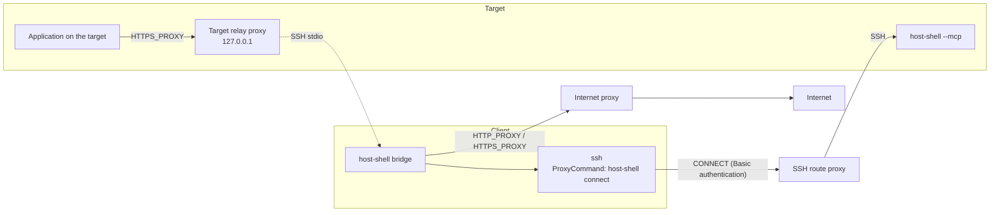

# SSH route proxy

> [!NOTE]
> This is an English translation. The Japanese version ([../ja/ssh-proxy.md](../ja/ssh-proxy.md)) is the single source of truth (SSOT) and takes precedence if they differ.

This document explains how to connect to host-shell when the SSH connection itself must pass through an authenticated HTTP proxy, such as an environment where users connect using the proxy settings of Tera Term (type "HTTP"). Set `host-shell connect` as the `ProxyCommand` of OpenSSH `ssh`: it performs Basic authentication with HTTP `CONNECT` and then relays the SSH traffic. Within HTTP proxy features, `host-shell connect` is compatible with the arguments and environment variables of the `connect` command shipped with Git for Windows.

## Three proxies

The host-shell documentation and skills distinguish three kinds of "proxy". Even when a single Squid or similar server plays multiple roles, each is configured in its own place.

| Term | What it is | Where it is configured | Document |
| --- | --- | --- | --- |
| SSH route proxy | The HTTP proxy that the SSH connection itself passes through (the equivalent of the Tera Term proxy settings) | `ProxyCommand` in the Host block of the client's `~/.ssh/config` | This document |
| Internet proxy | The client-side proxy that `bridge` uses to reach the internet | `HTTP_PROXY`, `HTTPS_PROXY`, and `NO_PROXY` in the environment of `bridge` | [HTTP proxy through the client](client-proxy.md) |
| Target relay proxy | The authenticated proxy that listens on `127.0.0.1` of the target and relays to `bridge` | `--proxy` on `bridge`, `--client-proxy` on the target | [HTTP proxy through the client](client-proxy.md) |

Table: Three proxies



A request such as "connect through the proxy" does not always make clear which proxy is meant. Check the following to distinguish them.

- **SSH route proxy**: Does logging in with SSH from the local machine to the target (or the first jump host) require proxy settings? If you connect with Tera Term using proxy settings, this is the one.
- **Internet proxy**: Does the local machine need proxy settings (such as `HTTP_PROXY`) to reach the internet?
- **Target relay proxy**: Do applications on the target (code-server, CLI coding agents, package managers, and so on) need to reach the internet through the local machine?

## host-shell connect

### Placement

`host-shell connect` is a subcommand of the same executable that the client uses for `bridge`, so nothing else needs to be deployed. Because `ssh` runs it on the client, do not place it on the target or the jump hosts.

### Usage

```text
host-shell connect [-d] [-w SECONDS] [--password-file PATH] -H [http://][USER@]PROXY[:PORT] HOST PORT
host-shell connect -V
```

| Argument | Description |
| --- | --- |
| `-H [http://][USER@]PROXY[:PORT]` | The SSH route proxy (required). `PORT` defaults to 80. Enclose an IPv6 address in `[...]`. `USER@` ends at the last `@` |
| `-w SECONDS` | Limit from connecting to the proxy until receiving the `CONNECT` response. Defaults to 30 seconds; `0` means no limit. Does not apply after relaying starts |
| `--password-file PATH` | File to read the password from ([Credentials](#credentials)) |
| `-d` | Print diagnostics to standard error. Specify twice to include response headers. Credentials are never printed |
| `-V` | Print the version to standard error |
| `HOST PORT` | The SSH server. Specify `%h %p` in `ProxyCommand` |

Table: Arguments of host-shell connect

Other `connect` options such as `-h` (read the proxy from the `HTTP_PROXY` environment variable), `-S`/`-s` (SOCKS), and `-T`/`-t`/`-c` (TELNET) are not supported and exit with an error. `HTTP_PROXY` configures the internet proxy and is never read by `host-shell connect`.

### Behavior

1. When a user name is given, the password is obtained before connecting to the proxy. If no password can be obtained, the command exits without connecting.
2. It sends `CONNECT HOST:PORT HTTP/1.1` to the proxy. When a user name is given, `Proxy-Authorization: Basic` is included from the first request.
3. On a 2xx response, it relays bytes unchanged between standard input/output and the proxy. On 407 (authentication failed or required) or any other response, it exits without retrying.

The exit code is 0 on success (when relaying ends) and 1 on failure, printing the reason on a single line to standard error. `ssh` then prints messages such as `kex_exchange_identification: Connection closed by remote host` or `Connection closed by UNKNOWN port 65535`, whose cause is the preceding `host-shell connect:` line.

## Per-target configuration

Configure the SSH route proxy for each target in a Host block of the client's `~/.ssh/config`. `ssh`, the scripts of the `host-shell-connect` skill, the MCP registration command, and VS Code Remote - SSH all use the same route simply by specifying the Host name.

```text
Host target-a
    HostName 10.0.0.5
    User alice
    ProxyCommand /home/alice/.local/bin/host-shell connect -H alice@proxy-a.example.com:8080 --password-file /home/alice/.ssh/proxy-a.pass %h %p
    ServerAliveInterval 30

Host target-b
    HostName 10.1.0.7
    User alice
    ProxyCommand /home/alice/.local/bin/host-shell connect -H bob@proxy-b.example.com:3128 --password-file /home/alice/.ssh/proxy-b.pass %h %p
    ServerAliveInterval 30
```

- **Windows clients**: Use `/` as the path separator for the executable and the password file (for example, `C:/Users/alice/bin/host-shell.exe` and `C:/Users/alice/.ssh/proxy-a.pass`).
- **Keeping the connection (recommended setting)**: Many proxies close idle `CONNECT` tunnels after a period of inactivity. With `ServerAliveInterval 30` as in the example above, the connection is kept while idle. If the proxy's idle timeout is 30 seconds or less, use a shorter value.
- **Multi-hop routes**: With `ProxyCommand` in the Host block of the first hop, the section from the client to the first hop passes through the proxy for both nested `ssh -T hop1 ssh -T target` and `ProxyJump`. Proxies between later hops are not supported.
- **sshd forwarding settings**: The SSH route proxy section does not use sshd port forwarding, so `AllowTcpForwarding no` does not affect it (hops reached with `ProxyJump` still require forwarding to be allowed).

```text
Host hop1
    HostName 192.0.2.10
    ProxyCommand /home/alice/.local/bin/host-shell connect -H alice@proxy-a.example.com:8080 --password-file /home/alice/.ssh/proxy-a.pass %h %p
    ServerAliveInterval 30

Host target-behind-hop1
    HostName 10.2.0.20
    ProxyJump hop1
```

## Credentials

The user name and password are determined in the following order of precedence.

| Item | Order |
| --- | --- |
| User name | `USER@` in `-H` → environment variable `HTTP_PROXY_USER` → `CONNECT_USER`. If none is set, no authentication is sent |
| Password | `--password-file` → environment variable `HTTP_PROXY_PASSWORD` → `CONNECT_PASSWORD` → terminal prompt |

Table: Order of credential sources

- **Password file (recommended)**: Each Host block can specify a separate file, allowing different credentials per target. The first line of the file is used as the password (the trailing newline is stripped; UTF-8 and UTF-16LE with a BOM are supported).
- **Environment variables**: Because they apply to the entire process, they cannot specify different passwords per target. If written into an agent's MCP registration (such as `claude mcp add -e`), they remain in plain text in its configuration file.
- **Terminal prompt**: Prompts only when standard error is a terminal. When an agent starts `ssh` for MCP, there is no terminal, so it exits with an error without prompting. This can be used when running `ssh` directly in a local terminal.

Basic authentication sends credentials to the proxy in a form equivalent to plain text. Do not write the password in conversations, command lines, or logs.

### Creating a password file

Linux and macOS (creates a file unreadable by other users and writes the password without echoing it):

```bash
(umask 077; IFS= read -rs -p 'proxy password: ' p; echo; printf '%s\n' "$p" > ~/.ssh/proxy-a.pass; unset p)
```

Windows (PowerShell; creates the file under the user profile):

```powershell
$p = Read-Host -AsSecureString 'proxy password'
[IO.File]::WriteAllText("$env:USERPROFILE\.ssh\proxy-a.pass", [Net.NetworkCredential]::new('', $p).Password)
Remove-Variable p
```

By default inheritance, files under `%USERPROFILE%\.ssh\` are accessible only to the user, `SYSTEM`, and `Administrators`.

### Permission check of the password file

Before reading the password file, `host-shell connect` checks the same conditions that OpenSSH requires for the user's `~/.ssh/config`, and exits after printing the reason to standard error if they are not met.

| OS | Condition |
| --- | --- |
| Linux and macOS | The owner is the user or `root`, and neither the group nor others have write permission |
| Windows | The owner is the user, `Administrators`, `SYSTEM`, or `TrustedInstaller`, and no other user or group has a write-class right (write, append, write attributes or extended attributes, delete, change permissions or owner). Inherited permissions are evaluated the same way |

Table: Permission conditions for the password file

These conditions prevent other users from modifying the file; they do not reject read permissions. Files with mode `644` on Linux or files that grant read access to `Users` on Windows are accepted, but allow other users to read the password. Restrict the file so that only you can read it, as shown in the steps above.

On Windows, a file created outside the user profile (for example, under `C:\tools\`) inherits permissions from its parent folder, and is rejected under a folder that grants write access to `Users` or others. In that case, remove inheritance and grant access only to yourself.

```text
icacls C:\tools\proxy-a.pass /inheritance:r /grant:r "%USERNAME%:F"
```

This removes only inherited permissions. Permissions set explicitly on the file (for example `Users:(W)`) remain, so if `icacls C:\tools\proxy-a.pass` shows anyone other than you, remove them with `/remove:g` (for example `icacls C:\tools\proxy-a.pass /remove:g Users`). The rejection message names the user or group that is allowed to write.

## MCP registration

With `ProxyCommand` in the Host block, the registration command is unchanged: the `ssh` process started by `bridge` reads the Host block.

```bash
claude mcp add host-shell-a -- /home/alice/.local/bin/host-shell bridge -- ssh -T target-a /tmp/host-shell-1000/host-shell --mcp
```

When applications on the target also need to reach the internet, enable the [HTTP proxy through the client](client-proxy.md). If the client itself requires a proxy to reach the internet, set `HTTPS_PROXY` (the internet proxy) in the startup environment of `bridge`. Even when it is the same proxy as the SSH route proxy, the `ProxyCommand` setting is not inherited by `bridge`.

When using the `host-shell-connect` skill, tell the agent that the SSH route goes through a proxy. The agent confirms the proxy host, port, user name, and password file location, and presents the Host block. The user adds it to `~/.ssh/config` and creates the password file.

## Mapping from Tera Term settings

The items of the Tera Term "Proxy Setup" dialog correspond to the following host-shell settings.

| Tera Term item | host-shell setting |
| --- | --- |
| Type | Only `HTTP` (`http://` in `-H` may be omitted). `TELNET`, `SOCKS4`, and `SOCKS5` are not supported |
| Hostname | `PROXY` in `-H` |
| Port number | `:PORT` in `-H` (80 when omitted) |
| Username | `USER@` in `-H` |
| Password | The file specified with `--password-file` |
| Connection Timeout in Other setup | `-w` |
| Proxy connection log in Other setup | `-d` (output to standard error; no log file is written) |
| SOCKS and TELNET items in Other setup (name resolution, prompts, messages) | Not applicable |

Table: host-shell settings equivalent to the Tera Term Proxy Setup dialog

Write the SSH settings such as the target host name, user name, and key in `HostName`, `User`, and `IdentityFile` of the Host block.

## Troubleshooting

| Message | Cause | Action |
| --- | --- | --- |
| `rejected the credentials of USER (407)` | Wrong user name or password | Check the password file (newlines, extra spaces) and the user name |
| `requires authentication (407)` | No user name was specified | Add `USER@` to `-H` |
| `no password for USER@PROXY` | No password could be obtained | Specify `--password-file` |
| `password input was interrupted` | Typing the password on the terminal was interrupted, for example with Ctrl+C (the terminal settings are restored) | Run it again |
| `bad owner or permissions on password file` | The owner or permissions of the file do not meet the conditions | See [Permission check of the password file](#permission-check-of-the-password-file) |
| `refused CONNECT HOST:PORT (403 Forbidden)` | The proxy does not allow the destination or port | Ask the proxy administrator |
| `refused CONNECT HOST:PORT (503 Service Unavailable)` and similar | The proxy cannot reach the destination (including name resolution failures) | Use a `HostName` that the proxy can resolve and reach |
| `cannot connect to SSH route proxy` | The proxy cannot be reached | Check the host and port in `-H` |
| `timed out after 30s waiting for SSH route proxy` | The proxy does not respond | Increase `-w` or check the proxy status |
| `client_loop: send disconnect: Broken pipe` after an idle period | The proxy closed the idle tunnel | Set `ServerAliveInterval 30` (if already set, make it shorter than the proxy's idle timeout) |

Table: Troubleshooting the SSH route proxy

Adding `-d` to `ProxyCommand` prints the connection, request transmission, response status, and start of relaying to standard error.

## Verified scope

| Item | Method and environment | Status |
| --- | --- | --- |
| Handshake of `host-shell connect`, order of credential sources, errors, 8-bit transparency, half-close, timeout, password file permissions (Linux) | Automated tests with a test `CONNECT` proxy, run on Linux | Verified |
| The same automated tests on Windows (including the permission check) | Windows 11 Pro for Workstations (build 26300, amd64), go1.27.4 | Verified |
| The same automated tests on macOS | CI (GitHub Actions macos-latest) | Verified |
| Connection through Squid and error messages (407, 403, 503, unreachable proxy, password file permissions) | Podman containers: Squid 6.10 (Basic authentication), sshd with OpenSSH 9.9p1 on Oracle Linux 10.2, client with OpenSSH 8.0p1 on Oracle Linux 8.10 (WSL2). Squid is the only route from the client to sshd | Verified |
| Scripts of the `host-shell-connect` skill (`remote.sh`, `detect.sh`, `deploy.sh`, `probe.sh`), nested multi-hop routes and `ProxyJump` | Same as above | Verified |
| MCP operations through `bridge` (`exec_run`, 20 MB `transfer_push` and `transfer_pull`) | Same as above | Verified |
| Combination with the internet proxy (the same Squid as `HTTPS_PROXY` of `bridge`, HTTPS fetched through the target relay proxy) | Same as above | Verified |
| Idle disconnection and `ServerAliveInterval` | Same as above (Squid `read_timeout` set to 30 seconds) | Verified |
| Windows clients: connecting with `ssh`, MCP operations through `bridge` (`exec_run`, 10 MiB `transfer_push` and `transfer_pull`), the 407 message, the permission check of the password file, and not prompting without a terminal | Windows OpenSSH 9.5p2 and the OpenSSH 10.6p1 of Git for Windows on Windows 11 Pro for Workstations (build 26300, amd64); Squid and sshd are the Linux containers above | Verified |
| Typing the password on a terminal with a Windows client (the input is not echoed; after Ctrl+C the input mode is restored and no input is left behind) | Same as above, typed by hand in Windows Terminal (PowerShell 7.7.0) and conhost (Windows PowerShell 5.1), with Windows OpenSSH and the OpenSSH of Git for Windows | Verified |
| Typing the password on a Linux terminal (echo is restored after Ctrl+C) | Input sent through a pseudo terminal (the Linux client above) | Verified |
| Typing the password on a macOS terminal | None | Unverified |

Table: Verification status of the SSH route proxy

## Limitations

- Only HTTP `CONNECT` with no authentication or Basic authentication is supported. SOCKS and TELNET proxies, NTLM, Negotiate (Kerberos), and Digest authentication, TLS connections to the proxy (`https://` proxies), and proxy redirects (302) are not supported. For a proxy that requires NTLM or similar authentication, a local proxy that accepts Basic or no authentication (such as cntlm) can be placed in between on the local machine, though this is unverified.
- Proxies between later hops are not supported.
- Terminal password input works only when standard error is a terminal. `SSH_ASKPASS` and OS credential stores are not supported (for the SSH login password itself, see [Storing SSH passwords](ssh-password.md)).
