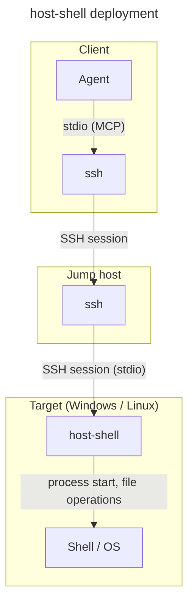
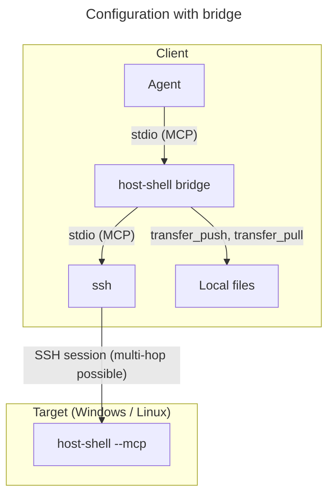

# host-shell User Guide

> [!NOTE]
> This is an English translation. The Japanese version ([../ja/user-guide.md](../ja/user-guide.md)) is the master and takes precedence if they differ.

This guide explains how to deploy `host-shell` on a target, register it with an agent, and use it for common tasks.  
For tool inputs and outputs, see the [Reference](reference.md); for security and operational design, see the [Operations Guide](operations.md).

## Contents

- [How it works](#how-it-works)
- [Requirements](#requirements)
- [Getting the executables](#getting-the-executables)
- [Deploying to the target](#deploying-to-the-target)
- [Checking the SSH route](#checking-the-ssh-route)
- [Registering with the agent](#registering-with-the-agent)
- [Verifying the setup](#verifying-the-setup)
- [Usage](#usage)
- [Troubleshooting](#troubleshooting)

## How it works

`host-shell` is an MCP server deployed on the remote machine you want to operate (the target).  
You register the SSH command that starts `host-shell` with your agent as an MCP stdio server. Because the MCP stdio transport exchanges JSON-RPC messages over the child process's standard input and output, the SSH session's standard input and output serve directly as the MCP channel.



Even across jump hosts, port forwarding (`-L`, `-R`, `-D`, `ProxyJump`, `-W`) and SFTP are not used. Each hop runs a nested `ssh` command, so connections work even when `sshd` sets `AllowTcpForwarding no`.

- A single SSH connection stays open for the entire MCP session, avoiding per-call reconnection overhead even over multi-hop routes.
- `host-shell` normalizes differences between Windows and Linux (shells, quoting, path separators), allowing the agent to invoke the same tools with identical arguments.
- Output limits, timeouts, and audit logs are managed centrally on the target.

### Using bridge

Running `host-shell bridge` on the client side enables direct file and directory transfers between the local machine and the target.



`bridge` relays all tools exposed by the target's `host-shell` and adds `transfer_push` (local to target) and `transfer_pull` (target to local).  
File contents stream directly between `bridge` and the target's `host-shell` without passing through the agent context, supporting large files and directory trees.  
`bridge` is a subcommand of the same `host-shell` binary; use the executable matching the client OS (Linux, Windows, or macOS).

## Requirements

| Location | Requirement |
|---|---|
| Client | An agent supporting MCP stdio servers (Claude Code, VS Code GitHub Copilot, etc.) and the OpenSSH client. Using `bridge` requires the `host-shell` binary for the client OS (Linux, Windows, or macOS 12+) |
| Jump host | OpenSSH client and server, plus credentials (such as keys) for the next hop |
| Target | OpenSSH server on Windows 10 / Windows Server 2016+ or Linux kernel 3.2+ (`amd64` / `arm64`) |

Table: Requirements

Because the `ssh` process started by the agent cannot answer interactive password prompts, every hop must authenticate non-interactively via public keys or `ssh-agent`.

## Getting the executables

Each OS and architecture uses a single static binary with no external dependencies.

| OS and architecture | File | Role |
|---|---|---|
| Linux (x86_64) | `host-shell-linux-amd64` | Target, local (`bridge`) |
| Linux (aarch64) | `host-shell-linux-arm64` | Target, local (`bridge`) |
| Windows (x64) | `host-shell-windows-amd64.exe` | Target, local (`bridge`) |
| Windows (ARM64) | `host-shell-windows-arm64.exe` | Target, local (`bridge`) |
| macOS (Intel) | `host-shell-darwin-amd64` | Local (`bridge`) |
| macOS (Apple silicon) | `host-shell-darwin-arm64` | Local (`bridge`) |

Table: Executables

The same binary runs as an MCP server on the target with `--mcp` and as a local relay on the client with `bridge`.  
To build all six binaries in `dist/` from source (requires Go 1.26 or later; see the [Development Guide](development.md)):

```bash
make dist
```

## Deploying to the target

To avoid modifying system directories on the target, place the binary in a user-owned path in the following order of preference.

| Target | 1. Temporary directory (recommended) | 2. Home directory |
|---|---|---|
| Linux | `/tmp/host-shell-<uid>/host-shell` | `.local/bin/host-shell` (relative to home) |
| Windows | `%TEMP%/host-shell/host-shell.exe` | `%LOCALAPPDATA%/Programs/host-shell/host-shell.exe` |

Table: Where to place the binary

- `<uid>` is the target user's UID (`id -u`). Examples below use `/tmp/host-shell-1000/host-shell` on Linux and `C:/Users/alice/AppData/Local/Temp/host-shell/host-shell.exe` on Windows.
- If `/tmp` is mounted `noexec` or Windows execution policies (such as AppLocker) block binaries in `%TEMP%`, use the home directory path instead.
- Create `/tmp/host-shell-<uid>` owned by your user with mode `700` so other local users cannot replace the binary.
- Files in `/tmp` and `%TEMP%` may be removed on reboot or by periodic cleanup; redeploy to the same path if removed (agent registration remains unchanged).
- On Linux, if `/tmp/host-shell-<uid>` is deleted, another user could create a directory with the same name and plant a fake binary. On multi-user machines with untrusted users, use `.local/bin/host-shell`.
- System directories such as `/opt` are intended for administrator-managed setups with a dedicated service user ([Operations Guide](operations.md)).
- Avoid spaces in the installation path because command lines are re-parsed at each SSH hop.
- On Linux, `.local/bin/host-shell` works as a relative path because `sshd` starts commands in the user's home directory (do not use `~`, which is expanded by the local shell).

`scripts/deploy.sh` in `.agents/skills/host-shell-connect` automates candidate selection, permission checks, SHA-256 verification, and startup testing.

### Sending over SSH only

When SFTP and port forwarding are unavailable, stream the binary over SSH standard input and verify its SHA-256 hash afterward.

Linux target (direct connection):

```bash
ssh target id -u
ssh target 'mkdir -m 700 /tmp/host-shell-1000 && cat > /tmp/host-shell-1000/host-shell && chmod 755 /tmp/host-shell-1000/host-shell' \
    < dist/host-shell-linux-amd64
ssh target sha256sum /tmp/host-shell-1000/host-shell
sha256sum dist/host-shell-linux-amd64
```

`mkdir -m 700` fails if the directory already exists. When redeploying, verify with `ls -ld /tmp/host-shell-1000` that you own the directory with mode `drwx------`, then transfer without `mkdir`.

Linux target (via jump host):

```bash
ssh hop1 "ssh target 'mkdir -m 700 /tmp/host-shell-1000 && cat > /tmp/host-shell-1000/host-shell && chmod 755 /tmp/host-shell-1000/host-shell'" \
    < dist/host-shell-linux-amd64
ssh hop1 "ssh target sha256sum /tmp/host-shell-1000/host-shell"
```

The outer `"..."` is parsed by the local shell and the inner `'...'` by the jump host shell. Keep the output redirection (`>`) inside the inner quotes so it runs on the target.

Windows target (when `sshd` uses `cmd` as the default shell):

```bash
ssh target "echo %TEMP%"
ssh target "powershell -NoProfile -Command \"New-Item -ItemType Directory -Force C:/Users/alice/AppData/Local/Temp/host-shell | Out-Null; \$i=[Console]::OpenStandardInput(); \$o=[IO.File]::Create('C:/Users/alice/AppData/Local/Temp/host-shell/host-shell.exe'); \$i.CopyTo(\$o); \$o.Close()\"" \
    < dist/host-shell-windows-amd64.exe
ssh target "powershell -NoProfile -Command \"(Get-FileHash C:/Users/alice/AppData/Local/Temp/host-shell/host-shell.exe).Hash\""
sha256sum dist/host-shell-windows-amd64.exe
```

`cmd` on the target invokes `powershell -NoProfile -Command "..."`, which copies raw standard input bytes into the file. If the hash does not match, check `DefaultShell` in `sshd_config`.

Once `host-shell` is running, you can also upload newer versions via `fs_write` (`base64` with `offset`) or `transfer_push` and swap the binary with `exec_run`. On Windows, a running `host-shell.exe` cannot be overwritten in place; upload to a temporary name and rename it before the next session.

### Removing

Delete the installation directory (`/tmp/host-shell-1000/`, `%TEMP%/host-shell/`, etc.) and, if needed, the audit log directory (`~/.local/state/host-shell/` on Linux, `%LOCALAPPDATA%/host-shell/` on Windows).

### Checking the target

Verify that the binary starts over SSH:

```bash
ssh -T target /tmp/host-shell-1000/host-shell --version
ssh -T target C:/Users/alice/AppData/Local/Temp/host-shell/host-shell.exe --version
```

Printing `host-shell <version>` confirms deployment.

## Checking the SSH route

### Do not allocate a pseudo-terminal

Pass `-T` to every SSH hop to disable pseudo-terminal allocation (also check that `RequestTTY` is not `yes` or `force` in `~/.ssh/config`). Allocating a PTY corrupts JSON-RPC framing through newline translation and echo.

### Keep the target shell quiet

`sshd` invokes commands through the target user's login shell. If shell startup files (`.bashrc`, `.profile`, etc.) write to standard output during non-interactive sessions, JSON-RPC communication breaks. Confirm that the following commands produce no output:

```bash
ssh -T target true | od -c | head
ssh -T hop1 ssh -T target true | od -c | head
```

If any bytes are printed, guard interactive output in the startup files. For bash, place this line at the top of `.bashrc`:

```bash
case $- in *i*) ;; *) return;; esac
```

### Authentication on jump hosts

In nested SSH connections, each jump host initiates the next `ssh` hop. Either place the next-hop key on each jump host or forward your local `ssh-agent` with `-A` (requires `AllowAgentForwarding yes` in each jump host's `sshd_config`).

### Connection script

For multi-hop routes or long startup flags, register a local wrapper script with the agent:

```{.bash caption="~/bin/host-shell-target (Linux / macOS client)"}
#!/bin/sh
# Connect to host-shell on target through hop1
exec ssh -T -o BatchMode=yes -o ServerAliveInterval=30 hop1 \
    ssh -T -o BatchMode=yes -o ServerAliveInterval=30 target \
    /tmp/host-shell-1000/host-shell --mcp
```

```{.bat caption="C:\Users\me\bin\host-shell-target.cmd (Windows client)"}
@echo off
rem Connect to host-shell on target through hop1
ssh -T -o BatchMode=yes -o ServerAliveInterval=30 hop1 ssh -T -o BatchMode=yes -o ServerAliveInterval=30 target C:/Users/alice/AppData/Local/Temp/host-shell/host-shell.exe --mcp
```

`BatchMode=yes` fails immediately instead of hanging on password prompts, and `ServerAliveInterval` prevents idle connection drops.

Pass `host-shell` options after `--mcp`:

```text
/tmp/host-shell-1000/host-shell --mcp --max-output 131072 --timeout 2m
C:/Users/alice/AppData/Local/Temp/host-shell/host-shell.exe --mcp --windows-shell cmd
```

## Registering with the agent

### Claude Code

With `bridge` (recommended):

```bash
claude mcp add host-shell -- ~/.local/bin/host-shell bridge -- ssh -T hop1 ssh -T target /tmp/host-shell-1000/host-shell --mcp
```

Without `bridge`:

```bash
claude mcp add host-shell -- ssh -T hop1 ssh -T target /tmp/host-shell-1000/host-shell --mcp
```

`~/.local/bin/host-shell` is the client binary (for example, `host-shell-darwin-arm64` on Apple silicon macOS).  
Place target restriction options ([Operations Guide](operations.md#restriction-options)) after `--mcp`, and local transfer path restrictions after `bridge` as `--allow-local-path DIR`.

Using a wrapper script:

```bash
claude mcp add host-shell -- ~/bin/host-shell-target
```

Add `--scope project` to save the configuration in `.mcp.json` for team sharing. When registering multiple targets, give each a distinct server name such as `host-shell-web01` and `host-shell-db01`.

To auto-approve read-only tools in Claude Code, add the following to `.claude/settings.json`:

```{.json caption=".claude/settings.json"}
{
  "permissions": {
    "allow": [
      "mcp__host-shell__help_get",
      "mcp__host-shell__sys_get_info",
      "mcp__host-shell__proc_list",
      "mcp__host-shell__disk_list",
      "mcp__host-shell__svc_list",
      "mcp__host-shell__log_query",
      "mcp__host-shell__net_check",
      "mcp__host-shell__net_list_listeners",
      "mcp__host-shell__net_list_interfaces",
      "mcp__host-shell__fs_list",
      "mcp__host-shell__fs_stat",
      "mcp__host-shell__fs_read",
      "mcp__host-shell__search_grep",
      "mcp__host-shell__search_find",
      "mcp__host-shell__fs_manifest",
      "mcp__host-shell__job_read",
      "mcp__host-shell__job_list"
    ]
  }
}
```

### VS Code

```{.json caption=".vscode/mcp.json"}
{
  "servers": {
    "host-shell": {
      "type": "stdio",
      "command": "C:/Users/alice/AppData/Local/Programs/host-shell/host-shell.exe",
      "args": ["bridge", "--", "ssh", "-T", "hop1", "ssh", "-T", "target", "C:/Users/alice/AppData/Local/Temp/host-shell/host-shell.exe", "--mcp"]
    }
  }
}
```

Without `bridge`, set `command` to `"ssh"` and `args` to `["-T", "hop1", "ssh", "-T", "target", "C:/Users/alice/AppData/Local/Temp/host-shell/host-shell.exe", "--mcp"]`. With a wrapper script, set `command` to the script path and leave `args` empty.

### Other agents

Any MCP client supporting `stdio` servers can register `host-shell bridge -- ssh ... host-shell --mcp` (or `ssh ... host-shell --mcp`) as its server command.

## Verifying the setup

### Without an agent

Send a single `initialize` request and verify that a JSON-RPC response is returned (`sleep` keeps standard input open until the response arrives):

```bash
(printf '%s\n' '{"jsonrpc":"2.0","id":1,"method":"initialize","params":{"protocolVersion":"2025-06-18","capabilities":{},"clientInfo":{"name":"check","version":"0"}}}'; sleep 2) \
    | ssh -T hop1 ssh -T target /tmp/host-shell-1000/host-shell --mcp
```

A single line matching `{"jsonrpc":"2.0","id":1,"result":{...,"serverInfo":{"name":"host-shell",...}}}` confirms normal operation. If any text appears before that line, see [Keep the target shell quiet](#keep-the-target-shell-quiet).

You can also test tools interactively in a browser with [MCP Inspector](https://github.com/modelcontextprotocol/inspector):

```bash
npx @modelcontextprotocol/inspector ssh -T hop1 ssh -T target /tmp/host-shell-1000/host-shell --mcp
```

### From the agent

Ask the agent to "call sys_get_info of host-shell and report the target's OS and host name".

## Usage

Agents select tools automatically using the initialize `instructions`, tool descriptions, and the `help_get` tool, so you do not need to specify tool names in prompts.

### What the agent is told

`host-shell` provides built-in guidance over MCP:

- Initialize `instructions`: target host name, OS, default shell, encodings, output limit, tool selection guidelines, and active policy restrictions.
- Tool and argument `description` fields: each tool's role, when to prefer it, and how to paginate reads.
- `help_get` tool and resources: step-by-step usage, argument examples, and Windows notes by topic (`files`, `edit`, `search`, `jobs`, `network`, `admin`, `transfer`, `policy`, etc.), also exposed as `host-shell://help/<topic>` resources.

If an agent picks suboptimal tools, prompt it to "read host-shell's help before working" (in Claude Code, you can also reference resources with `@`).

### Investigating

| Example prompt | Primary tools used |
|---|---|
| Check the target's OS, free disk space, and running services | `sys_get_info`, `disk_list`, `svc_list` |
| Show warnings logged by nginx in the last hour | `log_query` (`unit`, `since`, `priority`) |
| Request `localhost:8080/health` on the target | `net_request_http` |
| Check connectivity to DB port 5432 and TLS certificate expiration | `net_check` (`tls`) |
| Find the process listening on port 8080 | `net_list_listeners` |
| Find today's ERROR lines in `/var/log/app` | `search_find` (`sort: mtime`), `search_grep` |
| Read and explain the `server` blocks in `nginx.conf` | `search_grep` (`context`), `fs_read` |
| Count C files calling `connect(` in the repository | `search_grep` (`literal`, `output_mode: count`) |
| Count running Java processes | `proc_list` |

Table: Investigation examples

For large files, `fs_read` with `line_start` and `line_count` reads only the requested line range (for example, "read the last 200 lines of the log").

### Comparing with local sources

When you have a matching source tree locally, use `fs_manifest` to compare SHA-256 hashes and read only modified files:

```text
Get the fs_manifest of /srv/app/src on the target, compare it with the SHA-256 of the local ./src,
read only the files that differ with fs_read, and explain the differences.
```

`fs_manifest` normalizes path separators to `/`, making comparisons consistent across Linux and Windows targets.

### Making changes

| Example prompt | Primary tools used |
|---|---|
| Set `max_connections` to 200 in the config file | `fs_read`, `fs_edit` |
| Rename a function across the source tree | `search_grep` (`output_mode: files`), `fs_edit` (`replace_all`) |
| Restart the service and verify its status | `svc_control` (`restart`, with `sudo` on Linux) |
| Terminate a runaway process | `proc_list`, `proc_kill` |
| Update a registry value (Windows) | `reg_read`, `reg_write` |
| Deploy a script to `/opt/tools/` and mark it executable | `fs_mkdir`, `fs_write` (`perm`) |
| Move old logs to `archive` and delete logs older than a year | `search_find`, `fs_move`, `fs_remove` |

Table: Change examples

`fs_edit` modifies existing files in place by sending only the surrounding lines, preserving the file's encoding, BOM, and line endings, and returning a line-numbered snippet so the file does not need to be re-read.  
`fs_move`, `fs_copy`, and `fs_remove` provide OS-independent file management.

Because mutating tools carry `destructiveHint`, enable pre-execution approval in your agent.

### Long-running work

Run tasks taking tens of seconds or longer (builds, test suites, large copies) as background jobs. Prompting the agent to "run it as a job and follow its output" starts the command with `job_start` and polls output with `job_read` (`wait_sec`).  
Commands run with `exec_run` also emit progress notifications (elapsed time and latest line) when the client supports them, and kill the entire process tree on cancellation.

```text
job_start   {"command": "make -C /srv/app test"}             -> {"id": "job-1", "running": true, ...}
job_read    {"id": "job-1", "offset": 0, "wait_sec": 20}     -> {"output": "...", "next_offset": 4096, ...}
job_read    {"id": "job-1", "offset": 4096, "wait_sec": 20}  -> {"output": "", "status": {"running": false, "exit_code": 0}}
```

For interactive programs over pipes, set `stdin_open: true` on `job_start` and send input via `job_write`.  
For programs requiring a terminal (`sudo`, `ssh`, or REPLs such as `python` and `psql`), set `pty: true`, wait for prompts with `until` in `job_read`, and send input with `job_write`.

```text
job_start  {"command": "psql -h db.internal app", "pty": true}       -> {"id": "job-2", "pty": true, ...}
job_read   {"id": "job-2", "wait_sec": 20, "until": "Password.*: $"}  -> {"matched": true, ...}
job_write  {"id": "job-2", "input": "********\n"}
job_read   {"id": "job-2", "wait_sec": 20, "until": "app=> $"}        -> {"matched": true, ...}
job_write  {"id": "job-2", "input": "select count(*) from users;\n"}
job_read   {"id": "job-2", "wait_sec": 20, "idle_ms": 500}            -> {"output": " count \n-------\n  4213\n..."}
```

`job_stop` forcefully kills the job by default. On Linux, `signal` can send signals such as `interrupt` (in `pty` jobs, `interrupt` sends Ctrl-C on both Linux and Windows).

All running jobs terminate when the SSH session disconnects. To keep processes running after disconnection, launch them via OS facilities such as `nohup`, `systemd-run`, or Windows Task Scheduler.

### Transferring files

When registered with `bridge`, prompts such as "transfer local `dist/` to `/srv/app/dist` on the target" or "download `/var/log/app` into the local `logs/` directory" use `transfer_push` and `transfer_pull`.

- File data bypasses the agent context, streaming in 1 MiB chunks into a temporary file verified by SHA-256 before renaming.
- Identical files at the destination are skipped automatically, allowing repeated runs to act as a differential sync.
- Existing files with different content are skipped unless `overwrite: true` is set. `exclude` filters out patterns such as `.git` or `node_modules`, and Linux executable bits are preserved.

Files accessible via HTTP/HTTPS from the target can be downloaded directly to a target path using `save_to` in `net_request_http`.

Without `bridge`, files can be transferred in chunks via `fs_read` and `fs_write` (`base64`, `offset`), though this passes data through the agent context and is practical only up to a few megabytes (`offset` writes are idempotent and can resume from `fs_stat` `size`).

### Encodings and line endings

Even on Shift_JIS or EUC-JP targets, `host-shell` converts text to and from UTF-8 on the target so the agent always works in UTF-8.

- Command output, file reads, and searches auto-detect UTF-8 and fall back to the target's default encoding when non-UTF-8 bytes are found.
- `fs_write` writes UTF-8 by default; specify `charset` to convert encoding and `newline` to normalize line endings.
- `fs_edit` preserves the original file's encoding, BOM, and line endings automatically. When overwriting an entire file with `fs_write`, pass the `charset`, `bom`, and `newline` values returned by `fs_read` to keep its format.

### Windows targets

- `exec_run` and `job_start` default to PowerShell. To use `cmd` syntax, pass `"shell": "cmd"` per call or start the server with `--windows-shell cmd`.
- PowerShell commands are encoded in base64, avoiding SSH and `cmd` quoting issues. Errors and warnings are returned as plain text (warnings on standard output).
- Shift_JIS output from `cmd` and native binaries is converted to UTF-8 automatically, with the source encoding reported in `stdout_encoding`.
- `exec_sudo` is unavailable on Windows. Run privileged operations (service control, `HKLM` registry writes, etc.) from a `host-shell` instance started under an administrator account.
- Dedicated tools handle Windows services (`svc_list`, `svc_control`), Event Log (`log_query`), and registry keys (`reg_read`, `reg_write`, `reg_delete`).
- `pty` jobs use ConPTY (Windows 10 1809 / Windows Server 2019 or later).

## Troubleshooting

| Symptom | Cause and remedy |
|---|---|
| Agent reports "cannot connect" or "server exited" | Run the registered command locally with `--version` to verify the SSH route and binary path, and confirm `--mcp` is included |
| JSON parse error during initialization | A shell startup file on the target writes to standard output ([how to check](#keep-the-target-shell-quiet)) |
| Connection hangs without responding | An SSH hop is waiting for a password or host key confirmation. Run `ssh hop1 ssh target` interactively once to record host keys, and add `BatchMode=yes` |
| Pseudo-terminal warning or corrupted line breaks | Pass `-T` to every `ssh` hop and check `RequestTTY` in `~/.ssh/config` |
| Server exits immediately with `open audit log` | The audit log directory is not writable. Pass a writable path with `--log-file` or disable logging with `--no-log` |
| `sudo: a password is required` | No `NOPASSWD` rule matches in `sudoers` ([Operations Guide](operations.md#configuring-sudo)). Pass the password via `password` in `exec_sudo` |
| Tool returns an error starting with `policy:` | Blocked by target startup options. Check active rules in `restrictions` of `sys_get_info` |
| Tool covered by `--confirm` fails with `cannot ask the user` | The agent client does not support MCP elicitation. Remove `--confirm` and use agent-side approval settings |
| `transfer_push` and `transfer_pull` are missing | Registered without `bridge`, or the `files` group is disabled on the target (`bridge` logs the reason to standard error at startup) |
| `bridge` exits with `remote host-shell disconnected` | The underlying SSH session closed. Inspect the `ssh` error in the agent's MCP log (`bridge` standard error) |
| Command stops with `timed_out` | Increase `timeout_sec` (up to `--max-timeout`) or run the command as a background job with `job_start` |
| Garbled Japanese text | Check `console_encoding` and `file_encoding` in `sys_get_info`, and specify `output_encoding` or `charset` explicitly when files or commands use a non-default encoding ([Encodings and line endings in the Reference](reference.md#encodings-and-line-endings)) |
| `host-shell.exe` is deleted or blocked on Windows | Antivirus false positive; configure an exclusion or sign the binary |
| Public key authentication fails for a Windows administrator | Windows OpenSSH reads public keys for `Administrators` group members from `C:\ProgramData\ssh\administrators_authorized_keys` |

Table: Troubleshooting

If the issue persists, inspect the failed tool call and error message in the target's audit log ([Audit log in the Reference](reference.md#audit-log)).
