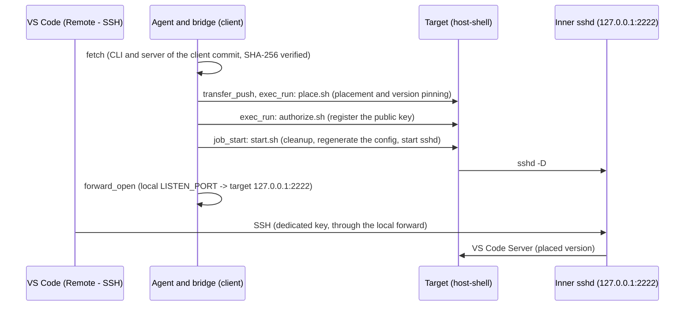

# Using a target with VS Code Remote - SSH

> [!NOTE]
> This is an English translation. The Japanese version [../ja/vscode-remote-ssh.md](../ja/vscode-remote-ssh.md) is authoritative; if they differ, the Japanese version takes precedence.

This guide describes how to edit files on a Linux `host-shell` target from your local VS Code (the Remote - SSH extension), and how to use its terminal and Copilot Chat there. It also works when the target is in a closed network without internet access.

The procedure is packaged as the `host-shell-vscode-remote-ssh` skill (`.agents/skills/host-shell-vscode-remote-ssh/`), which an agent runs with the MCP tools. This guide covers the architecture, preparation, what is placed on the target, version updates, and limitations.

To use VS Code in a browser instead, see [Injecting code-server](code-server.md).

## Use cases

- Edit a target from your local VS Code when the target's system sshd forbids port forwarding or scp (sftp), so that Remote - SSH cannot connect to it directly.
- Place the VS Code Server from the client on a target that cannot reach the internet.
- Use the Copilot Chat built into VS Code on the target's files and terminal (traffic goes through the client's network).

> [!IMPORTANT]
> This setup starts a second sshd with the target user's privileges and uses that inner SSH to work around the system sshd policy (forbidden forwarding or scp). The inner sshd provides a shell and port forwarding, so `host-shell` restrictions (`--read-only`, `--allow-command`, `--allow-path`, and so on) do not apply to it, and its actions are not recorded in the `host-shell` audit log. Use it only where the target's administrator permits it.

## Architecture



- The inner sshd listens only on `127.0.0.1:2222` on the target. The client reaches it through `host-shell` [port forwarding](port-forward.md).
- The VS Code CLI and server of the client's commit are fetched on the client, verified by SHA-256, and transferred. The target verifies the same values again before placing them. Nothing is downloaded on the target.
- Target traffic (Copilot Chat, the Marketplace, and so on) goes through the client's network only when the [HTTP proxy through the client](client-proxy.md) is used.

## Requirements

| Item | Requirement |
| --- | --- |
| Target | Linux (glibc), x64 or arm64 (arm64 is unverified). Musl environments (such as Alpine) are not supported |
| Target commands | `/usr/sbin/sshd` and `ssh-keygen` (OpenSSH server package), `tar`, `gzip`, `sha256sum`, `df`, `pgrep`, `pkill`. The system sshd does not need to run, and no root privileges are needed |
| Target free space | About 1 GiB per version (226 MiB transferred and 675 MiB extracted) |
| Machine running VS Code | VS Code, the Remote - SSH extension, and the OpenSSH client (`ssh`, `ssh-keygen`) |
| Fetching on the client | Linux and macOS: `curl` and `sha256sum` (or `shasum`). Windows: Windows PowerShell 5.1 or later |

Table: Requirements

The machine running the agent and bridge may differ from the machine running VS Code (for example, VS Code on Windows and the agent in WSL). The machine running VS Code must reach the local forward on `127.0.0.1`; with WSL2, WSL's localhost forwarding provides this.

## Preparation (registration command)

The skill uses port forwarding and file transfer. The registration command needs these options:

| Side | Option |
| --- | --- |
| Target | `--allow-forward-local` (also allow `127.0.0.1:2222` if the target uses `--allow-host`) |
| bridge | `--forward-allow-local '127.0.0.1:2222'` |

Table: Required options

```text
host-shell bridge --forward-allow-local '127.0.0.1:2222' -- ssh -T target /path/to/host-shell --mcp --allow-forward-local
```

To use Copilot Chat and similar services, also add the options in [Traffic through the proxy](#traffic-through-the-proxy).

## Procedure overview

The skill proceeds in this order. `SKILL.md` has the detailed steps.

1. **Check prerequisites:** the target OS, CPU, the presence of `sshd`, and the registration command options.
2. **Find the commit:** run `code --version` on the machine running VS Code and take the commit (40 hex digits) on the second line.
3. **Fetch (client):** `scripts/client/fetch.sh COMMIT ARCH` (Windows: `fetch.ps1`) fetches the CLI and server into `packages/<COMMIT>-<ARCH>/`. A folder that already verifies is not fetched again.
4. **Place (target):** send the scripts and the distribution with `transfer_push` and place them with `place.sh`. Then delete the distribution in the kit.
5. **Register the key (first time only):** on the machine running VS Code, run `ssh-key.sh key NAME` and register the printed public key on the target with `authorize.sh`. Pass the printed host key to `ssh-key.sh trust`; it writes known_hosts and prints the Host block to add to `~/.ssh/config`.
6. **Start (every host-shell session):** start `start.sh` with `job_start`, and use `forward_open` to forward the local `LISTEN_PORT` (default 42222) to `127.0.0.1:2222` on the target.
7. **Connect:** in VS Code, connect to `host-shell-vscode-NAME` with "Remote-SSH: Connect to Host...". After connecting, check the version pinning with `status.sh`.
8. **End:** before the session ends, stop the VS Code Server with `cleanup.sh`.

### SSH configuration

`ssh-key.sh trust` (Windows: `ssh-key.ps1 trust`) prints a Host block like the following. The user adds it to `~/.ssh/config`; the script does not modify `~/.ssh/config`.

```text
Host host-shell-vscode-NAME
    HostName 127.0.0.1
    Port 42222
    User <target user>
    IdentityFile ~/.ssh/host-shell-vscode-NAME_ed25519
    IdentitiesOnly yes
    UserKnownHostsFile ~/.ssh/host-shell-vscode-NAME_known_hosts
    StrictHostKeyChecking yes
```

- The key and known_hosts are dedicated files per target and do not mix with other SSH settings.
- known_hosts records the host as `[127.0.0.1]:<LISTEN_PORT>`. Run `ssh-key.sh trust` again when `LISTEN_PORT` changes.
- Adding `{"host-shell-vscode-NAME": "linux"}` to the VS Code setting `remote.SSH.remotePlatform` skips the platform prompt on every connection.

## What is placed on the target

| Path | Contents |
| --- | --- |
| `~/.vscode-server/code-<COMMIT>` | Wrapper that starts the CLI and pins the agent host to this commit ([Version pinning](#version-pinning)) |
| `~/.vscode-server/host-shell-cli/code-<COMMIT>` | The CLI itself (`cli-alpine-<ARCH>`; statically linked, so it also runs on glibc systems) |
| `~/.vscode-server/cli/servers/Stable-<COMMIT>/server/` | The server (`server-linux-<ARCH>` extracted) |
| `~/.vscode-server/cli/servers/lru.json` | List of placed versions. The first entry is the version placed last or the one the agent host used last |
| `~/.vscode-server/extensions/`, `~/.vscode-server/data/` | Extensions and user data (created by the VS Code Server) |
| `~/.local/share/host-shell-vscode-remote-ssh/kit/` | Scripts (`scripts/linux/`) and transferred distributions |
| `~/.local/share/host-shell-vscode-remote-ssh/sshd/` | Inner sshd configuration, host key, and `authorized_keys` (directory mode 700, files 600) |

Table: What is placed on the target

When `place.sh` places a version that is already placed, it keeps the server and rewrites only the wrapper and the CLI, so it can run while that version's server is running.

### Inner sshd configuration

`start.sh` regenerates the following configuration in every host-shell session. It checks the file with `sshd -t` before replacing the previous one.

- `ListenAddress 127.0.0.1`, `Port 2222` (change it with the environment variable `HSVR_SSHD_PORT`)
- `AllowUsers <target user>`, public key authentication only (`PasswordAuthentication no`, `KbdInteractiveAuthentication no`)
- `AllowTcpForwarding local`, `AllowStreamLocalForwarding local` (Remote - SSH uses them to reach the server)
- Agent forwarding, X11 forwarding, tunnels, `GatewayPorts`, `PermitUserEnvironment`: disabled
- `Subsystem sftp`: not configured (sftp and scp in SFTP mode are refused)
- `SetEnv`: written only when the proxy is used ([Traffic through the proxy](#traffic-through-the-proxy))

sshd clears the environment when it creates an SSH session, so the `job_start` environment does not reach the VS Code Server. Required variables are passed with `SetEnv`.

## Traffic through the proxy

Traffic from the VS Code Server, Copilot Chat, and terminals on the target goes through the client's network only when the [HTTP proxy through the client](client-proxy.md) is used. Start the target with `--client-proxy` and the bridge with `--proxy` and the following `--proxy-allow-host` rules before starting `start.sh`.

| Purpose | Allowed destinations |
| --- | --- |
| Copilot | `github.com:443`, `api.github.com:443`, `*.githubcopilot.com:443`, `copilot-proxy.githubusercontent.com:443` |
| Installing from the Marketplace on the target | `marketplace.visualstudio.com:443`, `*.gallerycdn.vsassets.io:443`, `*.gallery.vsassets.io:443`, `main.vscode-cdn.net:443` |
| Download by Remote - SSH itself ([fallback](#download-by-remote---ssh-itself)) | `update.code.visualstudio.com:443`, `vscode.download.prss.microsoft.com:443` |

Table: Proxy allow rules

- `start.sh` passes the session's proxy (`HTTPS_PROXY` and related variables) and `NO_PROXY=127.0.0.1,localhost,::1` to SSH sessions with `SetEnv`. Without `NO_PROXY`, internal connections on the target are also sent to the proxy.
- The proxy URL contains a per-session token. A running VS Code Server keeps the URL it started with, so `start.sh` first stops the VS Code Server of the previous session.
- Connections to the following destinations are denied without affecting operation: telemetry (`mobile.events.data.microsoft.com`, `default.exp-tas.com`, `copilot-telemetry.githubusercontent.com`, Application Insights) and cloud metadata (`169.254.169.254`, `metadata.google.internal`).
- Extension signature verification also tries CRL and OCSP (`crl3.digicert.com:80`, `ocsp.digicert.com:80`). Verification succeeds without allowing them.
- Name resolution on the target ([remote-dns](remote-dns.md)) is not used, because the VS Code Server removes `LD_PRELOAD` when it starts child processes. Features that resolve names on the target themselves (such as Copilot Chat's Web Fetch) fail.

Without the proxy, Copilot Chat does not work. Extensions can still be installed by relaying them from the client ([Extensions and display language](#extensions-and-display-language)).

## Version pinning

In VS Code 1.144, an agent host (`code-<COMMIT> agent host`) runs on the target, and the VS Code Server and the Copilot runtime (`copilot-runtime`) run under it. Without pinning, the agent host behaves as follows:

- When it can reach the network, it checks for the latest stable version, downloads it, and runs a server of a different version than the client.
- When it cannot, it runs the first version in `lru.json`.

The wrapper `~/.vscode-server/code-<COMMIT>` written by `place.sh` starts the CLI with the environment variable `VSCODE_CLI_INITIAL_AH_VERSION=<COMMIT>`. Remote - SSH starts `code-<COMMIT>` for the client's commit when it exists, so the agent host always runs the connecting client's version. The agent host log (`~/.vscode-server/cli/agent-host-stable.log`) then records `Using initial agent host version override: <COMMIT>`, and no check against `update.code.visualstudio.com` takes place.

`status.sh` warns and exits with status 1 when:

- a `Stable-*` version has no wrapper (the agent host or Remote - SSH downloaded it);
- `code-<COMMIT>` is not a `place.sh` wrapper;
- the agent host runs a server of a commit other than its own;
- a running server is not a pinned version.

`VSCODE_CLI_INITIAL_AH_VERSION` is an undocumented environment variable. If a future VS Code stops honoring it, `status.sh` reports it.

## Updating VS Code

With an offline target, if only the client is updated first, it cannot connect because no server of the new version exists. Place the new version first, then update the client. Combining this with the setting that disables VS Code's automatic updates (`update.mode`) is unverified.

1. Find the new commit, then fetch and place it. You can place it while the old client is still connected; the running server is not affected.
2. Update VS Code. VS Code applies a downloaded update only when all its windows are closed.
3. Restart `start.sh` (if it is still running in the same session, `job_stop` it first, then `job_start`) and reconnect. A window that was connected before shows "Cannot reconnect. Please reload the window."; reload the window. Check with `status.sh` that the new version is pinned.
4. After confirming that it works, run `cleanup.sh` and then `place.sh --prune <new COMMIT>` to delete the other versions.

Installed extensions and the language pack registration carry over to the new version.

### Download by Remote - SSH itself

When the client cannot fetch distributions and the target can use the proxy, Remote - SSH can download the server on the target. Add `update.code.visualstudio.com:443` and `vscode.download.prss.microsoft.com:443` to the [proxy allow rules](#traffic-through-the-proxy) and start with `start.sh --commit <COMMIT>`. This route has no wrapper, so `--commit` pins the agent host version with `SetEnv`. Restart with the new commit after every client update.

## Extensions and display language

| Method | Condition |
| --- | --- |
| Download from the Marketplace on the target | Requires the Marketplace allow rules on the proxy |
| Relay from the client | When the target cannot reach the network, VS Code downloads the extension on the client and sends it to the target. No proxy needed |
| VSIX file | Send it with `transfer_push` and install it with `~/.vscode-server/cli/servers/Stable-<COMMIT>/server/bin/code-server --install-extension <vsix>` |

Table: Ways to install extensions

- The server's display language follows the client's display language.
- Language packs installed or updated from the VS Code UI are registered in `~/.vscode-server/data/languagepacks.json` automatically. A new translation is used after the server is stopped and the client reconnects.
- Language packs installed with `--install-extension` are not registered, and the UI stays in English. Running `language-packs.mjs ~/.vscode-server/data ~/.vscode-server/extensions` (`scripts/lib/language-packs.mjs` of the code-server skill) with the `node` bundled with the server registers them.

## Terminal and Copilot

- The VS Code terminal runs the target's shell. When the proxy is used, the terminal also receives `HTTPS_PROXY` and `NO_PROXY`.
- Copilot Chat runs in `copilot-runtime` under the agent host on the target and uses the client's sign-in. No token file is created in `~/.copilot` on the target.
- To use Copilot CLI in the terminal, place it at `~/.local/bin/copilot` as described in [Deploying CLI coding agents](coding-agents.md). The terminal PATH in VS Code 1.144 includes a `copilot` (`server/bin/copilot-shim`) that tries to install Copilot CLI from npm, so place the real one where PATH finds it first. Copilot CLI's credentials (`~/.copilot/config.json`) carry over when the server version is updated.

## Ending and removal

When the host-shell session ends, host-shell, the inner sshd, the SSH session, and the forward stop. The VS Code Server, the agent host, `copilot-runtime`, terminal shells, and programs started in them (such as Copilot CLI) keep running as children of init. The Remote - SSH reconnection grace time (`remote.SSH.reconnectionGraceTime`) is 3 hours by default.

- **At the end of a session:** run `cleanup.sh` before the session ends. `start.sh` also stops the VS Code Server of the previous session when it starts.
- **What `cleanup.sh` affects:**
  - Processes whose command line starts with `$HOME/.vscode-server` and the terminal shells started from them. It sends TERM, then KILL to those that remain. Other VS Code installations of the same user (such as a Remote - WSL server with another HOME) are not affected.
  - `code-*` and `vscode-*` entries owned by the user in the temporary directory (`TMPDIR`, default `/tmp`). They are removed only when none of those processes remain.
- **Removal:** `cleanup.sh --purge` also deletes `~/.vscode-server` (placed versions, extensions, user data) and `~/.local/share/host-shell-vscode-remote-ssh` (kit, sshd configuration and keys). `~/.copilot`, which Copilot CLI shares, is kept. On the machine running VS Code, the user removes the Host block and `~/.ssh/host-shell-vscode-NAME_ed25519`, `.pub`, and `_known_hosts`.

## Verified scope

Verified in this environment:

- **Target:** a Podman container (`--network none`), Oracle Linux 10.2 / x86_64 / glibc 2.39, OpenSSH 9.9p1. The bridge connected through the standard I/O of `podman exec -i`; connections through SSH standard I/O (`ssh -T`) are not part of this verification.
- **Client:** the agent and bridge on WSL2.
- **VS Code:** VS Code 1.144.0 (commit `2c33b50b16c472efe58357d1d2a8a5414bc23fbf`) and 1.144.1 (commit `261c84cb1eddf11235f9e2c921425e9663fbe556`) on Windows, Remote - SSH 0.128.0, OpenSSH_for_Windows 9.5p2, Windows PowerShell 5.1.

| Item | Status | Details |
| --- | --- | --- |
| Connecting with placed versions (offline) | Verified | Connected without any download on the target |
| Connecting through the proxy | Verified | `SetEnv` passed the proxy; there was no connection to `update.code.visualstudio.com` |
| Version pinning | Verified | With a newer version placed first and listed first in `lru.json`, the older client still ran its own version |
| Client update (1.144.0 -> 1.144.1) | Verified | Both offline and through the proxy |
| Deleting old versions (`--prune`) | Verified | Reconnected after the deletion |
| Version upgrade requested during a connection | Unverified | The agent host has a path that upgrades the version when the client and server protocol versions do not match |
| Download by Remote - SSH itself | Partly verified | Download through the proxy and pinning by the environment variable are verified. `start.sh --commit` is covered by automated tests only |
| Extensions | Verified | Installed from the Marketplace (through the proxy), by relay from the client, and from a VSIX file |
| Display language | Verified | Japanese. A language pack update from the UI was registered automatically; `--install-extension` needed registration |
| Copilot Chat | Verified | Chat, reading files, and running commands in the terminal worked through the proxy |
| Copilot Chat Web Fetch | Verified (limitation) | Confirmed to fail with `failed to lookup address information` |
| Copilot CLI | Verified | Deployment, startup, authentication, inference, operations, and use alongside Copilot Chat. Ctrl-C, resizing, and Web Fetch are unverified |
| sftp and scp in SFTP mode | Verified | Refused with `subsystem request failed` |
| Legacy scp (`scp -O`) | Unverified | It goes through the shell and cannot be refused |
| Processes left after the session | Verified | The VS Code Server and others remained after the session ended and stopped with `cleanup.sh` |
| `cleanup.sh --purge` | Unverified | Covered by automated tests only |
| Effect of `remote.SSH.reconnectionGraceTime`, server exit after the grace time | Unverified | |
| `fetch.sh` | Verified (WSL) | macOS is unverified |
| `fetch.ps1` | Verified | Windows PowerShell 5.1. Its output was byte-identical to that of `fetch.sh` |
| `ssh-key.ps1` | Verified | Windows PowerShell 5.1: key with an empty passphrase, known_hosts, Host block |
| `ssh-key.sh` | Unverified | Covered by automated tests only; unverified with VS Code on Linux and macOS |
| arm64 targets | Unverified | |

Table: Verified scope

The automated tests of the scripts (`tests/scripts.test.sh`, using fake distributions and a fake sshd) are verified in Oracle Linux 8 and 10 containers. See the [Development Guide](development.md#maintaining-the-vs-code-remote---ssh-skill) for how to run them.

The validation records are in the [validation record](../prompts/past/261103-vscode-remote-ssh-validation.md) and the [backlog](../prompts/past/261103-vscode-remote-ssh-backlog.md) (Japanese).

## Limitations

- The inner sshd provides a shell, so file transfer cannot be prevented completely. sftp and scp in SFTP mode are refused, but legacy scp through the shell (`scp -O`) and reading or writing files from the shell are not.
- `host-shell` restrictions and the audit log do not apply to actions through the inner sshd.
- Version pinning relies on the undocumented environment variable `VSCODE_CLI_INITIAL_AH_VERSION`.
- Name resolution on the target is not used, so features that resolve names on the target (such as Web Fetch) do not work.
- The VS Code Server keeps running after the host-shell session ends; stop it with `cleanup.sh`.
- Only Linux (glibc) targets are supported. Windows targets and musl environments are not.
- Use of the VS Code Server and Remote - SSH is subject to their respective license terms. The distributions are placed without modification.
