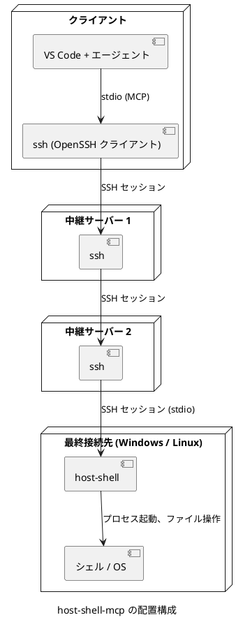

# host-shell-mcp 設計メモ

## この文書の目的

この文書は、クライアントのコーディング エージェントが、プレーンな SSH だけを経由して遠隔のマシンを調査、操作するための構成を検討した結果をまとめたものです。  
検討の経緯で比較した既存の方式と、採用する構成、名前、実装言語の判断根拠を記録します。

## 前提条件

利用環境は次のとおりです。

| 項目 | 前提 |
|---|---|
| クライアント | VS Code と一般的なコーディング エージェント (Claude Code、GitHub Copilot など) |
| 経路 | プレーンな SSH。段数と各段の認証方式は任意 |
| 禁止事項 | ポート転送 (`-L`、`-R`、`-D`、ProxyJump の中継) と SFTP は使えないものとする |
| 最終接続先 | Windows または Linux |
| 事前配置 | 最終接続先に実行ファイルを事前に配置してよい |
| 手元の資材 | クライアントに、遠隔と同じ構成のソースを置ける |

Table: 利用環境の前提

目的は、当初は読み取り専用の調査でしたが、検討の途中で「SSH で可能なシェル操作すべて (sudo を含む)」へ拡大しました。  
この文書は、拡大後の目的に基づいて記載します。

## 採用しなかった方式

### VS Code Remote-SSH

Remote-SSH は、内部で遠隔の VS Code Server へのポート転送を使います。  
sshd で TCP 転送が無効な場合は接続に失敗することが、利用者から報告されています ([TrueNAS フォーラム](https://forums.truenas.com/t/vscode-over-ssh/20815)、[HashiCorp サポート記事](https://support.hashicorp.com/hc/en-us/articles/48181191597331-Failed-to-set-up-socket-for-dynamic-port-forward-Socket-closed-TCP-port-forwarding-may-be-disabled))。  
転送なしで動かす公式の方法は確認できなかったため、採用しません。

### ProxyJump と ssh -W による多段接続

`ProxyJump` (`ssh -J`) と `-W` は、中継サーバー上で TCP 転送 (direct-tcpip チャネル) を使います。  
中継サーバーで `AllowTcpForwarding no` が設定されていると使えないため、採用しません。

### エージェントの Bash ツールから毎回 ssh を実行する方式

準備は不要ですが、呼び出しのたびに全段の接続と認証をやり直すため遅くなります。  
Windows 版 OpenSSH クライアントは ControlMaster (接続を使い回す機能) に対応していないと認識しています。  
また、cmd、PowerShell、bash の引用符の違いを、エージェントが毎回正しく扱う必要があります。  
試験的な利用にとどめます。

### SFTP によるマウント

sshfs、SSHFS-Win、rclone mount で手元にマウントする方式です。  
SFTP はポート転送ではなく SSH のサブシステムとして動くため、転送を禁止された環境の補助手段にはなります。  
ただし今回は SFTP も使えない前提とし、さらに多段経由の再帰的な検索は非常に遅いため、採用しません。

### 既存の SSH 系 MCP サーバー

既存の SSH 系 MCP サーバーの多くは手元で動き、SSH ライブラリまたは手元の `ssh` コマンドで接続先を操作します。  
代表例として [bbt567/remote-ssh-mcp](https://github.com/bbt567/remote-ssh-mcp) のソース (コミット `3a03702`、2026-07-13) を確認した結果は次のとおりです。

| 観点 | 確認結果 |
|---|---|
| 通信の方式 | ツールを呼ぶたびに `ssh -T -o BatchMode=yes ホスト "シェルコマンド"` を起動する。SSH のセッション (exec) だけを使う |
| SFTP | 使わない。読み取りは `head -c`、書き込みは標準入力から `cat >` で行う |
| ポート転送 | `remote_ssh_start_port_forward` だけが `ssh -L` を使う。呼ばなければ不要 |
| 多段接続 | `~/.ssh/config` の ProxyJump に任せる。中継サーバーで転送が禁止されていると使えない |
| Windows の接続先 | 遠隔側の処理が POSIX シェル前提のため、`exec` 以外は動かないと判断 (実機では未確認) |
| 認証 | `BatchMode=yes` 固定のため、公開鍵または ssh-agent に限られる |
| 接続の再利用 | 呼び出しごとに新しい接続を作る。ControlMaster は指定していない |

Table: bbt567/remote-ssh-mcp の確認結果

接続先が Linux で、中継サーバーで `ProxyCommand ssh hop1 nc %h %p` が使える場合は利用できます。  
しかし、Windows の接続先への対応と多段接続の性能が条件に合わないため、設計の参考にとどめます。  
同じ種類のサーバーとして [mcp-secure-shell](https://github.com/Brainwires/mcp-secure-shell)、[jeefies/remote-shell-mcp](https://glama.ai/mcp/servers/jeefies/remote-shell-mcp)、[ssh-mcp-rs](https://docs.rs/crate/ssh-mcp-rs/3.0.0) なども見つかりましたが、いずれも手元で動き SSH や SFTP で接続する方式です。

## 採用する構成

### 概要

最終接続先に、MCP サーバーとして動く単体の実行ファイル `host-shell` を配置します。  
クライアントのエージェントは、MCP の stdio 方式で起動するコマンドとして「入れ子の ssh で `host-shell` を起動するコマンド」を登録します。  
MCP の stdio 方式は、子プロセスの標準入出力で JSON-RPC をやり取りするだけなので、SSH のセッションの標準入出力をそのまま中継路として使えます。



### 多段接続の方式

中継サーバーの TCP 転送を使わないように、SSH の中で SSH を起動する入れ子の形で接続します。

```text
ssh -T hop1 ssh -T hop2 ssh -T target /opt/host-shell/host-shell --mcp
```

この形は各段の標準入出力をつなぐだけなので、`AllowTcpForwarding` の設定に影響されません。  
ただし、各中継サーバー上に次の段へ接続するための鍵などの認証手段が必要です。  
エージェント転送 (`-A`) を使う場合は、`AllowTcpForwarding` とは別の設定 `AllowAgentForwarding` が許可されている必要があります。

各段で `-T` を指定し、疑似端末を割り当てないことが重要です。  
疑似端末が入ると、改行の変換やエコーで JSON-RPC の通信が壊れることがあります。  
同じ理由で、接続先のシェル初期化ファイル (`.bashrc` など) が非対話のときに標準出力へ何かを出力すると通信が壊れるため、確認が必要です。

段数が多い場合や段ごとに認証方式が違う場合は、手元に接続用のラッパー スクリプトを置き、それをエージェントの設定に指定します。

### エージェントへの登録

VS Code の場合の例です。

```{.json caption=".vscode/mcp.json"}
{
  "servers": {
    "host-shell": {
      "type": "stdio",
      "command": "ssh",
      "args": ["-T", "hop1", "ssh", "-T", "hop2", "ssh", "-T", "target", "C:/tools/host-shell.exe", "--mcp"]
    }
  }
}
```

Claude Code の場合の例です。

```bash
claude mcp add host-shell -- ssh -T hop1 ssh -T hop2 ssh -T target /opt/host-shell/host-shell --mcp
```

### この構成の利点

接続は MCP のセッションの間ずっと1本のまま使い続けるため、多段接続でもツールの呼び出しごとに接続し直す遅延がありません。  
ツールの実装が Windows と Linux の差を吸収するため、エージェントは OS やシェルの引用符の違いを意識せずに同じツールを呼べます。  
出力サイズの上限、タイムアウト、操作の記録を接続先側で一元的に実装できます。

## 提供するツール

目的をシェル操作全体へ拡大したため、コマンド実行、ファイル操作、検索、特権実行を提供します。

| 分類 | ツールの内容 |
|---|---|
| コマンド実行 | 作業ディレクトリ、環境変数、標準入力、タイムアウトを指定してコマンドを実行する。Windows では cmd と PowerShell を選べるようにする |
| 長時間の実行 | 実行を開始して識別子を返し、後から出力の取得、状態の確認、停止を行う |
| ファイル操作 | ディレクトリ一覧、属性の取得、範囲を指定した読み取り、書き込み、バイナリの base64 での読み書き |
| 検索 | 正規表現による全文検索 (ripgrep 相当)、ファイル名での検索 |
| 差分の確認 | パスとハッシュの一覧を出力する。手元のソースと比べ、差分のあるファイルだけを読む用途に使う |
| 特権実行 | sudo を使ったコマンド実行 (Linux) |
| 環境情報 | OS、ホスト名、ユーザー、プロセス一覧などの取得 |

Table: host-shell が提供するツール

出力が大きい場合に備えて、すべてのツールで出力の上限を設け、超えた場合は先頭と末尾を残して切り詰めたことを示します。

## sudo の扱い

MCP の stdio 中継では疑似端末を割り当てないため、sudo が尋ねるパスワードの入力にエージェントは応答できません。  
この方式で sudo を使うには、次のどちらかが必要です。

- 接続先の sudoers で対象のユーザーに `NOPASSWD` を設定し、`sudo -n` (対話なし) で実行する
- パスワードを標準入力から渡す `sudo -S` に対応する。この場合は、パスワードがツールの引数やログに残らない設計が必要になる

運用の面では、前者を範囲を絞った sudoers の規則と組み合わせる方法を基本とします。

## 安全性

目的を拡大したため、任意のコマンドを実行できます。  
`authorized_keys` の `command="..."` や sshd の `ForceCommand` で `host-shell` の起動に固定すると、「この鍵での操作は必ず `host-shell` を経由する」ことは保証できます。  
ただし、`host-shell` 自体が任意のコマンドを実行できるため、権限を制限する効果はありません。

安全性は、次の組み合わせで確保します。

- 専用の鍵と専用のユーザーを使い、ユーザーの権限と sudoers の規則で操作の範囲を決める
- `host-shell` の側で、すべての操作を接続先のログ ファイルに記録する
- エージェント側で、書き込みや特権実行のツールに承認を必須にする

## 名前

リポジトリ名は `host-shell-mcp`、Go のモジュール パスは `github.com/hondarer/host-shell-mcp`、実行ファイル名は `host-shell` (Windows では `host-shell.exe`) とします。

`host` は「接続先のマシン上で動く」こと、`shell` は「シェル操作全般」を表します。  
`ssh` は通信経路にすぎず、手元で `ssh` を呼ぶ既存のツールと仕組みが逆であるため、名前に含めません。  
`remote-shell-mcp` は [jeefies/remote-shell-mcp](https://glama.ai/mcp/servers/jeefies/remote-shell-mcp) と、`ssh-*-mcp` 系は既存の多数のツールと重なるため避けます。  
`probe` を含む名前も、[Probe (@buger/probe-mcp)](https://probeai.dev/mcp-integration) や [mcp-probe](https://terminaltrove.com/mcp-probe) と重なるため避けます。

同じ名前のプロジェクトとして [funkyfunc/host-shell-mcp](https://github.com/funkyfunc/host-shell-mcp) があります。  
確認した内容は次のとおりで、小規模なため同じ名前を使っても実用上の支障は小さいと判断します。

| 項目 | 内容 |
|---|---|
| コミット | 5件。すべて 2026-09-26 の1日に集中している |
| 規模 | JavaScript で約 1,400 行 (`package-lock.json` を除く) |
| 配布 | npm には未公開。Cowork のプラグインとして配布 |
| 目的 | VM の中のエージェントから、利用者自身の Mac でコマンドを実行させる (macOS のみ) |

Table: funkyfunc/host-shell-mcp の概要

意味の面では、相手の `host` は「VM の外にある利用者自身のマシン」、こちらの `host` は「SSH の先にある接続先のマシン」で、少し重なります。  
README の冒頭で「接続先に配置し、SSH などの標準入出力で中継する」ことを明記して区別します。  
Go のモジュール パスは所有者名で区別され、Go のモジュール プロキシ上にも同じパスはまだありません (2026-10-29 時点)。

## 実装言語

Go を採用します。  
条件は「依存のない単体の実行ファイルにでき、Windows と Linux へ持ち運べること」です。

| 言語 | 単体配布 | クロスビルドの手間 | 古い OS への対応 | MCP SDK |
|---|---|---|---|---|
| Go | 容易 (静的リンクが既定に近い) | 小さい | Windows 10 以降、Linux カーネル 3.2 以降 | 公式あり |
| Rust | 可能 (Linux は musl で静的リンク) | 中程度 (ターゲットごとのツールチェーンが必要) | Windows 7 向けターゲットはあるが公式サポート外 | 公式あり (rmcp) |
| C (cplat を流用) | 可能 | 大きい (OS ごとにビルド環境を用意する) | 最も広い | なし (JSON-RPC を自作する) |

Table: 実装言語の比較

Go を選ぶ理由は次のとおりです。

- `CGO_ENABLED=0` で、glibc などの C ライブラリに依存しない静的な実行ファイルを作れる
- 1台の開発機で `GOOS` と `GOARCH` を切り替えるだけで、Windows 版と Linux 版 (amd64、arm64) を作れる
- 公式の MCP 用 Go SDK ([modelcontextprotocol/go-sdk](https://github.com/modelcontextprotocol/go-sdk)) があり、stdio 方式を標準で扱える

Go の制約として、Go 1.21 以降は Windows 10 または Windows Server 2016 以降が必要で、Go 1.24 以降は Linux カーネル 3.2 以降が必要です。  
この境界は私の知識に基づくもので、採用前に [Go の MinimumRequirements](https://go.dev/wiki/MinimumRequirements) で確認します。  
これより古い OS への対応が必須になった場合は、C (cplat の流用) か Rust を再検討します。  
ほかに、Windows のウイルス対策ソフトが Go 製の実行ファイルを誤検知する事例が知られており、コード署名で軽減できる場合があります。

## ビルドと配布

OS とアーキテクチャごとに1ファイルずつ配布します。  
1つのファイルが複数の OS で動く Cosmopolitan libc の APE 形式も検討しましたが、Windows でのプロセス制御や誤検知の扱いが未知数なため採用しません。

```bash
CGO_ENABLED=0 GOOS=linux GOARCH=amd64 go build -trimpath -ldflags="-s -w" -o dist/host-shell-linux-amd64 ./cmd/host-shell
```

```bash
CGO_ENABLED=0 GOOS=windows GOARCH=amd64 go build -trimpath -ldflags="-s -w" -o dist/host-shell-windows-amd64.exe ./cmd/host-shell
```

リポジトリの構成は次を想定します。

```text
host-shell-mcp/
  cmd/host-shell/main.go   -> host-shell / host-shell.exe
  internal/...
```

## 未決事項

- 接続先に Windows 10、Windows Server 2016 より古い OS が含まれるか
- Windows の接続先で、コマンド実行の既定を cmd と PowerShell のどちらにするか
- sudo を `NOPASSWD` だけに限るか、`sudo -S` にも対応するか
- 接続先での操作ログの保存先と保持期間
- SSH の切断時に、実行中の長時間ジョブを停止するか継続するか
