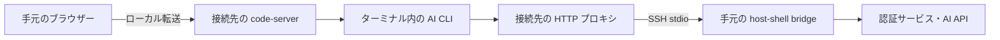

# 隔離環境の code-server から AI CLI を利用する

> [!NOTE]
> この文書が正本です。英訳は [../en/ai-cli.md](../en/ai-cli.md) にあります。内容が一致しない場合は日本語版が優先されます。

Copilot、agy、Claude Code、Codex、Grok の CLI を接続先のユーザー領域へ配置し、[code-server](code-server.md) のターミナルから利用する構成と検証手順を説明します。現時点では検証中のユースケースです。code-server 用スキルは AI CLI の導入・認証を自動実行しません。

## 接続の構成

接続先へ SSH の標準入出力で到達でき、手元のクライアントから認証サービスや AI API へ通信できることを前提にします。接続先からインターネットへの直接通信や、接続先のサービス設定の変更は必要ありません。必要な通信を SSH 経由で中継できることが条件であり、完全オフラインでの推論を意味しません。



CLI 本体、依存物、設定の転送には `transfer_push` を使用します。ブラウザーへの画面転送と CLI からの外部通信は、それぞれ[ポート転送](port-forward.md)と[クライアント経由 HTTP プロキシ](client-proxy.md)が担当します。

## 登録と通信経路

code-server の登録コマンドにプロキシのオプションを組み合わせます。以下の `api.vendor.example` と `auth.vendor.example` は説明用であり、実際の CLI のバージョン・認証方式に必要な宛先へ置き換えてください。

```bash
host-shell bridge --proxy \
    --proxy-allow-host 'api.vendor.example:443' \
    --proxy-allow-host 'auth.vendor.example:443' \
    --forward-allow-local '127.0.0.1:80[0-7]?' -- \
    ssh -T target /path/to/host-shell --mcp \
    --client-proxy --allow-forward-local
```

`job_start` で起動する code-server には `HTTP_PROXY`、`HTTPS_PROXY` と小文字版が設定され、ターミナルの子プロセスにも通常は継承されます。プロキシを有効にしてから code-server を起動してください。CLI が認証付き HTTP プロキシに対応しているか、シェル設定が環境変数を上書きしていないかを確認します。プロキシ URL には認証情報が含まれるため、`env` や `printenv` で出力しないでください。

`NO_PROXY` は継承されます。外部 API が除外対象になっていると直接通信を試みるため、接続先に合わせて設定します。許可先には推論 API だけでなく、ログイン、トークン更新、必要な追加機能の宛先も含めます。拒否の調査には `proxy_status` を使用します。HTTP CONNECT 後の TLS 通信は復号されません。CLI が独自の通信実装を使う場合や、平文 HTTP の Upgrade を必要とする場合は別途互換性確認が必要です。

## CLI の配置

1. 接続先の OS・CPU・libc と空き容量を確認します。Linux x86_64 での起動確認を、Windows や arm64 の確認として扱わないでください。
2. 手元で対象環境用の配布物を取得し、バージョン、配布元、SHA-256 を記録します。公式の署名・ハッシュが提供される場合は照合します。
3. `transfer_push` で専用ディレクトリ (例: `~/.local/share/host-shell-ai-cli/<CLI>/<version>/`) へ転送し、接続先でも SHA-256 を照合します。実行権限とランタイム・共有ライブラリーを確認します。
4. 最初は絶対パスで `--version` と `--help` を実行します。利用者の PATH やシェル起動ファイルを変更せずに確認できます。
5. code-server のターミナルから対話起動し、認証後に小さな検証用ディレクトリで推論・編集・コマンド実行を確認します。

手元のコマンドがシンボリックリンクの場合、リンク先の実体と必要な同梱ファイルを転送します。npm 版はエントリーポイントだけでは動きません。対象環境用の依存物と対応する Node.js が必要です。code-server 同梱の Node.js を CLI のランタイムとして利用できるとは限りません。自己更新や追加ツールの自動取得も別の通信・依存物を要求するため、初回検証では固定バージョンを使います。

## 認証と CLI ごとの確認

| CLI | 導入・認証で確認する点 |
| --- | --- |
| Copilot | ネイティブ版と npm 版を区別。npm 版は Node.js 22 以降が必要。リモート環境ではデバイスコード認証や対応トークンによる認証を検討する |
| agy | 同名コマンドとの混同を避け、配布元とバージョンを記録。対象版の認証方法、ランタイム、プロキシ対応を実機で確認する |
| Claude Code | ネイティブ配布物と OS 要件を確認。HTTP/HTTPS プロキシに対応。認証先と利用するモデル基盤に応じて許可先を設定する |
| Codex | 対象 OS 用の配布物と同梱ヘルパーを確認。ChatGPT または API キー認証を選択し、ヘッドレス環境の認証手順とサンドボックス要件を確認する |
| Grok | 同名 CLI があるため配布元とバージョンを固定。対象版のログイン、API 接続、プロキシ対応、補助プロセスを確認する |

Table: CLI ごとの確認点

デバイスコード認証では手元のブラウザーを利用できますが、接続先の CLI 自身も認証サーバーへ通信できる必要があります。ブラウザー認証が `localhost` へ戻る方式では、手元のブラウザーの localhost と接続先の localhost は別です。対応するデバイス認証を使うか、コールバックのポートを別途ローカル転送します。

認証は利用者が行い、API キーやトークンをドキュメント、ツール引数、会話履歴、検証ログへ貼り付けないでください。認証ファイルを含むホームディレクトリ全体の複製は避けます。同じ接続先ユーザーでは CLI の認証情報や会話履歴も共有され得るため、別アカウントを併用する場合は CLI が正式に対応する設定領域の分離方法を確認します。

公式資料: [Copilot の導入](https://docs.github.com/en/copilot/how-tos/copilot-cli/set-up-copilot-cli/install-copilot-cli)、[Copilot の認証](https://docs.github.com/en/copilot/how-tos/copilot-cli/set-up-copilot-cli/authenticate-copilot-cli)、[Claude Code の導入](https://code.claude.com/docs/en/setup)、[Claude Code のネットワーク設定](https://code.claude.com/docs/en/network-config)、[Codex の認証](https://learn.chatgpt.com/docs/auth?surface=cli)。agy と Grok の配布元は、検証対象の確定時に追記します。

## 隔離と終了

隔離の境界は接続先の OS・コンテナー・ファイル権限です。code-server 内から起動した CLI のファイル操作・コマンド実行には、host-shell の MCP ツール用のパス・コマンド制限や承認は適用されず、その内容も MCP の操作ログには記録されません。プロキシのログは接続先と結果を記録するもので、CLI の操作内容の監査を代替しません。

外部サービスへの通信では、プロンプトやコードが送信されます。隔離環境内で実行することと、データを外部へ送らないことは別の条件です。CLI 独自のサンドボックスも、接続先のカーネル機能やコンテナー設定によって動作しない場合があります。

MCP 接続終了時には code-server とプロキシ・転送を停止します。CLI とその補助プロセスの終了は実機で確認してください。Unix の別プロセスグループやセッションへ離脱した子孫は残る可能性があるため、ターミナル内の全プロセスが必ず回収されるとは扱いません。配置したバイナリ、認証情報、履歴は切断だけでは削除されません。

## 検証状況

2026-11-02 時点の結果です。手元の Linux x86_64 に配置済みの以下の実体で、単体実行とローカル host-shell の PTY 付き `job_start` の両方で `--version` が終了コード 0 になることを確認しました。配布元の照合、接続先への注入、認証・推論の成功を意味しません。

| CLI | 手元のバージョン | 単体 / host-shell PTY 起動 |
| --- | --- | --- |
| Copilot | 1.0.83 | 成功 / 成功 |
| agy | 1.4.12 | 成功 / 成功 |
| Claude Code | 2.1.316 | 成功 / 成功 |
| Codex | 0.166.0 | 成功 / 成功 |
| Grok | 1.0.70 | 成功 / 成功 |

Table: 初期確認

Codex は読み取り専用ファイルシステムで PATH 用エイリアスを作成できない警告を出しましたが、バージョン表示は成功しました。この環境固有の警告は、通常操作の成功を示すものではありません。

`internal/clientproxy`、`internal/jobs`、`internal/bridge` の既存テストも成功しています。これは中継・ジョブ管理の基盤の確認であり、各 AI CLI の API 互換性の確認ではありません。

実機では次の段階を順に記録します。

| 段階 | 合格条件 | 状態 |
| --- | --- | --- |
| 配置 | 対象への転送・ハッシュ照合・依存物確認 | 接続経路の指定待ち |
| 起動 | 対象で `--version`・`--help` が成功 | 未検証 |
| ターミナル | code-server 内で描画・入力・Ctrl-C・リサイズが動作 | 未検証 |
| 認証 | 選択した方式でログイン・トークン更新が成功 | 未検証 |
| 推論 | 接続先の直接通信を遮断し、bridge 経由だけで応答を取得 | 未検証 |
| 操作 | 検証用ファイルの編集と小さなコマンドの実行が成功 | 未検証 |
| 終了 | MCP 切断後、code-server・CLI・補助プロセス・待ち受けを確認 | 未検証 |
| 複数接続 | 別接続の起動・認証状態・切断の影響を確認 | 未検証 |

Table: 実機検証の段階

検証記録には OS・CPU・libc、CLI と code-server と host-shell のバージョン、配布元・ハッシュ、認証方式 (秘密値を除く)、許可先、成功段階と失敗理由を残します。
