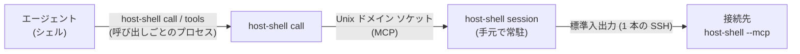

# MCP を登録できないエージェントからの CLI での利用

> [!NOTE]
> この文書が正本です。英訳は [../en/cli-without-mcp.md](../en/cli-without-mcp.md) にあります。内容が一致しない場合は日本語版が優先されます。

MCP サーバーを登録できないエージェントから、シェルのコマンドだけで `host-shell` のツールを使う方法を説明します。手元で `host-shell session start` を起動しておくと、エージェントは `host-shell call TOOL ...` と `host-shell tools` で、MCP で登録した場合と同じツール (`exec_run`、`job_*`、`fs_*`、`transfer_*`、`forward_*` など) を呼べます。

```bash
host-shell session start --detach -- ssh -T target /tmp/host-shell-1000/host-shell --mcp
host-shell tools
host-shell call exec_run command='uname -a'
host-shell session stop
```

> [!IMPORTANT]
> 使う前に、組織のポリシーがシェル経由での接続先の操作を許していることを確認してください。MCP を禁じる規則の趣旨は「MCP サーバーの登録の禁止」とは限らず、「エージェントから他の機械を操作することの禁止」である場合があります。その場合は、この方法も規則の趣旨に反します。

## 使いどころ

- 組織のポリシーやエージェントの設定で MCP サーバーの登録が無効になっているが、エージェントはシェルのコマンドを実行できる。
- MCP に対応していないエージェントやスクリプトから、`host-shell` のツールを使う。

シェルを使えず、ファイルの読み書きしかできないエージェントは対象外です。

## 構成



- **セッション** (`host-shell session start`): 手元で常駐し、接続先との接続を保ちます。中身は `host-shell bridge` と同じで、ファイル転送、ポート転送、クライアント経由 HTTP プロキシ、名前解決の中継も同じように使えます。
- **CLI** (`host-shell call`、`host-shell tools`): エージェントがシェルから実行するたびに、ソケットでセッションに接続し、ツールを 1 回呼んで終了します。
- `host-shell` の内部 (CLI とセッションの間、セッションと接続先の間) は MCP で通信します。接続先には、MCP で登録する場合と同じ `host-shell --mcp` を配置します。

セッションを終了すると接続先との接続が閉じます。MCP で登録した場合と同じく、接続先は開始したコマンドとジョブ、ポート転送、プロキシを片付けます。

## 手順

### 接続先の準備

接続先への配置と経路の確認は、MCP で登録する場合と同じです ([利用ガイド](user-guide.md))。`host-shell-connect` スキルを使う場合は、最後の段階で「CLI で利用する」を選ぶと、`host-shell-cli` スキルへ進みます。

手元の `host-shell` は、`make dist` の `dist/` またはリリース アーカイブの手元の OS 用の実行ファイルを使います。

### セッションの開始

`host-shell bridge` の登録コマンドの `bridge` を `session start` に置き換えます。`bridge` のオプションは `--` の前、接続先のオプションは `--mcp` の後に書きます。

前面で起動する (端末を占有し、Ctrl+C で終了します):

```bash
host-shell session start -- ssh -T hop1 ssh -T target /tmp/host-shell-1000/host-shell --mcp
```

切り離して起動する (接続できた時点で状態を JSON で出力して戻ります):

```bash
host-shell session start --detach -- ssh -T -o BatchMode=yes target /tmp/host-shell-1000/host-shell --mcp
```

| 起動の形 | 使う場面 |
| --- | --- |
| 前面 | SSH のパスワードや多要素認証を端末で入力する経路。接続先が `--confirm` を使う場合 ([確認が必要なツール](#確認が必要なツール)) |
| `--detach` | 鍵認証、または [`host-shell ssh-pass`](ssh-password.md) で保存したパスワードで接続できる経路。エージェントがセッションの開始から行う場合 |

Table: 起動の形

切り離したセッションには端末がないため、パスワードの入力はできません。接続に失敗した場合は、セッションのログを標準エラーに出力して終了コード 1 で戻ります。

エージェントのシェルが、コマンドの終了時にそのコマンドが起動したプロセスをすべて終了させる場合は、エージェントが `--detach` で開始したセッションも、そのコマンドとともに終了します。Codex の sandbox (`workspace-write`) がこの動作です。この場合は、利用者が自分の端末でセッションを開始してください。

### ツールの一覧と使い方

```bash
host-shell tools                        # ツール名と説明の最初の文
host-shell tools --instructions         # 接続先の OS、シェル、文字コード、上限、有効な機能
host-shell tools --schema exec_run      # 説明の全文と入力スキーマ (JSON)
host-shell call help_get topic=commands # 接続先の詳しい説明
```

### ツールの呼び出し

`host-shell call` の直後にツール名を書き、オプションと引数を続けます。

```bash
host-shell call exec_run command='ls -la /var/log'
host-shell call exec_run argv=sh argv=-c argv='echo "$HOME"'
host-shell call fs_write path=/tmp/app.conf content=@app.conf
host-shell call exec_run --json - <<'EOF'
{"command": "Get-ChildItem 'C:\\Program Files' | Select-Object -First 5", "shell": "powershell"}
EOF
```

| 形 | 意味 |
| --- | --- |
| `KEY=VALUE` | 入力スキーマの型に変換します。文字列はそのまま、整数・数値・真偽値 (`true`、`false`) はその型に、配列とオブジェクトは JSON として解釈します。文字列の配列は、同じキーを繰り返すと 1 要素ずつ追加します |
| `KEY=@FILE` | 手元のファイルの内容を値にします。キーの型が文字列なら内容をそのまま、それ以外は JSON として解釈します。`@` で始まる文字列そのものは `@@` と書きます |
| `--json FILE` | 引数全体を JSON オブジェクトとしてファイルから読みます。`-` は標準入力です。`KEY=VALUE` で同じキーを指定した場合は `KEY=VALUE` を優先します |

Table: 引数の渡し方

入力スキーマにないキーや、型に変換できない値は、ツールを呼ばずにエラーにします (使えるキーを表示します)。引用符を含む値 (PowerShell のコマンド、JSON、スクリプト) は、手元のシェルの引用符の規則で壊れないよう `--json -` と標準入力で渡してください。

| オプション | 意味 |
| --- | --- |
| `--session NAME` | 使うセッション。省略時は環境変数 `HOST_SHELL_SESSION`、それもなければ `default` |
| `--json FILE` | 上記 |
| `--quiet` | 進捗とログを標準エラーに出力しない |

Table: host-shell call のオプション

結果は、ツールが返した JSON を 1 行で標準出力に出力します。MCP で登録した場合にエージェントが受け取る内容と同じです。進捗は標準エラーに出力します。

| 終了コード | 意味 |
| --- | --- |
| 0 | 成功。`exec_run` が実行したコマンド自体の終了コードは、結果の `exit_code` で確認します |
| 1 | ツールがエラーを返した (内容を標準エラーに出力) |
| 2 | 使い方の誤り (未知のツール、引数の誤りを含む) |
| 3 | セッションに接続できない、または呼び出しの途中でセッションか接続先との接続が切れた |
| 130 | 割り込みで中断した (接続先の処理はキャンセルされます) |

Table: host-shell call の終了コード

- `host-shell call` を Ctrl+C で中断した場合や、エージェントのシェルの実行時間の上限でプロセスが終了させられた場合は、接続先の処理もキャンセルされます。時間のかかる処理は、`job_start` で開始して `job_read` の `wait_sec` (と `until`) で接続先で待つか、`exec_run` の `timeout_sec` をシェルの上限より短く指定してください。
- 複数の `host-shell call` を同時に実行できます。進捗は、要求した `host-shell call` にだけ届きます。
- `transfer_push` と `transfer_pull` の手元のパスは、`host-shell call` を実行したディレクトリからの相対パスです。

### 複数のセッション

接続先ごとに名前を付けて開始し、`--session` または `HOST_SHELL_SESSION` で選びます。

```bash
host-shell session start --detach --name web -- ssh -T web /tmp/host-shell-1000/host-shell --mcp
host-shell session start --detach --name db -- ssh -T db /tmp/host-shell-1000/host-shell --mcp
host-shell call fs_read --session web path=/etc/hosts
HOST_SHELL_SESSION=db host-shell call exec_run command=uptime
```

名前に使える文字は英数字、`.`、`_`、`-` で、長さは 1〜32 文字です。

### セッションの状態と終了

```bash
host-shell session status [--name NAME]   # 状態を JSON で出力
host-shell session list                   # 動作中のセッションを 1 行に 1 つ JSON で出力
host-shell session stop [--name NAME]     # 終了を要求し、終了するまで待つ
```

作業が終わったらセッションを終了してください。セッションは次のいずれかで終了します。

- `host-shell session stop`
- 前面のセッションでの Ctrl+C、または SIGTERM
- `--idle-timeout DURATION` を指定した場合、`host-shell call` などの接続がない状態がその時間続いたとき (ポート転送やプロキシの通信は数えません)
- 接続先との接続の切断 (終了コード 1)

## 確認が必要なツール

接続先の `--confirm` で利用者の確認が必要なツールは、次のように扱います。

- 前面で起動し、標準入力と標準エラーが端末であるセッションは、その端末に確認を表示します。`y` (または `yes`) で実行し、それ以外は拒否します (`host-shell call` は終了コード 1)。呼び出しがキャンセルされた場合は、確認を取り下げます。

  ```text
  [host-shell session default] host-shell on target: allow fs_remove with {"path":"/tmp/x"}?
  Allow? [y/N]:
  ```

- 切り離したセッションと端末のないセッションは、確認が必要なツールを実行せずにエラーを返します。
- 確認の答えはセッションの端末からだけ受け付けます。`host-shell call` やソケットの側から渡された答えは、接続先へ渡しません。

`host-shell call` を実行するのはエージェント自身です。CLI の側で確認を尋ねると、エージェントが自分の呼び出しを自分で承認できてしまうため、確認は利用者が見ている端末で行います。

## エージェントの許可設定

ツール名が `host-shell call` の直後に来るため、エージェントの許可設定でツールごとに許可を分けられます。Claude Code の例:

```json
{
  "permissions": {
    "allow": [
      "Bash(host-shell call fs_read:*)",
      "Bash(host-shell call search_grep:*)",
      "Bash(host-shell tools:*)"
    ]
  }
}
```

コマンド名で照合する許可設定は、エージェントが実行ファイルを変数に入れた場合や、1 回のシェルの呼び出しに複数のコマンドを並べた場合に一致しないことがあります。エージェントには、1 回の呼び出しで `host-shell` のコマンドを 1 つだけ実行するよう指示してください。

## セッションの保存場所

ソケット (`NAME.sock`)、状態 (`NAME.json`)、切り離したセッションのログ (`NAME.log`) は、次のディレクトリに置きます。環境変数 `HOST_SHELL_SESSION_DIR` で変更できます。

| OS | ディレクトリ |
| --- | --- |
| Linux | `$XDG_RUNTIME_DIR/host-shell/sessions`。`XDG_RUNTIME_DIR` がない場合は一時ディレクトリの `host-shell-UID/sessions` |
| macOS | `/tmp/host-shell-UID/sessions` (`XDG_RUNTIME_DIR` がない場合) |
| Windows | `%LOCALAPPDATA%\host-shell\sessions` |

Table: セッションの保存場所

- ディレクトリは本人だけが使える権限で作ります (Linux・macOS は 0700、Windows は本人だけの保護された DACL)。Linux・macOS では、既存のディレクトリが他の利用者の所有である場合、または他の利用者に権限がある場合は、使わずにエラーにします。
- ソケットに接続できるのは本人のプロセスだけです。本人のプロセスであれば、どのプロセスもツールを呼べます。これは、本人が `ssh` で接続先を操作できることと同じ範囲です。
- Unix ドメイン ソケットのパスは 103 バイト以下である必要があります。長すぎる場合は、`HOST_SHELL_SESSION_DIR` に短いディレクトリを指定してください。

## トラブルシューティング

| 症状 | 対処 |
| --- | --- |
| `no session "NAME" is running` (終了コード 3) | `host-shell session list` で動作中のセッションを確認し、セッションを開始するか、`--session` を正しく指定します |
| `session start --detach` がログを出力して終了コード 1 で戻る | ログは経路 (`ssh`) と接続先の出力です。経路と配置を [利用ガイド](user-guide.md) の手順で確認します |
| 切り離したセッションが途中で終了した | セッションのディレクトリの `NAME.log` を確認します |
| `this tool needs the user's confirmation, but this session cannot ask` | 接続先が `--confirm` を使っています。利用者が端末でセッションを前面で起動します |
| `socket path ... is too long` | `HOST_SHELL_SESSION_DIR` に短いディレクトリを指定します |
| `... is accessible to other users` | セッションのディレクトリの権限を 0700 にするか、`HOST_SHELL_SESSION_DIR` で別のディレクトリを指定します |

Table: トラブルシューティング

## 検証済みの範囲

| 項目 | 方法・環境 | 状態 |
| --- | --- | --- |
| 引数の変換、セッションの開始・状態・一覧・停止、同じ名前のセッションの拒否、残ったソケットの片付け、ディレクトリの権限の確認、`--idle-timeout`、`--detach` (失敗時のログの出力を含む)、確認 (端末での承認・拒否・取り下げ、端末のないセッションでの拒否、クライアントが渡した答えを渡さないこと)、複数の呼び出しの並行と進捗の届け先、キャンセル (割り込みとプロセスの終了)、接続先の切断、`--finish-on-eof`、終了コード | 自動テスト。CI (GitHub Actions の ubuntu-latest、windows-latest、macos-latest) | 検証中 |

Table: 検証状況

## 制限

- シェルを使えないエージェントは対象外です。
- `host-shell` の内部では MCP で通信します。MCP の通信そのものを禁じる環境では使えません。
- 確認が必要なツールは、前面で起動したセッションでしか使えません。
- 確認 (`--confirm`) は `host-shell` を通る操作に対するものです。シェルを使えるエージェントが `ssh` で接続先を直接操作することは、この仕組みでは防げません (MCP で登録した場合も同じです)。
- 切り離したセッションは、対話的な認証 (パスワードの入力、多要素認証) を使えません。
