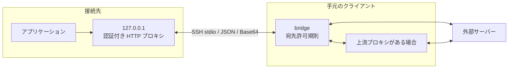

# クライアント経由 HTTP プロキシ

> [!NOTE]
> この文書が正本です。英訳は [../en/client-proxy.md](../en/client-proxy.md) にあります。内容が一致しない場合は日本語版が優先されます。

接続先から外部へ直接通信できない環境において、HTTP プロキシに対応した接続先アプリケーションの HTTP / HTTPS 通信を、クライアント側 `bridge` のネットワーク経由で中継します。既存の SSH セッションの標準入出力のみを使用し、SSH のポート転送は不要です。既定では無効です。HTTP 以外の TCP 通信や逆向きの通信には [ポート転送](port-forward.md) を使用します。

本機能は `sshd` の転送機能を使用しないため、`sshd` の `no-port-forwarding` や `AllowTcpForwarding no` では制限されません。接続先で `--client-proxy` を指定した場合にのみ利用できます。

## 起動

クライアント側と接続先の両方で明示的に有効化し、`bridge` に宛先許可規則を指定します。

```bash
host-shell bridge --proxy --proxy-allow-host 'packages.example.com:443' -- \
    ssh -T target /path/to/host-shell --mcp --client-proxy
```

- `bridge` 側では `--proxy` と `--proxy-allow-host` (複数指定可)、接続先では `--client-proxy` を指定します。
- `--proxy` を指定する場合は、`--proxy-allow-host` が 1 件以上必要です。
- 片側のみの有効化、両端のバージョン不一致、または不正な許可規則がある場合は起動エラーになります。
- `--no-transfer` とも併用できます。
- `--proxy-deny-host HOST[:PORT]` (複数指定可) で明示的な拒否規則を指定できます。許可と拒否の両方に一致する宛先は拒否します。
- MCP でのセッション中の変更を許す場合は `--proxy-allow-rule-updates` を追加します。指定しなければ更新ツールは公開されません。



通常の HTTP プロキシ要求と `CONNECT` メソッドに対応します。TLS の復号や証明書の差し替えは行いません。接続先は Linux / Windows、`bridge` は Linux / Windows / macOS に対応します。

## 経路と制限

- **宛先許可規則**: `--proxy-allow-host` にはホスト名の glob と任意のポート番号を指定します (例: `packages.example.com:443`、`*.example.com:443`)。CIDR 表記と Unix ドメイン ソケットは指定できません。この規則は要求されたホスト名を検査するものであり、名前解決後の IP アドレスを制限するものではありません (プライベート IP アドレスも一律には禁止しません)。
- **クライアント側の環境変数**: `bridge` はクライアント起動時の `HTTP_PROXY`、`HTTPS_PROXY`、`NO_PROXY` (および小文字版) を参照するため、上流プロキシ経由の通信にも対応します。接続先の環境変数はクライアント側へ引き継がれません。また、中継失敗時に直接接続へ自動で切り替えたり再試行したりすることはありません。
- **接続先子プロセスへの環境変数設定**: 接続先の `exec_run` および `job_start` で起動するプロセスには、`HTTP_PROXY` と `HTTPS_PROXY` (および小文字版) にローカル中継プロキシの URL を自動設定し、`NO_PROXY` はそのまま維持します。自動設定の後に `--unset-env` が適用され、最後にツール引数の `env` が適用されます (Windows では環境変数名の大文字・小文字を区別しません)。
- **各ツールの優先順位**: `net_request_http` で `proxy` 引数 (プロキシ URL または `none`) を明示指定した場合はその指定が優先され、省略時は中継プロキシ設定と `NO_PROXY` に従います (`unix_socket` 指定時は直接接続します)。`exec_sudo` は `sudo` 自身の環境変数引き継ぎ規則に従うため、プロキシ環境変数が自動伝播するとは限りません。
- **制限の範囲**: 本機能は OS 全体の通信を隔離するものではありません。`CONNECT` は許可されたポートへの任意の TCP ストリームを中継できるため、必要な宛先とポートのみを許可してください。接続先に `--allow-host` が指定されている場合は、ネットワーク ツール (`net_*`) に対する制限として引き続き適用されます。

### DNS と許可対象外の切り分け

本機能は HTTP プロキシであり、接続先 OS の DNS 問い合わせ自体を中継するものではありません。プロキシへホスト名を渡す通信では、クライアント側 (上流プロキシ利用時はその経路) で名前解決します。そのため、ネットワークを持たないコンテナーで `getaddrinfo` や `nslookup` が失敗しても、プロキシ経由の HTTP/HTTPS 通信は成立します。プロキシ接続前に `getaddrinfo` で独自の名前解決を行う Linux/glibc 上のプログラムには、[接続元を使う名前解決 (remote-dns)](remote-dns.md) (`--remote-dns`) を併用してください。

`proxy_status` の `destination not allowed` は宛先許可規則による拒否であり、DNS エラーではありません (HTTP では 403、HTTPS では `CONNECT` に対する 403)。許可済みホストの通信、拒否されたホストとポート、アプリ側のエラーを照合して判断してください。

### Windows の接続先

Windows の接続先では、次の 2 つのクライアントに追加の指定が必要です。

| クライアント | 症状 | 対処 |
|---|---|---|
| `curl.exe` (Windows 同梱、TLS は Schannel) | `CONNECT` は成功するが、証明書の失効確認先 (CRL、OCSP) に届かず `CRYPT_E_REVOCATION_OFFLINE` (終了コード 35) で失敗する | `--ssl-revoke-best-effort` (確認できなければ省略する) を指定する。失効確認を行う場合は、認証局の CRL・OCSP の宛先を `--proxy-allow-host` で許可する |
| Windows PowerShell 5.1 の `Invoke-WebRequest`・`Invoke-RestMethod` | `HTTPS_PROXY` を読まず、接続先で名前解決しようとして失敗する | `-Proxy` と `-ProxyCredential` を指定する (下記) |

Table: Windows の接続先で追加の指定が必要なクライアント

```powershell
$u = [Uri]$env:HTTPS_PROXY
$user, $pass = $u.UserInfo.Split(':', 2)
$cred = New-Object PSCredential($user, (ConvertTo-SecureString ([Uri]::UnescapeDataString($pass)) -AsPlainText -Force))
Invoke-WebRequest -UseBasicParsing -Proxy "http://$($u.Authority)" -ProxyCredential $cred https://api.github.com/zen
```

プロキシの URL には認証情報が含まれるため、変数の値を表示しないでください。

確認した環境は、Windows 11 Enterprise (ビルド 26300、amd64) の接続先で、curl 8.21.0 (Schannel) と Windows PowerShell 5.1.26100 です。どちらも、許可済みの `api.github.com:443` への HTTPS が対処の後で成功し、未許可の宛先は `CONNECT` に対する 403 になりました (検証済)。PowerShell 7 (`pwsh`) と他の HTTP クライアントは未検証です。

## 認証と診断

接続先の中継プロキシは IPv4 ループバック (`127.0.0.1`) の動的ポートのみで待ち受け、セッション固有のトークンによるプロキシ認証を要求します。

- 同一ユーザーの外部プロセスからプロキシを利用する場合は、`sys_get_info` の `proxy_url_file` が示すファイルから認証付きプロキシ URL を読み取れます。このファイルの内容を会話や通常のログへ貼り付けないでください。
- URL ファイルは接続ユーザーのみが読み取れる権限で作成され、正常終了時および切断時に削除されます (権限を確保できない場合は起動に失敗します)。強制終了等でファイルが残った場合でも、そのトークンは次のセッションでは使用できません。
- 通常のツール結果、操作ログ、進捗通知に含まれるセッション トークンは自動的にマスクされます。

### proxy_status (bridge)

`bridge` が公開する読み取り専用ツール `proxy_status` で、中継の状態や拒否された宛先・理由を確認できます。

```json
{"after_seq": 0, "limit": 20}
```

- **入力**: `after_seq` (0 以上の整数、既定 `0`)、`limit` (1〜100、既定 `20`)。
- **出力**: `enabled`、`state`、`allow_hosts`、`deny_hosts`、`rules_revision`、`active_connections`、`events`、`next_seq`、`truncated`。
- `events` の各要素は `seq`、`time`、`connection_id`、`host`、`port`、`result` (`allowed` / `denied` / `failed`)、`reason`、および集約時の `count` を持ちます。直近 100 件を保持し、`seq` の昇順で返します。継続取得時は前回の `next_seq` を `after_seq` に渡します。`truncated` は履歴の脱落または未返却のイベントがあることを示します。
- 同じメタ情報は `bridge` の標準エラーにも出力されます。リクエスト本文、URL のパスやクエリ、資格情報は診断情報に含まれません。
- 通信が拒否された場合は `host`、`port`、`reason` を確認し、利用者が判断した必要な宛先のみを許可します。更新ツールが有効なら、後述の手順で再起動せずに反映できます。無効なら起動オプションの変更と再接続が必要です。エージェントが独断で許可範囲を広げることはできません。

### proxy_rules_update (bridge)

`bridge` を `--proxy --proxy-allow-rule-updates` 付きで起動すると、セッション内の宛先許可・拒否規則を変更する `proxy_rules_update` を公開します。接続先の追加オプションは不要です。プロキシを無効にした状態で後から有効化する機能ではありません。

1. `proxy_status` で現在の `allow_hosts`、`deny_hosts`、`rules_revision` を取得します (初期世代は `1`)。
2. 利用者が承認した変更を加えた **両リスト全体** を、取得した世代番号とともに渡します。差分追加の API ではないため、維持する既存宛先も含めます。

```json
{
  "expected_revision": 1,
  "allow_hosts": ["api.github.com:443", "hondarer-soft.com:443"],
  "deny_hosts": []
}
```

- 戻り値は更新後の `allow_hosts`、`deny_hosts`、`rules_revision` です (`proxy_status` で取得した既存規則を基にリスト全体を構成してください)。
- 入力の規則をすべて検証してから一括で交換します。不正な規則や世代番号の不一致では変更されません (競合時は `proxy_status` を読み直してください)。
- 拒否 (`deny_hosts`) が許可 (`allow_hosts`) より優先します。空の `allow_hosts` は新規接続をすべて拒否します。
- 更新後の規則は新しい中継接続から適用され、処理中の要求や既存の `CONNECT` トンネルは切断しません。
- 変更は現在のセッションのメモリ内のみで有効です (`bridge` の標準エラーに世代番号と両リストを記録します)。設定ファイルは書き換えず、次回接続時は起動オプションの規則に戻ります。
- 対象はクライアント経由 HTTP/HTTPS プロキシのみです。接続先の `--allow-host`、ポート転送の許可規則、`remote-dns` の設定は変更しません。

### 接続先の操作ログ

接続先の操作ログには、次のレコードが記録されます。

- `proxy_connect`: HTTP 要求 1 件または `CONNECT` 1 件ごとに、種別 (`http` / `connect`)、宛先のホストとポート、結果 (`allowed` / `denied` / `failed`)、および理由を記録します。URL のパス・クエリ、ヘッダー、本文、資格情報は記録しません。結果は `bridge` への中継ストリームを開いた時点のものであり、HTTP 要求で `bridge` から上流サーバーへの接続が後から失敗した場合 (HTTP 502) も `allowed` と記録されます。
- `proxy_auth_failed`: プロキシ認証失敗 (HTTP 407) の件数を記録します。最初の失敗は即座に 1 件として記録し、以降は 1 分ごとにその間の件数をまとめて記録します (セッション終了時に未記録分があれば終了時に出力します)。認証前の要求の宛先は記録しません。

## 上限と終了

- **同時接続とウィンドウ**: 最大同時接続数は 64 ([ポート転送](port-forward.md) と共有)、1 フレームあたりの復号後データは最大 16 KiB、片方向のフロー制御ウィンドウは 64 KiB です。通常の MCP メッセージとチャネル制御フレームはデータ フレームより優先され、送信キューの上限によりメモリ使用量を制限します。
- **タイムアウト**: 上流接続および HTTP ヘッダー待ちは 30 秒、無通信タイムアウトは 5 分、終了時の待機は最大 5 秒です。
- **HTTP エラー応答**: 宛先拒否は `403`、プロキシ認証失敗は `407`、同時接続上限到達は `503`、上流接続失敗は `502`、接続確立タイムアウトは `504` を返します。`CONNECT` 確立後の通信障害はストリームのクローズで通知します。セッション切断時には待ち受けと全中継接続を閉じます。
- **MCP 制限オプションとの関係**: 接続先の `--tools` や `--read-only` は MCP ツールの公開範囲を制御するものであり、プロキシ経由の通信自体は制限しません。プロキシ通信の可否は両端の明示的な有効化と `bridge` の `--proxy-allow-host` で管理してください。
