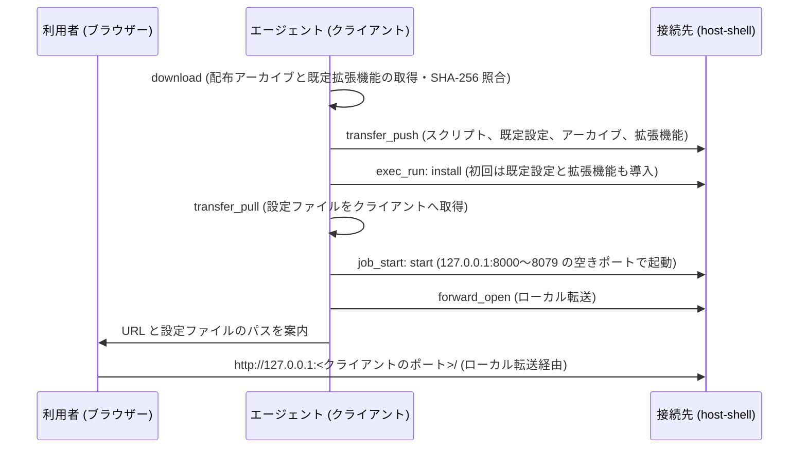

# 接続先への code-server の導入

> [!NOTE]
> この文書が正本です。英訳は [../en/code-server.md](../en/code-server.md) にあります。内容が一致しない場合は日本語版が優先されます。

インターネットに接続できない閉鎖環境の接続先へ、`host-shell` を通じて [code-server](https://github.com/coder/code-server) (ブラウザーで動作する VS Code) を導入・起動し、[ポート転送](port-forward.md) 経由で手元のブラウザーから開く手順を説明します。初回導入時には、既定の設定と拡張機能もあわせて適用します。

一連の手順は `host-shell-code-server` スキル (`.agents/skills/host-shell-code-server/`) にまとめられており、エージェントが MCP ツールを使って自動実行します。この文書では、事前の準備、導入される内容、および運用上の注意点を説明します。

## 概要



- 接続先はインターネットへ接続しません。配布アーカイブと拡張機能はクライアント側で取得し、SHA-256 ハッシュを照合したうえで接続先へ転送します。接続先でも展開・導入前に同じ SHA-256 ハッシュを再照合します。
- code-server は接続先の `127.0.0.1` のポート 8000〜8079 のうち、最初に空いているポートのみで待ち受け、ローカル転送を介してクライアントから接続します ([待ち受けポート](#待ち受けポート))。クライアント側の待ち受けポートは自動で割り当てられます。
- code-server とポート転送は、MCP セッションの終了とともに停止します。

## 対象環境

| 接続先 | 確認状況 |
| --- | --- |
| Linux x86_64 | 実機で確認済み |
| Linux arm64 (aarch64) | 配布物の取得・照合・選択のみ確認済み (実機では未確認) |
| Windows amd64 | 実機で確認済み |

Table: 対象の接続先

Windows arm64 は対象外です (code-server の公式リリースに配布バイナリが存在しないため)。対象とする code-server のバージョンは 4.144.0 (VS Code 1.144.0 相当) です。

- **Linux の接続先**: `bash`、`tar`、`gzip`、`sha256sum`、`od` が必要です (`python3` や `curl` は不要です)。code-server 同梱の Node.js は glibc を必要とするため、Alpine Linux など musl ベースの環境では動作しません。`install` スクリプトは、glibc が存在しない場合や `HOME` に書き込めない場合、アーカイブを展開する前にエラーで停止します。
- **Windows の接続先**: Windows PowerShell 5.1 以降と OS 標準の `tar.exe` を使用します。
- **クライアント**: Linux、macOS、Windows に対応します。Linux と macOS のクライアントでは取得処理に `curl` と `python3` を使用します。
- **コンテナー**: `podman exec -i` 等で接続した稼働中の Linux コンテナー内にも導入できます。コンテナー固有の条件は [コンテナーへの接続](container.md) を参照してください。

## 事前の準備 (登録コマンド)

ローカル転送を使用するため、MCP サーバーの登録コマンドに次のオプションを指定してください。登録内容を変更した場合は、エージェントから MCP サーバーへ再接続してください。

| 場所 | オプション | 内容 |
| --- | --- | --- |
| 接続先 | `--allow-forward-local` | ローカル転送を許可する。`--allow-host` を併用している場合は `127.0.0.1:80[0-7]?` も許可に含める |
| `bridge` | `--forward-allow-local '127.0.0.1:80[0-7]?'` | エージェントが `forward_open` で開ける宛先を、接続先の code-server 用ポート (8000〜8079) に限定する |

Table: 必要なオプション

```bash
host-shell bridge --forward-allow-local '127.0.0.1:80[0-7]?' \
    -- ssh -T target /path/to/host-shell --mcp --allow-forward-local
```

- `80[0-7]?` は許可規則のポート glob であり、8000〜8079 に一致します。シェルに展開されないよう引用符で囲んでください。
- スクリプトと配布物の転送に `bridge` の `transfer_push` を使用するため、`--read-only` を指定した接続先や `--no-transfer` を指定した `bridge` では使用できません。
- 必要なオプションが不足している場合、エージェントは処理を中断し、追加すべきオプションを案内します。

## 待ち受けポート

`start` スクリプトは接続先の `127.0.0.1` のポート 8000〜8079 を順に調べ、最初に空いているポートで code-server を起動します。エージェントは code-server が出力する `HTTP server listening on http://127.0.0.1:<ポート>/` からポート番号を読み取り、そのポートへのローカル転送を開きます。

- ポート 8000〜8079 がすべて使用中の場合は、`no free port in 8000-8079 on 127.0.0.1` を出力して終了します。
- 環境変数 `CODE_SERVER_PORT` を指定すると、そのポートのみを使用します (使用中の場合はエラーで終了します)。
- 空き確認から待ち受け開始までの間に別プロセスが同じポートを取得した場合、code-server は `EADDRINUSE` で終了し、エージェントが `start` を再実行します。
- `bridge` の許可規則が `127.0.0.1:8000` のみになっており、ポート 8000 が使用中だった場合は、別ポートで起動した code-server への転送が拒否されます。その場合、エージェントは code-server を停止し、許可規則を `'127.0.0.1:80[0-7]?'` に変更して再接続するよう案内します。

## パスワード

code-server はパスワード認証を有効にして起動します。パスワードは初回導入時に接続先でランダム生成 (48 桁の 16 進文字列) され、設定ファイル `config.yaml` に保存されます。

- パスワードはツール結果に出力されないため、エージェントとの会話履歴には残りません。
- エージェントは `transfer_pull` で設定ファイルをクライアントの `~/.config/host-shell-code-server/<接続先名>/config.yaml` (Windows クライアントでは `%USERPROFILE%\.config\host-shell-code-server\<接続先名>\config.yaml`) へコピーし、そのファイル パスのみを利用者へ案内します。ファイル内の `password:` 行に記載された値がログイン パスワードです。
- 接続先の設定ファイルは、所有者のみが読み取れる権限で作成されます。
- ブラウザーのログイン セッションはクライアント側のポート番号ごとに保持されます。転送を開き直してポート番号が変わった場合は、再度ログインしてください。

## 既定の設定と拡張機能

スキルの `defaults/` ディレクトリにあるファイルが、初回導入時に接続先の code-server へ適用されます。これらのファイルは利用者が事前に編集できます。

| ファイル | 配置先 (code-server のユーザー データ配下) | 適用条件 |
| --- | --- | --- |
| `defaults/User/settings.json` | `User/settings.json` | 配置先にファイルが存在しない場合のみ |
| `defaults/Machine/settings.json` | `Machine/settings.json` | 配置先にファイルが存在しない場合のみ |
| `defaults/extensions.txt` | 拡張機能ディレクトリ | マーカー ファイル `.host-shell-code-server-defaults` が存在しない場合のみ |

Table: 既定の設定と拡張機能

同梱されている設定の主な項目と前提条件は次のとおりです (前提条件を満たさない環境でも該当設定が無視されるだけで、エラーにはなりません)。

| 設定項目 | 前提条件 |
| --- | --- |
| カラー テーマ `Visual Studio Dark - C++` | 拡張機能 `ms-vscode.cpptools-themes` (既定の拡張機能に含まれる) |
| フォント `UDEV Gothic HSRFJPDOCEM` (15px) | クライアントのブラウザー環境で該当フォントが利用可能であること |
| PlantUML JAR のパス (`plantuml.jar`、`markdown-preview-enhanced.plantumlJarPath`) | 接続先に該当 JAR ファイルが配置されていること |
| ワークスペース信頼確認の無効化、Git 自動フェッチ、空白文字の表示、差分での行末空白比較 | なし |

Table: 同梱されている設定

### 拡張機能の取得

`extensions.txt` には 1 行に 1 件ずつ `publisher.name` または `publisher.name@version` を記述します (`#` 以降はコメント)。クライアント側の `download` スクリプトが、接続先のアーキテクチャーごとに Open VSX から拡張機能を取得します。

1. 接続先プラットフォーム (`linux-x64`、`linux-arm64`、`win32-x64`) 向けのパッケージを探し、なければ全プラットフォーム共通 (`universal`) のパッケージを選択します。
2. プレリリース版を除外し、`@version` 指定があればそのバージョンを、なければ VS Code 1.144.0 に対応する最新バージョンを選択します。
3. Open VSX が公開する SHA-256 ハッシュと照合してから保存し、選択したバージョンと SHA-256 を `packages/extensions/<種類>/resolved-extensions.txt` に記録します。
4. 該当する拡張機能が見つからない場合は警告を出してスキップし、記録ファイルにコメントとして理由を残します。

接続先の `install` スクリプトは、記録された SHA-256 ハッシュを照合したうえでオフラインで拡張機能を導入し、全件の導入が完了した時点でマーカー ファイルを作成します。途中で失敗した場合はマーカー ファイルを作成しないため、次回の `install` 実行時に再試行されます。

### 既定値へのリセット

一度適用された設定や拡張機能は、利用者が code-server 上で変更・削除した後に `install` を再実行しても上書き・復元されません。既定の状態に戻したい場合は、接続先のユーザー データ内にある `User/settings.json`、`Machine/settings.json`、およびマーカー ファイル `.host-shell-code-server-defaults` のうちリセットしたい対象を削除してから `install` を再実行してください。

## 個別の拡張機能の追加導入

閉鎖環境の code-server は、そのままでは拡張機能マーケットプレース (Open VSX) へ接続できません。追加の拡張機能を導入する場合は、次のいずれかの方法を使用します。

- **`.vsix` ファイルの転送**: クライアント側に用意した `.vsix` ファイルをエージェントが接続先へ転送し、`install --extension <ファイル>` で導入します。
- **[クライアント経由 HTTP プロキシ](client-proxy.md) の利用**: 接続先の `--client-proxy` と `bridge` の `--proxy` を有効にし、`--proxy-allow-host open-vsx.org:443` と `--proxy-allow-host openvsx.eclipsecontent.org:443` を指定します (`--proxy-allow-host` はカンマ区切り非対応のため宛先ごとに指定します)。code-server は `HTTPS_PROXY` 経由でマーケットプレースに接続するため、`install --extension <ID>` でもブラウザー上の拡張機能ビューからでも導入できます (いずれも動作確認済み)。

ブラウザーの拡張機能ビューを使用する場合、操作によって通信元が異なります。

| 操作 | 通信元 | 必要な接続経路 |
| --- | --- | --- |
| 検索、詳細の表示 | クライアントのブラウザー | ブラウザーから `open-vsx.org` および `openvsx.eclipsecontent.org` へ直接接続できること (`bridge` のプロキシは経由しません) |
| インストール | 接続先の code-server | 上記 2 件の `--proxy-allow-host` による中継プロキシ |

Table: 拡張機能ビューの通信経路

- 特定の発行元の拡張機能を初めてインストールする際は、発行元を信頼するかどうかの確認ダイアログが表示されます。
- `bridge` の `proxy_status` に拒否された宛先として `mobile.events.data.microsoft.com` (テレメトリ通信) が記録されることがありますが、拡張機能の検索・インストールには影響しません。

## 停止とアンインストール

- **停止**: エージェントが `forward_close` と `job_stop` を実行します (MCP セッションの終了時にも自動停止します)。
- **アンインストール**: `job_stop` の後に `uninstall` スクリプトを実行します。既定では code-server 本体のみを削除し、設定ファイル、ユーザー データ、拡張機能、転送済みキットは残します。`--purge` (Windows では `-Purge`) を指定すると、これらもすべて削除します。

接続先でのファイル配置先は下表のとおりです。[code-server-launcher](https://github.com/Hondarer/code-server-launcher) とは別名 (`host-shell-code-server`) のディレクトリを使用するため、同一接続先に launcher 版の code-server が導入されていても互いに影響しません。

| 用途 | Linux | Windows |
| --- | --- | --- |
| 転送したファイル一式 (kit) | `~/.local/share/host-shell-code-server/kit/` | `%LOCALAPPDATA%\host-shell-code-server\kit\` |
| code-server 本体 | `~/.local/lib/host-shell-code-server/code-server-<バージョン>/` | `%LOCALAPPDATA%\host-shell-code-server\code-server-<バージョン>\` |
| 設定ファイル | `~/.config/host-shell-code-server/config.yaml` | `%USERPROFILE%\.config\host-shell-code-server\config.yaml` |
| ユーザー データ | `~/.local/share/host-shell-code-server/user-data/` | `%LOCALAPPDATA%\host-shell-code-server\user-data\` |
| 拡張機能 | `~/.local/share/host-shell-code-server/extensions/` | `%LOCALAPPDATA%\host-shell-code-server\extensions\` |
| セッション用ソケット | ユーザー データ内の `code-server-ipc.sock`。パス長が Unix ドメイン ソケットの上限 (107 バイト) を超える場合は `$XDG_RUNTIME_DIR/host-shell-code-server-ipc.sock` (`XDG_RUNTIME_DIR` 未設定時は `/tmp/host-shell-code-server-<uid>/ipc.sock`) | 名前付きパイプ (ファイルは作成されない) |

Table: 接続先のファイル配置

上記のほか、code-server と拡張機能は他の VS Code 系製品と共有するディレクトリに小さなファイル (合計数十 KB) を作成する場合があります (`~/.vscode-oss-shared/`、`~/.copilot/logs/`、`~/.cache/Microsoft/`、`~/.local/state/crossnote/` など。Windows では `%USERPROFILE%` 配下)。これらは共有領域であるため `--purge` でも削除しません。なお、code-server が既定パスに出力する `coder-logs` と `heartbeat` は `--purge` で削除されます。

## 転送サイズと所要時間の目安

開発環境 (WSL) で SSH を介さず `bridge` と接続先 `host-shell` を直接接続して測定した参考値です。実際の所要時間は SSH 経路の回線帯域に依存します (`transfer_push` は base64 エンコードで送信するため、通信量は元サイズの約 1.33 倍になります)。

| 項目 | Linux x86_64 | Windows amd64 |
| --- | --- | --- |
| 配布アーカイブ | 231 MB、16 秒 | 212 MB、17 秒 |
| 既定の拡張機能 (20 件) | 144 MB、3 秒 | 144 MB、4 秒 |
| `install` (展開と拡張機能の導入) | 43 秒 | 82 秒 |

Table: 転送サイズと所要時間 (測定値)

2 回目以降の転送では、SHA-256 が一致する未変更ファイルはスキップされます。

## セキュリティ上の注意

- code-server の内蔵ターミナルやファイル操作は、`host-shell` のポリシー制限 (`--allow-command`、`--allow-path`、`--deny-command` など) を経由せず、`host-shell` の操作ログにも記録されません (接続先の操作ログに記録されるのはポート転送の接続 `forward_connect` のみです)。接続先にポリシー制限が設定されている場合、エージェントはこの点を説明し、利用者の明示的な承認を得てから処理を進めます。接続先の管理者は `--allow-forward-local` の許可有無によってこの経路を制御できます。
- クライアント側の待ち受けポートには接続認証がないため、クライアント マシン上の他ユーザーからも接続可能です。code-server のパスワード認証は無効化しないでください。
- code-server は接続先の `127.0.0.1` のみで待ち受けるため、接続先の外部ネットワークからは直接アクセスできません。

## 保守

スキルのスクリプト群は [code-server-launcher](https://github.com/Hondarer/code-server-launcher) の `download`、`install`、`start`、`uninstall` をベースに `host-shell` 向けの拡張を加えたものです。既定の設定と拡張機能リストは `code-server-container` の既定値と共通です。バージョンの更新手順は [開発ガイド](development.md#code-server-導入スキルの保守) を参照してください。
