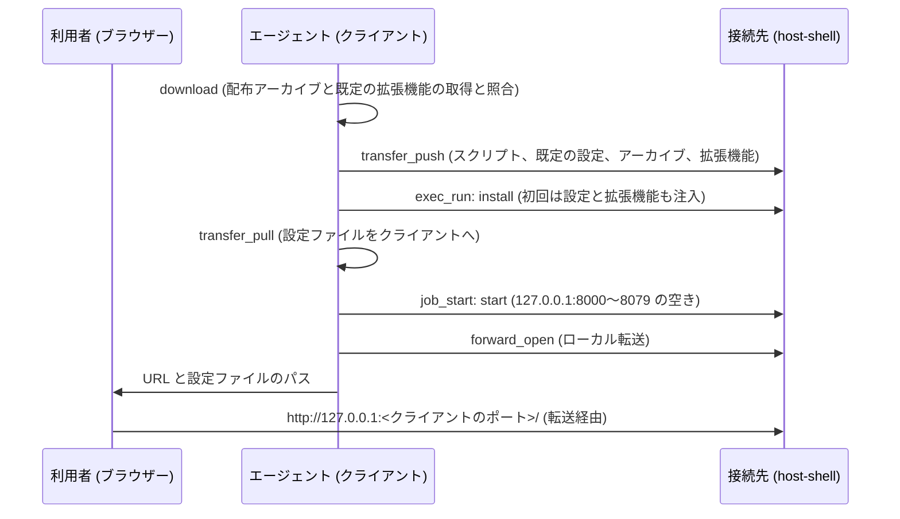

# 接続先への code-server の注入

インターネットに接続できない閉鎖環境の接続先へ、host-shell を通じて [code-server](https://github.com/coder/code-server) (ブラウザーで動く VS Code) を導入・起動し、[ポート転送](port-forward.md) で手元のブラウザーから開きます。初回の導入では、既定の設定と拡張機能も注入します。

手順はスキル `host-shell-code-server` (`.agents/skills/host-shell-code-server/`) にまとめてあり、エージェントが MCP のツールで実行します。この文書は、利用者が事前に準備することと、注入される内容、注意点を説明します。

## 概要



- 接続先はインターネットに接続しません。配布アーカイブと拡張機能はクライアントで取得し、SHA-256 で照合してから送ります。接続先でも同じ SHA-256 で照合します。
- code-server は接続先の `127.0.0.1` の 8000〜8079 のうち、最初に空いているポートだけで待ち受け、ローカル転送でクライアントから接続します ([待ち受けポート](#待ち受けポート))。クライアント側のポートは自動で割り当てます。
- code-server と転送は、MCP セッションの終了で止まります。

## 対象

| 接続先 | 確認状況 |
| --- | --- |
| Linux x86_64 | 実機で確認済み |
| Linux arm64 (aarch64) | 配布物の取得・照合・選択だけを確認 (実機では未確認) |
| Windows amd64 | 実機で確認済み |

Table: 対象の接続先

Windows arm64 は対象外です (code-server の公式リリースに配布物がありません)。code-server は 4.144.0 (VS Code 1.144.0) です。

接続先 (Linux) で必要なコマンドは `bash`、`tar`、`gzip`、`sha256sum`、`od` です。`python3` や `curl` は必要ありません。code-server の node は glibc を必要とするため、Alpine など musl の環境では使えません。install は、glibc がない場合と、HOME が書き込めない場合に、展開の前に止まります。Windows の接続先は Windows PowerShell 5.1 以降と、OS 標準の `tar.exe` を使います。

クライアントは Linux、macOS、Windows です。Linux と macOS のクライアントでは `curl` と `python3` を使います。

稼働中のコンテナーの中 (`podman exec -i` などで接続) にも注入できます。コンテナーに固有の条件は [コンテナーの中への接続](container.md) を参照してください。

## 事前の準備 (登録コマンド)

ローカル転送を使うため、MCP サーバーの登録コマンドに次のオプションが必要です。登録を変えた場合は、エージェントで MCP サーバーに接続し直してください。

| 側 | オプション | 内容 |
| --- | --- | --- |
| 接続先 | `--allow-forward-local` | ローカル転送を許可します。`--allow-host` を指定している場合は、`127.0.0.1:80[0-7]?` も許可してください |
| bridge | `--forward-allow-local '127.0.0.1:80[0-7]?'` | エージェントが forward_open で開ける宛先を、接続先の code-server のポート (8000〜8079) に限ります |

Table: 必要なオプション

```sh
host-shell bridge --forward-allow-local '127.0.0.1:80[0-7]?' \
  -- ssh -T target /path/to/host-shell --mcp --allow-forward-local
```

- `80[0-7]?` は許可規則のポートの glob で、8000〜8079 に一致します。シェルに展開されないよう、引用符で囲みます。
- スクリプトと配布物の送付に bridge の transfer_push を使うため、`--read-only` の接続先や、bridge の `--no-transfer` では使えません。
- オプションが足りない場合、エージェントは手順を止めて、必要なオプションを案内します。

## 待ち受けポート

start は、接続先の `127.0.0.1` の 8000 から 8079 までを順に調べ、最初に空いているポートで code-server を起動します。エージェントは code-server が出力する `HTTP server listening on http://127.0.0.1:<ポート>/` からポートを読み取り、そのポートへ転送を開きます。

- 8000〜8079 がすべて使用中の場合は、`no free port in 8000-8079 on 127.0.0.1` で止まります。
- 環境変数 `CODE_SERVER_PORT` を指定すると、そのポートだけを使います。使用中なら止まります。
- 調べてから待ち受けるまでの間に他のプロセスが同じポートを取った場合、code-server は `EADDRINUSE` で終了します。エージェントは start をもう一度実行します。
- bridge の許可規則が `127.0.0.1:8000` だけの登録で、8000 が使用中だった場合は、転送が拒否されます。エージェントは code-server を止め、許可規則を `'127.0.0.1:80[0-7]?'` に変えて接続し直すよう案内します。

## パスワード

code-server はパスワード認証で起動します。パスワードは接続先で初回の導入時に生成し (48 桁の 16 進数)、設定ファイル `config.yaml` に保存します。

- パスワードはツールの結果に表示されないため、エージェントとの会話には残りません。
- エージェントは設定ファイルを transfer_pull でクライアントの `~/.config/host-shell-code-server/<接続先の名前>/config.yaml` (Windows のクライアントは `%USERPROFILE%\.config\host-shell-code-server\<接続先の名前>\config.yaml`) へ写し、そのパスだけを示します。ファイルの `password:` の行がログインのパスワードです。
- 接続先の設定ファイルは、作成した利用者だけが読める権限で作成します。
- ブラウザーのログイン状態はクライアントのポートごとに保存されます。転送を開き直すとポートが変わるため、ログインし直す場合があります。

## 既定の設定と拡張機能

スキルの `defaults/` に置いたファイルを、初回の導入時に接続先の code-server へ注入します。内容は利用者が編集できます。

| ファイル | 注入先 (code-server のユーザー データ) | 注入の条件 |
| --- | --- | --- |
| `defaults/User/settings.json` | `User/settings.json` | 注入先にファイルがない場合だけ |
| `defaults/Machine/settings.json` | `Machine/settings.json` | 注入先にファイルがない場合だけ |
| `defaults/extensions.txt` | 拡張機能のフォルダー | 目印のファイル `.host-shell-code-server-defaults` がない場合だけ |

Table: 既定の設定と拡張機能

同梱している設定の主な内容と、その前提は次のとおりです。前提がない場合は、その項目が効かないだけでエラーにはなりません。

| 設定 | 前提 |
| --- | --- |
| カラー テーマ `Visual Studio Dark - C++` | 拡張機能 `ms-vscode.cpptools-themes` (既定の拡張機能に含む) |
| フォント `UDEV Gothic HSRFJPDOCEM` (15px) | クライアントのブラウザーにそのフォントがあること |
| PlantUML の JAR のパス (`plantuml.jar`、`markdown-preview-enhanced.plantumlJarPath`) | 接続先にその JAR があること |
| ワークスペースの信頼の無効化、git の自動フェッチ、空白の表示、diff の行末空白 | なし |

Table: 同梱している設定

### 拡張機能の取得

`extensions.txt` には 1 行に 1 件、`publisher.name` または `publisher.name@version` を書きます (`#` 以降はコメント)。クライアントの download が、接続先の種類ごとに Open VSX から拡張機能を取得します。

1. 接続先のプラットフォーム (`linux-x64`、`linux-arm64`、`win32-x64`) 向けの版を探し、なければ全プラットフォーム共通 (`universal`) の版を使います。
2. プレリリースを除き、`@version` があればその版を、なければ VS Code 1.144.0 で動く最新版を選びます。
3. Open VSX が公開する SHA-256 で照合してから保存し、選んだ版と SHA-256 を `packages/extensions/<種類>/resolved-extensions.txt` に記録します。
4. 見つからない拡張機能は飛ばして警告し、記録にコメントで理由を残します。

接続先の install は、記録した SHA-256 で照合してから、ネットワークに接続せずに導入します。すべて導入できた後に目印のファイルを作ります。失敗した場合は目印を作らないため、次の install で再び試みます。

### 既定に戻す

設定は、利用者が code-server の画面で変えても、install を再び実行しても上書きされません。拡張機能も、利用者が削除したものは戻りません。既定に戻す場合は、接続先のユーザー データにある `User/settings.json`、`Machine/settings.json`、目印の `.host-shell-code-server-defaults` のうち、戻したいものを削除してから install を実行します。

## 個別の拡張機能の導入

閉鎖環境の code-server は、そのままでは拡張機能のマーケットプレース (Open VSX) に接続できません。次のどちらかで導入します。

- `.vsix` ファイル: クライアントに用意した `.vsix` をエージェントが送り、`install --extension <ファイル>` で導入します。
- [クライアント経由 HTTP プロキシ](client-proxy.md): 接続先の `--client-proxy` と、bridge の `--proxy` を有効にし、`--proxy-allow-host open-vsx.org:443` と `--proxy-allow-host openvsx.eclipsecontent.org:443` を指定します。`--proxy-allow-host` はカンマで区切れないため、宛先ごとに指定します。code-server は HTTPS_PROXY を使ってマーケットプレースに接続するため、`install --extension <ID>` でも、画面の拡張機能ビューからでも導入できます (どちらも確認済み)。

画面の拡張機能ビューでは、通信する側が操作によって異なります。

| 操作 | 通信する側 | 必要な接続 |
| --- | --- | --- |
| 検索、詳細の表示 | クライアントのブラウザー | ブラウザーから `open-vsx.org` と `openvsx.eclipsecontent.org` へ直接接続できること (プロキシを通りません) |
| 導入 | 接続先の code-server | 上記の 2 つの `--proxy-allow-host` |

Table: 拡張機能ビューの通信

- ある発行者の拡張機能を初めて導入するときは、発行者を信頼するかの確認が表示されます。
- bridge の `proxy_status` には、拒否された接続先として `mobile.events.data.microsoft.com` (テレメトリー) が現れる場合がありますが、検索と導入には必要ありません。

## 終了と削除

- 終了: エージェントが forward_close と job_stop を行います。MCP セッションの終了でも止まります。
- 削除: job_stop の後に uninstall を実行します。既定では code-server の本体だけを削除し、設定、ユーザー データ、拡張機能、送付したファイル一式は残します。`--purge` (Windows は `-Purge`) を指定すると、これらもすべて削除します。

接続先の配置は次のとおりです。[code-server-launcher](https://github.com/Hondarer/code-server-launcher) とは別の名前を使うため、同じ接続先に launcher で導入した code-server があっても互いに影響しません。

| 用途 | Linux | Windows |
| --- | --- | --- |
| 送付したファイル一式 | `~/.local/share/host-shell-code-server/kit/` | `%LOCALAPPDATA%\host-shell-code-server\kit\` |
| 本体 | `~/.local/lib/host-shell-code-server/code-server-<版>/` | `%LOCALAPPDATA%\host-shell-code-server\code-server-<版>\` |
| 設定ファイル | `~/.config/host-shell-code-server/config.yaml` | `%USERPROFILE%\.config\host-shell-code-server\config.yaml` |
| ユーザー データ | `~/.local/share/host-shell-code-server/user-data/` | `%LOCALAPPDATA%\host-shell-code-server\user-data\` |
| 拡張機能 | `~/.local/share/host-shell-code-server/extensions/` | `%LOCALAPPDATA%\host-shell-code-server\extensions\` |

Table: 接続先の配置

code-server とその拡張機能は、上記のほかに、他の VS Code 系の製品と共有する場所へ小さなファイル (合計数十 KB) を作ります (`~/.vscode-oss-shared/`、`~/.copilot/logs/`、`~/.cache/Microsoft/`、`~/.local/state/crossnote/` など。Windows は `%USERPROFILE%` 配下)。共有の場所であるため、`--purge` でも削除しません。code-server が既定の場所に書く `coder-logs` と `heartbeat` は、`--purge` で削除します。

## 送付量と所要時間

作業環境 (WSL) で、SSH を使わずに bridge と接続先の host-shell を直接つないで測定した値です。実際の所要時間は SSH の経路の帯域に依存します (transfer_push は base64 で送るため、通信量は約 1.33 倍です)。

| 項目 | Linux x86_64 | Windows amd64 |
| --- | --- | --- |
| 配布アーカイブ | 231 MB、16 秒 | 212 MB、17 秒 |
| 既定の拡張機能 (20 件) | 144 MB、3 秒 | 144 MB、4 秒 |
| install (展開と拡張機能の導入) | 43 秒 | 82 秒 |

Table: 送付量と所要時間 (測定値)

2 回目以降の送付では、内容が同じファイルは送りません。

## セキュリティ上の注意

- code-server の内蔵端末とファイル操作は、host-shell の制限 (`--allow-command`、`--allow-path`、`--deny-command` など) を通らず、host-shell の操作ログにも記録されません。接続先の操作ログに残るのは、転送の接続 (`forward_connect`) だけです。接続先に制限がある場合、エージェントはこのことを示し、利用者の承認を得てから進めます。接続先の管理者は、`--allow-forward-local` を許可するかどうかでこの経路を管理できます。
- クライアントの待ち受けポートは接続を認証しないため、クライアントの他のユーザーも接続できます。code-server のパスワード認証を無効にしないでください。
- code-server は接続先の `127.0.0.1` だけで待ち受けるため、接続先のネットワークからは接続できません。

## 保守

スキルのスクリプトは [code-server-launcher](https://github.com/Hondarer/code-server-launcher) の download、install、start、uninstall を複写して拡張したものです。既定の設定と拡張機能の一覧は code-server-container の既定値と同じ内容です。版の更新手順は [開発ガイド](development.md) を参照してください。
