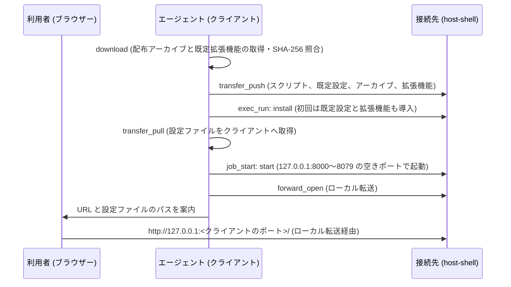
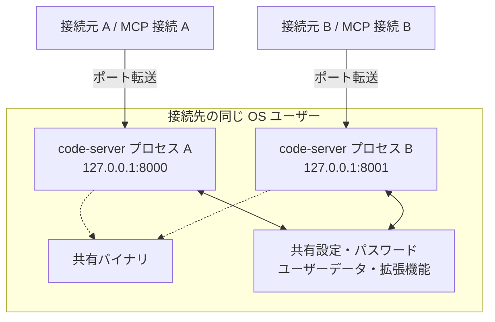

# 接続先への code-server の導入

> [!NOTE]
> この文書が正本です。英訳は [../en/code-server.md](../en/code-server.md) にあります。内容が一致しない場合は日本語版が優先されます。

インターネットに接続できない閉鎖環境の接続先へ、`host-shell` を通じて [code-server](https://github.com/coder/code-server) (ブラウザーで動作する VS Code) を導入・起動し、[ポート転送](port-forward.md) 経由で手元のブラウザーから開く手順を説明します。初回導入時には、既定の設定と拡張機能もあわせて適用します。

一連の手順は `host-shell-code-server` スキル (`.agents/skills/host-shell-code-server/`) にまとめられており、エージェントが MCP ツールを使って自動実行します。この文書では、事前の準備、導入される内容、および運用上の注意点を説明します。

CLI 型 AI コーディングエージェントを接続先へ配置してターミナルから利用する構成と検証状況は、[隔離環境への CLI 型 AI コーディングエージェントの導入](coding-agents.md) を参照してください。

手元のデスクトップ版 VS Code (Remote - SSH 拡張機能) と手元の GitHub サインインをそのまま使いたい場合 (Linux 接続先で `/usr/sbin/sshd` が利用可能な場合) は、[VS Code Remote - SSH での接続先の利用](vscode-remote-ssh.md) を参照してください。ブラウザーだけで完結させたい場合、Windows 接続先や `sshd` のないコンテナーを使う場合、MCP 切断時の自動停止や [`remote-dns`](remote-dns.md) が必要な場合は、本書の code-server を使用します。

## 概要



- 接続先はインターネットへ接続しません。配布アーカイブと拡張機能はクライアント側で取得し、SHA-256 ハッシュを照合したうえで接続先へ転送します。接続先でも展開・導入前に同じ SHA-256 ハッシュを再照合します。
- code-server は接続先の `127.0.0.1` のポート 8000〜8079 のうち、最初に空いているポートのみで待ち受け、ローカル転送を介してクライアントから接続します ([待ち受けポート](#待ち受けポート))。クライアント側の待ち受けポートは自動で割り当てられます。
- code-server とポート転送は、MCP セッションの終了とともに停止します ([接続中だけ動作する](user-guide.md#接続中だけ動作する))。

## 対象環境

| 接続先 | 検証状況 |
| --- | --- |
| Linux x86_64 | 実機で検証済 |
| Linux arm64 (aarch64) | 配布物の取得・照合・選択のみ検証済 (実機では未検証) |
| Windows amd64 | 実機で検証済 |

Table: 対象の接続先

Windows arm64 は対象外です (code-server の公式リリースに配布バイナリが存在しないため)。対象とする code-server のバージョンは 4.144.0 (VS Code 1.144.0 相当) です。

- **Linux の接続先**: `bash`、`tar`、`gzip`、`sha256sum`、`od` が必要です (`python3` や `curl` は不要です)。code-server 同梱の Node.js は glibc を必要とするため、Alpine Linux など musl ベースの環境では動作しません。`install` スクリプトは、glibc が存在しない場合や `HOME` に書き込めない場合、アーカイブを展開する前にエラーで停止します。
- **Windows の接続先**: Windows PowerShell 5.1 以降と OS 標準の `tar.exe` を使用します。
- **クライアント**: Linux、macOS、Windows に対応します。Linux と macOS のクライアントでは取得処理に `curl` と `python3` を使用します。
- **コンテナー**: `podman exec -i` 等で接続した稼働中の Linux コンテナー内にも導入できます。コンテナー固有の条件は [コンテナーへの接続](container.md) を参照してください。

## 事前の準備 (登録コマンド)

ローカル転送を使用するため、MCP サーバーの登録コマンドに次のオプションを指定してください。登録内容を変更した場合は、エージェントから MCP サーバーへ再接続してください。

| 場所 | オプション | 内容 |
| --- | --- | --- |
| 接続先 | `--allow-forward-local` | ローカル転送を許可する。`--allow-host` を併用している場合は `127.0.0.1:80[0-7]?` も許可に含める |
| `bridge` | `--forward-allow-local '127.0.0.1:80[0-7]?'` | エージェントが `forward_open` で開ける宛先を、接続先の code-server 用ポート (8000〜8079) に限定する |

Table: 必要なオプション

```bash
host-shell bridge --forward-allow-local '127.0.0.1:80[0-7]?' \
    -- ssh -T target /path/to/host-shell --mcp --allow-forward-local
```

- `80[0-7]?` は許可規則のポート glob であり、8000〜8079 に一致します。シェルに展開されないよう引用符で囲んでください。
- スクリプトと配布物の転送に `bridge` の `transfer_push` を使用するため、`--read-only` を指定した接続先や `--no-transfer` を指定した `bridge` では使用できません。
- 必要なオプションが不足している場合、エージェントは処理を中断し、追加すべきオプションを案内します。

## 待ち受けポート

`start` スクリプトは接続先の `127.0.0.1` のポート 8000〜8079 を順に調べ、最初に空いているポートで code-server を起動します。エージェントは code-server が出力する `HTTP server listening on http://127.0.0.1:<ポート>/` からポート番号を読み取り、そのポートへのローカル転送を開きます。

- ポート 8000〜8079 がすべて使用中の場合は、`no free port in 8000-8079 on 127.0.0.1` を出力して終了します。
- 環境変数 `CODE_SERVER_PORT` を指定すると、そのポートのみを使用します (使用中の場合はエラーで終了します)。
- Windows の接続先では、開くフォルダーを URL で指定します。`start.ps1` が出力する `workspace URL path: /?folder=%2FC%3A%2FUsers%2Falice` の形のパスを、クライアントの URL (`http://127.0.0.1:<クライアントのポート>`) に続けて開きます。code-server の Windows 版は、起動時に渡したフォルダーを `?folder=C:\Users\alice` の形にして転送するため、ブラウザーがフォルダーを開けません (`filesystem プロバイダーを解決できません`)。そのため `start.ps1` はフォルダーを code-server に渡さず、ルートの URL は空のウィンドウを開きます。UNC パスのフォルダーには対応しません。
- 空き確認から待ち受け開始までの間に別プロセスが同じポートを取得した場合、code-server は `EADDRINUSE` で終了し、エージェントが `start` を再実行します。
- `bridge` の許可規則が `127.0.0.1:8000` のみになっており、ポート 8000 が使用中だった場合は、別ポートで起動した code-server への転送が拒否されます。その場合、エージェントは code-server を停止し、許可規則を `'127.0.0.1:80[0-7]?'` に変更して再接続するよう案内します。

## 同じ接続先ユーザーへの複数の MCP 接続

複数の接続元から同じ接続先ユーザーで接続する場合、導入済みの code-server バイナリを共有し、各 MCP 接続から `job_start` で別々の code-server プロセスを起動できます。接続先のサービス設定を変更する必要はありません。



- 各プロセスは 8000〜8079 の別々の空きポートで待ち受け、各接続元は自分のポート転送経由でブラウザーから利用します。たとえば、接続元 A は接続先のポート 8000、接続元 B はポート 8001 を使用します。`CODE_SERVER_PORT` で同じポートを指定すると、後から起動する側はエラーになります。
- MCP 接続が終了すると、その接続で起動した code-server とポート転送が停止します。他の MCP 接続で起動した code-server は引き続き動作します。
- code-server の設定ファイル (ログイン パスワードを含む)、ユーザー データ、拡張機能の保存先は共有します。同じ接続先ユーザーの権限で動作するため、設定・拡張機能の変更や同じファイルへの編集は他の接続にも影響します。ブラウザーごとに利用できても、利用者ごとに分離された環境にはなりません。

導入は最初に一度行い、以降の接続では起動とポート転送を行ってください。利用中の共有バイナリやデータに影響する更新・削除は、すべての接続で code-server を停止してから行ってください。

## パスワード

code-server はパスワード認証を有効にして起動します。パスワードは初回導入時に接続先でランダム生成 (48 桁の 16 進文字列) され、設定ファイル `config.yaml` に保存されます。

- パスワードはツール結果に出力されないため、エージェントとの会話履歴には残りません。
- エージェントは `transfer_pull` で設定ファイルをクライアントの `~/.config/host-shell-code-server/<接続先名>/config.yaml` (Windows クライアントでは `%USERPROFILE%\.config\host-shell-code-server\<接続先名>\config.yaml`) へコピーし、そのファイル パスのみを利用者へ案内します。ファイル内の `password:` 行に記載された値がログイン パスワードです。
- 接続先の設定ファイルは、所有者のみが読み取れる権限で作成されます。
- ブラウザーのログイン セッションはクライアント側のポート番号ごとに保持されます。転送を開き直してポート番号が変わった場合は、再度ログインしてください。

## 既定の設定と拡張機能

スキルの `defaults/` ディレクトリにあるファイルが、初回導入時に接続先の code-server へ適用されます。これらのファイルは利用者が事前に編集できます。

| ファイル | 配置先 (code-server のユーザー データ配下) | 適用条件 |
| --- | --- | --- |
| `defaults/User/settings.json` | `User/settings.json` | 配置先にファイルが存在しない場合のみ |
| `defaults/Machine/settings.json` | `Machine/settings.json` | 配置先にファイルが存在しない場合のみ |
| `defaults/extensions.txt` | 拡張機能ディレクトリ | マーカー ファイル `.host-shell-code-server-defaults` が存在しない場合のみ |

Table: 既定の設定と拡張機能

同梱されている設定の主な項目と前提条件は次のとおりです (前提条件を満たさない環境でも該当設定が無視されるだけで、エラーにはなりません)。

| 設定項目 | 前提条件 |
| --- | --- |
| カラー テーマ `Visual Studio Dark - C++` | 拡張機能 `ms-vscode.cpptools-themes` (既定の拡張機能に含まれる) |
| フォント `UDEV Gothic HSRFJPDOCEM` (15px) | クライアントのブラウザー環境で該当フォントが利用可能であること |
| PlantUML JAR のパス (`plantuml.jar`、`markdown-preview-enhanced.plantumlJarPath`) | 接続先に該当 JAR ファイルが配置されていること |
| ワークスペース信頼確認の無効化、Git 自動フェッチ、空白文字の表示、差分での行末空白比較 | なし |

Table: 同梱されている設定

### 表示言語

既定の表示言語は英語です。日本語などで使う場合は、`install` に `--locale <言語>` (Windows では `-Locale <言語>`) を指定します。例: `install.sh --locale ja`。指定した言語は `User/argv.json` の `locale` に書き込まれ、初回の起動からその言語で表示されます。翻訳は導入済みの Language Pack から接続先で生成するため、接続先とクライアントのどちらにもネットワーク接続は必要ありません。

| 項目 | 内容 |
| --- | --- |
| 指定できる言語 | `en` と、導入済みの Language Pack がある言語。既定の拡張機能には日本語 Language Pack (`MS-CEINTL.vscode-language-pack-ja`) が含まれる。ほかの言語は、その Language Pack を `defaults/extensions.txt` に加えて `download` からやり直す |
| Language Pack がない言語を指定した場合 | `no language pack for <言語> is installed` で停止し、表示言語は変わらない |
| 指定しない場合 | 既存の設定を変えない。新規の導入では英語 |
| 英語に戻す | `--locale en` を指定するか、`User/argv.json` を削除する |

Table: 表示言語の指定

- `install` は導入済みの Language Pack をユーザー データの `languagepacks.json` に登録します (code-server の `--install-extension` 単体では登録されないため)。導入後はコマンド パレットの「Configure Display Language」(「表示言語を構成する」) からもオフラインのまま切り替えられます (`User/argv.json` が更新され、再起動後に反映されます)。
- 言語選択一覧では、サーバー プロセス自身の言語 (英語) と比較される仕様のため、実際の表示言語にかかわらず「English (Current)」と付記されますが、選択した言語へ正常に切り替わります。
- ログイン画面、Welcome ページの code-server 独自欄 (Next Up)、および Language Pack (1.131.0) より新しい VS Code 1.144.0 の一部文言は英語で表示されます。

| 確認内容 | 方法・環境 | 状態 |
| --- | --- | --- |
| 初回日本語起動 (`--locale ja`)、コマンド パレットからの日英相互切り替え、未導入言語指定時のエラー停止 (`--locale fr`) | Oracle Linux 10.2 / x86_64 の Podman コンテナー (`--network none`、クライアント経由プロキシなし)、code-server 4.144.0、Chrome for Testing 148 (`127.0.0.1` 以外への通信を遮断) | 検証済 |
| `languagepacks.json` の生成と `argv.json` の書き込み (コメント・既存項目の保持、地域付きタグ、不正指定の拒否) | 自動テスト (`tests/language-packs.test.mjs`) | 検証済 |
| Windows 接続先 (`install.ps1 -Locale`) で、`languagepacks.json` の登録、`argv.json` への `"locale": "ja"` の書き込み、未導入言語指定時のエラー停止 (`-Locale fr`、`argv.json` を作らない) | Windows 11 Enterprise (ビルド 26300、amd64) の Hyper-V 仮想マシン (インターネットへの経路なし)、Windows PowerShell 5.1、code-server 4.144.0 | 検証済 |
| Windows 接続先のブラウザーでの日本語表示 (ログイン、エクスプローラー、チャット、コマンド パレット、統合ターミナル)、`workspace URL path` の URL でのフォルダーの表示、統合ターミナルの PowerShell 5.1 での日本語の入出力 | Windows 11 Enterprise (ビルド 26300、amd64) の Hyper-V 仮想マシン、code-server 4.144.0、ホストの Chrome からローカル転送経由で操作。接続ユーザーが管理者、Users だけ、Power Users にも所属の 3 通り | 検証済 |
| 管理者でない接続ユーザー (Users、Power Users) の Windows 接続先で、`install.ps1 -Locale` (`ja` と `fr`)、`start.ps1` の起動と `/login` の取得、実行中の `uninstall.ps1` の拒否、`job_stop` による停止 | 同上 (接続ユーザーを Administrators から外した状態) | 検証済 |
| Linux arm64 の接続先 | なし | 未検証 |

Table: 表示言語の検証状況

経緯は [code-server の表示言語のオフライン化の検証記録](../prompts/past/261103-code-server-offline-locale-validation.md)、[Windows 接続先の code-server のブラウザー検証記録](../prompts/past/261105-windows-code-server-browser-validation.md) にあります。

### 拡張機能の取得

`extensions.txt` には 1 行に 1 件ずつ `publisher.name` または `publisher.name@version` を記述します (`#` 以降はコメント)。クライアント側の `download` スクリプトが、接続先のアーキテクチャーごとに Open VSX から拡張機能を取得します。

1. 接続先プラットフォーム (`linux-x64`、`linux-arm64`、`win32-x64`) 向けのパッケージを探し、なければ全プラットフォーム共通 (`universal`) のパッケージを選択します。
2. プレリリース版を除外し、`@version` 指定があればそのバージョンを、なければ VS Code 1.144.0 に対応する最新バージョンを選択します。
3. Open VSX が公開する SHA-256 ハッシュと照合してから保存し、選択したバージョンと SHA-256 を `packages/extensions/<種類>/resolved-extensions.txt` に記録します。
4. 該当する拡張機能が見つからない場合は警告を出してスキップし、記録ファイルにコメントとして理由を残します。

接続先の `install` スクリプトは、記録された SHA-256 ハッシュを照合したうえでオフラインで拡張機能を導入し、全件の導入が完了した時点でマーカー ファイルを作成します。途中で失敗した場合はマーカー ファイルを作成しないため、次回の `install` 実行時に再試行されます。

### 既定値へのリセット

一度適用された設定や拡張機能は、利用者が code-server 上で変更・削除した後に `install` を再実行しても上書き・復元されません。既定の状態に戻したい場合は、接続先のユーザー データ内にある `User/settings.json`、`Machine/settings.json`、およびマーカー ファイル `.host-shell-code-server-defaults` のうちリセットしたい対象を削除してから `install` を再実行してください。

## 個別の拡張機能の追加導入

閉鎖環境の code-server は、そのままでは拡張機能マーケットプレース (Open VSX) へ接続できません。追加の拡張機能を導入する場合は、次のいずれかの方法を使用します。

- **`.vsix` ファイルの転送**: クライアント側に用意した `.vsix` ファイルをエージェントが接続先へ転送し、`install --extension <ファイル>` で導入します。
- **[クライアント経由 HTTP プロキシ](client-proxy.md) の利用**: 接続先の `--client-proxy` と `bridge` の `--proxy` を有効にし、`--proxy-allow-host open-vsx.org:443` と `--proxy-allow-host openvsx.eclipsecontent.org:443` を指定します (`--proxy-allow-host` はカンマ区切り非対応のため宛先ごとに指定します)。code-server は `HTTPS_PROXY` 経由でマーケットプレースに接続するため、`install --extension <ID>` でもブラウザー上の拡張機能ビューからでも導入できます (いずれも検証済)。

ブラウザーの拡張機能ビューを使用する場合、操作によって通信元が異なります。

| 操作 | 通信元 | 必要な接続経路 |
| --- | --- | --- |
| 検索、詳細の表示 | クライアントのブラウザー | ブラウザーから `open-vsx.org` および `openvsx.eclipsecontent.org` へ直接接続できること (`bridge` のプロキシは経由しません) |
| インストール | 接続先の code-server | 上記 2 件の `--proxy-allow-host` による中継プロキシ |

Table: 拡張機能ビューの通信経路

- 特定の発行元の拡張機能を初めてインストールする際は、発行元を信頼するかどうかの確認ダイアログが表示されます。
- `bridge` の `proxy_status` に拒否された宛先として `mobile.events.data.microsoft.com` (テレメトリ通信) が記録されることがありますが、拡張機能の検索・インストールには影響しません。

## 停止とアンインストール

- **停止**: エージェントが `forward_close` と `job_stop` を実行します (MCP セッションの終了時にも自動停止します)。
- **アンインストール**: `job_stop` の後に `uninstall` スクリプトを実行します。既定では code-server 本体のみを削除し、設定ファイル、ユーザー データ、拡張機能、転送済みキットは残します。`--purge` (Windows では `-Purge`) を指定すると、これらもすべて削除します。

接続先でのファイル配置先は下表のとおりです。[code-server-launcher](https://github.com/Hondarer/code-server-launcher) とは別名 (`host-shell-code-server`) のディレクトリを使用するため、同一接続先に launcher 版の code-server が導入されていても互いに影響しません。

| 用途 | Linux | Windows |
| --- | --- | --- |
| 転送したファイル一式 (kit) | `~/.local/share/host-shell-code-server/kit/` | `%LOCALAPPDATA%\host-shell-code-server\kit\` |
| code-server 本体 | `~/.local/lib/host-shell-code-server/code-server-<バージョン>/` | `%LOCALAPPDATA%\host-shell-code-server\code-server-<バージョン>\` |
| 設定ファイル | `~/.config/host-shell-code-server/config.yaml` | `%USERPROFILE%\.config\host-shell-code-server\config.yaml` |
| ユーザー データ | `~/.local/share/host-shell-code-server/user-data/` | `%LOCALAPPDATA%\host-shell-code-server\user-data\` |
| 拡張機能 | `~/.local/share/host-shell-code-server/extensions/` | `%LOCALAPPDATA%\host-shell-code-server\extensions\` |
| セッション用ソケット | ユーザー データ内の `code-server-ipc.sock`。パス長が Unix ドメイン ソケットの上限 (107 バイト) を超える場合は `$XDG_RUNTIME_DIR/host-shell-code-server-ipc.sock` (`XDG_RUNTIME_DIR` 未設定時は `/tmp/host-shell-code-server-<uid>/ipc.sock`) | 名前付きパイプ (ファイルは作成されない) |

Table: 接続先のファイル配置

上記のほか、code-server と拡張機能は他の VS Code 系製品と共有するディレクトリに小さなファイル (合計数十 KB) を作成する場合があります (`~/.vscode-oss-shared/`、`~/.copilot/logs/`、`~/.cache/Microsoft/`、`~/.local/state/crossnote/` など。Windows では `%USERPROFILE%` 配下)。これらは共有領域であるため `--purge` でも削除しません。なお、code-server が既定パスに出力する `coder-logs` と `heartbeat` は `--purge` で削除されます。

## 必要なディスク容量

code-server 4.144.0 と既定の拡張機能 3 件を導入した場合の、接続先のディスク使用量の実測値です。どちらも実際に `install` を実行して計測しました。Linux は開発環境 (WSL2、ext4)、Windows は Windows 11 Enterprise (ビルド 26300) の仮想マシン (NTFS) です。Windows の値はファイル サイズの合計で、ドライブの空き容量は 836 MiB 減りました。

| 配置先 | Linux x86_64 | Windows amd64 |
| --- | --- | --- |
| キット (配布アーカイブ、拡張機能、スクリプト) | 222 MiB | 204 MiB |
| code-server 本体 | 683 MiB | 611 MiB |
| 拡張機能 | 5 MiB | 5 MiB |
| ユーザー データ (設定) | 1 MiB | 1 MiB |
| 合計 | 912 MiB | 821 MiB |

Table: 接続先のディスク使用量 (実測値)

- 配置先のディレクトリは [停止とアンインストール](#停止とアンインストール) の表のとおりです。キット、本体、拡張機能、ユーザー データは同じファイル システム (Linux はホーム ディレクトリ、Windows は `%LOCALAPPDATA%` のドライブ) に置かれます。
- 導入中の一時的な使用量のピークは合計値と同じです (展開した本体は同じファイル システム上で移動するため、二重には使用しません)。
- 起動後はログとキャッシュが増えます。ヘッドレス起動での計測では 1 MiB 未満でしたが、ブラウザーでの利用や追加の拡張機能に応じて増加します。
- 導入前に、ホーム ディレクトリ (Windows は `%LOCALAPPDATA%`) のファイル システムに **約 1 GiB** の空きが必要です。スキルは転送前に `fs_stat` の `available_bytes` で空き容量を確認し、`transfer_push` も転送前に確認します。`install` は展開前に本体などの導入に必要な空き (`version.env` の `CODE_SERVER_INSTALL_MIB`、768 MiB) を確認し、足りなければ何も展開せずに終了します。
- キットは導入後も残ります (再導入と拡張機能の再適用に使用します)。不要な場合は `--purge` 付きのアンインストールで削除します。

## 転送サイズと所要時間の目安

開発環境 (WSL) で SSH を介さず `bridge` と接続先 `host-shell` を直接接続して測定した参考値です。実際の所要時間は SSH 経路の回線帯域に依存します (`transfer_push` は base64 エンコードで送信するため、通信量は元サイズの約 1.33 倍になります)。

| 項目 | Linux x86_64 | Windows amd64 |
| --- | --- | --- |
| 配布アーカイブ | 231 MB、16 秒 | 212 MB、17 秒 |
| 既定の拡張機能 (3 件) | 1.4 MB | 1.4 MB |
| `install` (展開と拡張機能の導入) | 9 秒 | 82 秒 (旧既定の拡張機能 20 件を含む測定) |

Table: 転送サイズと所要時間 (測定値)

拡張機能の転送は旧既定の 20 件 (144 MB) でも 3〜4 秒であり、現在の 3 件では所要時間はほぼ無視できます。

2 回目以降の転送では、SHA-256 が一致する未変更ファイルはスキップされます。

## ターミナルからのコピーと Edge の入力ヒント表示

- **Copilot CLI からのコピー**: 通常のターミナルではコピーできても、Copilot CLI 内では `Copied` と表示されるだけでクリップボードが更新されない場合があります。マウスを有効にしたままコピーするには、コマンド パレットから `Terminal: Select All` と `Terminal: Copy Selection` を順に実行してください (詳細は [Copilot CLI のコピーが動作しない場合](coding-agents.md#copilot-cli-のコピーが動作しない場合) を参照)。
- **Edge のカーソル付近の青いドット・ペン表示**: Microsoft Edge の「文書作成支援」がターミナル入力欄に表示するアイコンです。非表示にするには `edge://settings/languages` を開き、「文書作成支援」内の **「文章作成のヒントを表示する」** をオフにしてください (上位の「文書作成支援を使用する」はオンのままで構いません)。

## セキュリティ上の注意

- code-server の内蔵ターミナルやファイル操作は、`host-shell` のポリシー制限 (`--allow-command`、`--allow-path`、`--deny-command` など) を経由せず、`host-shell` の操作ログにも記録されません (接続先の操作ログに記録されるのはポート転送の接続 `forward_connect` のみです)。接続先にポリシー制限が設定されている場合、エージェントはこの点を説明し、利用者の明示的な承認を得てから処理を進めます。接続先の管理者は `--allow-forward-local` の許可有無によってこの経路を制御できます。
- クライアント側の待ち受けポートには接続認証がないため、クライアント マシン上の他ユーザーからも接続可能です。code-server のパスワード認証は無効化しないでください。
- code-server は接続先の `127.0.0.1` のみで待ち受けるため、接続先の外部ネットワークからは直接アクセスできません。

## 保守

スキルのスクリプト群は [code-server-launcher](https://github.com/Hondarer/code-server-launcher) の `download`、`install`、`start`、`uninstall` をベースに `host-shell` 向けの拡張を加えたものです。既定の設定と拡張機能リストは `code-server-container` の既定値と共通です。バージョンの更新手順は [開発ガイド](development.md#code-server-導入スキルの保守) を参照してください。

拡張ホスト・エージェントホストでも接続元の名前解決を使う場合は、[remote-dns の明示選択モード](remote-dns.md) を参照してください。対応する配布物の専用コピーへ限定パッチを適用し、通常起動には元の配布物を使用します。
