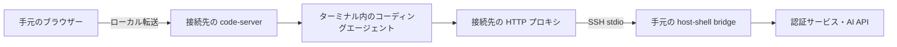
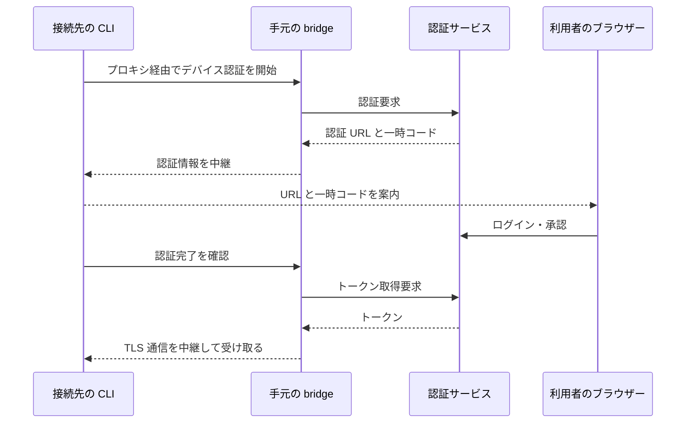

# 隔離環境への CLI 型 AI コーディングエージェントの導入

> [!NOTE]
> この文書が正本です。英訳は [../en/coding-agents.md](../en/coding-agents.md) にあります。内容が一致しない場合は日本語版が優先されます。

Copilot、agy、Claude Code、Codex、Grok の CLI を接続先のユーザー領域へ配置し、[code-server](code-server.md) のターミナルから利用する構成と検証手順を説明します。接続先から直接インターネットへ通信できない隔離環境でも、SSH 経由の中継で CLI を利用することが目的です。実機で一通り確認できているのは Copilot CLI だけです ([検証済みの範囲](#検証済みの範囲))。利用者が用意したモデルを使う [BYOK](#byok-利用者が用意するモデル) では、Copilot CLI と画面内の Copilot Chat を GitHub へのサインインなしで使えます。code-server 用スキルは CLI 型 AI コーディングエージェントの導入・認証を自動実行しません。

エージェント向けの手順のひな型は [host-shell-coding-agents スキル](../../.agents/skills/host-shell-coding-agents/SKILL.md) にあります。CLI ごとの実証済みインストーラーはまだ含まれていません。

## 接続の構成

接続先へ SSH の標準入出力で到達でき、手元のクライアントから認証サービスや AI API へ通信できることを前提にします。接続先からインターネットへの直接通信や、接続先のサービス設定の変更は必要ありません。必要な通信を SSH 経由で中継できることが条件であり、完全オフラインでの推論を意味しません。



CLI 本体、依存物、設定の転送には `transfer_push` を使用します。ブラウザーへの画面転送と CLI からの外部通信は、それぞれ[ポート転送](port-forward.md)と[クライアント経由 HTTP プロキシ](client-proxy.md)が担当します。

## 登録と通信経路

code-server の登録コマンドにプロキシのオプションを組み合わせます。以下の `api.vendor.example` と `auth.vendor.example` は説明用であり、実際の CLI のバージョン・認証方式に必要な宛先へ置き換えてください。

```bash
host-shell bridge --proxy \
    --proxy-allow-host 'api.vendor.example:443' \
    --proxy-allow-host 'auth.vendor.example:443' \
    --forward-allow-local '127.0.0.1:80[0-7]?' -- \
    ssh -T target /path/to/host-shell --mcp \
    --client-proxy --allow-forward-local
```

`job_start` で起動する code-server には `HTTP_PROXY`、`HTTPS_PROXY` と小文字版が設定され、ターミナルの子プロセスにも通常は継承されます。プロキシを有効にしてから code-server を起動してください。CLI が認証付き HTTP プロキシに対応しているか、シェル設定が環境変数を上書きしていないかを確認します。プロキシ URL には認証情報が含まれるため、`env` や `printenv` で出力しないでください。

`NO_PROXY` はそのまま継承されます。外部 API が `NO_PROXY` に含まれているとプロキシを通さず直接通信を試みるため、接続先に合わせて見直してください。許可先には推論 API だけでなく、ログイン、トークン更新、必要な追加機能の宛先も含めます。拒否の調査には `proxy_status` を使用します。HTTP CONNECT 後の TLS 通信は復号されません。CLI が独自の通信実装を使う場合や、平文 HTTP の Upgrade を必要とする場合は別途互換性確認が必要です。

## CLI の配置

1. 接続先の OS・CPU・libc と空き容量を確認します。Linux x86_64 での起動確認を、Windows や arm64 の確認として扱わないでください。
2. 手元で対象環境用の配布物を取得し、バージョン、配布元、SHA-256 を記録します。公式の署名・ハッシュが提供される場合は照合します。
3. `transfer_push` で専用ディレクトリ (例: `~/.local/share/host-shell-coding-agents/<CLI>/<version>/`) へ転送し、接続先でも SHA-256 を照合します。実行権限とランタイム・共有ライブラリーを確認します。
4. 最初は絶対パスで `--version` と `--help` を実行します。利用者の PATH やシェル起動ファイルを変更せずに確認できます。
5. code-server のターミナルから対話起動し、認証後に小さな検証用ディレクトリで推論・編集・コマンド実行を確認します。

手元のコマンドがシンボリックリンクの場合、リンク先の実体と必要な同梱ファイルを転送します。npm 版はエントリーポイントだけでは動きません。対象環境用の依存物と対応する Node.js が必要です。code-server 同梱の Node.js を CLI のランタイムとして利用できるとは限りません。自己更新や追加ツールの自動取得も別の通信・依存物を要求するため、初回検証では固定バージョンを使います。

## 認証と CLI ごとの確認

| CLI | 導入・認証で確認する点 |
| --- | --- |
| Copilot | ネイティブ版と npm 版を区別。npm 版は Node.js 22 以降が必要。リモート環境ではデバイスコード認証や対応トークンによる認証を検討する |
| agy | 同名コマンドとの混同を避け、配布元とバージョンを記録。対象版の認証方法、ランタイム、プロキシ対応を実機で確認する |
| Claude Code | ネイティブ配布物と OS 要件を確認。HTTP/HTTPS プロキシに対応。認証先と利用するモデル基盤に応じて許可先を設定する |
| Codex | 対象 OS 用の配布物と同梱ヘルパーを確認。ChatGPT または API キー認証を選択し、ヘッドレス環境の認証手順とサンドボックス要件を確認する |
| Grok | 同名 CLI があるため配布元とバージョンを固定。対象版のログイン、API 接続、プロキシ対応、補助プロセスを確認する |

Table: CLI ごとの確認点

デバイスコード認証に対応した CLI での通信例です。bridge は TLS を復号せず、中継のみを行います。



デバイスコード認証では手元のブラウザーを利用できますが、接続先の CLI 自身も認証サーバーへ通信できる必要があります。ブラウザー認証が `localhost` へ戻る方式では、手元のブラウザーの localhost と接続先の localhost は別です。対応するデバイス認証を使うか、コールバックのポートを別途ローカル転送します。

Copilot CLI では `/login` でアカウント (`GitHub.com`) を選び、`Sign in with a device code` を選びます。`Sign in with your browser` は接続先の localhost へ戻る方式のため使用しません。

キーチェーンなどの安全な保存先がない接続先 (コンテナーや最小構成の Linux) では、認証後に `System vault not available` と表示され、トークンを `~/.copilot/config.json` (パーミッション 600) へ平文保存するかを問われます (拒否するとサインインは取り消されます)。使い捨ての検証環境では `1. Yes, store in plain text (insecure)` を選択できますが、共有環境や長期間使用する接続先では平文保存の可否を利用者と確認してください (GitHub 側の認可は GitHub の設定の Applications から別途取り消せます)。

認証は利用者が行い、API キーやトークンをドキュメント、ツール引数、会話履歴、検証ログへ貼り付けないでください。認証ファイルを含むホームディレクトリ全体の複製は避けます。同じ接続先ユーザーでは CLI の認証情報や会話履歴も共有され得るため、別アカウントを併用する場合は CLI が正式に対応する設定領域の分離方法を確認します。

公式資料: [Copilot の導入](https://docs.github.com/en/copilot/how-tos/copilot-cli/set-up-copilot-cli/install-copilot-cli)、[Copilot の認証](https://docs.github.com/en/copilot/how-tos/copilot-cli/set-up-copilot-cli/authenticate-copilot-cli)、[Claude Code の導入](https://code.claude.com/docs/en/setup)、[Claude Code のネットワーク設定](https://code.claude.com/docs/en/network-config)、[Codex の認証](https://learn.chatgpt.com/docs/auth?surface=cli)。agy と Grok の配布元は、検証対象の確定時に追記します。

## 隔離と終了

隔離の境界は接続先の OS・コンテナー・ファイル権限です。code-server 内から起動した CLI のファイル操作・コマンド実行には、host-shell の MCP ツール用のパス・コマンド制限や承認は適用されず、その内容も MCP の操作ログには記録されません。プロキシのログは接続先と結果を記録するもので、CLI の操作内容の監査を代替しません。

外部サービスへの通信では、プロンプトやコードが送信されます。隔離環境内で実行することと、データを外部へ送らないことは別の条件です。CLI 独自のサンドボックスも、接続先のカーネル機能やコンテナー設定によって動作しない場合があります。

MCP 接続終了時には code-server とプロキシ・転送を停止します。code-server のターミナルで対話実行していた CLI は、ターミナルのシェルが host-shell とは別のセッションにあっても、ターミナルが閉じることで終了します (検証済みの範囲を参照)。`nohup` や `setsid` などでターミナルから切り離して起動した子孫は残る可能性があるため、全プロセスが必ず回収されるとは扱いません。配置したバイナリ、認証情報、履歴、作業ファイルは切断だけでは削除されません。

## 名前解決が必要な内蔵ツール

HTTP プロキシは DNS 自体を中継しません。プロキシ対応のプログラムはホスト名をプロキシへ渡し、接続元側で名前解決されます。一方、接続前に接続先で名前解決を行う内蔵ツールは、DNS のない接続先では失敗します。

Copilot CLI の内蔵 Web Fetch も接続前に名前解決を行うため、`WebFetchBlockedUrlError: failed to lookup address information: Name or service not known` で失敗します。宛先許可を追加しても解消しません。両端で [remote-dns](remote-dns.md) を有効にしてから code-server を起動してください。スキル host-shell-connect がアダプターを配置し、`--remote-dns-library` のパスを示します。

- 拒否 (HTTP 403、`CONNECT tunnel failed, response 403`) は DNS 障害ではありません。`proxy_status` で拒否理由を確認します。
- 画面内の Copilot Chat など、VS Code の拡張ホスト・エージェントホストで動く処理には、code-server の [専用コピーモード](remote-dns.md#code-server-の拡張エージェントホストへの適用) が必要です。
- 代替としてプロキシ対応の `curl` などを使う場合も、必要なホスト・ポートへの明示的な許可が必要です。

## Copilot の許可先

| 用途 | 許可先 | 状態 |
| --- | --- | --- |
| ログイン、API、推論 | `github.com:443`、`api.github.com:443`、`*.githubcopilot.com:443`、`copilot-proxy.githubusercontent.com:443` | この組み合わせで認証と対話応答を検証済 |
| Copilot Chat の BYOK モデル一覧 (`https://main.vscode-cdn.net/extensions/copilotChat.json`) | `main.vscode-cdn.net:443` | 許可後の取得を検証済 |
| Copilot CLI の自動更新 | `release-assets.githubusercontent.com:443` | 未許可では起動時に `Error auto updating: TypeError: fetch failed` と表示され、プロキシ履歴にこの宛先の拒否が記録される。CLI の利用には影響しない |

Table: Copilot の許可先

画面内の Copilot Chat は、起動時に BYOK (利用者自身の API キーなどを使う外部モデル) の既知モデル一覧を `main.vscode-cdn.net` から取得します ([取得処理の実装](https://github.com/microsoft/vscode/blob/main/extensions/copilot/src/extension/byok/vscode-node/byokContribution.ts))。未許可の場合は `Failed to update known models list` が記録されます。取得を許可する場合は `--proxy-allow-host main.vscode-cdn.net:443` を追加します (実行中セッションでは [`proxy_rules_update`](client-proxy.md#proxy_rules_update-bridge) でも反映できます)。テレメトリーや実験用の宛先 (`mobile.events.data.microsoft.com`、`default.exp-tas.com` など) は不要です。

## BYOK (利用者が用意するモデル)

BYOK (Bring Your Own Key) は、利用者が用意したモデルのエンドポイントと API キーで推論する方式です。Copilot CLI も画面内の Copilot Chat も、BYOK のモデルは GitHub へのサインインなしで使えます。GitHub の認証が要る機能 (Copilot CLI の `/delegate`、GitHub MCP サーバー、Chat のインライン補完など) は使えません。推論の要求とプロンプトは、指定したエンドポイントへ送られます。

接続先からエンドポイントへの経路は、ほかの通信と同じく `bridge` が中継します。手元や閉じたネットワーク内のエンドポイントには[リモート転送](port-forward.md)を、外部のエンドポイントには[クライアント経由 HTTP プロキシ](client-proxy.md)の許可先 (例: `<リソース名>.openai.azure.com:443`) を使います。

### Copilot CLI

エンドポイントを `providers.json` に書き、環境変数 `COPILOT_PROVIDERS_CONFIG` でそのパスを指定します。`COPILOT_OFFLINE=true` を指定すると、GitHub のサーバーへの通信 (テレメトリーを含む) を行いません。Azure OpenAI の例です (`apiKey` は実際のキーに置き換えます。ファイルの権限は利用者だけに絞ります)。

```json
{
  "providers": [
    {
      "name": "myazure",
      "type": "azure",
      "baseUrl": "https://<リソース名>.openai.azure.com/openai",
      "apiKey": "<API キー>",
      "azure": { "apiVersion": "2024-10-21" }
    }
  ],
  "models": [
    { "id": "gpt", "provider": "myazure", "wireModel": "<デプロイ名>", "modelId": "gpt-4.1" }
  ]
}
```

起動時に `--model myazure/gpt` でモデルを選びます (対話中は `/model`)。`type: azure` の場合、CLI は `<baseUrl>/deployments/<wireModel>/chat/completions?api-version=<apiVersion>` へ `api-key` ヘッダーでキーを送ります。プロバイダーに `"wireApi": "responses"` を加えると、Responses API (`<baseUrl>/responses?api-version=...`) を使います。モデルとエンドポイントは、ツール呼び出しとストリーミングに対応している必要があります ([BYOK モデルの利用](https://docs.github.com/en/copilot/how-tos/copilot-cli/customize-copilot/use-byok-models))。

### 画面内の Copilot Chat

チャット欄のモデル選択から「+」を選び、言語モデルの画面の「モデルの追加」で提供元 (Azure、OpenAI、Custom Endpoint など) を選びます。グループ名と API キーを入力すると、ユーザー データの `User/chatLanguageModels.json` が開きます。キーは秘密情報として保存され、ファイルには参照 (`${input:chat.lm.secret...}`) だけが書かれます。`models` の `id`、`name`、`url` (Azure ではデプロイの Chat Completions の URL、例: `https://<リソース名>.openai.azure.com/openai/deployments/<デプロイ名>/chat/completions?api-version=2024-10-21`) を埋めて保存し、ブラウザーでページを読み込み直すと、モデル選択に表示されます。検証では、Chat はキーを `Authorization: Bearer` ヘッダーで送りました (`url` は `*.openai.azure.com` ではないダミーのエンドポイント)。

`apiKey` が受け付けるのは、セキュア ストレージに保存したキーへの参照 (`${input:chat.lm.secret...}`) だけです。キーは画面から入力し、ファイルに直接書かないでください。直接書いた値はキーとして使われず、Azure の提供元では Microsoft アカウントでのサインイン (Entra ID の認証) を求められます。

サインインしていない場合、チャット欄に「Set BYOK utility models」と表示されます。VS Code の文書によると、補助処理に使うモデルを BYOK のモデルから選ぶと、その処理も使えるようになります (未検証)。

### HTTPS のエンドポイントとプロキシ

クライアント経由 HTTP プロキシを使う場合、接続先の CLI と code-server は `HTTPS_PROXY` に従って `CONNECT` で手元を経由し、TLS は接続先のプロセスとエンドポイントの間で結ばれます。そのため、エンドポイントの証明書は接続先の側で検証されます。公開の認証局の証明書 (Azure OpenAI など) では追加の設定は不要と考えられますが、実際の Azure OpenAI では未検証です。社内の認証局など、接続先が信頼していない認証局の証明書を使うエンドポイントでは、次のように認証局の証明書を渡します。

- **Copilot CLI**: 認証局の証明書 (PEM) を接続先に置き、`NODE_EXTRA_CA_CERTS` にそのパスを指定して起動します。Windows 版と Linux 版の両方で、指定しないと証明書の検証で失敗し、指定すると応答します。
- **画面内の Copilot Chat (Linux)**: `NODE_EXTRA_CA_CERTS` は使われません。接続先の既定の証明書の束 (Ubuntu では `/etc/ssl/certs/ca-certificates.crt`) と認証局の証明書をつないだファイルを利用者の領域に作り、code-server を起動する `job_start` の `env` で `SSL_CERT_FILE` にそのパスを指定します。
- **画面内の Copilot Chat (Windows)**: `NODE_EXTRA_CA_CERTS` と `SSL_CERT_FILE` のどちらも使われず、`unable to verify the first certificate` で失敗します。OS の証明書ストアへの登録が必要と考えられますが、これは接続先に残る設定のため、host-shell では扱わず、未検証です。

画面内の Copilot Chat は、エンドポイントのホスト名が `localhost` の場合、`HTTPS_PROXY` があってもプロキシを通さずに接続先の `localhost` へ直接接続します。手元のエンドポイントには、リモート転送を使います。

## Copilot CLI のコピーが動作しない場合

通常のターミナルではコピーできるのに、Copilot CLI の対話画面内でだけ、`Copied` と表示されてもクリップボードが更新されない場合の対処です。Copilot CLI 1.0.83、code-server 4.144.0、Microsoft Edge の組み合わせで確認しています。コピーされる範囲は、Chrome for Testing 148 (WSLg) から Windows のクリップボードへコピーした内容で確認しています。

マウス操作が有効な間は Copilot がマウス入力を受け取るため、ドラッグでは code-server 側の選択を作れません。`Shift` を押しながらのドラッグや `Ctrl+Shift+C` でもコピーできません。

| 方法 | 手順 | 制限 |
| --- | --- | --- |
| コマンド パレットで表示範囲をコピー (推奨) | `Ctrl+Shift+P` で `Terminal: Select All` を実行し、続けて `Terminal: Copy Selection` を実行する。ブラウザー外のエディターなどへ貼り付け、必要な部分を切り出す | Copilot CLI では、そのとき画面に表示されている範囲 (枠やステータス行を含む) だけがコピーされ、画面外の会話は含まれない。ホイールでスクロールしてから実行すると、その表示範囲がコピーされる。部分的な選択はできない。頻繁に使う場合は 2 つのコマンドにキーを割り当てる |
| `/share` で保存 | 会話をファイルへ保存し、エディターで開いてコピーする | 部分的な選択や、画面に収まらない長い出力に向く |
| マウス処理の無効化 | `copilot --continue --no-mouse` で再開し、マウスで選択・コピーする | ホイールスクロールが効かないなど、操作性が下がる |

Table: コピーの方法

推奨の方法なら、ホイールスクロールなど Copilot のマウス操作を維持できます。`Copied` の表示だけで成功とは扱わず、ブラウザー外へ貼り付けて確認してください。内部のどの処理で失敗するかは確定していません。関連する報告は [Copilot CLI Issue #2082](https://github.com/github/copilot-cli/issues/2082) (`mouse: false` による回避、Copied 表示後もクリップボードが変わらない報告) と [code-server Issue #7938](https://github.com/coder/code-server/issues/7938) (TUI のマウス処理による選択・コピーの問題) にあります。

通常のターミナルからもコピーできない場合は別の原因です。ブラウザーのクリップボード権限やアクセス URL を確認します。関連する操作と設定は [Copilot の公式リファレンス](https://docs.github.com/en/copilot/reference/copilot-cli-reference/cli-command-reference) を参照してください。

## 検証済みの範囲

### Copilot CLI

Copilot CLI 1.0.83 (`copilot-linux-x64.tar.gz`、[github/copilot-cli の v1.0.83](https://github.com/github/copilot-cli/releases/tag/v1.0.83)、SHA-256 `ffbe1c429664b8a05efed67ecdb467123e40fcaa3c6c14ef9a98ba74da4687b7`) と code-server 4.144.0 で確認しました。接続先は Oracle Linux 10.2 / x86_64 / glibc 2.39 の Podman コンテナーです。`--network none` で起動し、外部へのルートはありません。SSH は `ProxyCommand` (`podman exec -i` による標準入出力中継) でコンテナー内の sshd に接続しており、通常の TCP による SSH 接続はこの確認に含みません。操作段階は、同じ構成のコンテナーに bridge から `podman exec -i` で直接接続し、[remote-dns](remote-dns.md) の専用コピーモードで起動した code-server のターミナルで確認しました。

| 段階 | 合格条件 | 状態 |
| --- | --- | --- |
| 配置 | 対象への転送・ハッシュ照合・依存物確認 | 検証済 |
| 起動 | 対象で `--version`・`--help` が成功 | 検証済 |
| ターミナル | code-server 内で描画・入力・Ctrl-C・リサイズが動作 | 検証済 |
| クリップボード | ターミナルからブラウザー外へコピーできる | [コマンド パレットの方法](#copilot-cli-のコピーが動作しない場合) で検証済 |
| 認証 | 選択した方式でログインが成功 | デバイスコード方式 (表示コードを別ブラウザーに入力) で検証済。有効期限後の認証維持は未検証 |
| 推論 | 接続先の直接通信を遮断し、bridge 経由だけで応答を取得 | 検証済 |
| 内蔵 Web Fetch | 接続先に DNS がない状態で取得が成功 | [remote-dns](remote-dns.md) の併用で検証済 |
| 操作 | 検証用ファイルの編集と小さなコマンドの実行が成功 | 検証済 (承認後のファイル作成・編集、および読み取り専用コマンドの実行を確認) |
| 終了 | MCP 切断後、code-server・CLI・補助プロセス・待ち受けを確認 | 検証済 (MCP 切断により接続先の `host-shell`、code-server 一式、ターミナルのシェル・Copilot CLI、待ち受けポート、DNS・プロキシの一時ディレクトリがすべて終了・削除されることを確認。配置物・認証情報・作業ファイルは残る) |
| 複数接続 | 別接続の起動・認証状態・切断の影響を確認 | 未検証 |

Table: Copilot CLI の検証段階

### BYOK

推論先には、手元のホストで動かした Azure OpenAI 形式のダミーのエンドポイント (Chat Completions と Responses API に固定の文を返し、指示に応じてツール呼び出しを返す検証用のもの) を使いました。接続先からは、リモート転送 (接続先の `127.0.0.1:18443` から手元のダミー) で到達させています。HTTPS の確認では、検証用の認証局で発行した証明書でダミーを HTTPS にし、クライアント経由 HTTP プロキシ (許可先はダミーのホスト名とポートだけ) で到達させました。GitHub へのサインインは行っていません。実際の Azure OpenAI との通信は確認していません。

| 対象 | 確認内容 | 方法・環境 | 状態 |
| --- | --- | --- | --- |
| Copilot CLI 1.0.105 (`copilot-win32-x64.zip`、SHA-256 `34e16e9cf47de0e1534920171d6f39fa246638bddbb6ece820870b382bcc061a`) | `COPILOT_OFFLINE=true` の有無の両方で、`-p` の質問に BYOK のモデルから応答が返る。Chat Completions と Responses API の両方。`--allow-all-tools` で `create` によるファイル作成と `powershell` によるコマンド実行が接続先で行われ、結果がモデルへ戻る | Windows 11 Enterprise (ビルド 26300、amd64) の Hyper-V 仮想マシン、`exec_run` から実行 | 検証済 |
| 画面内の Copilot Chat (code-server 4.144.0 の GitHub Copilot Chat 0.72.0) | Azure の提供元で BYOK のモデルを登録し、応答が表示される。エージェントの `create_file` と `read_file` が接続先で実行され、結果がモデルへ戻る | 同上、ホストの Chrome から操作 | 検証済 |
| Copilot CLI 1.0.105 の Linux 版 (`copilot-linux-x64.tar.gz`、SHA-256 `aba1f06f27bc0447656647f76e0a4cf58b4b2a341c75ff04a750982b6aeb6bd2`) | Windows 版と同じ確認。ツール実行は `create` と `bash` | 同じ仮想マシン上の WSL 2 (WSL 3.0.3、Ubuntu 24.04、x86_64、glibc 2.39)。接続先の `host-shell` は `ssh <接続先> wsl -d ubuntu -- <host-shell> --mcp` で起動 | 検証済 |
| 画面内の Copilot Chat (Linux 版 code-server 4.144.0) | Windows と同じ確認 | 同上、ホストの Chrome から操作 | 検証済 |
| Copilot CLI 1.0.105 (Windows 版、Linux 版) の HTTPS とクライアント経由プロキシ | `NODE_EXTRA_CA_CERTS` なしでは証明書の検証で失敗し、ありでは Chat Completions と Responses API の応答とツール実行が成功する。`proxy_status` で許可した宛先だけを経由 | Windows 版は上記の仮想マシン、Linux 版は同じ仮想マシンの WSL 2 (WSL の sshd と ProxyJump で接続) | 検証済 |
| 画面内の Copilot Chat (Linux 版 code-server 4.144.0) の HTTPS とクライアント経由プロキシ | `SSL_CERT_FILE` で応答とツール実行が成功する。`NODE_EXTRA_CA_CERTS` だけでは証明書の検証で失敗する。`localhost` の宛先はプロキシを通らない | 同上の WSL 2、ホストの Chrome から操作 | 検証済 |
| 画面内の Copilot Chat (Windows 版 code-server 4.144.0) の HTTPS とクライアント経由プロキシ | `NODE_EXTRA_CA_CERTS` と `SSL_CERT_FILE` のどちらでも証明書の検証で失敗する | 上記の仮想マシン、ホストの Chrome から操作 | 検証済 |
| 画面内の Copilot Chat (Windows) で、OS の証明書ストアに認証局を登録した場合 | 応答 | なし | 未検証 |
| 実際の Azure OpenAI | 通信と応答 | なし | 未検証 |

Table: BYOK の検証状況

### その他の CLI

手元の Linux x86_64 で、単体実行とローカル host-shell の PTY 付き `job_start` の両方で `--version` が成功することだけを確認しています。配布元の照合、接続先への配置、認証・推論は未検証です。

| CLI | 確認したバージョン |
| --- | --- |
| agy | 1.4.12 |
| Claude Code | 2.1.316 |
| Codex | 0.166.0 |
| Grok | 1.0.70 |

Table: 起動を確認した CLI

Codex は読み取り専用ファイルシステムでは、PATH 用エイリアスを作成できない警告を出します。バージョン表示には影響しません。

### 検証の記録

新しく検証するときは、OS・CPU・libc、CLI と code-server と host-shell のバージョン、配布元・ハッシュ、認証方式 (秘密値を除く)、許可先、検証済みの段階と失敗理由を記録します。経緯の記録は `docs/prompts/past/` に置き、この文書には結果だけを反映します。これまでの経緯は [CLI 型 AI コーディングエージェントの検証記録](../prompts/past/261102-coding-agents-validation.md) 、[Copilot CLI の操作段階の検証記録](../prompts/past/261103-copilot-cli-operation-validation.md)、[Copilot CLI のコピー範囲の検証記録](../prompts/past/261103-copilot-cli-copy-scope-validation.md)、[終了段階の検証記録](../prompts/past/261103-coding-agents-shutdown-validation.md)、[BYOK の検証記録](../prompts/past/261105-copilot-byok-validation.md)、[WSL での BYOK の検証記録](../prompts/past/261105-wsl-byok-validation.md)、[BYOK の HTTPS とプロキシの検証記録](../prompts/past/261105-byok-https-proxy-validation.md) にあります。
