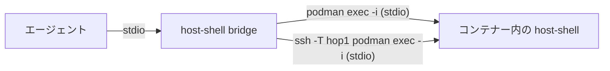

# コンテナーへの接続

> [!NOTE]
> この文書が正本です。英訳は [../en/container.md](../en/container.md) にあります。内容が一致しない場合は日本語版が優先されます。

`host-shell` は SSH の接続先だけでなく、稼働中の Linux コンテナー (Podman、Docker、Kubernetes Pod) の内部でも動作します。`bridge` は `--` 以降に指定されたコマンドの標準入出力を通信路として使用するだけであるため、`ssh` の代わりに `podman exec -i` 等を指定すればコンテナー内の `host-shell` にそのまま接続できます。



この文書では、コンテナー環境に固有のバイナリ配置、登録手順、および注意点を説明します。SSH 接続先と共通の仕様については [利用ガイド](user-guide.md) を参照してください。

## 対象と確認状況

| 実行環境 | 確認状況 |
| --- | --- |
| Podman | 動作確認済み (Podman 4.9.4、rootless) |
| Docker | Podman の Docker 互換コマンド (`docker`) で確認済み (Docker Engine では未確認) |
| `kubectl` (Kubernetes) | 未確認 (生成されるコマンドの構文のみ確認済み) |

Table: 対象の実行環境

- 対象は Linux コンテナーのみです (Windows コンテナーは対象外です)。
- `host-shell` は静的リンクされた単一バイナリであるため、glibc ベースのイメージでも musl ベースのイメージ (Alpine Linux など) でも動作します。
- 配置・確認用スクリプト (`.agents/skills/host-shell-connect/scripts/`) を使用する場合は、コンテナー内に `sh` および `uname`、`id`、`dirname`、`ls`、`sha256sum`、`mkdir`、`chmod`、`mv`、`cat`、`rm` が必要です。シェルを含まないコンテナーについては [シェルのないコンテナー](#シェルのないコンテナー) を参照してください。

## 経路の指定

`host-shell-connect` スキルのスクリプト群では、経路引数 `ROUTE` (中継サーバーと接続先をカンマ区切りで並べたもの) の末尾要素としてコンテナーを 1 つ指定できます。

| 末尾の要素 | 実行されるコマンド | 追加オプション用の環境変数 |
| --- | --- | --- |
| `podman:<コンテナー>` | `podman exec -i ... <コンテナー> sh -c <コマンド>` | `HOST_SHELL_PODMAN_OPTS` (例: `--user dev`) |
| `docker:<コンテナー>` | `docker exec -i ... <コンテナー> sh -c <コマンド>` | `HOST_SHELL_DOCKER_OPTS` (例: `--user dev`) |
| `kubectl:<pod>` | `kubectl exec -i ... <pod> -- sh -c <コマンド>` | `HOST_SHELL_KUBECTL_OPTS` (例: `-n app -c web --context prod`) |

Table: コンテナーの経路要素

- たとえば `podman:web` はローカル マシン上のコンテナー、`hop1,podman:web` は中継サーバー `hop1` 上のコンテナーを指します (後者は `hop1` まで SSH で接続し、`hop1` 上で `podman exec -i` を実行します)。
- コンテナー要素を指定できるのは経路 (`ROUTE`) の末尾のみです。
- 各環境変数の値は、`HOST_SHELL_SSH_OPTS` と同様に空白区切りで展開されます。

```bash
scripts/detect.sh podman:web
scripts/deploy.sh podman:web linux-amd64
scripts/probe.sh podman:web /tmp/host-shell-0/host-shell
HOST_SHELL_KUBECTL_OPTS='-n app -c web' scripts/deploy.sh kubectl:web-0 linux-amd64
```

## 配置

`deploy.sh` は SSH 接続先と同様に、コンテナー内の `/tmp/host-shell-<uid>/host-shell`、`.local/bin/host-shell` (ホーム ディレクトリからの相対パス) の順で配置を試みます。コンテナーの既定ユーザーが `root` の場合は `/tmp/host-shell-0/host-shell` に配置されます。

- ルート ファイルシステムが読み取り専用の場合や `/tmp` が `noexec` マウントされている場合は、書き込みと実行が可能なボリューム上のパスを第 3 引数に指定してください。
- コンテナーを再作成すると、ボリューム以外の領域に配置したファイルは消去されます (`podman restart` などの再起動では消去されません)。コンテナーを再作成した際は再度配置してください。

## 登録コマンド

`bridge` の `--` の後ろに、`exec -i` でコンテナー内の `host-shell` を直接起動するコマンドを指定します。実行ユーザーや名前空間などの追加オプションもあわせて指定してください。

```bash
claude mcp add host-shell-web -- ~/.local/bin/host-shell bridge -- podman exec -i web /tmp/host-shell-0/host-shell --mcp
claude mcp add host-shell-web -- ~/.local/bin/host-shell bridge -- docker exec -i --user dev web /tmp/host-shell-1000/host-shell --mcp
claude mcp add host-shell-web -- ~/.local/bin/host-shell bridge -- kubectl exec -i -n app -c web web-0 -- /tmp/host-shell-1000/host-shell --mcp
claude mcp add host-shell-web -- ~/.local/bin/host-shell bridge -- ssh -T -o BatchMode=yes hop1 podman exec -i web /tmp/host-shell-0/host-shell --mcp
```

> [!IMPORTANT]
> `exec` には必ず `-i` を指定し、`-t` は絶対に指定しないでください。疑似端末を割り当てると、端末制御シーケンスによって MCP の JSON-RPC 通信が破損します。

ポリシー制限オプション (`--read-only`、`--allow-path` など) は、SSH 接続先と同様に `--mcp` の後ろに指定します。

## 注意点

- **実行ユーザー**: `host-shell` は `exec` の既定ユーザー (イメージの `USER`、多くの場合は `root`) の権限で動作します。権限を絞る場合は `--user` (`kubectl` ではコンテナーの `securityContext`) を指定してください。
- **プロセスの寿命**: MCP セッションが終了すると、コンテナー内の `host-shell` および `job_start` で起動した子プロセスも終了し、コンテナー内には残りません。
- **Pod のネットワークと名前空間**: 同一 Pod 内のコンテナーはネットワーク名前空間を共有するため、`forward_open` で `127.0.0.1:<port>` へ転送すると同じ Pod 内の別コンテナーのサービスにも到達できます (Podman の Pod で確認済み)。一方、PID 名前空間は共有されないため、別コンテナーのプロセスは `proc_list` には表示されません。
- **操作ログ**: 既定の操作ログはコンテナー内 (`~/.local/state/host-shell/`) に出力されるため、コンテナーを再作成すると失われます。永続化する場合は `--log-file` でボリューム上のパスを指定してください。
- **権限の範囲**: `podman exec` 等を実行できる利用者は、もともとコンテナー内で任意のコマンドを実行できる権限を持っています。`host-shell` によって新たな権限が付与されることはありません。

## シェルのないコンテナー

distroless イメージなど `sh` を含まないコンテナーでは、配置・確認スクリプト (`deploy.sh` 等) は使用できません。次のように手動でバイナリをコピーして登録してください。

```bash
podman cp .agents/skills/host-shell-connect/bin/host-shell-linux-amd64 web:/tmp/host-shell
podman exec web /tmp/host-shell --version
claude mcp add host-shell-web -- ~/.local/bin/host-shell bridge -- podman exec -i web /tmp/host-shell --mcp
```

- Docker の場合は `docker cp` を使用します。なお、`kubectl cp` はコンテナー内に `tar` を必要とするため、最小構成イメージへの配置には使用できません。
- シェルのないコンテナーでもファイル操作 (`fs_*`) や検索 (`search_*`) などのツールはそのまま利用できますが、`exec_run` でのシェル実行や code-server の導入は行えません。

## code-server の利用

稼働中のコンテナー内にも、`host-shell-code-server` スキルを使って [code-server を導入](code-server.md) できます。手順は SSH 接続先と共通ですが、コンテナー環境では次の条件を満たす必要があります。

| 条件 | 内容 |
| --- | --- |
| glibc | code-server 同梱の Node.js は glibc を必要とするため、Alpine Linux など musl ベースのイメージでは動作しない (`install` が展開前に停止する) |
| 必要なコマンド | コンテナー内に `bash`、`tar`、`gzip`、`sha256sum`、`od` が必要 (Alpine には標準で `bash` も含まれない) |
| `HOME` | 設定、ユーザー データ、拡張機能は `HOME` 配下に保存されるため、`HOME` が設定されており書き込み可能なディレクトリである必要がある |
| データの永続化 | コンテナーの再作成後も設定や拡張機能を維持する場合は、`HOME` にボリュームをマウントする |

Table: コンテナー内で code-server を使用する条件

| イメージ | 検証結果 |
| --- | --- |
| Oracle Linux 9 | 導入、起動、ポート転送、ログイン、および既定設定・拡張機能の反映を確認済み |
| `debian:stable-slim` | 必要なコマンドが標準でそろっており、同様に動作確認済み |
| `alpine:3.22` | `bash` がないため `install` を起動できない。`bash` を追加しても glibc がないため展開前に停止する |

Table: 検証したコンテナー イメージ

code-server はコンテナー内の `127.0.0.1` のポート 8000〜8079 のうち最初に空いているポートで待ち受けます。コンテナーごとにネットワーク名前空間が分離されているため、通常はポート 8000 が使用されます。
