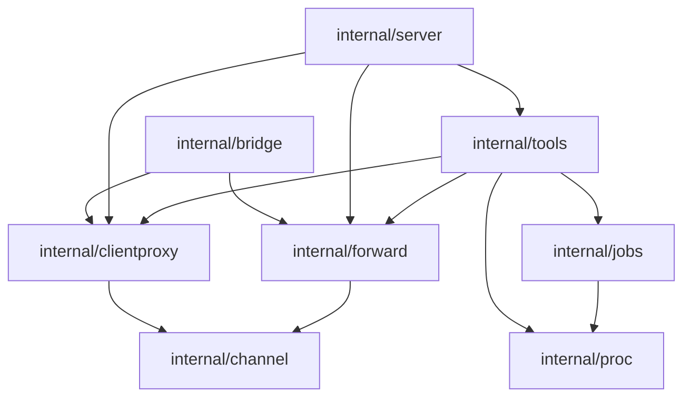

# host-shell 開発ガイド

> [!NOTE]
> この文書が正本です。英訳は [../en/development.md](../en/development.md) にあります。内容が一致しない場合は日本語版が優先されます。

`host-shell` のビルド、ソース構成、設計規約、ツールの追加手順、テストとリリースの手順をまとめます。

## 開発環境

| 項目 | 要件 |
|---|---|
| Go | 1.26 以降 (`go.mod` の `go` ディレクティブ) |
| make | GNU make |
| OS | Linux、macOS、Windows のいずれか (クロス ビルドにより 1 台で全ターゲットを生成可能) |

Table: 開発環境

外部の C ライブラリには依存せず、常に `CGO_ENABLED=0` で静的ビルドします。

## ビルド

| コマンド | 内容 |
|---|---|
| `make` | `vet`、`test`、`build` を順に実行する |
| `make build` | 開発機の OS・アーキテクチャー向けに `dist/host-shell` を生成する |
| `make dist` | 配布用の 6 バイナリ (`dist/host-shell-{linux,windows,darwin}-{amd64,arm64}[.exe]`) を生成し、`host-shell-connect` スキルの `bin/` にも複製する (macOS 用はローカルの `host-shell bridge` 専用) |
| `make dns-lib` | 開発機のアーキテクチャー向けに名前解決アダプター `dist/libhostshell_dns-linux-<arch>.so` を生成する (Linux のみ。glibc 2.17 より新しいシンボルを必要とする場合は失敗する) |
| `make release` | Release 添付用アーカイブを `dist/release/` に生成する ([リリース](#リリース)) |
| `make test` | 全パッケージのテストを実行する |
| `make vet` | Linux、Windows、macOS 向けに `go vet` を実行する |
| `make clean` | `dist/` とスキルの `bin/` を削除する |

Table: make のターゲット

バージョンは `git describe --tags --always --dirty` から埋め込みます (Git 情報がない場合は `dev`)。  
バージョンを明示する場合は `make dist VERSION=1.0.0` のように指定します。

## ソースの構成

```text
cmd/host-shell/        エントリー ポイント (フラグ解析、操作ログ初期化、stdio 起動、bridge サブコマンド振り分け)
internal/server/       MCP サーバーの構築 (ポリシー解決、実行時部品 (Session) の受け渡し、ツール登録、初期化案内)
internal/policy/       ポリシー (ツール選択、許可パス、許可・拒否コマンド、接続先ホスト、環境変数除外、事前確認、伏せ字) の解析と検査、リモート転送の待ち受けポート範囲
internal/tools/        各ツールの実装
  tools.go             ツール グループと登録、ポリシー検査・事前確認・伏せ字・操作ログ記録の共通ラッパー
  args.go              引数解釈の共通処理 (文字コード、text / base64、until、出力上限)
  policy.go            入力型ごとのパス検査対象 (PathArgs)、事前確認 (multi round-trip)、伏せ字処理
  progress.go          進捗通知
  ansi.go              端末出力の整形 (エスケープ シーケンス除去と CR 処理)
  help.go              help ツール、help リソース、初期化応答の instructions 生成
  help/*.md            help の各トピック本文 (バイナリに埋め込み)
  exec.go              exec_run、job_*
  files.go             fs_list、fs_stat、fs_read、fs_write
  edit.go              fs_edit
  fsops.go             fs_mkdir、fs_move、fs_copy、fs_remove
  search.go            search_grep、search_find、fs_manifest
  glob.go              glob 照合 (**、{a,b})
  system.go            exec_sudo、sys_get_info、proc_list
  processes_*.go       proc_list の OS 別実装 (/proc、Windows API)
  net*.go              net_request_http、net_exchange、net_check、net_list_listeners、net_list_interfaces
  listen_*.go          net_list_listeners の OS 別実装 (/proc/net、netstat)
  admin.go             proc_kill、svc_*、log_query、disk_list の入出力定義と共通処理
  admin_*.go           OS 別管理実装 (systemd / journald、サービス コントロール マネージャー / イベント ログ)
  registry*.go         reg_read、reg_write、reg_delete (Windows)
internal/bridge/       host-shell bridge (ローカル中継、transfer_push、transfer_pull、転送・プロキシ ツールの公開)
internal/channel/      SSH stdio 上の多重化チャネル (機能ネゴシエーション、双方向ストリーム、フロー制御) と、その上の機能が共有する部品 (接続の応答と中継、失敗コードと理由の対応、状態ツールの履歴と出力型)
internal/clientproxy/  クライアント経由 HTTP プロキシ (bridge 側の宛先検査と上流接続、接続先側の認証付きプロキシ)
internal/forward/      ポート転送 (常設転送の書式解析、bridge 側の待ち受け・SOCKS5・forward_*、接続先側の発信と待ち受け)
internal/proc/         子プロセス起動、OS 別シェル実行、プロセス ツリー終了、シグナル送信、生存確認
  proc_unix.go         Linux (プロセス グループ、SIGKILL、シグナル名の表)
  proc_windows.go      Windows (cmd コマンドライン、taskkill /T)
internal/pty/          疑似端末 (Linux は creack/pty、Windows は ConPTY API)
internal/jobs/         長時間ジョブ管理 (パイプ・疑似端末、シグナル、終了済みジョブの破棄)
internal/limit/        出力上限管理 (先頭・末尾を残す Buffer、オフセット読み取り用の Ring)
internal/textenc/      文字コード変換 (エンコーディング名解決、自動判定、入出力変換、OS 既定文字コード取得)
  system_unix.go       Linux (ロケール環境変数から判定)
  system_windows.go    Windows (GetOEMCP、GetACP)
internal/audit/        操作ログ (JSON Lines)
internal/config/       起動オプションの設定値と既定値 (実行時に生成する部品は持たない)
internal/askpass/      exec_sudo のパスワードを sudo -A へ渡す askpass ヘルパー
internal/wire/         bridge と接続先ツールが共有する名前と転送データ型
internal/bytesize/     バイト数の表示用整形 (接続先ツールと bridge で共有)
internal/testutil/     パッケージ横断のテスト用ヘルパー
internal/version/      バージョン情報
.agents/skills/host-shell-connect/
                       接続先へのバイナリ配置・起動確認スキル (bin/ は make dist で生成、Git 管理外)
.agents/skills/host-shell-code-server/
                       接続先への code-server 導入スキル (packages/ は download で取得、Git 管理外)
.agents/skills/host-shell-vscode-remote-ssh/
                       接続先への VS Code Remote - SSH 接続スキル (packages/ は fetch で取得、Git 管理外)
docs/ja/               文書の日本語版 (正本)
docs/en/               文書の英語版 (docs/ja/ の英訳)
```

## 設計上の約束

実装を変更する際は、次の規約を遵守してください。

- **標準出力への書き込み禁止**: 標準出力は MCP の JSON-RPC 通信専用です。診断ログは標準エラー (`log` パッケージ)、操作記録は `audit` パッケージへ出力します。
- **子プロセスへの標準入出力の継承禁止**: `exec.Cmd` の `Stdin`、`Stdout`、`Stderr` に `os.Stdin`、`os.Stdout` を渡さないでください。子プロセスの起動には必ず `proc.Command` または `proc.Run` を使用します。
- **出力サイズの上限設定**: ツールの出力は `limit` パッケージまたは件数上限により `--max-output` 程度に収め、切り詰めた場合は `truncated` フィールド等で明示します。
- **機密引数のログ出力抑制**: 書き込み内容や標準入力など操作ログに残すべきでない引数は、入力型に `AuditArgs() any` (`audit.Redactor`) を実装してマスクします。
- **ツール内部での文字コード変換**: ツールの入出力は常に UTF-8 とします。接続先の文字コードとの変換には `textenc` パッケージを、文字コード指定引数の解決には `textenc.ParseAuto` (自動判定を許す引数) または `textenc.ParseFixed` (既定の文字コードを持つ引数) を使用し、分割読み取り時はマルチバイト文字の境界を分断しないようにします。
- **共通部品の再利用**: 同じ処理を各ツールで再実装しないでください。引数の解釈には `internal/tools/args.go` (`readCharset`、`writeCharset`、`decodeData`、`compileUntil`、`clampMax`)、BOM と UTF-16 の判定には `textenc.Choice.Detect`、UTF-8 以外の復号には `Encoding.DecodeUnlessUTF8`、出力の伏せ字とプロキシ認証情報のマスクには `d.redact` と `d.mask`、プロセスの生存確認には `proc.Alive` を使用します。
- **設定と実行時部品の分離**: `config.Config` は起動オプションの値のみを持ちます。実行時に生成する部品 (クライアント プロキシとポート転送の接続先側) は `server.Session` を経由して `tools.Deps` に渡します。ポリシーは `server.NewPolicy` で 1 回だけ生成し、ツールとポート転送で共有します。
- **bridge と接続先ツールの分離**: `internal/bridge` は `internal/tools` を import しません。両者が共有するクライアント名、転送単位、マニフェストのデータ型は `internal/wire` に置きます。
- **フラグ引数を避けた API**: 動作を切り替える bool 引数は追加せず、関数を分ける (`CheckRead` と `CheckWrite`、`Signal` と `SignalGroup`、`ParseAuto` と `ParseFixed`) か、名前付きフィールドを持つ構造体 (`forward.TargetOptions`、`policy.Tool`) で受け取ります。
- **命名の統一**: エラー変数は `err`、オプション構造体の引数は `opt` とし、組み込み関数と同名の変数 (`max`、`min` など) は使用しません。同じ意味の値には同じ名前を使い (接続 ID は `connID`、`*channel.Conn` は `conn`)、HTTP ステータスは `net/http` の定数で記述します。出力フィールドでは、1 回の試行の結果 (接続イベント、転送のファイル別結果) を `result`、継続している状態 (セッション、プロセス、サービス) を `state` と呼びます (`status` はジョブ状態のスナップショットと HTTP ステータス コードに限ります)。パッケージ外から使わない識別子は公開しません。
- **MCP 情報のみでの自己完結**: ツール説明、引数説明、`help_get` 本文、エラー メッセージは、エージェントが次の操作を判断できるよう具体的に記述します。
- **OS 差異の内部吸収**: OS 固有処理は `runtime.GOOS` 分岐または `_unix.go`、`_windows.go` ファイルに分離します。
- **既定は無制限・明示指定のみ制限**: 起動オプションで指定されたポリシーのみを適用します。新規ツールで制限が回避されないよう、パス引数を持つ入力型には `PathArgs`、プログラムを起動する入力型には `CommandArgs` を実装し、ネットワーク接続先は `d.Policy.CheckHost` で検査します。
- **大きなファイル配置前の空き容量確認**: 接続先に大きなファイルを書き込む処理 (転送、ダウンロード、展開) は、書き込みを始める前に空き容量を確認し、足りない場合は何も書き込まずにエラーを返します。ツールでは `checkSpace`、`bridge` では `checkRemoteSpace` (`fs_stat` の `available_bytes`)、スキルのスクリプトでは `df` または `DriveInfo` を使用します。
- **長時間処理のキャンセル対応**: ハンドラーの `ctx` はクライアントからのキャンセル通知で完了するため、子プロセスや通信処理はすべて `ctx` に紐付けます。
- **コード コメントの英語統一**: Go コード、シェル スクリプト、Makefile、ワークフローのコメントと、スキル (`SKILL.md`) は英語で記述します (テスト データ内の日本語文字列はそのまま維持します)。
- **文書の正本は日本語**: `docs/ja/` の日本語版を正本とし、`docs/en/` に英訳を配置します。文書を変更する際は正本の日本語版を変更し、同じ変更で英語版へ反映します。内容が一致しない場合は日本語版が優先されます。`README.md` と `docs/README.md` には英語、日本語の順で両言語を記述します。
- **文書は最終仕様として記述**: 文書には、ユースケース、手順、検証済みの範囲、制限を記述します。作業の経緯 (日付、誰が何を確認したか、調査の過程、ログの抜粋) は `docs/prompts/past/` に残します。詳細は [AGENTS.md](../../AGENTS.md#documentation-policy) を参照してください。

## ツールの追加

1. 入力型と出力型を定義し、`json` タグでフィールド名、`jsonschema` タグで説明を指定します。省略可能な引数には `omitempty` を付与します (付与しない引数は必須になります)。
2. `func (d *Deps) xxx(ctx context.Context, req *mcp.CallToolRequest, in XxxInput) (*mcp.CallToolResult, XxxOutput, error)` のシグネチャでハンドラーを実装します。操作失敗時に `error` を返すと `isError: true` の結果に変換されます。
3. `definitions` (または `registerNet`、`registerAdmin` などの下位関数) 内で `add` を呼び出し、グループ (`groupFiles` など) とツール注釈 (`readOnly()`、`destructive()`、`network()`) を指定して登録します。注釈は `--read-only` と `--confirm destructive` の判定にも使用されます。
4. パス引数を受け取る場合は、入力型に `PathArgs() (read, write []string)` を実装します (`internal/tools/policy.go`)。
5. `internal/server` に結合テストを追加します。ツールの呼び出しと結果の検証には `testutil.Call`、`testutil.CallErr` を使用します。
6. 必要に応じて `internal/tools/help/*.md` の該当トピックと `Instructions` の案内文を更新します。
7. [リファレンス](reference.md) にツール仕様とツール グループ表を追記します。

```go
add(r, groupFiles, &mcp.Tool{
    Name:        "fs_example",
    Description: "One-line description for agents.",
    Annotations: readOnly(),
}, d.fsExample)
```

ツールの `Description` と引数の説明はエージェント向けに英語で簡潔に記述し、用途・使用場面・併用するツールを示します。  
`Title` には承認画面等で利用者に表示される短い名称を設定します。  
エラー メッセージは原因と対処方法を 1 文で返します (例: `old_string occurs 3 times ... Include more surrounding lines to make it unique, or set replace_all`)。

## テスト

`internal/server` のテストは、インメモリ トランスポート (`mcp.NewInMemoryTransports`) でサーバーとクライアントを接続して各ツールを呼び出します。`connectWith` でポリシーとクライアント設定 (elicitation、進捗通知の受信) を指定できます。  
パッケージをまたいで使うテスト用ヘルパー (ツール呼び出しの `Call`、ツール名一覧の `ToolNames` と `ToolSet`、空きポートの `FreePort`、条件待ちの `WaitFor`、`exec_sudo` を使うテスト バイナリ向けの `Main` など) は `internal/testutil` に置き、各テストで再実装しないでください。  
`internal/bridge` のテストは、「エージェント - bridge - 接続先 host-shell」の 3 者をインメモリ トランスポートで接続し、中継とファイル転送を検証します。  
OS ごとに挙動が異なるツールは `runtime.GOOS` でテスト用コマンドを切り替え、実行環境に存在しない機能 (systemd のないコンテナー環境での `svc_list` など) は失敗とせずスキップしてログに記録します。

Linux 開発機では、Windows 向け実装は `make vet` (`GOOS=windows go vet`) による静的検査まで確認できます。`proc_windows.go` などを変更した場合は Windows 実機または CI で `go test ./...` を実行してください。  
標準入出力経由の動作確認手順は [利用ガイドの動作の確認](user-guide.md#動作の確認) を参照してください。

## CI

GitHub Actions (`.github/workflows/ci.yml`) は、`main` ブランチへの push とプル リクエストごとに次のジョブを実行します。

| ジョブ | 内容 |
|---|---|
| `test (ubuntu-latest)` | `go vet` (Linux、Windows、macOS 向け)、`go test`、`sudo` パスワード認証テスト |
| `test (windows-latest)` | `go vet`、`go test` (ConPTY、サービス、イベント ログ、レジストリを含む Windows 実機テスト) |
| `test (macos-latest)` | `go vet`、`go test` (ローカル側の `bridge` 動作の検証) |
| `dns-lib (amd64)`、`dns-lib (arm64)` | AlmaLinux 8 (glibc 2.28) のコンテナーで `make dns-lib` を実行し、そのコンテナーとランナー (新しい glibc) の両方で動作をテストする (`.github/workflows/dns-lib.yml`) |
| `build` | `dns-lib` の生成物を `dist/` に置いて `make release` を実行し、`dist/release/` をアーティファクトとして 14 日間保持する |

Table: CI のジョブ

テスト実行時は `-v` の出力から、結果行と字下げされた `ファイル名.go:行:` の行のみを抽出して表示します。後者には失敗・スキップの理由やテスト ログが含まれます (`testing.go` が出力する後片付け失敗の行なども保持します)。

## リリース

GitHub で Release を公開または編集したとき、および既存のタグを別のコミットへ移したとき、`.github/workflows/release.yml` が対象タグ (例: `v1.0.0`) をバージョンとしてビルドし、次のアーカイブを Release に添付します。同名のファイルは上書きし、以前の名前のアーカイブは削除します。

| ファイル | 内容 |
|---|---|
| `host-shell-mcp-<version>-bin.zip`、`host-shell-mcp-<version>-bin.tar.gz` | GitHub 標準のソース アーカイブと同じディレクトリ構成にビルド済みバイナリを同梱したもの |

Table: Release に添付するファイル

`<version>` はタグ名です。先頭の `v` も残します (タグ `v20261031.1.0` なら `host-shell-mcp-v20261031.1.0-bin.zip`)。  
アーカイブは最上位の `host-shell-mcp-<version>/` 配下に `git archive` の内容と次のファイルを含みます。

| パス | 内容 |
|---|---|
| `dist/` | 6 種類の実行ファイル (`make dist` の生成物) と、名前解決アダプター `libhostshell_dns-linux-{amd64,arm64}.so` |
| `.agents/skills/host-shell-connect/bin/` | 同一の実行ファイル・アダプター一式と `VERSION` (展開後すぐにスキルを使用可能) |

Table: アーカイブに加えるもの

アダプターは、リリースのワークフローでも CI と同じ `dns-lib.yml` で各アーキテクチャーの実機上でビルド・テストします。

ローカルで同一のアーカイブを生成する場合は `make release VERSION=v1.0.0` を実行します (`dist/release/` に出力されます)。事前に両アーキテクチャーのアダプターを `dist/` に置く必要があります。開発機のアーキテクチャー分は `make dns-lib` で生成できます。もう一方は CI のアーティファクト (`dns-lib-<arch>`) から取得してください。

## 依存

| モジュール | 用途 |
|---|---|
| `github.com/modelcontextprotocol/go-sdk` | MCP 公式 Go SDK (stdio 通信、JSON-RPC、スキーマ生成・検証) |
| `golang.org/x/text` | 文字コード変換 (Pure Go 実装のため静的リンクを維持) |
| `golang.org/x/sys` | Windows API 呼び出し (ConPTY、サービス コントロール マネージャー、レジストリ、ディスク情報) |
| `github.com/creack/pty` | Linux・macOS の疑似端末制御 |
| `github.com/charmbracelet/x/vt` | 仮想端末エミュレーター (`job_read` の `screen` 取得用、Pure Go、MIT / BSD ライセンス) |

Table: 直接の依存

依存モジュールを更新した際は、`go mod tidy` の実行後に `make` で検証してください。

## 動作する OS

Go ランタイムの最小要件に基づき、次の OS で動作します。

| OS | 要件 |
|---|---|
| Windows | Windows 10 / Windows Server 2016 以降 (`pty` ジョブは Windows 10 1809 / Windows Server 2019 以降) |
| Linux | カーネル 3.2 以降 |
| macOS | macOS 12 以降 (ローカルで `bridge` として使用する場合) |

Table: 動作する OS

上記より古い OS はサポート対象外です ([Go MinimumRequirements](https://go.dev/wiki/MinimumRequirements) 参照)。  
Windows 環境ではウイルス対策ソフトが Go 製バイナリを誤検知する場合があるため、配布時はコード署名の付与を検討してください。

## 多重化チャネルとプロキシ・転送の構成

利用者向けの仕様は [クライアント経由 HTTP プロキシ](client-proxy.md) および [SSH stdio 経由のポート転送](port-forward.md) を参照してください。

矢印は主な依存方向を示します。`bridge` と接続先の `tools` は互いを参照せず、チャネル上の共通部品を使用します。



- **`internal/channel/`**: `bridge` と接続先の `mcp.Connection` ラッパーとして `host-shell/channel/*` 通知を処理し、通常の MCP 層へは渡しません。接続開始時のネゴシエーションでは、`bridge` が要求する機能 (`http_proxy`、`forward_local`、`forward_remote`) と接続先が許可する機能を `hello` フレームで交換し、常設リモート転送の待ち受け (`listen`) を完了させてから `ready` フレームで MCP の初期化へ進みます。接続先は許可オプションが指定されていない場合でも最初のメッセージを確認し、通常の MCP メッセージであればそのまま処理します。データ ストリームは両端のどちらからでも開始でき、接続 ID は `bridge` 起点が奇数、接続先起点が偶数を使用します。なお、接続先側から開けるストリームは `bridge` が `listen` で登録したリモート転送への着信のみであり、接続先から任意の宛先を指定して `bridge` に発信させることはできません。
- **共有部品**: `internal/channel/` は、その上の機能が共通に使う部品も提供します。着信ストリームへの応答 (発信、失敗時の拒否、受け付け) は `Incoming.Answer`、双方向の中継 (半クローズの伝達、アイドル タイムアウト、残存時間) は `Relay`、失敗コードから結果 (`allowed`、`denied`、`failed`) と固定の理由文字列への対応は `Describe` が担います。状態ツールの出力は `EventHead`、`Outcome`、`Recent` を埋め込んで構成し、`Snapshot` で履歴とセッション状態から生成します。理由は固定文字列とし、認証情報を含みうるネットワーク エラーの文字列は記録しません。
- **`internal/clientproxy/`**: `internal/channel/` の上に、認証付きローカル HTTP プロキシ、上流接続、および診断機能 (`proxy_status`) を実装します。
- **`internal/forward/`**: `internal/channel/` の上に、ローカル転送、リモート転送、SOCKS5、および転送管理ツール (`forward_*`) を実装します。

## code-server 導入スキルの保守

`.agents/skills/host-shell-code-server/` のスクリプト群は、[code-server-launcher](https://github.com/Hondarer/code-server-launcher) (MIT License) の `download`、`install`、`start`、`uninstall` および共通処理をベースに、次の拡張を加えたものです (利用者向けの手順は [code-server の導入](code-server.md) を参照)。

- Linux arm64 への対応、および待ち受けアドレスの `127.0.0.1` への固定
- 最小構成の閉鎖環境でも動作するよう、Linux 接続先で `python3`、`openssl`、`ss`、`curl` に依存しない実装に変更
- ツール結果がエージェントとの会話履歴に残らないよう、パスワードの標準出力への表示を抑止
- 導入ディレクトリ名を `host-shell-code-server` とし、`code-server-launcher` の環境と分離
- 初回導入時における既定設定と拡張機能の適用 (`defaults/` の内容は `code-server-container` の既定値と共通)
- 導入済み Language Pack の言語パック一覧への登録と、`install --locale` による表示言語の設定 (`scripts/lib/language-packs.mjs`)。オフラインでも初回起動から指定の表示言語で表示するため

スクリプトのコメントと出力はすべて英語とし、ファイル内容は ASCII 文字のみで構成します (Windows PowerShell 5.1 が UTF-8 BOM なしファイルを誤読しないようにするため)。

スキルの自動テストは `node --test .agents/skills/host-shell-code-server/tests/*.test.mjs` で実行します (Node.js が必要)。

code-server のバージョンを更新する手順は次のとおりです。

1. `version.env` の `CODE_SERVER_VERSION`、`CODE_SERVER_VSCODE_VERSION` (リリース ノートの `Code` のバージョン)、および 3 種類の配布アーカイブ (`linux-amd64`、`linux-arm64`、`windows-amd64`) の SHA-256 (GitHub Releases の digest) を更新します。
2. Linux と Windows の接続先で、取得 (`download`)、転送 (`transfer_push`)、導入 (`install`)、起動 (`start`)、ポート転送、およびブラウザーからのログインを確認します (Windows 版 code-server は上流の CI で自動テストされていないため、バージョン更新ごとに実機確認が必要です)。
3. `docs/ja/code-server.md` と `docs/en/code-server.md` に記載されているバージョン番号を更新します。

### ブラウザーでの画面確認 (WSL の Chrome for Testing)

WSL2 の開発環境では、WSLg に Chrome for Testing を表示し、利用者と同じ画面を見ながら code-server を確認できます。

1. ポート転送 (`forward_open`) で得た `http://127.0.0.1:<転送ポート>/` を開き、CDP の待ち受けを付けて Chrome for Testing を起動します。

   ```bash
   chrome --ozone-platform=x11 --remote-debugging-port=9222 --remote-debugging-address=127.0.0.1 \
     --user-data-dir=<作業用ディレクトリ>/cft-profile --no-first-run --no-default-browser-check \
     --window-size=1400,900 --window-position=40,40 http://127.0.0.1:<転送ポート>/
   ```

2. code-server のパスワードと GitHub の認証は、利用者がこのウィンドウに直接入力します。エージェントはパスワードを読みません。
3. エージェントは `playwright-core` の `chromium.connectOverCDP('http://127.0.0.1:9222')` で同じブラウザーに接続し、ページ単位のスクリーンショット (`page.screenshot`) で画面を確認します。
4. 確認が終わったら Chrome を終了し、`--user-data-dir` に指定したプロファイルを削除します (GitHub のログイン情報が残るため)。

注意点は次のとおりです。

- CDP のスクリーンショットは、ウィンドウが Windows 側に表示されていなくても撮れます。表示できていることの確認には使えません。
- Windows のデスクトップ全体のスクリーンショットは撮りません。手前に開いているファイル (code-server の `config.yaml` など) の秘密情報が写ります。Windows 側の表示は、次に示すウィンドウ一覧で確認します。
- Chrome はプロセスタイトルを書き換えるため、`/proc/<pid>/environ` から `DISPLAY` の有無は判断できません。X サーバーへの接続は `ss -xp` で `/tmp/.X11-unix/X0` の接続相手を確認します。

#### WSLg のウィンドウが表示されない場合

開発機の Windows にリモートデスクトップ (mstsc) で接続している場合、切断・再接続のあとで WSLg がウィンドウを表示しなくなることがあります。このとき、次の状態になります。

- X サーバーは応答する (`xrandr` が画面サイズを返す) が、新しい X11 ウィンドウは画面外の座標 (`-32730,-32709` など) に置かれたままになる
- Windows 側の WSLg 用 RDP クライアント (`C:\Program Files\WSL\msrdc.exe`) は動作しているが、表示中のウィンドウを持たない
- クリップボードの連携は動作し続ける

Windows 側の表示中のウィンドウは、PowerShell で `msrdc.exe` のプロセスが持つウィンドウを `EnumWindows` で列挙し、`IsWindowVisible` とタイトルで確認します。WSLg のウィンドウのタイトルには、ディストリビューション名が付きます (例: `code-server login - Google Chrome for Testing (OracleLinux8-Dev)`)。

回復するには、WSLg 用の `msrdc.exe` を強制終了します。

```bash
taskkill.exe /F /PID <msrdc.exe の PID>
```

- PID は `tasklist.exe /FI "IMAGENAME eq msrdc.exe"` で確認します。複数ある場合は、パスが `C:\Program Files\WSL\msrdc.exe` で、起動引数に `/wslg` を含むものを選びます。
- `/F` を付けない終了要求は無視されます。
- WSLg は数秒で `msrdc.exe` を起動し直し、既存の X11 クライアント (Chrome など) のウィンドウが表示されます。
- 終了しても、mstsc の接続、WSL のプロセス、コンテナーには影響しません。
- この方法で回復しない場合は、Windows 側で `wsl --shutdown` を実行します。WSL 上のすべてのプロセスとコンテナーが停止します。

確認環境: Windows (mstsc で接続)、WSLg 1.0.71、Oracle Linux 8 (WSL2)、Chrome for Testing 148.0.7778.97。

## VS Code Remote - SSH 接続スキルの保守

`.agents/skills/host-shell-vscode-remote-ssh/` のスクリプトは、手元用 (`scripts/client/`、sh と PowerShell) と接続先用 (`scripts/linux/`、POSIX sh) に分かれます。コメントと出力は英語とし、ファイル内容は ASCII 文字のみで構成します。

- 接続先の `cleanup.sh` は、コマンドラインが `$HOME/.vscode-server` で始まるプロセスと、そこから起動したターミナルのシェルを停止します。一時ディレクトリー (`TMPDIR`、既定は `/tmp`) の `code-*` と `vscode-*` は、それらのプロセスが残っていないときだけ削除します。同じ利用者の別の VS Code (Remote - WSL など) を巻き込まないよう、この範囲を広げないでください。
- 版の固定は、`place.sh` が書くラッパー `~/.vscode-server/code-<commit>` の環境変数 `VSCODE_CLI_INITIAL_AH_VERSION` に依存します。VS Code の更新で効かなくなった場合は、`status.sh` が警告します。

スキルの自動テストは、偽の配布物と偽の sshd を使い、ネットワークを使いません。`cleanup.sh` がプロセスを停止するため、使い捨てのコンテナーで実行します。

```sh
podman run --rm --network none --user 1000:1000 --entrypoint sh \
  -v "$PWD/.agents/skills/host-shell-vscode-remote-ssh:/skill:ro,Z" IMAGE /skill/tests/scripts.test.sh
```

`IMAGE` には、`sh`、`tar`、`gzip`、`sha256sum`、`pgrep`、`ssh-keygen` を含む Linux のイメージを指定します。Oracle Linux 8 と 10 のイメージで検証済です。
