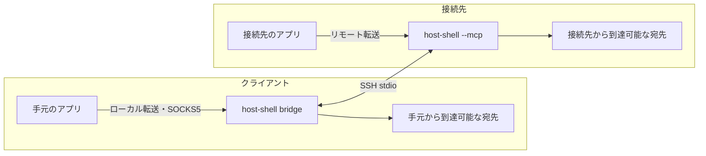

# SSH stdio 経由のポート転送

> [!NOTE]
> この文書が正本です。英訳は [../en/port-forward.md](../en/port-forward.md) にあります。内容が一致しない場合は日本語版が優先されます。

SSH のポート転送 (`-L`、`-R`、`-D`) が使えない環境において、既存の SSH セッションの標準入出力のみを使用して TCP ポート転送を行います。[クライアント経由 HTTP プロキシ](client-proxy.md) と同じ多重化チャネルを共用します。既定では無効です。

## 転送の種類

| 種類 | 待ち受け側 | 発信側 | `ssh` の相当オプション | 用途の例 |
| --- | --- | --- | --- | --- |
| ローカル転送 | クライアント (`bridge`) | 接続先 | `-L` | 接続先で起動した開発サーバーを手元のブラウザーで確認する |
| リモート転送 | 接続先 | クライアント (`bridge`) | `-R` | 接続先のアプリケーションから手元や社内の DB・Git サーバーへ接続する |
| SOCKS5 | クライアント (`bridge`) | 接続先 (宛先は接続ごとに指定) | `-D` | 手元のブラウザーから接続先の内部ネットワークを閲覧する |

Table: 転送の種類

ローカル転送の具体例として、閉鎖環境の接続先へ code-server を導入して手元のブラウザーから開く手順を [code-server の導入](code-server.md) にまとめています。



転送対象は TCP のみです (Unix ドメイン ソケットと UDP には対応していません)。接続先は Linux / Windows、`bridge` は Linux / Windows / macOS に対応します。

## 起動

`bridge` 側の転送オプションで機能を要求し、接続先側の許可オプションで方向ごとに許可します。

```bash
host-shell bridge \
    --forward-local 8080:localhost:3000 \
    --forward-remote 15432:db.client.example:5432 \
    --forward-socks 1080 --forward-allow-local '*.internal.example' \
    -- ssh -T target /path/to/host-shell --mcp --allow-forward-local --allow-forward-remote
```

### bridge のオプション

| オプション | 値 | 内容 |
| --- | --- | --- |
| `--forward-local` | `[BIND:]PORT:HOST:HOSTPORT` | 常設のローカル転送。手元の `PORT` で待ち受け、接続先から `HOST:HOSTPORT` へ接続する |
| `--forward-remote` | `[BIND:]PORT:HOST:HOSTPORT` | 常設のリモート転送。接続先の `PORT` で待ち受け、手元から `HOST:HOSTPORT` へ接続する |
| `--forward-socks` | `[BIND:]PORT` | 常設の SOCKS5 プロキシ。手元の `PORT` で待ち受ける |
| `--forward-allow-local` | `HOST[:PORT]` | `forward_open` で作成するローカル転送の宛先、および SOCKS5 の各接続の宛先に対する許可規則 |
| `--forward-allow-remote` | `HOST[:PORT]` | `forward_open` で作成するリモート転送の宛先に対する許可規則 |

Table: bridge の転送オプション (すべて複数指定可)

- `BIND` に指定できるのは `127.0.0.1` (省略時の既定値) または `[::1]` のみです。外部ホストからの接続は受け付けません。
- `PORT` に `0` を指定すると空きポートを自動割り当てします。割り当てられたポート番号は `forward_status` で確認できます。
- `HOST` に IPv6 アドレスを指定する場合は `[2001:db8::1]` のように `[` と `]` で囲みます。
- 許可規則の書式は `--proxy-allow-host` と同じくホスト名の glob と任意のポートです (CIDR 表記は使用できません)。要求されたホスト名を検査するものであり、名前解決後の IP アドレス範囲は制限しません。
- ポート番号にも glob を使用できます。たとえば `'127.0.0.1:80[0-7]?'` は 8000〜8079 に一致します (シェルに展開されないよう引用符で囲んでください)。
- `--forward-local` と `--forward-remote` による常設転送は、起動オプションの指定自体を利用者の明示的な許可とみなすため、`--forward-allow-*` の許可規則とは照合しません。
- `--forward-socks` を使用する場合は、1 件以上の `--forward-allow-local` が必要です。すべての宛先を許可する場合は `--forward-allow-local '*'` を明示的に指定します。
- 常設転送のいずれかで待ち受けに失敗した場合 (ポートが使用中など) は、接続先での待ち受け失敗も含めて起動エラーになります。

### 接続先のオプション

| オプション | 内容 |
| --- | --- |
| `--allow-forward-local` | ローカル転送と SOCKS5 (接続先からの発信) を許可する (値なし) |
| `--allow-forward-remote` | リモート転送 (接続先のループバックでの待ち受け) を許可する (値なし) |
| `--allow-forward-remote-port PORT[-PORT]` | リモート転送で接続先が待ち受けるポート番号を指定範囲に限定する (`ssh` の `PermitListen` に相当)。複数指定およびカンマ区切りに対応し、`--allow-forward-remote` が必要 |

Table: 接続先の許可オプション

- 接続先から発信するローカル転送と SOCKS5 の宛先には、接続先の `--allow-host` も適用されます (`--allow-host` 未指定時は接続先側では宛先を制限しません)。
- 接続先で待ち受けるポート番号は、`--allow-forward-remote-port` を指定しない限り制限されません。指定した場合は範囲外のポートでの待ち受けを拒否します (常設のリモート転送は起動エラー、`forward_open` はツール エラーになります)。ポート `0` (自動割り当て) が要求された場合は、指定された範囲を先頭から順に小さいポート番号から探索して空きポートを割り当て、範囲内に空きがなければエラーにします。許可されているポート範囲は `sys_get_info` の `restrictions` で確認できます。

  ```bash
  host-shell --mcp --allow-forward-remote --allow-forward-remote-port 15432,20000-20099
  ```

- `--read-only` と `--tools` はポート転送を制限しません。`--read-only` を指定した接続先であっても、`--allow-forward-local` を付与するとローカル転送経由で接続先のサービス (DB など) へ書き込めます。`--read-only` を厳格な境界として運用する場合は、転送の許可オプションを指定しないでください。
- これらの許可オプションは `--client-proxy` とは独立しています。

### 要求と許可の照合

| `bridge` 側の指定 (要求) | 接続先に必要な指定 (許可) |
| --- | --- |
| `--forward-local`、`--forward-socks`、`--forward-allow-local` | `--allow-forward-local` |
| `--forward-remote`、`--forward-allow-remote` | `--allow-forward-remote` |
| `--proxy` | `--client-proxy` (両端必須) |

Table: 要求と許可の対応

- 接続先で許可されていない機能を `bridge` が要求した場合は、不足しているオプション名を示して起動エラーになります。
- 接続先で許可オプションを指定していても、`bridge` 側が要求しない機能は無効のまま正常に起動します。そのため、管理者は `authorized_keys` の `command=` に許可オプションをあらかじめ設定しておくことができます。
- `bridge` が中継機能を何も要求しない場合は、通常の MCP セッションとして動作します。
- 両端の `host-shell` のバージョンが異なる場合も起動エラーになります。両端を同じバージョンにそろえてください。

## ツール (bridge)

| ツール | 公開される条件 | 内容 |
| --- | --- | --- |
| `forward_status` | 常設転送または許可規則を 1 件以上指定した場合 | 転送の一覧、許可規則、および接続結果の履歴を返す |
| `forward_open` | 許可規則 (`--forward-allow-*`) を 1 件以上指定した場合 | 新しいポート転送を作成する |
| `forward_close` | 許可規則 (`--forward-allow-*`) を 1 件以上指定した場合 | `forward_open` で作成した転送を閉じ、確立中の接続も切断する |

Table: 転送ツール

### forward_open と forward_close

`forward_open` の入力は `direction` (`local`、`remote`、`socks`)、`listen_address` (`127.0.0.1` または `::1`、既定 `127.0.0.1`)、`listen_port` (既定 `0`)、および `host` と `port` (`local`・`remote` では必須、`socks` では指定不可) です。出力として `forward_id` と実際の待ち受けアドレス・ポートを返します。

```json
{"direction": "local", "host": "localhost", "port": 3000}
```

- 宛先は、`local` と `socks` では `--forward-allow-local`、`remote` では `--forward-allow-remote` の許可規則に一致する必要があります。許可規則が指定されていない方向の転送は作成できません。
- 起動オプション (`--forward-local` 等) で作成した常設転送は `forward_close` では閉じられません。

### forward_status

`forward_status` の入力は `proxy_status` と同じく `after_seq` と `limit` (1〜100、既定 `20`) です。出力として `state`、`forwards` (`forward_id`、`direction`、`persistent`、`listen_address`、`listen_port`、`host`、`port`、`active_connections`)、`allow_local`、`allow_remote`、`active_connections`、`events`、`next_seq`、`truncated` を返します。

`events` の各要素は `seq`、`time`、`forward_id`、`connection_id`、`direction`、`host`、`port`、`status` (`allowed` / `denied` / `failed`)、`reason` を持ち、直近 100 件を保持します。`reason` には次の固定文字列が入ります。

| `reason` | 意味 |
| --- | --- |
| `connection established` | 接続が確立した |
| `destination not allowed` | `bridge` の許可規則に一致しない |
| `destination not allowed by target` | 接続先の `--allow-host` に一致しない |
| `connection limit reached` | 同時接続数の上限に達した |
| `forward closed` | 転送が閉じられた |
| `unsupported SOCKS request` | 未対応の SOCKS 要求を受信した |
| `connection refused`、`host unreachable`、`connection timeout`、`connection failed` | 宛先への接続に失敗した |

Table: forward_status の reason

同じ内容は `bridge` の標準エラーにも出力されます。転送された通信データ自体は記録されません。

## SOCKS5

- SOCKS5 の `CONNECT` コマンドのみに対応します (`BIND`、`UDP ASSOCIATE`、および SOCKS4 / 4a にはエラー応答を返します)。
- 宛先アドレスには IPv4、IPv6、ドメイン名を指定できます。ドメイン名を接続先側で名前解決させるため、`curl` 等では `socks5h://` を使用してください。

  ```bash
  curl --proxy socks5h://127.0.0.1:1080 http://intranet.internal.example/
  ```

- 認証は行いません (認証方式 `0x00` のみ)。
- SOCKS5 応答コードは、許可規則による拒否が `0x02`、名前解決失敗・到達不能が `0x04`、接続拒否が `0x05`、接続確立タイムアウト (30 秒) が `0x06` です。

## 安全性

- 待ち受けソケットはクライアント・接続先の両側ともループバック (`127.0.0.1` または `::1`) 限定です。ただし待ち受けポートへの接続自体には認証がないため、同一ホスト上の他ユーザーのプロセスからも接続できます (これは `ssh` の `-L`、`-R`、`-D` と同じ性質です)。
- 本機能は `sshd` の転送機能を使用しないため、`sshd` の `no-port-forwarding` や `AllowTcpForwarding no` では制限されません。接続先の管理者は `--allow-forward-local` / `--allow-forward-remote` の有無で可否を制御し、禁止する場合は `authorized_keys` の `command=` にこれらのオプションを含めないようにします。
- リモート転送では、`bridge` は宛先へ直接 TCP 接続を行い、`HTTP_PROXY` や `HTTPS_PROXY` は経由しません。
- 接続先の操作ログには、リモート転送の待ち受け開始・終了・拒否 (`forward_listen`、`forward_unlisten`) と、ローカル転送および SOCKS5 の発信接続 (`forward_connect`: 方向、宛先、結果) が記録されます。
- `sys_get_info` は、接続先で許可された転送方向 (`forward_local`、`forward_remote`) と、接続先で現在待ち受け中のリモート転送一覧 (`remote_forwards`) を返します。

## 上限と終了

- **同時接続数**: [クライアント経由 HTTP プロキシ](client-proxy.md) と合わせて 1 セッションあたり最大 64 接続です。
- **転送 (待ち受け) 数**: 常設転送と `forward_open` の合計で 1 セッションあたり最大 16 件です。
- **タイムアウト**: 宛先への接続確立待ちは 30 秒です。確立後の転送ストリームには無通信タイムアウトはなく、両端のいずれかが閉じるか、`forward_close` が呼ばれるか、MCP セッションが終了するまで維持されます。
- **ハーフ クローズ**: 片方向の終了 (half-close) はそのまま相手側ソケットへ伝達されます。
- **セッション切断時**: MCP セッションが切断されると、両端の待ち受けと確立中の全接続を即座に閉じます (自動再接続は行いません)。
