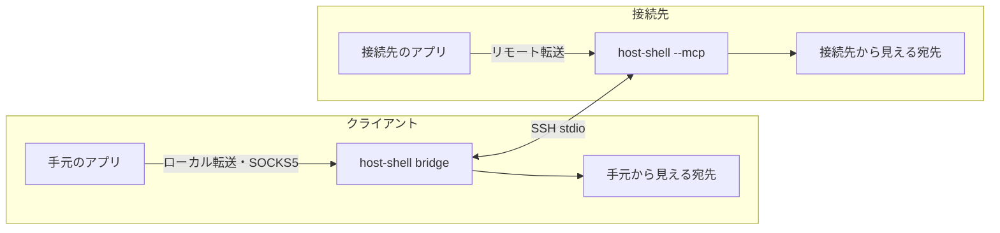

# SSH stdio 経由のポート転送

SSH のポート転送 (`-L`、`-R`、`-D`) を使えない環境で、既存 SSH セッションの標準入出力だけを使って TCP のポート転送を行います。[クライアント経由 HTTP プロキシ](client-proxy.md) と同じ通信路を共用します。既定では無効です。

## 転送の種類

| 種類 | 待ち受け | 発信 | ssh の相当 | 用途の例 |
| --- | --- | --- | --- | --- |
| ローカル転送 | クライアント (bridge) | 接続先 | `-L` | 接続先で起動した開発サーバーを手元のブラウザーで確認する |
| リモート転送 | 接続先 | クライアント (bridge) | `-R` | 接続先のアプリから手元や社内の DB・Git サーバーを使う |
| SOCKS5 | クライアント (bridge) | 接続先 (宛先は接続ごと) | `-D` | 手元のブラウザーから接続先の社内ネットワークを閲覧する |

Table: 転送の種類

対象は TCP だけです。Unix ドメイン ソケットと UDP は転送できません。接続先は Linux/Windows、bridge は Linux/Windows/macOS に対応します。

## 起動

bridge の転送オプションで「要求」し、接続先の許可オプションで「許可」します。

    host-shell bridge \
      --forward-local 8080:localhost:3000 \
      --forward-remote 15432:db.client.example:5432 \
      --forward-socks 1080 --forward-allow-local '*.internal.example' \
      -- ssh -T target /path/to/host-shell --mcp --allow-forward-local --allow-forward-remote

### bridge のオプション

| オプション | 値 | 内容 |
| --- | --- | --- |
| `--forward-local` | `[BIND:]PORT:HOST:HOSTPORT` | 常設のローカル転送。手元の PORT で待ち受け、接続先から HOST:HOSTPORT へ接続します |
| `--forward-remote` | `[BIND:]PORT:HOST:HOSTPORT` | 常設のリモート転送。接続先の PORT で待ち受け、手元から HOST:HOSTPORT へ接続します |
| `--forward-socks` | `[BIND:]PORT` | 常設の SOCKS5。手元の PORT で待ち受けます |
| `--forward-allow-local` | `HOST[:PORT]` | forward_open で作るローカル転送の宛先と、SOCKS5 の各接続の宛先の許可規則 |
| `--forward-allow-remote` | `HOST[:PORT]` | forward_open で作るリモート転送の宛先の許可規則 |

Table: bridge の転送オプション (すべて複数指定可)

- BIND は `127.0.0.1` (省略時) または `[::1]` だけです。ほかのホストからの接続は受け付けません。
- PORT に 0 を指定すると空きポートを割り当てます。実際のポートは forward_status で確認できます。
- IPv6 アドレスの HOST は `[2001:db8::1]` のように `[` `]` で囲みます。
- 許可規則の書式は `--proxy-allow-host` と同じホスト名 glob と任意のポートです (CIDR は使えません)。要求された名前の制限であり、名前解決後の IP の範囲は保証しません。
- 常設のローカル転送・リモート転送は、定義そのものを利用者の許可とみなし、許可規則と照合しません。
- `--forward-socks` には 1 件以上の `--forward-allow-local` が必要です。すべての宛先を許可する場合は `--forward-allow-local '*'` を明示します。
- 常設転送のいずれかで待ち受けに失敗した場合 (ポート使用中など) は、接続先での待ち受けを含めて起動エラーです。

### 接続先のオプション

| オプション | 内容 |
| --- | --- |
| `--allow-forward-local` | ローカル転送と SOCKS5 (接続先からの発信) を許可します。値は取りません |
| `--allow-forward-remote` | リモート転送 (接続先のループバックでの待ち受け) を許可します。値は取りません |

Table: 接続先の許可オプション

- 接続先から発信する宛先には `--allow-host` を適用します。未指定時は接続先側では宛先を制限しません。
- 接続先で待ち受けるポート番号は制限しません。
- `--read-only` と `--tools` は転送を制限しません。`--read-only` の接続先でも、許可オプションを指定するとローカル転送で接続先のサービス (DB など) へ書き込めます。`--read-only` を厳格な境界として運用する場合は許可オプションを指定しないでください。
- 許可オプションは `--client-proxy` と独立です。

### 要求と許可の照合

| bridge の指定 (要求) | 接続先に必要な指定 (許可) |
| --- | --- |
| `--forward-local`、`--forward-socks`、`--forward-allow-local` | `--allow-forward-local` |
| `--forward-remote`、`--forward-allow-remote` | `--allow-forward-remote` |
| `--proxy` | `--client-proxy` (両端必須) |

Table: 要求と許可

- 許可のない要求は起動エラーです。エラーには不足するオプションを示します。
- 許可だけで要求のない機能は、無効のまま正常に起動します。管理者は許可オプションを `authorized_keys` の `command=` に常設できます。
- bridge が何も要求しない場合は通常の MCP として動作します。
- 両端の host-shell の版が異なる場合も起動エラーになります。両端を同じ版にそろえてください。

## ツール (bridge)

| ツール | 公開される条件 | 内容 |
| --- | --- | --- |
| forward_status | 常設転送か許可規則を 1 つでも指定した場合 | 転送の一覧、許可規則、接続結果の履歴 |
| forward_open | 許可規則を 1 件以上指定した場合 | 転送を作成します |
| forward_close | 許可規則を 1 件以上指定した場合 | forward_open で作った転送を閉じ、その接続も切断します |

Table: 転送ツール

forward_open の入力は direction (`local`、`remote`、`socks`)、listen_address (`127.0.0.1` または `::1`、既定 `127.0.0.1`)、listen_port (既定 0)、host と port (`local`、`remote` で必須、`socks` では指定不可) です。出力は forward_id と実際の待ち受けアドレス・ポートです。

    {"direction": "local", "host": "localhost", "port": 3000}

- 宛先は `local` と `socks` は `--forward-allow-local`、`remote` は `--forward-allow-remote` の規則に一致する必要があります。規則のない方向は作成できません。
- 常設転送は forward_close で閉じられません。

forward_status の入力は proxy_status と同じ after_seq と limit (1〜100、既定 20) です。出力は state、forwards (forward_id、direction、persistent、listen_address、listen_port、host、port、active_connections)、allow_local、allow_remote、active_connections、events、next_seq、truncated です。

events は seq、time、forward_id、connection_id、direction、host、port、status (allowed/denied/failed)、reason を持ち、直近 100 件を保持します。reason は次の固定の文言です。

| reason | 意味 |
| --- | --- |
| `connection established` | 接続しました |
| `destination not allowed` | bridge の許可規則に一致しません |
| `destination not allowed by target` | 接続先の `--allow-host` に一致しません |
| `connection limit reached` | 同時接続の上限に達しました |
| `forward closed` | 転送が閉じられました |
| `unsupported SOCKS request` | 対応していない SOCKS の要求です |
| `connection refused`、`host unreachable`、`connection timeout`、`connection failed` | 発信に失敗しました |

Table: forward_status の reason

同じ内容を bridge の stderr にも記録します。転送した通信の内容は記録しません。

## SOCKS5

- SOCKS5 の CONNECT だけに対応します。BIND、UDP ASSOCIATE、SOCKS4/4a はエラー応答を返します。
- アドレスは IPv4、IPv6、ドメイン名です。ドメイン名は接続先で名前解決するため、curl では `socks5h://` を使います。

        curl --proxy socks5h://127.0.0.1:1080 http://intranet.internal.example/

- 認証はありません (認証方式 0x00 だけ)。
- 拒否は 0x02、名前解決の失敗・到達不可は 0x04、接続拒否は 0x05、確立待ち 30 秒の超過は 0x06 を返します。

## 安全性

- 待ち受けは両側ともループバックだけです。待ち受けポートへの接続は認証しないため、同じホストのほかのユーザーのプロセスも接続できます。これは ssh の `-L`、`-R`、`-D` と同じ性質です。
- 本機能は sshd の転送機能を使わないため、sshd の `no-port-forwarding` や `AllowTcpForwarding no` では止められません。接続先の管理者は許可オプションで本機能を許可し、`command=` に許可オプションを書かないことで禁止できます。
- リモート転送で bridge は宛先へ直接接続し、HTTP_PROXY/HTTPS_PROXY は使いません。
- 接続先の操作ログに、リモート転送の待ち受けの開始・終了 (`forward_listen`、`forward_unlisten`) と、ローカル転送・SOCKS5 の発信 (`forward_connect`: 方向、宛先、結果) を記録します。
- sys_get_info は、許可された方向 (`forward_local`、`forward_remote`) と、接続先で待ち受け中のリモート転送 (`remote_forwards`) を返します。

## 上限と終了

- 同時接続は HTTP プロキシと合わせてセッションあたり 64 です。
- 転送 (待ち受け) は常設と forward_open の合計でセッションあたり 16 です。
- 発信の確立待ちは 30 秒です。転送した接続には無通信タイムアウトはありません。どちらかの終了、forward_close、セッションの終了まで維持します。
- 片方向の終了 (half-close) は相手側へ伝えます。
- セッションが切断されると、両側の待ち受けと接続をすべて閉じます。自動では再接続しません。
