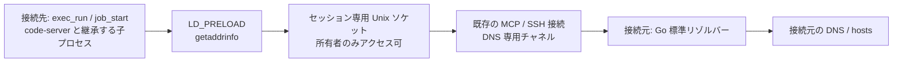
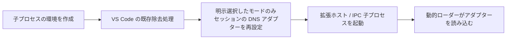

# 接続元を使う名前解決（remote-dns）

> [!NOTE]
> この文書が正本です。英訳は [../en/remote-dns.md](../en/remote-dns.md) にあります。内容が一致しない場合は日本語版が優先されます。

Linux/glibc の接続先で `getaddrinfo` を呼ぶプロセスの名前解決を、既存の MCP 接続を通じて接続元に中継します。通常ユーザーで利用でき、`/etc/resolv.conf`、`/etc/hosts` やサービス設定の変更は不要です。初期状態では無効です。



## 有効化

同じ機能を備える host-shell を両端で使用し、両方に `--remote-dns` を指定します。

```bash
host-shell bridge --remote-dns -- \
  ssh -T target /path/to/host-shell --mcp --remote-dns
```

接続先には `cc` と glibc 開発用ヘッダーが必要です。同梱の C ソースから、セッション開始時に共有ライブラリーを作成します。

コンパイラーのない接続先では、ビルド済みのアダプターを転送し、`--remote-dns-library` で指定します。GitHub Release のアーカイブには、`dist/` とスキル host-shell-connect の `bin/` に `libhostshell_dns-linux-amd64.so` と `libhostshell_dns-linux-arm64.so` を同梱しています。CI が AlmaLinux 8 (glibc 2.28) 上でビルドします。glibc 2.17 以降のシンボルだけを使うことを検査しています。

```bash
# 接続先の CPU に合うアダプターを転送した後の接続例
host-shell bridge --remote-dns -- \
  ssh -T target /path/to/host-shell --mcp --remote-dns \
    --remote-dns-library /absolute/path/libhostshell_dns-linux-amd64.so
```

ソースからビルドする場合は、接続先の CPU 向けに、接続先以前の glibc を持つ環境で `make dns-lib` を実行します。

`exec_run` / `job_start` に `LD_PRELOAD`、`HOST_SHELL_DNS_LIBRARY`、`HOST_SHELL_DNS_SOCKET` が自動設定されます。既存の `LD_PRELOAD` は保持します。ポリシーの `--unset-env` と、呼び出しの `env` による明示設定はその後に適用されます。`sys_get_info` の `remote_dns`、`remote_dns_library`、`remote_dns_socket` で設定を確認できます。ライブラリーとソケットはセッションごとの非公開一時ディレクトリーに置き、切断時に削除します。事前に転送した原本は削除しません。

## HTTP プロキシとの併用

名前解決は通信経路を作りません。外向き接続を持たない接続先で Web アクセスする場合は、[クライアントプロキシ](client-proxy.md) も有効にします。

```bash
host-shell bridge --remote-dns --proxy \
  --proxy-allow-host api.github.com:443 -- \
  ssh -T target /path/to/host-shell --mcp --remote-dns --client-proxy
```

code-server はこのセッションの `job_start` から起動します。既に起動しているプロセスの環境は変わりません。追加の Python サービス、別の MCP セッション、リモートポート転送は不要です。

DNS 問い合わせ自体には HTTP プロキシの許可・拒否リストを適用しません。`--remote-dns` は接続元から任意の名前を解決することへの許可です。HTTP/HTTPS の通信先は引き続きプロキシの許可・拒否リストで制限されます。名前解決に成功しても、未許可宛先への通信は 403 になります。

## code-server の拡張・エージェントホストへの適用

Linux 向け code-server スキルの `start.sh` に、明示的に選択する専用コピーモードを用意しています。通常起動では元の配布物を使用します。

1. 更新した host-shell を両端で起動し、`--remote-dns` を有効にします。Web アクセスには HTTP プロキシと必要な宛先許可も必要です。
2. 更新したスキルの `scripts/linux` を接続先キットへ転送します。code-server 本体は既存の検証済み配布物を利用できます。
3. `job_start` で次を指定して起動します。`<kit>` は配置したキットの絶対パスです。

   ```json
   {
     "argv": ["bash", "<kit>/scripts/linux/start.sh"],
     "env": {
       "HOST_SHELL_CODE_SERVER_REMOTE_DNS": "1",
       "CODE_SERVER_WORKSPACE": "/absolute/path/to/workspace"
     }
   }
   ```

`start.sh` は通常のユーザーデータを使います。既存インスタンスと並行して検証する場合は、専用コピーの `bin/code-server` を別ポート・別 `--user-data-dir`・別 `--session-socket` で直接起動し、同じ有効化環境変数を渡してください。実行中のユーザーデータディレクトリーを共有しないでください。

初回は元のインストールと並ぶ `code-server-4.144.0-remote-dns-v1` に独立したコピーを作成します。コピー用に約750 MiBの空き領域が必要です。パッチ作成前に空き容量を検査し、コピー後に JavaScript の構文を検査してから、ディレクトリーを公開します。元の配布物や実行中セッションは書き換えません。再起動時はコピーを再作成せず、マニフェストと変更後ハッシュを検証します。変更を検出した場合は拒否し、上書き修復しません。

対象は code-server 4.144.0 / VS Code 1.144.0 の公式 Linux amd64・arm64 配布物です。検証済みアーカイブから固定した対象3ファイルの SHA-256 と4箇所の変更文字列が一致する場合だけ適用します。未知の版や変更済みファイル、二重適用は拒否します。arm64 はアーカイブの検査までで、実機動作は未検証です。



`out/server-main.js`、`out/vs/workbench/api/node/extensionHostProcess.js`、`out/vs/platform/agentHost/node/agentHostMain.js` の子プロセス起動直前に処理を追加します。`NODE_OPTIONS` 等の除去は維持し、元の `LD_PRELOAD` 全体は復元しません。親から継承した `HOST_SHELL_DNS_LIBRARY` と `HOST_SHELL_DNS_SOCKET` を使い、同じセッションのライブラリーだけを設定します。別セッションの値、所有者・権限が不適切な配置、シンボリックリンク、切断後のソケットは拒否します。

ブラウザー内の Web 拡張、独自 DNS API、拡張側が独自に除去する起動経路まではカバーしません。Copilot SDK の実際の起動経路と Web Fetch の確認は、以下の自動検証と区別してください。

### 検証状況とユーザーテスト

自動テストでは、元ファイルの保持、変更済みファイルの拒否、構文エラー時の後片付け、無効時の既存動作、2セッションの分離、危険な権限・リンク・期限切れソケットの拒否を確認しました。実際の共有ライブラリーを使い、環境変数の除去後に再注入した Node 子プロセスのライブラリー読み込みと、MCP チャネルを通じた名前解決も確認しています。

隔離コンテナーでは専用コピーの作成・再検証・HTTP サーバー起動まで確認済みです。利用者がテスト用 code-server のターミナルから起動した Copilot CLI で Web Fetch の成功を確認しました。プロキシ履歴にも `api.github.com:443` の許可を確認しています。実機の拡張ホストと VS Code 同梱 `copilot-runtime` では `LD_PRELOAD` の継承と共有ライブラリーの読み込みを確認しました。利用者は画面内の Copilot Chat のログイン成功を確認しました。取得も依頼しましたが、Web Fetch ツールがなく、チャットは curl を使用したと報告しています。内蔵 Web Fetch は未実施です。HTTP プロキシ経由の curl は接続元側で宛先を名前解決できるため、curl の実行だけでは SDK 自身の DNS フック動作を検証したことにはなりません。環境変数の伝播とライブラリーの読み込みは、上記の実機プロセス検査で確認済みです。

その後、利用者は Copilot Chat のターミナル実行ツールから、専用コピーの Node.js で `dns.lookup("api.github.com", {all: true}, ...)` を実行し、IPv4 `20.27.177.116` を取得しました。HTTP プロキシを使用しない `getaddrinfo` 呼び出しの成功であり、Chat が起動した Node 子プロセスでの名前解決を確認できました。拡張ホスト自身または SDK 自身が直接 DNS API を呼び出した結果とは区別します。確認には同じ許可済み URL（例: `https://api.github.com/zen`）を使い、HTTP 403 と名前解決失敗を分けてください。必要なら `HOST_SHELL_DNS_TRACE=1` を起動時に追加し、各 PID の環境変数と `/proc/<pid>/maps` でもアダプターの読み込みを確認します。

停止は該当するジョブの `job_stop` と転送の `forward_close` で行います。通常版へ戻す場合は、次回 `start.sh` 起動時に `HOST_SHELL_CODE_SERVER_REMOTE_DNS` を指定しないか `0` にします。既存のプロセスの環境は変化しません。専用コピーはセッション終了後も残り、通常の code-server アンインストールで一緒に削除されます。

開発時の検証コマンド（Linux、Node.js が必要）:

```bash
node --test .agents/skills/host-shell-code-server/tests/remote-dns.test.mjs
go test ./internal/remotedns
```

## 適用範囲と制限

- 接続先は Linux/glibc、接続元は host-shell が対応する各 OS です。静的バイナリー、特権実行で無視される `LD_PRELOAD`、独自 DNS 実装、Node.js の `dns.resolve*`、逆引き、`gethostbyname` は対象外です。
- VS Code は拡張ホスト・エージェントホストの起動時に `LD_PRELOAD` を除去する経路があります。code-server の親プロセスに設定しても、内蔵 Copilot SDK を含むすべての子プロセスに有効とは限りません。通常起動では除去処理を維持します。以下の明示的な起動モードで、DNS アダプターだけを再注入できます。
- 数値 IP、`localhost`、`AI_NUMERICHOST` は接続先の libc に委ねます。それ以外の接続先固有の hosts エントリーは接続元の名前解決に置き換わります。
- 接続元は Go 標準リゾルバーを使用します。OS ごとの libc/NSS の全挙動を再現するものではありません。IPv4/IPv6、canonical name、サービス名の処理に対応しますが、完全な libc の代替ではありません。
- 問い合わせの処理時間は約3秒に制限します。中継不能時は接続先 DNS にフォールバックせず失敗します。キャッシュは持ちません。ソケットは同じユーザーからは利用できます。


## 製品組み込み版の検証

2026-11-02、開発版を Oracle Linux 10.2 / x86_64 / glibc 2.39 の `--network none` コンテナーに SSH で接続して検証しました。

| 項目 | 結果 |
|---|---|
| 接続先で同梱ソースを自動コンパイル | 成功（接続先 GCC の最適化時警告も修正） |
| `exec_run` の名前解決・canonical name・サービスのポート番号 | 成功 |
| 24件の並列問い合わせ・子プロセスへの継承 | 成功 |
| `job_start` で起動したプロセスからの名前解決 | 成功 |
| 許可済み `api.github.com:443` への HTTPS | 成功 |
| 未許可の `example.com:443` | 名前解決は成功し、プロキシは 403 で拒否 |
| セッション切断 | DNS 一時ディレクトリーと実行中の検証ジョブを回収 |
| 既存の2つの code-server | 引き続き HTTP 200、セッションを維持 |

自動テストでは IPv4/IPv6、数値 IP、localhost、NXDOMAIN、`AI_NUMERICHOST`、中継不能、事前ビルド版のコピーと原本保持、不正ライブラリーの拒否、環境変数の合成、両端の機能交渉も確認しています。製品組み込み版でのブラウザーからの再検証や内蔵 Copilot SDK への適用を、この結果に含めてはいません。

## code-server・Copilot の診断

名前解決、環境変数の継承、HTTP プロキシの宛先許可を個別に確認してください。`HOST_SHELL_DNS_TRACE=1` はフックを通ったホスト名とアドレスファミリーを標準エラーへ記録する任意の診断設定です。

2026-11-02、Oracle Linux 10.2 / x86_64 / glibc 2.39 のネットワーク隔離コンテナーで、code-server 4.144.0 と Copilot CLI 1.0.83 を使い、名前解決フック単体について次を確認しました。この結果は、製品構成でのブラウザー・CLI の再検証を示すものではありません。

| 確認項目 | 結果 |
|---|---|
| 単体 Copilot CLI の Web Fetch → `https://api.github.com/zen` | フックなしでは名前解決失敗、フックありでは成功。同じ許可済み URL と Web Fetch のみを使用 |
| code-server のブラウザーターミナル | 利用者が追加の環境変数指定なしで、24件の並列問い合わせ・子プロセス・エラー処理を含む検証の成功を確認 |
| Node.js `dns.lookup()` | 成功 |
| Node.js `dns.resolve4()` | ECONNREFUSED。独自 DNS 経路はフック対象外 |
| VS Code の拡張ホスト・エージェントホスト・同梱 Copilot SDK | `LD_PRELOAD` が除去され、共有ライブラリーが読み込まれていないことを確認 |

VS Code 同梱 SDK の実行体は `lib/vscode/node_modules/@github/copilot-sdk-linux-x64/prebuilds/linux-x64/copilot-runtime` でした。`out/server-main.js`、`out/vs/workbench/api/node/extensionHostProcess.js`、`out/vs/platform/agentHost/node/agentHostMain.js` に `LD_PRELOAD` を除去する処理があり、親プロセスへの設定だけでは、この起動経路をカバーできません。単体 CLI の成功とは区別してください。

同日 13:11:49 (JST) の `https://hondarer-soft.com` 取得失敗は、プロキシ履歴では `hondarer-soft.com:443` が `destination not allowed` でした。フック付き Python での名前解決は成功しています。`a transport-level failure (DNS, connection, or TLS handshake)` という表示だけで DNS 障害と判断せず、`proxy_status` で実際の拒否理由を確認してください。この調査で宛先の許可は追加していません。

## 継続利用時のログ確認（2026-11-03）

利用者がブラウザーで code-server を開き、CLI と画面内 Copilot Chat の両方が正しく応答することを確認しました。05:42 JST 前後の保持されているプロキシ履歴では、`api.individual.githubcopilot.com:443` と `api.github.com:443` への接続が許可されています。実行中のエージェントホスト・拡張ホスト・同梱 `copilot-runtime` は、いずれも `LD_PRELOAD` と DNS アダプターの読み込みを確認できました。code-server の保持出力には `api.github.com` のフック通過が2件ありましたが、この出力には問い合わせ時刻がないため、今回の各応答との対応は断定しません。

起動時には Copilot の未サインイン・トークンソース未準備、BYOK モデル一覧更新の `fetch failed`、custom agents 取得の `Canceled` が記録されています。調査したログでは DNS 再注入の検査エラーや `ENOTFOUND`・`EAI_AGAIN` は見つかっていません。`mobile.events.data.microsoft.com`、`default.exp-tas.com`、Application Insights の宛先、`169.254.169.254:80` は宛先ルールで拒否されており、許可先は追加していません。プロキシ履歴は直近100件までのため、全期間の無障害を示す結果ではありません。

このブラウザー接続は従来の SSH セッションを使用しています。接続元ループバックの新しい TCP 入口を使う別 SSH セッションでも MCP 初期化・DNS 中継・HTTPS を確認しましたが、このブラウザーインスタンスをその新セッションへ切り替えた検証ではありません。
