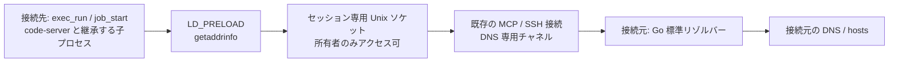
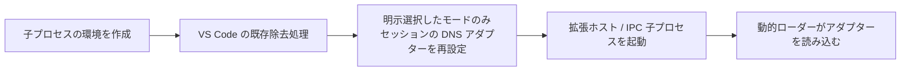

# 接続元を使う名前解決 (remote-dns)

> [!NOTE]
> この文書が正本です。英訳は [../en/remote-dns.md](../en/remote-dns.md) にあります。内容が一致しない場合は日本語版が優先されます。

Linux/glibc の接続先で `getaddrinfo` を呼ぶプロセスの名前解決を、既存の MCP 接続を通じて接続元に中継します。通常ユーザーで利用でき、`/etc/resolv.conf`、`/etc/hosts` やサービス設定の変更は不要です。初期状態では無効です。



## ユースケース

| ユースケース | 使う機能 |
|---|---|
| 接続先に DNS がなく、プログラムが接続前に自分で名前解決する (例: Copilot CLI 内蔵の Web Fetch が `failed to lookup address information` で失敗する) | remote-dns |
| DNS も外向き通信もない接続先から Web にアクセスする | remote-dns と [クライアント経由 HTTP プロキシ](client-proxy.md) |
| code-server の拡張ホスト・エージェントホスト (画面内の Copilot Chat など) でも接続元の名前解決を使う | 上記に加えて [code-server の専用コピーモード](#code-server-の拡張エージェントホストへの適用) |

Table: ユースケース

HTTP プロキシに対応したプログラム (curl など) は、宛先のホスト名をプロキシに渡し、接続元側で名前解決されます。そのため、プロキシ経由の通信だけなら remote-dns は不要です。

## 有効化

クライアント側 (`bridge`) と接続先の両方で `--remote-dns` を指定します。接続先には名前解決用のアダプター (共有ライブラリー) が必要です。

| アダプターの用意 | 接続先の指定 | 条件 |
|---|---|---|
| スキル host-shell-connect の `deploy.sh` が配置したもの (推奨) | `--remote-dns --remote-dns-library <表示されたパス>` | スキルの `bin/` にアダプターがあること (リリース アーカイブに同梱) |
| リリース アーカイブの `dist/libhostshell_dns-linux-<arch>.so` を手動で転送 | `--remote-dns --remote-dns-library <絶対パス>` | 接続先の CPU に合うもの |
| 接続先でのビルド | `--remote-dns` のみ | 接続先に `cc` と glibc 開発用ヘッダー |

Table: アダプターの用意

### スキルを使う場合

`deploy.sh` は、glibc の Linux 接続先に本体を配置するとき、対応するアダプターを同じディレクトリーに `libhostshell_dns.so` として配置します。接続先で実際に `LD_PRELOAD` で読み込めるかを確認し、`dns adapter deployed: <絶対パス>` と表示します。スキルは、このパスを `--remote-dns-library` に指定した登録コマンドを示します。利用者がアダプターを用意する必要はありません。

```bash
host-shell bridge --remote-dns -- \
  ssh -T target /tmp/host-shell-1000/host-shell --mcp --remote-dns \
    --remote-dns-library /tmp/host-shell-1000/libhostshell_dns.so
```

### 手動で用意する場合

リリース アーカイブの `dist/` とスキル host-shell-connect の `bin/` に、`libhostshell_dns-linux-amd64.so` と `libhostshell_dns-linux-arm64.so` があります。CI が AlmaLinux 8 (glibc 2.28) 上でビルドし、glibc 2.17 以前のシンボルだけを使うことを検査しています。接続先の CPU に合うものを転送し、絶対パスを `--remote-dns-library` に指定します。

ソースからビルドする場合は、接続先と同じ CPU アーキテクチャーかつ接続先以下のバージョンの glibc を持つ環境で `make dns-lib` を実行します。

`--remote-dns-library` を省略すると、接続先の `cc` で同梱の C ソースからセッション開始時にアダプターを作成します。

### 有効時の動作

- `exec_run` / `job_start` に `LD_PRELOAD`、`HOST_SHELL_DNS_LIBRARY`、`HOST_SHELL_DNS_SOCKET` が自動設定されます。既存の `LD_PRELOAD` は保持します。ポリシーの `--unset-env` と、呼び出しの `env` による明示設定はその後に適用されます。
- `sys_get_info` の `remote_dns`、`remote_dns_library`、`remote_dns_socket` で設定を確認できます。
- アダプターとソケットはセッションごとの非公開一時ディレクトリーに置き、切断時に削除します。`--remote-dns-library` で指定した原本は削除しません。
- bridge なしで `--remote-dns` 付きの接続先を起動すると、`bridge must enable --remote-dns` で停止します。

## HTTP プロキシとの併用

名前解決は通信経路を作りません。外向き接続を持たない接続先で Web アクセスする場合は、[クライアント経由 HTTP プロキシ](client-proxy.md) も有効にします。

```bash
host-shell bridge --remote-dns --proxy \
  --proxy-allow-host api.github.com:443 -- \
  ssh -T target /path/to/host-shell --mcp --remote-dns --client-proxy
```

code-server はこのセッションの `job_start` から起動します。既に起動しているプロセスの環境は変わりません。追加の Python サービス、別の MCP セッション、リモートポート転送は不要です。

DNS 問い合わせ自体には HTTP プロキシの許可・拒否リストを適用しません。`--remote-dns` は接続元から任意の名前を解決することへの許可です。HTTP/HTTPS の通信先は引き続きプロキシの許可・拒否リストで制限されます。名前解決に成功しても、未許可宛先への通信は 403 になります。

## code-server の拡張・エージェントホストへの適用

VS Code は拡張ホスト・エージェントホストの起動時に `LD_PRELOAD` を除去します。code-server の親プロセスにアダプターを設定しても、画面内の Copilot Chat や同梱の Copilot SDK (`copilot-runtime`) には届きません。Linux 向け code-server スキルの `start.sh` に、明示的に選択する専用コピーモードを用意しています。通常起動では元の配布物を使用します。

### 手順

1. 両端の `host-shell` に `--remote-dns` を指定して起動します。Web アクセスを行う場合は、クライアント経由 HTTP プロキシと必要な宛先許可も指定します。
2. 接続先に code-server を導入します (導入済みで接続先の `<kit>/scripts/linux` が古い場合は、スキルの `scripts/linux` を転送して更新します。code-server 本体は導入済みの配布物をそのまま利用できます)。
3. `job_start` で環境変数 `HOST_SHELL_CODE_SERVER_REMOTE_DNS: "1"` を指定して `start.sh` を起動します。`<kit>` は配置したキットの絶対パスです。

   ```json
   {
     "argv": ["bash", "<kit>/scripts/linux/start.sh"],
     "env": {
       "HOST_SHELL_CODE_SERVER_REMOTE_DNS": "1",
       "CODE_SERVER_WORKSPACE": "/absolute/path/to/workspace"
     }
   }
   ```

`start.sh` は通常のユーザーデータを使います。既存インスタンスと並行して確認する場合は、専用コピーの `bin/code-server` を別ポート・別 `--user-data-dir`・別 `--session-socket` で直接起動し、同じ有効化環境変数を渡してください。実行中のユーザーデータディレクトリーを共有しないでください。

停止は該当するジョブの `job_stop` と転送の `forward_close` で行います。通常版へ戻す場合は、次回 `start.sh` 起動時に `HOST_SHELL_CODE_SERVER_REMOTE_DNS` を指定しないか `0` にします。既存のプロセスの環境は変化しません。専用コピーはセッション終了後も残り、通常の code-server アンインストールで一緒に削除されます。

### 専用コピーの仕組み

初回は元のインストールと並ぶ `code-server-4.144.0-remote-dns-v1` に独立したコピーを作成します。コピー用に約 750 MiB の空き領域が必要です。パッチ作成前に空き容量を検査し、コピー後に JavaScript の構文検査に通ってから正式なディレクトリー名へ配置します。元の配布物や実行中セッションは書き換えません。再起動時はコピーを再作成せず、マニフェストと変更後ハッシュを検証します。変更を検出した場合は拒否し、上書き修復しません。

対象は code-server 4.144.0 / VS Code 1.144.0 の公式 Linux amd64・arm64 配布物です。パッチ対象の 3 ファイルの SHA-256 と 4 箇所の置換対象文字列が一致する場合だけ適用します。未知の版や変更済みファイル、二重適用は拒否します。



`out/server-main.js`、`out/vs/workbench/api/node/extensionHostProcess.js`、`out/vs/platform/agentHost/node/agentHostMain.js` の子プロセス起動直前に処理を追加します。`NODE_OPTIONS` 等の除去は維持し、元の `LD_PRELOAD` 全体は復元しません。親から継承した `HOST_SHELL_DNS_LIBRARY` と `HOST_SHELL_DNS_SOCKET` を使い、同じセッションのアダプターだけを設定します。別セッションの値、所有者・権限が不適切な配置、シンボリックリンク、切断後のソケットは拒否します。

ブラウザー内の Web 拡張、独自 DNS API、拡張側が独自に除去する起動経路まではカバーしません。

## 診断

名前解決、環境変数の継承、HTTP プロキシの宛先許可を分けて確認します。

| 症状・確認方法 | 判断 |
|---|---|
| `getaddrinfo` 系のエラー (`failed to lookup address information`、`ENOTFOUND`、`EAI_AGAIN`) | 名前解決の失敗。`sys_get_info.remote_dns` と、対象プロセスへの `LD_PRELOAD` の継承を確認する |
| HTTP 403、`CONNECT tunnel failed, response 403` | プロキシの宛先拒否であり、DNS 障害ではない。`proxy_status` で拒否理由を確認する |
| `a transport-level failure (DNS, connection, or TLS handshake)` などの曖昧な表示 | この表示だけで DNS 障害と判断せず、`proxy_status` で実際の拒否理由を確認する |
| プロセスがアダプターを読み込んでいるか | 対象 PID の環境変数と `/proc/<pid>/maps` に `libhostshell_dns` があるかを確認する |
| フックを通った問い合わせ | 起動時に `HOST_SHELL_DNS_TRACE=1` を設定すると、ホスト名とアドレスファミリーを標準エラーへ記録する |

Table: 診断の観点

確認には同じ許可済み URL (例: `https://api.github.com/zen`) を使い、HTTP 403 と名前解決失敗を分けてください。

## 検証済みの範囲

表の「OL10 コンテナー」は、Oracle Linux 10.2 / x86_64 / glibc 2.39 の Podman コンテナー (`--network none`、外部へのルートなし) に SSH で接続した環境です。

| 対象 | 確認内容 | 方法・環境 |
|---|---|---|
| 名前解決の中継 | IPv4/IPv6、canonical name、サービス名、数値 IP、localhost、NXDOMAIN、`AI_NUMERICHOST`、中継不能時のエラー、24件の並列問い合わせ、子プロセスへの継承 | 自動テスト、OL10 コンテナー |
| `exec_run` と `job_start` のプロセス | 名前解決が成功する | OL10 コンテナー |
| HTTP プロキシとの併用 | 許可済み宛先への HTTPS が成功し、未許可宛先は名前解決後に 403 で拒否される | OL10 コンテナー |
| 切断時の後片付け | 一時ディレクトリーと実行中のジョブを回収する | 自動テスト、OL10 コンテナー |
| 接続先でのビルド | 同梱ソースのコンパイルと読み込み | OL10 コンテナー |
| ビルド済みアダプター | amd64・arm64 とも glibc 2.28 と新しい glibc で読み込みとフック動作が成功する | CI (AlmaLinux 8 コンテナーと GitHub ランナー) |
| `deploy.sh` によるアダプターの配置 | 配置、更新時の照合、読み込み確認、musl の除外、読み込めないアダプターの削除 | Podman コンテナー (Oracle Linux 10、Oracle Linux 8、Alpine) |
| 不正なアダプター | 形式・アーキテクチャー・版が合わないものを拒否する | 自動テスト |
| Copilot CLI (ターミナル) | 内蔵 Web Fetch が、remote-dns なしでは名前解決に失敗し、ありでは成功する | OL10 コンテナー、Copilot CLI 1.0.83 |
| Node.js | `dns.lookup()` は成功する。`dns.resolve4()` は対象外 (ECONNREFUSED) | OL10 コンテナー |
| code-server の専用コピーモード | 元ファイルの保持、変更済みファイルの拒否、構文エラー時の後片付け、無効時の既存動作、2セッションの分離、危険な権限・リンク・期限切れソケットの拒否 | 自動テスト |
| 専用コピーモードの動作 | 拡張ホスト・エージェントホスト・同梱 `copilot-runtime` へのアダプターの読み込み、Chat が起動した Node 子プロセスの名前解決、ターミナルの Copilot CLI の Web Fetch、画面内 Copilot Chat の応答 | OL10 コンテナー、code-server 4.144.0 |

Table: 検証済みの範囲

未検証の範囲:

- Copilot Chat・Copilot SDK の内部から直接行う名前解決と、画面内 Chat の内蔵 Web Fetch
- 専用コピーモードの arm64 での動作 (アーカイブの検査のみ)
- ブラウザー内の Web 拡張

検証の経緯は [remote-dns の検証記録](../prompts/past/261102-remote-dns-validation.md) にあります。

開発時の検証コマンド (Linux、Node.js が必要):

```bash
node --test .agents/skills/host-shell-code-server/tests/remote-dns.test.mjs
go test ./internal/remotedns
```

## 適用範囲と制限

- 接続先は Linux/glibc、接続元は host-shell が対応する各 OS です。musl (Alpine など)、静的バイナリー、特権実行で無視される `LD_PRELOAD`、独自 DNS 実装、Node.js の `dns.resolve*`、逆引き、`gethostbyname` は対象外です。
- 数値 IP、`localhost`、`AI_NUMERICHOST` は接続先の libc に委ねます。それ以外の接続先固有の hosts エントリーは接続元の名前解決に置き換わります。
- 接続元は Go 標準リゾルバーを使用します。OS ごとの libc/NSS の全挙動を再現するものではありません。IPv4/IPv6、canonical name、サービス名の処理に対応しますが、完全な libc の代替ではありません。
- 問い合わせの処理時間は約3秒に制限します。中継不能時は接続先 DNS にフォールバックせず失敗します。キャッシュは持ちません。ソケットは同じユーザーからは利用できます。
