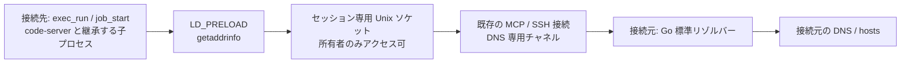

# 接続元を使う名前解決（remote-dns）

> [!NOTE]
> この文書が正本です。英訳は [../en/remote-dns.md](../en/remote-dns.md) にあります。内容が一致しない場合は日本語版が優先されます。

Linux/glibc の接続先で `getaddrinfo` を呼ぶプロセスの名前解決を、既存の MCP 接続を通じて接続元に中継します。通常ユーザーで利用でき、`/etc/resolv.conf`、`/etc/hosts` やサービス設定の変更は不要です。初期状態では無効です。



## 有効化

同じ機能を備える host-shell を両端で使用し、両方に `--remote-dns` を指定します。

```bash
host-shell bridge --remote-dns -- \
  ssh -T target /path/to/host-shell --mcp --remote-dns
```

接続先には `cc` と glibc 開発用ヘッダーが必要です。同梱の C ソースから、セッション開始時に共有ライブラリーを作成します。コンパイラーのない接続先では、対象の CPU・glibc と互換性のある環境で事前にビルドし、転送してください。

```bash
cc -Wall -Wextra -Werror -O2 -fPIC -shared \
  -o libhostshell_dns.so internal/remotedns/assets/preload.c -ldl -pthread

# ライブラリーを転送した後の接続例
host-shell bridge --remote-dns -- \
  ssh -T target /path/to/host-shell --mcp --remote-dns \
    --remote-dns-library /absolute/path/libhostshell_dns.so
```

`exec_run` / `job_start` に `LD_PRELOAD` と `HOST_SHELL_DNS_SOCKET` が自動設定されます。既存の `LD_PRELOAD` は保持します。ポリシーの `--unset-env` と、呼び出しの `env` による明示設定はその後に適用されます。`sys_get_info` の `remote_dns`、`remote_dns_library`、`remote_dns_socket` で設定を確認できます。ライブラリーとソケットはセッションごとの非公開一時ディレクトリーに置き、切断時に削除します。事前に転送した原本は削除しません。

## HTTP プロキシとの併用

名前解決は通信経路を作りません。外向き接続を持たない接続先で Web アクセスする場合は、[クライアントプロキシ](client-proxy.md) も有効にします。

```bash
host-shell bridge --remote-dns --proxy \
  --proxy-allow-host api.github.com:443 -- \
  ssh -T target /path/to/host-shell --mcp --remote-dns --client-proxy
```

code-server はこのセッションの `job_start` から起動します。既に起動しているプロセスの環境は変わりません。追加の Python サービス、別の MCP セッション、リモートポート転送は不要です。

DNS 問い合わせ自体には HTTP プロキシの許可・拒否リストを適用しません。`--remote-dns` は接続元から任意の名前を解決することへの許可です。HTTP/HTTPS の通信先は引き続きプロキシの許可・拒否リストで制限されます。名前解決に成功しても、未許可宛先への通信は 403 になります。

## 適用範囲と制限

- 接続先は Linux/glibc、接続元は host-shell が対応する各 OS です。静的バイナリー、特権実行で無視される `LD_PRELOAD`、独自 DNS 実装、Node.js の `dns.resolve*`、逆引き、`gethostbyname` は対象外です。
- VS Code は拡張ホスト・エージェントホストの起動時に `LD_PRELOAD` を除去する経路があります。code-server の親プロセスに設定しても、内蔵 Copilot SDK を含むすべての子プロセスに有効とは限りません。自動的にその除去処理を無効化しません。
- 数値 IP、`localhost`、`AI_NUMERICHOST` は接続先の libc に委ねます。それ以外の接続先固有の hosts エントリーは接続元の名前解決に置き換わります。
- 接続元は Go 標準リゾルバーを使用します。OS ごとの libc/NSS の全挙動を再現するものではありません。IPv4/IPv6、canonical name、サービス名の処理に対応しますが、完全な libc の代替ではありません。
- 問い合わせの処理時間は約3秒に制限します。中継不能時は接続先 DNS にフォールバックせず失敗します。キャッシュは持ちません。ソケットは同じユーザーからは利用できます。


## 製品組み込み版の検証

2026-11-02、開発版を Oracle Linux 10.2 / x86_64 / glibc 2.39 の `--network none` コンテナーに SSH で接続して検証しました。

| 項目 | 結果 |
|---|---|
| 接続先で同梱ソースを自動コンパイル | 成功（接続先 GCC の最適化時警告も修正） |
| `exec_run` の名前解決・canonical name・サービスのポート番号 | 成功 |
| 24件の並列問い合わせ・子プロセスへの継承 | 成功 |
| `job_start` で起動したプロセスからの名前解決 | 成功 |
| 許可済み `api.github.com:443` への HTTPS | 成功 |
| 未許可の `example.com:443` | 名前解決は成功し、プロキシは 403 で拒否 |
| セッション切断 | DNS 一時ディレクトリーと実行中の検証ジョブを回収 |
| 既存の2つの code-server | 引き続き HTTP 200、セッションを維持 |

自動テストでは IPv4/IPv6、数値 IP、localhost、NXDOMAIN、`AI_NUMERICHOST`、中継不能、事前ビルド版のコピーと原本保持、不正ライブラリーの拒否、環境変数の合成、両端の機能交渉も確認しています。製品組み込み版でのブラウザーからの再検証や内蔵 Copilot SDK への適用を、この結果に含めてはいません。

## code-server・Copilot の診断

名前解決、環境変数の継承、HTTP プロキシの宛先許可を個別に確認してください。`HOST_SHELL_DNS_TRACE=1` はフックを通ったホスト名とアドレスファミリーを標準エラーへ記録する任意の診断設定です。

2026-11-02、Oracle Linux 10.2 / x86_64 / glibc 2.39 のネットワーク隔離コンテナーで、code-server 4.144.0 と Copilot CLI 1.0.83 を使い、名前解決フック単体について次を確認しました。この結果は、製品構成でのブラウザー・CLI の再検証を示すものではありません。

| 確認項目 | 結果 |
|---|---|
| 単体 Copilot CLI の Web Fetch → `https://api.github.com/zen` | フックなしでは名前解決失敗、フックありでは成功。同じ許可済み URL と Web Fetch のみを使用 |
| code-server のブラウザーターミナル | 利用者が追加の環境変数指定なしで、24件の並列問い合わせ・子プロセス・エラー処理を含む検証の成功を確認 |
| Node.js `dns.lookup()` | 成功 |
| Node.js `dns.resolve4()` | ECONNREFUSED。独自 DNS 経路はフック対象外 |
| VS Code の拡張ホスト・エージェントホスト・同梱 Copilot SDK | `LD_PRELOAD` が除去され、共有ライブラリーが読み込まれていないことを確認 |

VS Code 同梱 SDK の実行体は `lib/vscode/node_modules/@github/copilot-sdk-linux-x64/prebuilds/linux-x64/copilot-runtime` でした。`out/server-main.js`、`out/vs/workbench/api/node/extensionHostProcess.js`、`out/vs/platform/agentHost/node/agentHostMain.js` に `LD_PRELOAD` を除去する処理があり、親プロセスへの設定だけでは、この起動経路をカバーできません。単体 CLI の成功とは区別してください。

同日 13:11:49 (JST) の `https://hondarer-soft.com` 取得失敗は、プロキシ履歴では `hondarer-soft.com:443` が `destination not allowed` でした。フック付き Python での名前解決は成功しています。`a transport-level failure (DNS, connection, or TLS handshake)` という表示だけで DNS 障害と判断せず、`proxy_status` で実際の拒否理由を確認してください。この調査で宛先の許可は追加していません。
