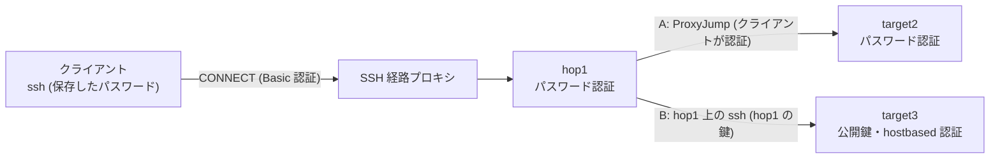

# SSH のパスワードの保存 (ssh-pass)

> [!NOTE]
> この文書が正本です。英訳は [../en/ssh-password.md](../en/ssh-password.md) にあります。内容が一致しない場合は日本語版が優先されます。

パスワード認証の SSH サーバー (ジャンプサーバーや接続先) に、パスワードを入力せずに接続する方法を説明します。`host-shell ssh-pass` で `USER@HOST` ごとにパスワードを保存しておくと、OpenSSH 標準の `SSH_ASKPASS` の仕組みで `ssh` に渡します。渡す経路は次の 3 つで、Linux、macOS、Windows で同じ操作です。

- `host-shell bridge` が起動する `ssh` (MCP のエージェント)
- `host-shell ssh`、`host-shell scp` (`ssh`、`scp` の代わりに使うラッパー。スクリプトや `host-shell-connect` スキル)
- 専用のフォルダーに `ssh`、`scp` という名前で置いた `host-shell` (VS Code Remote - SSH の `remote.SSH.path`)

経路 (`ProxyJump`、`ProxyCommand`、ユーザー名、ポート) は、ほかの用途と同じくクライアントの `~/.ssh/config` に記述します。

## 使いどころ

- 公開鍵認証を使えない (使わせてもらえない) ジャンプサーバーや接続先を、MCP のエージェントや VS Code から使う。
- 認証付き HTTP プロキシ ([SSH 経路プロキシ](ssh-proxy.md)) の先にあるパスワード認証のサーバーへ接続する。プロキシのパスワードは `--password-file` で、SSH のパスワードは `ssh-pass` で、それぞれ保存します。
- 1 段目のサーバーにだけパスワードで入り、2 段目へは 1 段目のサーバー上の鍵や hostbased 認証で入る (クライアントは 1 段目と 2 段目の間の認証に関与しない)。

## 2 つの構成

| 構成 | 経路の書き方 | クライアントが認証する段 | 保存するパスワード |
| --- | --- | --- | --- |
| A: 各段がパスワード認証 | 2 段目の Host ブロックに `ProxyJump hop1` | 1 段目と 2 段目 | 1 段目と 2 段目の `USER@HOST` |
| B: 2 段目は 1 段目の鍵または hostbased 認証 | 入れ子の `ssh hop1 ssh target` | 1 段目だけ | 1 段目の `USER@HOST` |

Table: 構成



- **A**: 2 段目の SSH はクライアントから 1 段目の転送を通して張られます。2 段目のパスワードは暗号化された SSH の中で送られるため、1 段目のサーバーからは読めません。1 段目の sshd でポート転送 (`AllowTcpForwarding`) の許可が必要です。
- **B**: 2 段目の `ssh` は 1 段目のサーバー上で動き、1 段目のサーバーの鍵 (`~/.ssh/id_*`) や hostbased 認証で 2 段目に入ります。クライアントに保存したパスワードは 2 段目には使われません。1 段目の sshd でポート転送を許可していなくても使えます。

## 前提

- クライアントの OpenSSH は 8.4 以降です (Windows の OpenSSH、Git for Windows の OpenSSH を含みます)。8.4 より前は既定で無効です ([OpenSSH 8.4 より前](#openssh-84-より前) を参照)。
- エージェントが使う各段のホスト鍵は、あらかじめ `known_hosts` に登録しておきます。エージェントが起動する `ssh` はホスト鍵の確認に答えられず、未登録のホストへの接続は失敗します。

## 手順

### 1. 経路の記述

クライアントの `~/.ssh/config` に経路を記述します。次の例は、SSH 経路プロキシの先の hop1 (パスワード認証) から、構成 A の target2 と構成 B の target3 へ進むものです。

```text
Host hop1
    HostName hop1.example.com
    User alice
    ProxyCommand /home/alice/.local/bin/host-shell connect -H alice@proxy.example.com:8080 --password-file /home/alice/.ssh/proxy.pass %h %p
    ServerAliveInterval 30

Host target2
    HostName target2.internal
    User bob
    ProxyJump hop1
    ServerAliveInterval 30
```

- 構成 B の target3 は、クライアントの `~/.ssh/config` には記述しません。hop1 のサーバー上で、hop1 の利用者の鍵 (`~/.ssh/id_ed25519` など) と、必要に応じて `~/.ssh/config` (`User` など) を用意し、`ssh target3` が対話なしで通ることを確かめておきます。
- Windows のクライアントでは、パスの区切りに `/` を使用します (例: `C:/Users/alice/bin/host-shell.exe`)。
- `NumberOfPasswordPrompts` は既定 (3) のままにしてください。保存したパスワードが拒否されたことを、`ssh` の 2 回目の問い合わせで検出します ([動作](#動作) を参照)。1 にすると検出できず、誤ったパスワードを接続のたびに送ります。
- `PreferredAuthentications` を指定する場合は、サーバーが使う方式 (`password`、`keyboard-interactive`) を含めます。

### 2. ホスト鍵の登録

端末で一度だけ各段に接続し、ホスト鍵を確かめて登録します。パスワードはこのときだけ手で入力します。

```text
ssh hop1 true
ssh target2 true
```

### 3. パスワードの保存

段ごとに、`ssh` がパスワードの入力時に表示する `USER@HOST` でパスワードを保存します。`HOST` は `~/.ssh/config` の `HostName` を適用した後のホスト名で、`HostKeyAlias` を指定している場合はその値です。ホスト名の大文字・小文字は区別しません。入力は表示されません。

```text
host-shell ssh-pass set alice@hop1.example.com
host-shell ssh-pass set bob@target2.internal
```

端末がない場合は、標準入力の 1 行目から読み取れます (`--stdin`)。パスワードをコマンド ラインや履歴に残さない方法で渡してください。

### 4. 接続の確認

`host-shell ssh` は、引数をそのまま `ssh` に渡します。

```text
host-shell ssh target2 id -un
host-shell ssh -T hop1 ssh -T target3 id -un
```

### 5. エージェントへの登録

`bridge` が起動する `ssh` には、保存したパスワードが渡されます。クライアントで動く `ssh` には `BatchMode=yes` を指定しません (指定するとパスワード認証を行いません)。保存したパスワードを使う `ssh` は端末からの入力を待たないため、認証に失敗した場合はすぐに終了します。

```bash
# 構成 A
claude mcp add host-shell-target2 -- /home/alice/.local/bin/host-shell bridge -- ssh -T target2 /tmp/host-shell-1000/host-shell --mcp
# 構成 B (hop1 上の ssh には BatchMode=yes を指定する)
claude mcp add host-shell-target3 -- /home/alice/.local/bin/host-shell bridge -- ssh -T hop1 ssh -T -o BatchMode=yes target3 /tmp/host-shell-1000/host-shell --mcp
```

`host-shell-connect` スキルで配置する場合は、環境変数 `HOST_SHELL_SSH` に `host-shell ssh` を指定します。経路 (`ROUTE`) は、構成 A では `target2` (段は `ProxyJump` に任せる)、構成 B では `hop1,target3` です。

```bash
export HOST_SHELL_SSH="/home/alice/.local/bin/host-shell ssh"
"$SKILL"/scripts/deploy.sh target2 linux-amd64
"$SKILL"/scripts/deploy.sh hop1,target3 linux-amd64
```

### 6. VS Code Remote - SSH

1. 専用のフォルダーを作り、`host-shell` を `ssh` と `scp` という名前で置きます (VS Code は、`remote.SSH.path` と同じフォルダーの `scp` でサーバーを転送するため)。このフォルダーは `PATH` に加えません。`host-shell` を更新したら、ハード リンクとコピーは作り直してください。

    ```text
    mkdir -p ~/.local/share/host-shell/vscode-ssh                                  (Linux・macOS)
    ln -s ~/.local/bin/host-shell ~/.local/share/host-shell/vscode-ssh/ssh
    ln -s ~/.local/bin/host-shell ~/.local/share/host-shell/vscode-ssh/scp
    ```

    ```powershell
    # Windows (PowerShell)。ハード リンクは同じドライブに作る
    New-Item -ItemType Directory C:\Users\alice\bin\vscode-ssh
    New-Item -ItemType HardLink -Path C:\Users\alice\bin\vscode-ssh\ssh.exe -Target C:\Users\alice\bin\host-shell.exe
    New-Item -ItemType HardLink -Path C:\Users\alice\bin\vscode-ssh\scp.exe -Target C:\Users\alice\bin\host-shell.exe
    ```

    この `ssh`・`scp` は、`PATH` 上の本物の `ssh`・`scp` (自身は除く) を実行します。別の版を使う場合は、環境変数 `HOST_SHELL_SSH_PATH`、`HOST_SHELL_SCP_PATH` で指定します。

2. VS Code の設定で、`remote.SSH.path` に専用のフォルダーの `ssh` の絶対パスを指定します。接続先の OS を尋ねられないよう、`remote.SSH.remotePlatform` も指定しておきます。

    ```json
    "remote.SSH.path": "C:\\Users\\alice\\bin\\vscode-ssh\\ssh.exe",
    "remote.SSH.remotePlatform": { "target2": "linux" }
    ```

    `remote.SSH.configFile` を指定する場合、Windows では区切りに `/` を使います (例: `C:/Users/alice/.ssh/config`)。Git for Windows の `ssh` は、`ProxyJump` の 2 段目の `ssh` を `sh` 経由で起動し、その際に `\` が失われます。

3. 「Remote-SSH: Connect to Host...」で `target2` に接続します。保存したパスワードは自動で渡され、保存していない `USER@HOST` のパスワード、拒否されたパスワード、ホスト鍵の確認は、VS Code の入力欄で尋ねられます。

構成 B の target3 には、VS Code Remote - SSH から直接接続できません (VS Code の `ssh` はクライアントで動き、hop1 の鍵を使えないため)。[VS Code Remote - SSH での接続先の利用](vscode-remote-ssh.md) の構成 (エージェントの MCP 接続を経由したポート転送) を使ってください。この構成では、VS Code は専用の鍵で接続し、パスワードは `bridge` だけが使います。

## サブコマンドと環境変数

| コマンド | 動作 |
| --- | --- |
| `host-shell ssh-pass set [--stdin] USER@HOST` | 端末 (エコーなし) または標準入力の 1 行目からパスワードを読み取って保存する。既存のものと拒否の記録は置き換える |
| `host-shell ssh-pass delete USER@HOST` | 保存したパスワードを削除する |
| `host-shell ssh-pass list` | 保存済みの `USER@HOST` を表示する (パスワードは表示しない)。拒否されたものには `rejected` を付ける |
| `host-shell ssh-pass dir` | 保存先のディレクトリを表示する |
| `host-shell ssh [SSH の引数...]` | 保存したパスワードを使う設定で `ssh` を実行する。終了コードは `ssh` のもの |
| `host-shell scp [SCP の引数...]` | 同じ設定で `scp` を実行する (`scp` が起動する `ssh` にもパスワードが渡る) |
| `ssh`、`scp` (`host-shell` のリンクまたはコピー) | `host-shell ssh`、`host-shell scp` と同じ |

Table: サブコマンド

| 環境変数 | 内容 |
| --- | --- |
| `HOST_SHELL_SSH_PASSWORD_DIR` | 保存先のディレクトリ。既定はユーザーの設定ディレクトリの `host-shell/ssh-passwords` (Linux・macOS は `$XDG_CONFIG_HOME` または `~/.config`、Windows は `%AppData%`) |
| `HOST_SHELL_SSH_PATH`、`HOST_SHELL_SCP_PATH` | `host-shell ssh`、`host-shell scp` が実行する `ssh`、`scp`。既定は `PATH` 上のもの (自身は除く) |
| `HOST_SHELL_SSH_ASKPASS_LEGACY` | `1` で OpenSSH 8.4 より前にも有効にする ([OpenSSH 8.4 より前](#openssh-84-より前)) |
| `HOST_SHELL_SSH` | `host-shell-connect` スキルのスクリプトが 1 段目に使うコマンド (既定は `ssh`) |

Table: 環境変数

`host-shell` は、`ssh` の環境に `SSH_ASKPASS`、`SSH_ASKPASS_REQUIRE`、`HOST_SHELL_SSH_ASKPASS`、`HOST_SHELL_SSH_ASKPASS_NEXT` を設定します。利用者が設定する必要はありません。

## 動作

- **環境の設定**: `bridge`、`host-shell ssh`、`host-shell scp` は、`ssh -V` で版を確かめ、8.4 以降であれば `SSH_ASKPASS` (`host-shell` 自身) と `SSH_ASKPASS_REQUIRE=force` を設定します。`bridge` は、`COMMAND` が `ssh` であればその `ssh` の版を、スクリプトなどであれば `PATH` 上の `ssh` の版を確かめます。すでに `SSH_ASKPASS` が設定されている場合 (VS Code など) は、それを次の問い合わせ先として残します。`ProxyJump` のために `ssh` が起動する `ssh` も、同じ環境を引き継ぎます。
- **答える問い合わせ**: `ssh` から呼び出された `host-shell` は、次の 2 つの形式の問い合わせにだけ、保存したパスワードを返します。
    - `USER@HOST's password:` (パスワード認証。文字列は `ssh` が作ります)
    - `(USER@HOST) Password:` (キーボード インタラクティブ認証で、サーバーの問い合わせが `Password:` のもの。PAM の既定の問い合わせです。`(USER@HOST)` は `ssh` 8.4 以降が付けるため、サーバーは別の `USER@HOST` を名乗れません)
- **答えない問い合わせ**: 保存していない `USER@HOST`、ホスト鍵の確認、鍵のパスフレーズ、ワンタイム パスワードなどの問い合わせには答えず、次の問い合わせ先 (VS Code の入力欄など) に渡します。次の問い合わせ先がなく、標準エラーが端末の場合は、`ssh` 自身と同じように端末で尋ねます (パスワードはエコーなし、`(yes/no` の確認はエコーあり)。手元のターミナルで実行した場合と、ターミナルの表示を読み取る VS Code Remote - SSH (Windows の既定) は、この問い合わせに答えられます。どちらもなければ (エージェントが起動した `ssh` など、標準エラーがパイプの場合)、入力を待たずに `ssh` の認証は失敗します。
- **拒否の検出**: 保存したパスワードは、1 つの `ssh` のプロセスにつき 1 回だけ渡します。同じ `ssh` から同じ `USER@HOST` を再び問い合わされた場合は、サーバーがパスワードを拒否したと判断し、拒否を記録します。記録したパスワードは、`ssh-pass set` で置き換えるまで、どの接続にも渡さず、上記と同じく次の問い合わせ先または端末で尋ねます。どちらもない場合は、その `ssh` を終了させます (`ssh` は応答がなくても空のパスワードで試行を続け、サーバーはそれも失敗として数えるため)。このとき `ssh` の終了コードは、Linux・macOS では 143 (SIGTERM)、Windows では 255 です。これにより、誤ったパスワードによるサーバー側の失敗は 1 回にとどまり、エージェントが再接続を繰り返してもアカウントのロックにつながりません。
- **保存先**: 1 つの `USER@HOST` につき 1 つのファイルです。Linux・macOS は、ディレクトリを `0700`、ファイルを `0600` で作成し、パスワードを 1 行で保存します。Windows は、ファイルに本人だけを許可する保護された DACL を設定し、パスワードを DPAPI (利用者の資格情報) で暗号化して保存します。読み取り時は、[パスワード ファイルの権限](ssh-proxy.md#パスワード-ファイルの権限の確認) と同じ条件を確認します。
- **保護の水準**: Linux・macOS ではパスワードを暗号化せずに保存するため、保護の水準はパスフレーズなしの秘密鍵と同等です。Windows では、同じ利用者として動くプログラムは復号できますが、ディスクやバックアップから取り出したファイルだけでは復号できません。

## OpenSSH 8.4 より前

OpenSSH 8.4 より前の `ssh` は、`SSH_ASKPASS_REQUIRE` を解釈せず、キーボード インタラクティブ認証の問い合わせを、サーバーが送った文字列のまま表示します。そのため、悪意のあるサーバーが `alice@hop1's password:` という問い合わせを送ると、別のホスト (hop1) 用に保存したパスワードを取得できます。この理由から、8.4 より前の `ssh` では既定で無効です。

環境変数 `HOST_SHELL_SSH_ASKPASS_LEGACY=1` を設定すると、8.4 より前でも有効になります。この場合は、次の条件をすべて満たしてください。

- `~/.ssh/config` の末尾の `Host *` に `PreferredAuthentications publickey,password` を記述し、キーボード インタラクティブ認証を使わない。OpenSSH 8.0p1 では、`KbdInteractiveAuthentication no` と `ChallengeResponseAuthentication no` を指定してもキーボード インタラクティブ認証が行われます。
- `ssh` を端末のないプロセスから起動する。8.4 より前の `ssh` は、端末を開けるときは端末から読み取ります。`bridge` は、この場合 `ssh` を新しいセッション (端末なし) で起動します。`host-shell ssh` は端末を切り離しません。
- 問い合わせには `USER@HOST's password:` の形式だけを答えます (キーボード インタラクティブ認証のサーバーには使えません)。また、`DISPLAY` が未設定の場合は `DISPLAY` にも値を設定します。

## 検証済みの範囲

| 項目 | 方法・環境 | 状態 |
| --- | --- | --- |
| 保存・取得・削除・一覧、キーの正規化、問い合わせの照合 (偽装した問い合わせの拒否を含む)、拒否の検出と記録、次の問い合わせ先への受け渡し、版の判定、環境の組み立て | 自動テストを Linux (go1.26.0) と Windows 11 Pro for Workstations (ビルド 26300、amd64) で実行 | 検証済 |
| 構成 A・B、SSH 経路プロキシとの併用、`host-shell-connect` スキルのスクリプト (`remote.sh`、`detect.sh`、`deploy.sh`、`probe.sh`)、`bridge` 経由の MCP の操作 (`exec_run`)、拒否の検出 (サーバー側の失敗が 1 回であること、再接続で送らないこと、`set` の後に成功すること)、`ssh`・`scp` のシンボリック リンク (専用のフォルダーを `PATH` の先頭に置いた場合を含む) | クライアントは Oracle Linux 10.2 のコンテナー (OpenSSH 9.9p1)。Squid 6.10 (Basic 認証)、hop1 (パスワード認証)、target2 (キーボード インタラクティブ認証、PAM)、target3 (hop1 の鍵のみ) は Oracle Linux 10.2 の OpenSSH 9.9p1 のコンテナー (Podman 4.9.4、WSL2) | 検証済 |
| 同上 (VS Code 以外)。DPAPI での保存、次の問い合わせ先 (`.cmd`) への受け渡し、`ssh.exe`・`scp.exe` のハード リンク (`scp` は Windows の OpenSSH と Git for Windows の両方)、ラッパーを強制終了したときに本物の `ssh.exe` が残らないこと | Windows 11 Pro for Workstations (ビルド 26300) の Windows の OpenSSH 9.5p2 と Git for Windows の OpenSSH 10.6p1。サーバー側は上記のコンテナー | 検証済 |
| 偽装した問い合わせ (`alice@hop1's password:`、`(alice@hop1) Password:` をキーボード インタラクティブ認証で送る試験用サーバー) に保存したパスワードを渡さないこと | OpenSSH 9.9p1 (Linux)、Windows の OpenSSH 9.5p2、Git for Windows の OpenSSH 10.6p1 | 検証済 |
| OpenSSH 8.4 より前: 既定で無効であること、`HOST_SHELL_SSH_ASKPASS_LEGACY=1` でのパスワード認証と構成 B、`PreferredAuthentications publickey,password` で偽装した問い合わせに渡さないこと | Oracle Linux 8.10 (WSL2) の OpenSSH 8.0p1 | 検証済 |
| VS Code Remote - SSH: 専用のフォルダーの `ssh.exe`・`scp.exe` での接続 (オフラインの接続先への `scp` によるサーバーの転送を含む)、保存していない・拒否されたパスワードの入力欄での入力、ウィンドウを閉じた後にプロセスが残らないこと。ターミナル方式 (既定) と `remote.SSH.useLocalServer: true` の両方 | VS Code 1.145.3 (ZIP 版)、Remote-SSH 0.128.0、Windows 11 Pro for Workstations (ビルド 26300)。`ssh` は Git for Windows の OpenSSH 10.6p1。Windows の OpenSSH 9.5p2 では接続と入力欄での入力 (サーバーの転送は除く) | 検証済 |
| macOS のクライアント | なし | 未検証 |

Table: 検証状況

## 制限

- 入れ子の `ssh hop1 ssh target` では、2 段目の `ssh` が中継サーバー上で動くため、クライアントに保存したパスワードを 2 段目に使えません。2 段目もパスワード認証の場合は `ProxyJump` (構成 A) を使ってください。
- パスワードの照合はユーザー名とホスト名だけで行い、ポート番号は区別しません。同じ名前の別のホストを区別するには、`HostKeyAlias` で別の名前を付けます。
- 鍵のパスフレーズ、ワンタイム パスワードなど `Password:` 以外のキーボード インタラクティブ認証の問い合わせ、パスワードの変更の要求には対応していません。
- 同じ `ssh` のプロセスが同じ `USER@HOST` のパスワードを 2 回求める構成 (`AuthenticationMethods password,keyboard-interactive` など) では、2 回目を拒否と判断します。
- Linux・macOS の OS の資格情報ストア (Secret Service、キーチェーン) には対応していません。
