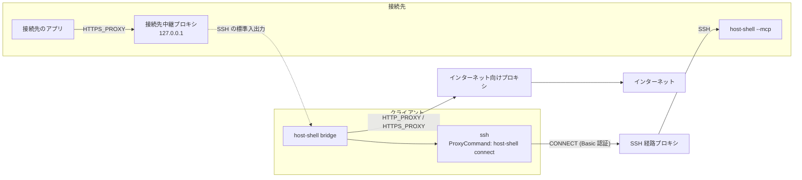

# SSH 経路プロキシ

> [!NOTE]
> この文書が正本です。英訳は [../en/ssh-proxy.md](../en/ssh-proxy.md) にあります。内容が一致しない場合は日本語版が優先されます。

SSH 接続そのものが認証付きの HTTP プロキシを通る環境で、host-shell に接続する方法を説明します。たとえば、Tera Term のプロキシ設定 (種別「HTTP」) を使って接続している環境が該当します。OpenSSH の `ssh` の `ProxyCommand` に `host-shell connect` を指定すると、HTTP の `CONNECT` で Basic 認証を行ってから SSH の通信を中継します。`host-shell connect` は、Git for Windows に同梱の `connect` コマンドと、HTTP プロキシの範囲で引数・環境変数に互換性があります。

## 3 つのプロキシ

host-shell の文書とスキルでは、「プロキシ」を次の 3 つに分けて呼びます。同じ Squid などが複数の役割を兼ねる場合も、設定はそれぞれの場所で行います。

| 用語 | 指すもの | 設定する場所 | 文書 |
| --- | --- | --- | --- |
| SSH 経路プロキシ | SSH 接続そのものが通る HTTP プロキシ (Tera Term のプロキシ設定に相当) | クライアントの `~/.ssh/config` の Host ブロックの `ProxyCommand` | この文書 |
| インターネット向けプロキシ | `bridge` がインターネットに出るときに使う、クライアント側のプロキシ | `bridge` の起動環境の `HTTP_PROXY`、`HTTPS_PROXY`、`NO_PROXY` | [クライアント経由 HTTP プロキシ](client-proxy.md) |
| 接続先中継プロキシ | 接続先の `127.0.0.1` で待ち受け、`bridge` へ中継する認証付きプロキシ | `bridge` の `--proxy`、接続先の `--client-proxy` | [クライアント経由 HTTP プロキシ](client-proxy.md) |

Table: 3 つのプロキシ



「プロキシ経由で接続したい」という依頼だけでは、どれを指すか決まらないことがあります。次の点を確かめて区別します。

- **SSH 経路プロキシ**: 手元から SSH で接続先 (または最初の中継サーバー) に入るときに、プロキシの設定が必要か。Tera Term でプロキシを設定して接続しているなら、これに当たります。
- **インターネット向けプロキシ**: 手元の PC がインターネットに出るときに、プロキシの設定 (`HTTP_PROXY` など) が必要か。
- **接続先中継プロキシ**: 接続先のアプリ (code-server、CLI 型コーディング エージェント、パッケージ管理など) が、手元を経由してインターネットに出る必要があるか。

## host-shell connect

### 配置

`host-shell connect` は、クライアントで `bridge` に使う `host-shell` と同じ実行ファイルのサブコマンドです。追加の配置は不要です。`ssh` がクライアントで起動するため、接続先や中継サーバーには置きません。

### 使い方

```text
host-shell connect [-d] [-w SECONDS] [--password-file PATH] -H [http://][USER@]PROXY[:PORT] HOST PORT
host-shell connect -V
```

| 引数 | 内容 |
| --- | --- |
| `-H [http://][USER@]PROXY[:PORT]` | SSH 経路プロキシ (必須)。`PORT` の既定は 80。IPv6 アドレスは `[...]` で囲む。`USER@` は最後の `@` で区切る |
| `-w SECONDS` | プロキシへの接続から `CONNECT` の応答までの上限。既定は 30 秒、`0` で上限なし。中継の開始後には適用しない |
| `--password-file PATH` | パスワードを読み取るファイル ([資格情報](#資格情報)) |
| `-d` | 診断情報を標準エラーに出力する。2 回指定すると応答ヘッダーも出力する。資格情報は出力しない |
| `-V` | バージョンを標準エラーに出力する |
| `HOST PORT` | SSH サーバー。`ProxyCommand` では `%h %p` を指定する |

Table: host-shell connect の引数

`-h` (プロキシを環境変数 `HTTP_PROXY` から取得)、`-S`・`-s` (SOCKS)、`-T`・`-t`・`-c` (TELNET) など、`connect` の他のオプションには対応しておらず、指定するとエラーで終了します。`HTTP_PROXY` はインターネット向けプロキシの設定であり、`host-shell connect` は参照しません。

### 動作

1. ユーザー名がある場合は、プロキシに接続する前にパスワードを取得します。取得できなければ接続せずに終了します。
2. プロキシに `CONNECT HOST:PORT HTTP/1.1` を送ります。ユーザー名がある場合は、最初の要求から `Proxy-Authorization: Basic` を付与します。
3. 応答が 200 番台であれば、標準入出力とプロキシの間でバイト列をそのまま中継します。407 (認証失敗または認証が必要) を含むそれ以外の応答では、再送せずに終了します。

成功時 (中継終了時) の終了コードは 0、失敗時は 1 です。失敗の理由は標準エラーに 1 行で出力します。続けて `ssh` が `kex_exchange_identification: Connection closed by remote host` や `Connection closed by UNKNOWN port 65535` などを表示しますが、原因は直前の `host-shell connect:` の行にあります。

## 接続先ごとの設定

SSH 経路プロキシは、クライアントの `~/.ssh/config` の Host ブロックに接続先ごとに記述します。`ssh`、`host-shell-connect` スキルのスクリプト、MCP の登録コマンド、VS Code Remote - SSH は、Host 名を指定するだけで同じ経路を使用します。

```text
Host target-a
    HostName 10.0.0.5
    User alice
    ProxyCommand /home/alice/.local/bin/host-shell connect -H alice@proxy-a.example.com:8080 --password-file /home/alice/.ssh/proxy-a.pass %h %p
    ServerAliveInterval 30

Host target-b
    HostName 10.1.0.7
    User alice
    ProxyCommand /home/alice/.local/bin/host-shell connect -H bob@proxy-b.example.com:3128 --password-file /home/alice/.ssh/proxy-b.pass %h %p
    ServerAliveInterval 30
```

- **Windows のクライアント**: 実行ファイルとパスワード ファイルのパス区切りには `/` を使用します (例: `C:/Users/alice/bin/host-shell.exe`、`C:/Users/alice/.ssh/proxy-a.pass`)。
- **接続の維持 (推奨設定)**: 多くのプロキシは、無通信の `CONNECT` トンネルを一定時間で切断します。上の例のとおり `ServerAliveInterval 30` を指定すると、無通信の間も接続が維持されます。プロキシの無通信タイムアウトが 30 秒以下の場合は、それより短い値にしてください。
- **多段接続**: 最初の段の Host ブロックに `ProxyCommand` を記述すれば、入れ子の `ssh -T hop1 ssh -T target` でも `ProxyJump` でも、クライアントから最初の段までの区間がプロキシを通ります。2 段目以降の区間にあるプロキシには対応していません。
- **sshd の転送設定**: SSH 経路プロキシの区間は sshd のポート転送を使わないため、`AllowTcpForwarding no` の影響を受けません (`ProxyJump` を使う段には、従来どおり転送の許可が必要です)。

```text
Host hop1
    HostName 192.0.2.10
    ProxyCommand /home/alice/.local/bin/host-shell connect -H alice@proxy-a.example.com:8080 --password-file /home/alice/.ssh/proxy-a.pass %h %p
    ServerAliveInterval 30

Host target-behind-hop1
    HostName 10.2.0.20
    ProxyJump hop1
```

## 資格情報

ユーザー名とパスワードは、次の優先順位で決まります。

| 項目 | 順序 |
| --- | --- |
| ユーザー名 | `-H` の `USER@` → 環境変数 `HTTP_PROXY_USER` → `CONNECT_USER`。いずれも指定がなければ認証しない |
| パスワード | `--password-file` → 環境変数 `HTTP_PROXY_PASSWORD` → `CONNECT_PASSWORD` → 端末からの入力 |

Table: 資格情報の順序

- **パスワード ファイル (推奨)**: Host ブロックごとに別のファイルを指定できるため、接続先ごとに異なる資格情報を扱えます。ファイルの 1 行目をパスワードとして使用します (末尾の改行は除きます。UTF-8 と BOM 付き UTF-16LE に対応しています)。
- **環境変数**: プロセス全体に適用されるため、接続先ごとに異なるパスワードは指定できません。エージェントの MCP 登録 (`claude mcp add -e` など) に記述すると、設定ファイルに平文で残ります。
- **端末からの入力**: 標準エラーが端末のときだけ入力を求めます。エージェントが MCP 用に `ssh` を起動する場合は端末がないため、入力を求めずにエラーで終了します。手元のターミナルで `ssh` を直接実行するときに利用できます。

Basic 認証は、プロキシまでの区間で資格情報を平文と同等の形式で送信します。パスワードを会話、コマンド ライン、ログに記述しないでください。

### パスワード ファイルの作り方

Linux・macOS (ほかの利用者が読めないファイルを作成し、パスワードを画面に表示せずに書き込みます):

```bash
(umask 077; IFS= read -rs -p 'proxy password: ' p; echo; printf '%s\n' "$p" > ~/.ssh/proxy-a.pass; unset p)
```

Windows (PowerShell。利用者のプロファイル配下に作成します):

```powershell
$p = Read-Host -AsSecureString 'proxy password'
[IO.File]::WriteAllText("$env:USERPROFILE\.ssh\proxy-a.pass", [Net.NetworkCredential]::new('', $p).Password)
Remove-Variable p
```

`%USERPROFILE%\.ssh\` 配下のファイルは、既定の継承により本人、`SYSTEM`、`Administrators` のみがアクセスできます。

### パスワード ファイルの権限の確認

`host-shell connect` は、パスワード ファイルを読み取る前に、OpenSSH が利用者の `~/.ssh/config` に求めるものと同じ条件を確認します。条件を満たさない場合は、理由を標準エラーに出力して終了します。

| OS | 条件 |
| --- | --- |
| Linux・macOS | 所有者が本人または `root` であり、グループとその他に書き込み権限がない |
| Windows | 所有者が本人、`Administrators`、`SYSTEM`、`TrustedInstaller` のいずれかであり、それ以外の利用者・グループに書き込み系の権限 (書き込み、追記、属性・拡張属性の書き込み、削除、アクセス許可・所有者の変更) がない。継承されたアクセス許可も同様に判定する |

Table: パスワード ファイルの権限の条件

この条件はほかの利用者による書き換えを防ぐものであり、読み取り権限は拒否しません。Linux の mode `644` のファイルや、Windows で `Users` に読み取りを許可したファイルも受け付けますが、ほかの利用者にパスワードを読み取られます。上記の手順のとおり、本人だけが読み取れるファイルにしてください。

Windows でプロファイルの外 (例: `C:\tools\`) に作成したファイルは、親フォルダーのアクセス許可を継承するため、`Users` などに書き込みを許可しているフォルダーの下では拒否されます。その場合は継承を解除し、本人だけにアクセスを許可してください。

```text
icacls C:\tools\proxy-a.pass /inheritance:r /grant:r "%USERNAME%:F"
```

この操作で外れるのは継承したアクセス許可だけです。ファイルに明示的に付けたアクセス許可 (例: `Users:(W)`) は残るため、`icacls C:\tools\proxy-a.pass` で本人以外が表示されたら、`/remove:g` で削除してください (例: `icacls C:\tools\proxy-a.pass /remove:g Users`)。拒否のメッセージには、書き込みを許されている利用者・グループの名前が表示されます。

## MCP の登録

Host ブロックに `ProxyCommand` を記述すれば、登録コマンドは通常と同じです。`bridge` が起動する `ssh` が Host ブロックを参照します。

```bash
claude mcp add host-shell-a -- /home/alice/.local/bin/host-shell bridge -- ssh -T target-a /tmp/host-shell-1000/host-shell --mcp
```

接続先のアプリからインターネットへ通信させる場合は、[クライアント経由 HTTP プロキシ](client-proxy.md) を有効にします。クライアントがインターネットに出る際にもプロキシが必要であれば、`bridge` の起動環境に `HTTPS_PROXY` (インターネット向けプロキシ) を設定します。SSH 経路プロキシと同じプロキシであっても、`ProxyCommand` の設定は `bridge` には引き継がれません。

`host-shell-connect` スキルを使う場合は、SSH の経路にプロキシがあることをエージェントに伝えてください。エージェントがプロキシのホスト・ポート・ユーザー名とパスワード ファイルの配置先を確認し、Host ブロックを提示します。`~/.ssh/config` への追記とパスワード ファイルの作成は利用者が行います。

## Tera Term の設定との対応

Tera Term の「Proxy Setup」ダイアログの項目は、host-shell の次の設定に相当します。

| Tera Term の項目 | host-shell での設定 |
| --- | --- |
| Type | `HTTP` のみ対応 (`-H` の `http://` は省略可)。`TELNET`、`SOCKS4`、`SOCKS5` には非対応 |
| Hostname | `-H` の `PROXY` |
| Port number | `-H` の `:PORT` (省略時は 80) |
| Username | `-H` の `USER@` |
| Password | `--password-file` で指定するファイル |
| Other setup の Connection Timeout | `-w` |
| Other setup の Proxy connection log | `-d` (標準エラーに出力。ファイルへの記録はなし) |
| Other setup の SOCKS・TELNET 用の項目 (名前解決、各プロンプト、メッセージ) | 対象外 |

Table: Tera Term の Proxy Setup に相当する設定

接続先のホスト名、ユーザー名、鍵などの SSH 設定は、Host ブロックの `HostName`、`User`、`IdentityFile` に記述します。

## トラブルシューティング

| 表示 | 原因 | 対処 |
| --- | --- | --- |
| `rejected the credentials of USER (407)` | ユーザー名またはパスワードの誤り | パスワード ファイルの内容 (改行・余分な空白) とユーザー名を確認する |
| `requires authentication (407)` | ユーザー名を指定していない | `-H` に `USER@` を付ける |
| `no password for USER@PROXY` | パスワードを取得できない | `--password-file` を指定する |
| `password input was interrupted` | 端末からのパスワード入力を Ctrl+C などで中断した (端末の設定は元に戻る) | もう一度実行する |
| `bad owner or permissions on password file` | ファイルの所有者または権限が条件を満たしていない | [パスワード ファイルの権限の確認](#パスワード-ファイルの権限の確認) を参照 |
| `refused CONNECT HOST:PORT (403 Forbidden)` | プロキシが宛先またはポートを許可していない | プロキシの管理者に確認する |
| `refused CONNECT HOST:PORT (503 Service Unavailable)` など | プロキシが宛先に接続できない (名前解決の失敗を含む) | `HostName` をプロキシから解決・到達できる名前にする |
| `cannot connect to SSH route proxy` | プロキシに接続できない | `-H` のホストとポートを確認する |
| `timed out after 30s waiting for SSH route proxy` | プロキシが応答しない | `-w` を延ばすか、プロキシの状態を確認する |
| 無通信の後に `client_loop: send disconnect: Broken pipe` | プロキシが無通信のトンネルを切断した | `ServerAliveInterval 30` を指定する (指定済みの場合は、プロキシの無通信タイムアウトより短くする) |

Table: SSH 経路プロキシのトラブルシューティング

`ProxyCommand` に `-d` を追加すると、接続、要求の送信、応答ステータス、中継の開始を標準エラーに表示します。

## 検証済みの範囲

| 項目 | 方法と環境 | 状態 |
| --- | --- | --- |
| `host-shell connect` の手順、資格情報の優先順位、エラー、8 ビット透過、half-close、タイムアウト、パスワード ファイルの権限 (Linux) | 自動テスト (試験用の `CONNECT` プロキシ) を Linux で実行 | 検証済 |
| 同じ自動テストの Windows での実行 (アクセス許可の判定を含む) | Windows 11 Pro for Workstations (ビルド 26300、amd64)、go1.27.4 | 検証済 |
| 同じ自動テストの macOS での実行 | CI (GitHub Actions の macos-latest) | 検証済 |
| Squid 経由の接続とエラー表示 (407、403、503、接続不可、パスワード ファイルの権限) | Podman のコンテナー。Squid 6.10 (Basic 認証)、sshd は Oracle Linux 10.2 の OpenSSH 9.9p1、クライアントは Oracle Linux 8.10 (WSL2) の OpenSSH 8.0p1。クライアントから sshd への経路は Squid のみ | 検証済 |
| `host-shell-connect` のスクリプト (`remote.sh`、`detect.sh`、`deploy.sh`、`probe.sh`)、入れ子の多段と `ProxyJump` | 同上 | 検証済 |
| `bridge` 経由の MCP の操作 (`exec_run`、20 MB の `transfer_push`・`transfer_pull`) | 同上 | 検証済 |
| インターネット向けプロキシとの併用 (同じ Squid を `bridge` の `HTTPS_PROXY` に指定し、接続先中継プロキシ経由で HTTPS を取得) | 同上 | 検証済 |
| 無通信時の切断と `ServerAliveInterval` | 同上 (Squid の `read_timeout` を 30 秒にして確認) | 検証済 |
| Windows のクライアント: `ssh` による接続、`bridge` 経由の MCP の操作 (`exec_run`、10 MiB の `transfer_push`・`transfer_pull`)、407 の表示、パスワード ファイルのアクセス許可の判定、端末がない場合に入力を求めないこと | Windows 11 Pro for Workstations (ビルド 26300、amd64) の Windows の OpenSSH 9.5p2 と Git for Windows の OpenSSH 10.6p1。Squid と sshd は上記の Linux のコンテナー | 検証済 |
| Windows のクライアントでの端末からのパスワード入力 (入力が表示されないこと、Ctrl+C で中断した後に入力モードが戻り余計な入力が残らないこと) | 同上。Windows Terminal (PowerShell 7.7.0) と conhost (Windows PowerShell 5.1) での手入力。Windows の OpenSSH と Git for Windows の OpenSSH | 検証済 |
| Linux の端末からのパスワード入力 (Ctrl+C で中断した後にエコーが戻ること) | 疑似端末から入力を送って確認 (上記の Linux のクライアント) | 検証済 |
| macOS の端末からのパスワード入力 | なし | 未検証 |

Table: SSH 経路プロキシの検証状況

## 制限

- 対応するのは HTTP の `CONNECT` と、認証なしまたは Basic 認証のみです。SOCKS、TELNET 形式のプロキシ、NTLM・Negotiate (Kerberos)・Digest 認証、プロキシとの TLS 接続 (`https://` のプロキシ)、プロキシのリダイレクト (302) には対応していません。NTLM などを要求するプロキシでは、Basic 認証または認証なしで受け付けるローカルのプロキシ (cntlm など) を手元に挟む方法がありますが、未検証です。
- 2 段目以降の区間にあるプロキシには対応していません。
- 端末からのパスワード入力は、標準エラーが端末の場合のみ有効です。`SSH_ASKPASS` や OS の資格情報ストアには対応していません (SSH 自体のパスワードは [SSH のパスワードの保存](ssh-password.md) を参照)。
