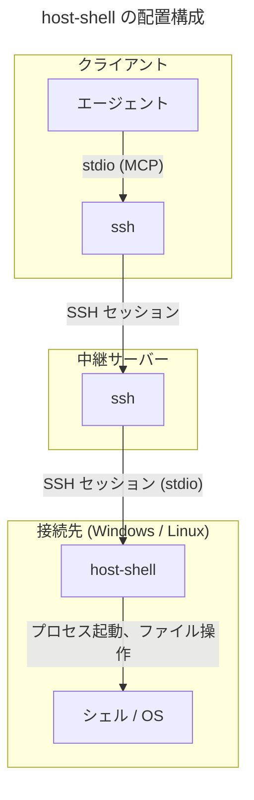
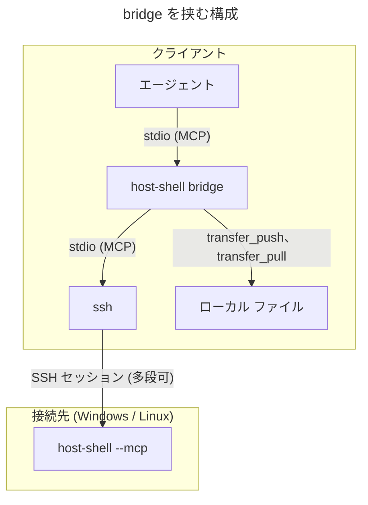

# host-shell 利用ガイド

> [!NOTE]
> この文書が正本です。英訳は [../en/user-guide.md](../en/user-guide.md) にあります。内容が一致しない場合は日本語版が優先されます。

`host-shell` を接続先に配置してエージェントから利用するまでの手順と、用途別の使い方を説明します。  
各ツールの入出力仕様は [リファレンス](reference.md)、安全な運用設計は [運用ガイド](operations.md) を参照してください。

## 目次

- [仕組み](#仕組み)
- [必要なもの](#必要なもの)
- [実行ファイルの入手](#実行ファイルの入手)
- [接続先への配置](#接続先への配置)
- [SSH の経路の確認](#ssh-の経路の確認)
- [エージェントへの登録](#エージェントへの登録)
- [動作の確認](#動作の確認)
- [使い方](#使い方)
- [トラブルシューティング](#トラブルシューティング)

## 仕組み

`host-shell` は操作対象のマシン (接続先) に配置する MCP サーバーです。  
エージェントには「SSH で `host-shell` を起動するコマンド」を MCP の stdio サーバーとして登録します。MCP の stdio 方式は子プロセスの標準入出力で JSON-RPC メッセージを送受信するため、SSH セッションの標準入出力がそのまま通信路になります。



中継サーバーを経由する場合も、SSH のポート転送 (`-L`、`-R`、`-D`、`ProxyJump`、`-W`) や SFTP は使用しません。中継サーバー上で次の `ssh` を入れ子で起動するため、sshd の `AllowTcpForwarding no` の影響を受けずに接続できます。

- MCP セッション中は 1 本の SSH 接続を維持するため、多段接続でもツール呼び出しごとの再接続遅延が発生しません。
- Windows と Linux の差異 (シェル、引用符、パス表記) を `host-shell` が吸収するため、エージェントは同一のツールを同じ引数形式で呼び出せます。
- 出力上限、タイムアウト、操作ログを接続先で一元管理できます。

### bridge を挟む構成

クライアント側で `host-shell bridge` を挟むと、ローカルと接続先の間でファイルやディレクトリを直接転送できます。



`bridge` は接続先の `host-shell` が公開するツールをそのまま中継しつつ、`transfer_push` (ローカルから接続先へ) と `transfer_pull` (接続先からローカルへ) を追加します。  
ファイル内容は `bridge` と接続先の `host-shell` 間で直接転送され、エージェントのコンテキストを経由しないため、大容量ファイルやディレクトリ全体も転送できます。  
`bridge` は接続先と同じ実行ファイルのサブコマンドであり、クライアント OS (Linux、Windows、macOS) 向けのバイナリを使用します。

## 必要なもの

| 場所 | 要件 |
|---|---|
| クライアント | MCP の stdio サーバーに対応したエージェント (Claude Code、VS Code GitHub Copilot など) と OpenSSH クライアント。`bridge` を使う場合はクライアント OS 用の `host-shell` (Linux、Windows、macOS 12 以降) |
| 中継サーバー | OpenSSH クライアント・サーバー、および次段へ接続するための認証手段 (鍵など) |
| 接続先 | OpenSSH サーバー、および Windows 10 / Windows Server 2016 以降または Linux カーネル 3.2 以降 (amd64 / arm64) |

Table: 必要なもの

エージェントが起動する `ssh` は対話的なパスワード入力に応答できないため、各段の SSH 認証は公開鍵や `ssh-agent` 等でパスワード入力なしに通過する必要があります。

## 実行ファイルの入手

OS とアーキテクチャーごとに、外部依存のない単一バイナリを提供します。

| OS とアーキテクチャー | ファイル | 用途 |
|---|---|---|
| Linux (x86_64) | `host-shell-linux-amd64` | 接続先、ローカル (`bridge`) |
| Linux (aarch64) | `host-shell-linux-arm64` | 接続先、ローカル (`bridge`) |
| Windows (x64) | `host-shell-windows-amd64.exe` | 接続先、ローカル (`bridge`) |
| Windows (ARM64) | `host-shell-windows-arm64.exe` | 接続先、ローカル (`bridge`) |
| macOS (Intel) | `host-shell-darwin-amd64` | ローカル (`bridge`) |
| macOS (Apple シリコン) | `host-shell-darwin-arm64` | ローカル (`bridge`) |

Table: 実行ファイル

同一のバイナリが、接続先では `--mcp` で MCP サーバーとして、クライアントでは `bridge` サブコマンドで中継プロセスとして動作します。  
ソースからビルドする場合は Go 1.26 以降で次を実行すると、`dist/` に 6 種類のバイナリが生成されます (詳細は [開発ガイド](development.md) を参照)。

```bash
make dist
```

## 接続先への配置

接続先のシステム領域を変更しないよう、接続ユーザーが所有するパスへ次の優先順で配置することを推奨します。

| 接続先 | 1. 一時ディレクトリ (推奨) | 2. ホーム ディレクトリ |
|---|---|---|
| Linux | `/tmp/host-shell-<uid>/host-shell` | `.local/bin/host-shell` (ホームからの相対パス) |
| Windows | `%TEMP%/host-shell/host-shell.exe` | `%LOCALAPPDATA%/Programs/host-shell/host-shell.exe` |

Table: 配置する場所

- `<uid>` は接続先ユーザーの UID (`id -u`) です。以降の説明では `/tmp/host-shell-1000/host-shell` と、`%TEMP%` が `C:/Users/alice/AppData/Local/Temp` の場合の `C:/Users/alice/AppData/Local/Temp/host-shell/host-shell.exe` を例にします。
- `/tmp` が `noexec` マウントされている場合や、Windows の実行制限 (AppLocker など) で一時ディレクトリから起動できない場合は、2 番目のホーム ディレクトリ配下に配置します。
- `/tmp` 配下のディレクトリは、他利用者によるバイナリ差し替えを防ぐため、自身の所有かつ権限 `700` で作成します。
- `/tmp` と `%TEMP%` の内容は再起動や定期削除で消去されることがあります。消去された場合は同じパスへ再配置してください (エージェントへの登録設定はそのまま使用できます)。
- Linux で `/tmp` の配置先が消去されている間は、接続先の他利用者が同名ディレクトリを作成して偽の実行ファイルを配置できるため、信頼できない利用者がログインする環境では 2 番目の `.local/bin/host-shell` を使用してください。
- `/opt` などのシステム領域は、管理者が専用ユーザーを用意して運用する場合に使用します ([運用ガイド](operations.md))。
- SSH の各段でコマンド ラインが再解釈されるため、空白を含まないパスに配置してください。
- Linux の `.local/bin/host-shell` は、sshd がホーム ディレクトリを作業ディレクトリとしてコマンドを起動するため相対パスのまま使用できます (`~` はローカル シェルに展開されるため使用しません)。

`.agents/skills/host-shell-connect` スキルの `scripts/deploy.sh` は、この優先順で配置、権限確認、SHA-256 照合、起動確認を自動実行します。

### SSH だけで送る

SFTP やポート転送が使えない環境でも、SSH セッションの標準入力経由でバイナリを転送できます。転送後は必ず SHA-256 ハッシュをローカルと照合してください。

Linux の接続先 (直接接続):

```bash
ssh target id -u
ssh target 'mkdir -m 700 /tmp/host-shell-1000 && cat > /tmp/host-shell-1000/host-shell && chmod 755 /tmp/host-shell-1000/host-shell' \
    < dist/host-shell-linux-amd64
ssh target sha256sum /tmp/host-shell-1000/host-shell
sha256sum dist/host-shell-linux-amd64
```

`mkdir -m 700` はディレクトリがすでに存在すると失敗します。再配置する際は、`ls -ld /tmp/host-shell-1000` で所有者が自分自身かつ権限が `drwx------` であることを確認したうえで、`mkdir` を除いて転送してください。

Linux の接続先 (中継サーバー経由):

```bash
ssh hop1 "ssh target 'mkdir -m 700 /tmp/host-shell-1000 && cat > /tmp/host-shell-1000/host-shell && chmod 755 /tmp/host-shell-1000/host-shell'" \
    < dist/host-shell-linux-amd64
ssh hop1 "ssh target sha256sum /tmp/host-shell-1000/host-shell"
```

外側の `"..."` はローカル シェル、内側の `'...'` は中継サーバーのシェルで解釈されます。リダイレクト (`>`) が接続先で解釈されるよう内側の引用符内に記述してください。

Windows の接続先 (sshd の既定シェルが `cmd` の場合):

```bash
ssh target "echo %TEMP%"
ssh target "powershell -NoProfile -Command \"New-Item -ItemType Directory -Force C:/Users/alice/AppData/Local/Temp/host-shell | Out-Null; \$i=[Console]::OpenStandardInput(); \$o=[IO.File]::Create('C:/Users/alice/AppData/Local/Temp/host-shell/host-shell.exe'); \$i.CopyTo(\$o); \$o.Close()\"" \
    < dist/host-shell-windows-amd64.exe
ssh target "powershell -NoProfile -Command \"(Get-FileHash C:/Users/alice/AppData/Local/Temp/host-shell/host-shell.exe).Hash\""
sha256sum dist/host-shell-windows-amd64.exe
```

接続先の `cmd` に `powershell -NoProfile -Command "..."` が渡され、PowerShell が標準入力のバイト列をそのままファイルへ書き込みます。ハッシュが一致しない場合は sshd の既定シェル設定 (`DefaultShell`) を確認してください。

一度 `host-shell` を配置した後は、新バージョンを `fs_write` (`base64` と `offset`) または `transfer_push` で転送し、`exec_run` で置き換えることもできます。Windows では実行中の `host-shell.exe` を上書きできないため、別名で転送し、次回接続前にリネームしてください。

### 取り除く

配置したディレクトリ (`/tmp/host-shell-1000/`、`%TEMP%/host-shell/` など) を削除します。  
操作ログを出力している場合は、ログ ディレクトリ (Linux は `~/.local/state/host-shell/`、Windows は `%LOCALAPPDATA%/host-shell/`) も削除します。

### 接続先の確認

配置後、SSH 経由で起動できることを確認します。

```bash
ssh -T target /tmp/host-shell-1000/host-shell --version
ssh -T target C:/Users/alice/AppData/Local/Temp/host-shell/host-shell.exe --version
```

`host-shell <バージョン>` と出力されれば配置完了です。

## SSH の経路の確認

### 疑似端末を割り当てない

SSH の各段には `-T` を指定し、疑似端末を割り当てないでください (`~/.ssh/config` で `RequestTTY` を `yes` や `force` にしている場合も同様です)。疑似端末が割り当てられると、改行変換やエコー バックによって JSON-RPC 通信が破損します。

### 接続先のシェルが余計な出力をしない

sshd は接続先ユーザーのログイン シェル経由でコマンドを起動します。シェルの初期化ファイル (`.bashrc`、`.profile` など) が非対話実行時にも標準出力へ文字列を出力すると、JSON-RPC 通信が破損します。次のコマンドで何も出力されないことを確認してください。

```bash
ssh -T target true | od -c | head
ssh -T hop1 ssh -T target true | od -c | head
```

何か出力される場合は、非対話実行時に出力しないよう初期化ファイルを修正してください。bash では `.bashrc` の先頭に次の行を記述します。

```bash
case $- in *i*) ;; *) return;; esac
```

### 中継サーバーの認証

入れ子接続では中継サーバー上の `ssh` が次段へ接続するため、各中継サーバーに次段への認証鍵を配置するか、各段に `-A` を指定してローカルの `ssh-agent` を転送します (`-A` を使う場合は各中継サーバーの `sshd_config` で `AllowAgentForwarding yes` が必要です)。

### 接続用のスクリプト

多段接続や起動オプションが長い場合は、ローカルに接続用ラッパー スクリプトを作成してエージェントに登録すると管理しやすくなります。

```{.bash caption="~/bin/host-shell-target (Linux / macOS クライアント)"}
#!/bin/sh
# hop1 経由で target の host-shell に接続する
exec ssh -T -o BatchMode=yes -o ServerAliveInterval=30 hop1 \
    ssh -T -o BatchMode=yes -o ServerAliveInterval=30 target \
    /tmp/host-shell-1000/host-shell --mcp
```

```{.bat caption="C:\Users\me\bin\host-shell-target.cmd (Windows クライアント)"}
@echo off
rem hop1 経由で target の host-shell に接続する
ssh -T -o BatchMode=yes -o ServerAliveInterval=30 hop1 ssh -T -o BatchMode=yes -o ServerAliveInterval=30 target C:/Users/alice/AppData/Local/Temp/host-shell/host-shell.exe --mcp
```

`BatchMode=yes` は認証失敗時にパスワード入力待ちで停止せず即座にエラー終了させ、`ServerAliveInterval` は無通信時の経路切断を防ぎます。

`host-shell` の起動オプションは `--mcp` の後ろに続けて指定します。

```text
/tmp/host-shell-1000/host-shell --mcp --max-output 131072 --timeout 2m
C:/Users/alice/AppData/Local/Temp/host-shell/host-shell.exe --mcp --windows-shell cmd
```

## エージェントへの登録

### Claude Code

`bridge` を挟む場合 (推奨):

```bash
claude mcp add host-shell -- ~/.local/bin/host-shell bridge -- ssh -T hop1 ssh -T target /tmp/host-shell-1000/host-shell --mcp
```

`bridge` を挟まない場合:

```bash
claude mcp add host-shell -- ssh -T hop1 ssh -T target /tmp/host-shell-1000/host-shell --mcp
```

`~/.local/bin/host-shell` はクライアント OS 用の実行ファイル (例: macOS Apple シリコンなら `host-shell-darwin-arm64`) の配置パスです。  
制限オプション ([運用ガイド](operations.md#制限のオプション)) は接続先の `--mcp` の後ろに、ローカル側の転送許可パス制限は `bridge` の後ろに `--allow-local-path DIR` として指定します。

接続用スクリプトを使う場合:

```bash
claude mcp add host-shell -- ~/bin/host-shell-target
```

`--scope project` を付けるとプロジェクトの `.mcp.json` に保存され、チーム内で共有できます。複数の接続先を扱う場合は `host-shell-web01`、`host-shell-db01` のように別名で登録します。

Claude Code で読み取り専用ツールのみを自動許可する場合は、`.claude/settings.json` に次を設定します。

```{.json caption=".claude/settings.json"}
{
  "permissions": {
    "allow": [
      "mcp__host-shell__help_get",
      "mcp__host-shell__sys_get_info",
      "mcp__host-shell__proc_list",
      "mcp__host-shell__disk_list",
      "mcp__host-shell__svc_list",
      "mcp__host-shell__log_query",
      "mcp__host-shell__net_check",
      "mcp__host-shell__net_list_listeners",
      "mcp__host-shell__net_list_interfaces",
      "mcp__host-shell__fs_list",
      "mcp__host-shell__fs_stat",
      "mcp__host-shell__fs_read",
      "mcp__host-shell__search_grep",
      "mcp__host-shell__search_find",
      "mcp__host-shell__fs_manifest",
      "mcp__host-shell__job_read",
      "mcp__host-shell__job_list"
    ]
  }
}
```

### VS Code

```{.json caption=".vscode/mcp.json"}
{
  "servers": {
    "host-shell": {
      "type": "stdio",
      "command": "C:/Users/alice/AppData/Local/Programs/host-shell/host-shell.exe",
      "args": ["bridge", "--", "ssh", "-T", "hop1", "ssh", "-T", "target", "C:/Users/alice/AppData/Local/Temp/host-shell/host-shell.exe", "--mcp"]
    }
  }
}
```

`bridge` を挟まない場合は `command` を `"ssh"`、`args` を `["-T", "hop1", "ssh", "-T", "target", "C:/Users/alice/AppData/Local/Temp/host-shell/host-shell.exe", "--mcp"]` にします。接続用スクリプトを使う場合は `command` にスクリプトのパスを指定し、`args` を空にします。

### そのほかのエージェント

MCP の stdio サーバーに対応する任意のエージェントで同様に利用できます。`host-shell bridge -- ssh ... host-shell --mcp` (または `ssh ... host-shell --mcp`) を起動コマンドとして登録してください。

## 動作の確認

### エージェントを使わずに確かめる

初期化リクエストを 1 行送り、JSON-RPC 応答が返ることを確認します (標準入力が即座に閉じると応答前に終了するため `sleep` を挟みます)。

```bash
(printf '%s\n' '{"jsonrpc":"2.0","id":1,"method":"initialize","params":{"protocolVersion":"2025-06-18","capabilities":{},"clientInfo":{"name":"check","version":"0"}}}'; sleep 2) \
    | ssh -T hop1 ssh -T target /tmp/host-shell-1000/host-shell --mcp
```

`{"jsonrpc":"2.0","id":1,"result":{...,"serverInfo":{"name":"host-shell",...}}}` が 1 行返れば正常です。この行より前に別の文字列が出力される場合は、[接続先のシェルが余計な出力をしない](#接続先のシェルが余計な出力をしない) を確認してください。

[MCP Inspector](https://github.com/modelcontextprotocol/inspector) を使うと、ブラウザー画面から各ツールを対話的に試行できます。

```bash
npx @modelcontextprotocol/inspector ssh -T hop1 ssh -T target /tmp/host-shell-1000/host-shell --mcp
```

### エージェントから確かめる

エージェントに「host-shell の sys_get_info を呼び出して、接続先の OS とホスト名を教えて」と指示し、接続先のホスト名が返ることを確認します。

## 使い方

エージェントは初期化応答の案内 (`instructions`)、各ツールの説明、`help_get` ツールを参照して自律的にツールを選択するため、利用者がツールの使い方を指示する必要はありません。

### エージェントへの案内

`host-shell` は MCP のプロトコル情報だけで使い方を把握できるよう、次の情報をエージェントへ提供します。

- 初期化応答の `instructions`: 接続先のホスト名、OS、既定シェル、文字コード、出力上限、ツールの選択方法、および適用中のポリシー制限。
- ツールと引数の説明 (`description`): 各ツールの役割、使い分け、分割読み取りの継続方法。
- `help_get` ツールとリソース: トピック別 (`files`、`edit`、`search`、`jobs`、`network`、`admin`、`transfer`、`policy` など) の手順、引数例、Windows 固有の注意点。同一内容を MCP リソース `host-shell://help/<topic>` としても公開します。

エージェントが適切なツールを選択できない場合は、「host-shell の help を読んでから作業して」と指示してください (Claude Code では `@` でリソースを会話に添付することも可能です)。

### 調査する

| 指示の例 | 主に使用されるツール |
|---|---|
| 接続先の OS、ディスク空き容量、稼働中サービスを調べて | `sys_get_info`、`disk_list`、`svc_list` |
| nginx が直近 1 時間に出力した警告ログを表示して | `log_query` (`unit`、`since`、`priority`) |
| 接続先の `localhost:8080/health` にアクセスして | `net_request_http` |
| DB サーバーのポート 5432 への疎通と TLS 証明書の有効期限を確認して | `net_check` (`tls`) |
| ポート 8080 を待ち受けているプロセスを特定して | `net_list_listeners` |
| `/var/log/app` 内で本日の ERROR を含む行を探して | `search_find` (`sort: mtime`)、`search_grep` |
| `nginx.conf` の `server` ブロックを読んで説明して | `search_grep` (`context`)、`fs_read` |
| リポジトリ内で `connect(` を呼び出している C ファイル数を数えて | `search_grep` (`literal`、`output_mode: count`) |
| 稼働中の Java プロセス数を確認して | `proc_list` |

Table: 調査の例

大きなファイルは `fs_read` の `line_start` と `line_count` で必要な行範囲だけを読み取ります。「ログの末尾 200 行を読んで」のように範囲を指定すると効率的です。

### 手元のソースと比べる

ローカルに接続先と同じ構成のソース ツリーがある場合は、`fs_manifest` で SHA-256 ハッシュを比較し、差分のあるファイルだけを読み取れます。

```text
接続先の /srv/app/src の fs_manifest を取得してローカルの ./src の SHA-256 と比較し、
異なるファイルだけを fs_read で読んで差分を説明して。
```

`fs_manifest` のパス区切りは常に `/` に正規化されるため、Windows の接続先とも同じ形式で比較できます。

### 変更する

| 指示の例 | 主に使用されるツール |
|---|---|
| 設定ファイルの `max_connections` を 200 に変更して | `fs_read`、`fs_edit` |
| 関数名をソース全体で一括置換して | `search_grep` (`output_mode: files`)、`fs_edit` (`replace_all`) |
| サービスを再起動して状態を確認して | `svc_control` (`restart`、Linux では `sudo`) |
| 暴走しているプロセスを停止して | `proc_list`、`proc_kill` |
| レジストリ値を変更して (Windows) | `reg_read`、`reg_write` |
| スクリプトを接続先の `/opt/tools/` に配置して実行権限を付与して | `fs_mkdir`、`fs_write` (`perm`) |
| 古いログを `archive` に移動し、1 年以上前のログを削除して | `search_find`、`fs_move`、`fs_remove` |

Table: 変更の例

既存ファイルの変更には `fs_edit` が使用されます。変更箇所の前後文字列のみを送受信するため通信量が少なく、文字コード・BOM・改行コードも維持されます。結果には変更箇所前後の行番号付き抜粋が含まれるため、ファイルを再読込せずに結果を確認できます。  
ファイルの移動・コピー・削除は OS 非依存の `fs_move`、`fs_copy`、`fs_remove` で実行されます。

変更を伴うツールには `destructiveHint` 注釈が付与されているため、エージェント側で実行前承認を有効にすることを推奨します。

### 時間のかかる処理

ビルド、テスト、大容量コピーなど数十秒以上を要する処理は、バックグラウンド ジョブとして実行します。「ジョブとして実行し、完了まで出力を追跡して」と指示すると、`job_start` で起動し、`job_read` の `wait_sec` で出力を待機しながら読み進めます。  
なお、`exec_run` で実行した場合もクライアントが進捗通知に対応していれば経過時間と最終行が通知され、キャンセル時にはプロセス ツリーごと停止します。

```text
job_start   {"command": "make -C /srv/app test"}             -> {"id": "job-1", "running": true, ...}
job_read    {"id": "job-1", "offset": 0, "wait_sec": 20}     -> {"output": "...", "next_offset": 4096, ...}
job_read    {"id": "job-1", "offset": 4096, "wait_sec": 20}  -> {"output": "", "status": {"running": false, "exit_code": 0}}
```

対話入力を求めるプログラムは、`job_start` の `stdin_open` で標準入力を開いたまま起動し、`job_write` で入力を送ります。  
疑似端末を要するプログラム (`sudo`、`ssh`、`python`、`psql` などの REPL) は `pty: true` で起動し、`job_read` の `until` でプロンプトを待ってから `job_write` で入力を送ります。

```text
job_start  {"command": "psql -h db.internal app", "pty": true}       -> {"id": "job-2", "pty": true, ...}
job_read   {"id": "job-2", "wait_sec": 20, "until": "Password.*: $"}  -> {"matched": true, ...}
job_write  {"id": "job-2", "input": "********\n"}
job_read   {"id": "job-2", "wait_sec": 20, "until": "app=> $"}        -> {"matched": true, ...}
job_write  {"id": "job-2", "input": "select count(*) from users;\n"}
job_read   {"id": "job-2", "wait_sec": 20, "idle_ms": 500}            -> {"output": " count \n-------\n  4213\n..."}
```

`job_stop` は既定でジョブを強制終了します。Linux では `signal` に `interrupt` 等を指定して終了シグナルを送ることができ、`pty` ジョブでは `interrupt` で Ctrl-C を送信します。

SSH セッションが切断されると実行中のジョブはすべて停止します。切断後も継続させたい処理は `nohup`、`systemd-run`、Windows タスク スケジューラーなど OS 側の仕組みで起動してください。

### ファイルを転送する

`bridge` を挟んで登録している場合は、「ローカルの `dist/` を接続先の `/srv/app/dist` に転送して」「接続先の `/var/log/app` をローカルの `logs/` に取得して」と指示すると、`transfer_push` と `transfer_pull` が使用されます。

- ファイル内容はエージェントのコンテキストを通らず、1 MiB 単位で転送して SHA-256 照合後にリネームされます。
- 転送先に同一内容のファイルが存在する場合は転送を省略するため、再実行すると差分同期として動作します。
- 転送先に内容の異なるファイルが存在する場合は、`overwrite: true` を指定しない限り上書きしません。`exclude` で `.git` や `node_modules` 等を除外でき、Linux の実行権限も維持されます。

接続先から直接到達できる URL のファイルは、`net_request_http` の `save_to` で接続先へ直接ダウンロードできます。

`bridge` を使わない場合も、`fs_read` (`base64`、`offset`) と `fs_write` (`base64`、`offset`) で分割転送できますが、データがエージェントのコンテキストを通過するため数 MB 程度までの利用にとどめてください (`offset` 指定の書き込みはべき等なため、中断時は `fs_stat` の `size` から再開できます)。

### 文字コードと改行

接続先が Shift_JIS や EUC-JP 環境であっても、`host-shell` が接続先側で UTF-8 と相互変換するため、エージェントは常に UTF-8 で読み書きできます。

- コマンド出力、ファイル読み取り、検索は UTF-8 かどうかを自動判定し、非 UTF-8 であれば接続先の既定文字コードとして UTF-8 へ変換します。
- ファイル書き込み (`fs_write`) は既定で UTF-8 を出力します。文字コードを変える場合は `charset`、改行コードを統一する場合は `newline` を指定します。
- `fs_edit` による部分置換では、元ファイルの文字コード、BOM、改行コードを自動維持します。`fs_write` でファイル全体を上書きする場合も、`fs_read` が返した `charset`、`bom`、`newline` を渡せば元の形式を維持できます。

### Windows の接続先

- `exec_run` と `job_start` の既定シェルは PowerShell です。`cmd` 構文を使う場合は呼び出しごとに `"shell": "cmd"` を指定するか、起動オプション `--windows-shell cmd` で既定シェルを変更します。
- PowerShell コマンドは base64 で渡されるため、SSH や `cmd` による引用符解釈の影響を受けません。エラーと警告はプレーン テキストで返ります (警告は標準出力)。
- `cmd` やネイティブ コマンドの Shift_JIS 出力は自動で UTF-8 に変換され、元の文字コード名が `stdout_encoding` に返ります。
- `exec_sudo` は存在しません。管理者権限を要する操作 (サービス変更、HKLM レジストリ書き込みなど) は、管理者アカウントで起動した `host-shell` から実行します。
- サービス (`svc_list`、`svc_control`)、イベント ログ (`log_query`)、レジストリ (`reg_read`、`reg_write`、`reg_delete`) を専用ツールで直接操作できます。
- `pty` ジョブは ConPTY を使用します (Windows 10 1809 / Windows Server 2019 以降)。

## トラブルシューティング

| 症状 | 原因と対処 |
|---|---|
| エージェントが「接続できない」「サーバーが終了した」と表示する | ローカルで同じコマンドに `--version` を付けて実行し、SSH 経路とバイナリ配置を確認する。`--mcp` の指定漏れも確認する |
| 初期化時に JSON 解析エラーになる | 接続先シェルの初期化ファイルが標準出力へ文字を出力している ([確認手順](#接続先のシェルが余計な出力をしない)) |
| 接続が応答せず停止する | 経路途中でパスワードやホスト鍵確認を待機している。ローカルで一度 `ssh hop1 ssh target` を実行してホスト鍵を登録し、`BatchMode=yes` を指定する |
| 疑似端末の警告が表示される、改行が崩れる | 各段の `ssh` に `-T` を指定し、`~/.ssh/config` の `RequestTTY` 設定を確認する |
| 起動直後に `open audit log` エラーで終了する | 操作ログの保存先に書き込めない。`--log-file` で書き込み可能なパスを指定するか、`--no-log` を指定する |
| `sudo: a password is required` が返る | sudoers に `NOPASSWD` 規則がない ([運用ガイド](operations.md#sudo-の設定))。パスワードを渡す場合は `exec_sudo` の `password` 引数を使用する |
| ツールが `policy:` で始まるエラーを返す | 接続先の起動オプションで制限されている。`sys_get_info` の `restrictions` で制限内容を確認する |
| `--confirm` 対象ツールが `cannot ask the user` で失敗する | エージェントが MCP の elicitation に対応していない。`--confirm` を外し、エージェント側の承認機能を使用する |
| `transfer_push`、`transfer_pull` がツール一覧にない | `bridge` を挟まずに登録しているか、接続先で `files` グループが非公開になっている (`bridge` 起動時にエラー出力) |
| `bridge` が `remote host-shell disconnected` で終了する | 接続先との SSH セッションが切断された。エージェントの MCP ログ (`bridge` の標準エラー) に出力された `ssh` のエラーを確認する |
| コマンドが `timed_out` で停止する | `timeout_sec` を増やすか (`--max-timeout` が上限)、`job_start` でジョブとして実行する |
| 日本語が文字化けする | `sys_get_info` の `console_encoding` と `file_encoding` を確認し、既定と異なる文字コードの場合は `output_encoding` や `charset` を明示する ([リファレンスの文字コードと改行](reference.md#文字コードと改行)) |
| Windows で `host-shell.exe` が削除される、または起動できない | ウイルス対策ソフトによる誤検知の可能性があるため、除外設定またはコード署名を検討する |
| Windows の管理者アカウントで公開鍵認証が通らない | Windows OpenSSH サーバーは Administrators グループ所属ユーザーの公開鍵を `C:\ProgramData\ssh\administrators_authorized_keys` から読み取る |

Table: トラブルシューティング

原因が特定できない場合は、接続先の操作ログ ([リファレンスの操作ログ](reference.md#操作ログ)) で失敗したツール呼び出しとエラー内容を確認してください。

## クライアント経由の外部通信

[クライアント経由 HTTP プロキシ](client-proxy.md) に起動設定、制限、proxy_status、環境変数の優先順位、上限を記載しています。

SSH のポート転送が使えない環境でポートを転送する場合は、[ポート転送](port-forward.md) を参照してください。同じ SSH セッションの標準入出力でローカル転送・リモート転送・SOCKS5 を行います。SSH のポート転送 (`-L`、`-R`、`-D`) は使用しません。
