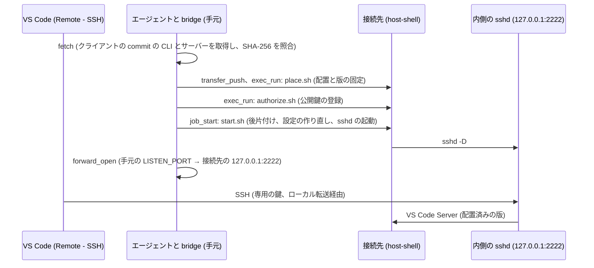

# VS Code Remote - SSH での接続先の利用

> [!NOTE]
> この文書が正本です。英訳は [../en/vscode-remote-ssh.md](../en/vscode-remote-ssh.md) にあります。内容が一致しない場合は日本語版が優先されます。

手元の VS Code (Remote - SSH 拡張機能) から、`host-shell` の Linux 接続先のファイルを編集し、ターミナルや Copilot Chat を使う手順を説明します。接続先がインターネットに接続できない閉鎖環境でも使えます。

一連の手順は `host-shell-vscode-remote-ssh` スキル (`.agents/skills/host-shell-vscode-remote-ssh/`) にまとめられており、エージェントが MCP ツールを使って実行します。この文書では、構成、事前の準備、配置される内容、版の更新、および制限を説明します。

ブラウザーだけで VS Code を使いたい場合、Windows 接続先や `/usr/sbin/sshd` のないコンテナーを使う場合、または MCP 切断時の自動停止や [`remote-dns`](remote-dns.md) が必要な場合は、[code-server の導入](code-server.md) を参照してください。

## 用途

- 接続先のシステムの sshd でポート転送や scp (sftp) が禁止されており、Remote - SSH で直接接続できない環境で、手元の VS Code から接続先を編集する。
- 接続先がインターネットに接続できない環境で、VS Code Server を手元から配置して使う。
- VS Code に組み込まれた Copilot Chat を、接続先のファイルとターミナルに対して使う (通信は手元のネットワークを経由します)。

> [!IMPORTANT]
> この構成は、接続先の利用者権限で 2 つ目の sshd を起動し、システムの sshd の方針 (転送や scp の禁止) を内側の SSH で回り込みます。内側の sshd はシェルとポート転送を提供するため、`host-shell` の制限 (`--read-only`、`--allow-command`、`--allow-path` など) も適用されず、その操作は `host-shell` の操作ログに残りません。接続先の管理者が認めている環境でだけ使ってください。

## 構成



- 内側の sshd は、接続先の `127.0.0.1:2222` でだけ待ち受けます。手元からは、`host-shell` の [ポート転送](port-forward.md) を通じて届きます。
- VS Code Server の CLI とサーバーは、手元でクライアントと同じ commit のものを取得し、SHA-256 を照合してから転送します。接続先でも配置の前に同じ値を照合します。接続先からの取得は行いません。
- 接続先の通信 (Copilot Chat、Marketplace など) は、[クライアント経由 HTTP プロキシ](client-proxy.md) を使う場合だけ、手元のネットワークを経由します。

## 対象環境

| 項目 | 条件 |
| --- | --- |
| 接続先 | Linux (glibc)、x64 または arm64 (arm64 は未検証)。musl の環境 (Alpine など) は対象外 |
| 接続先のコマンド | `/usr/sbin/sshd` と `ssh-keygen` (OpenSSH のサーバーのパッケージ)、`tar`、`gzip`、`sha256sum`、`df`、`pgrep`、`pkill`。システムの sshd が動いている必要はなく、root 権限も不要 |
| 接続先の空き容量 | 版ごとに約 1 GiB (転送する配布物 226 MiB と、展開後の 675 MiB) |
| VS Code を動かすマシン | VS Code、Remote - SSH 拡張機能、OpenSSH クライアント (`ssh`、`ssh-keygen`) |
| 手元での取得 | Linux・macOS: `curl` と `sha256sum` (または `shasum`)。Windows: Windows PowerShell 5.1 以降 |

Table: 対象環境

エージェントと bridge を動かすマシンと、VS Code を動かすマシンは別でも構いません (例: VS Code は Windows、エージェントは WSL)。手元の転送の待ち受けに、VS Code を動かすマシンから `127.0.0.1` で届く必要があります。WSL2 の場合は、WSL の localhost 転送で届きます。

## 事前の準備 (登録コマンド)

ポート転送とファイル転送を使います。登録コマンドには次のオプションが必要です。

| 起動する側 | オプション |
| --- | --- |
| 接続先 | `--allow-forward-local` (`--allow-host` を使う場合は `127.0.0.1:2222` も許可する) |
| bridge | `--forward-allow-local '127.0.0.1:2222'` |

Table: 必要なオプション

```text
host-shell bridge --forward-allow-local '127.0.0.1:2222' -- ssh -T target /path/to/host-shell --mcp --allow-forward-local
```

Copilot Chat などを使う場合は、さらに [プロキシ経由の通信](#プロキシ経由の通信) のオプションを加えます。

## 手順の概要

スキルは次の順に進めます。詳しい手順は `SKILL.md` にあります。

1. **前提の確認:** 接続先の OS、CPU、`sshd` の有無、登録コマンドのオプションを確認します。
2. **commit の確認:** VS Code を動かすマシンで `code --version` を実行し、2 行目の commit (40 桁の 16 進数) を確認します。
3. **取得 (手元):** `scripts/client/fetch.sh COMMIT ARCH` (Windows は `fetch.ps1`) で、`packages/<COMMIT>-<ARCH>/` に CLI とサーバーを取得します。照合済みのフォルダーがあれば取得を省きます。
4. **配置 (接続先):** スクリプトと配布物を `transfer_push` で送り、`place.sh` で配置します。配置したあと、キットの配布物は削除します。
5. **鍵の登録 (初回だけ):** VS Code を動かすマシンで `ssh-key.sh key NAME` を実行し、表示された公開鍵を `authorize.sh` で接続先に登録します。表示されたホスト鍵を `ssh-key.sh trust` に渡すと、known_hosts が作られ、`~/.ssh/config` に追加する Host ブロックが表示されます。
6. **開始 (host-shell のセッションごと):** `start.sh` を `job_start` で起動し、`forward_open` で手元の `LISTEN_PORT` (既定 42222) を接続先の `127.0.0.1:2222` へ転送します。
7. **接続:** VS Code の「Remote-SSH: Connect to Host...」で `host-shell-vscode-NAME` に接続します。接続後、`status.sh` で版の固定を確認します。
8. **終了:** セッションを終える前に、`cleanup.sh` で VS Code Server を止めます。

### SSH の設定

`ssh-key.sh trust` (Windows は `ssh-key.ps1 trust`) は、次の形の Host ブロックを表示します。`~/.ssh/config` へは、利用者が追加します。スクリプトは `~/.ssh/config` を変更しません。

```text
Host host-shell-vscode-NAME
    HostName 127.0.0.1
    Port 42222
    User <接続先の利用者>
    IdentityFile ~/.ssh/host-shell-vscode-NAME_ed25519
    IdentitiesOnly yes
    UserKnownHostsFile ~/.ssh/host-shell-vscode-NAME_known_hosts
    StrictHostKeyChecking yes
```

- 鍵と known_hosts は接続先ごとの専用のファイルで、ほかの SSH の設定と混ざりません。
- known_hosts は `[127.0.0.1]:<LISTEN_PORT>` の形で記録されます。`LISTEN_PORT` を変えたときは、`ssh-key.sh trust` を実行し直します。
- VS Code の設定 `remote.SSH.remotePlatform` に `{"host-shell-vscode-NAME": "linux"}` を加えると、接続のたびの OS の選択を省けます。

## 配置される内容

接続先の配置は次のとおりです。

| パス | 内容 |
| --- | --- |
| `~/.vscode-server/code-<COMMIT>` | CLI を起動するラッパー。agent host をこの commit に固定する ([版の固定](#版の固定)) |
| `~/.vscode-server/host-shell-cli/code-<COMMIT>` | CLI の本体 (`cli-alpine-<ARCH>`。静的リンクのため glibc の環境でも動作する) |
| `~/.vscode-server/cli/servers/Stable-<COMMIT>/server/` | サーバー (`server-linux-<ARCH>` を展開したもの) |
| `~/.vscode-server/cli/servers/lru.json` | 配置済みの版の一覧。先頭は、最後に配置した版か、agent host が最後に使った版 |
| `~/.vscode-server/extensions/`、`~/.vscode-server/data/` | 拡張機能と利用者データ (VS Code Server が作成) |
| `~/.local/share/host-shell-vscode-remote-ssh/kit/` | スクリプト (`scripts/linux/`) と、転送した配布物 |
| `~/.local/share/host-shell-vscode-remote-ssh/sshd/` | 内側の sshd の設定、ホスト鍵、`authorized_keys` (ディレクトリーの権限は 700、ファイルは 600) |

Table: 接続先に配置される内容

`place.sh` は、配置済みの版をもう一度配置するときはサーバーを残し、ラッパーと CLI だけを書き換えます。このため、その版のサーバーが動いていても実行できます。

### 内側の sshd の設定

`start.sh` は、host-shell のセッションごとに次の設定を作り直します。設定ファイルは `sshd -t` で検査してから置き換えます。

- `ListenAddress 127.0.0.1`、`Port 2222` (環境変数 `HSVR_SSHD_PORT` で変更可)
- `AllowUsers <接続先の利用者>`、公開鍵認証だけ (`PasswordAuthentication no`、`KbdInteractiveAuthentication no`)
- `AllowTcpForwarding local`、`AllowStreamLocalForwarding local` (Remote - SSH がサーバーへの接続に使う)
- エージェント転送、X11 転送、トンネル、`GatewayPorts`、`PermitUserEnvironment`: 無効
- `Subsystem sftp`: 記述しない (sftp と、SFTP 方式の scp は拒否される)
- `SetEnv`: プロキシを使う場合だけ書く ([プロキシ経由の通信](#プロキシ経由の通信))

sshd は SSH のセッションを作るときに環境変数を初期化するため、`job_start` の環境は VS Code Server に届きません。必要な環境変数は `SetEnv` で渡します。

## プロキシ経由の通信

接続先の VS Code Server、Copilot Chat、ターミナルからの通信は、[クライアント経由 HTTP プロキシ](client-proxy.md) を使う場合だけ手元のネットワークを経由します。接続先を `--client-proxy`、bridge を `--proxy` と次の `--proxy-allow-host` 付きで起動してから、`start.sh` を起動します。

| 用途 | 許可先 |
| --- | --- |
| Copilot | `github.com:443`、`api.github.com:443`、`*.githubcopilot.com:443`、`copilot-proxy.githubusercontent.com:443` |
| 接続先での Marketplace からの導入 | `marketplace.visualstudio.com:443`、`*.gallerycdn.vsassets.io:443`、`*.gallery.vsassets.io:443`、`main.vscode-cdn.net:443` |
| Remote - SSH 自身による取得 ([予備の経路](#remote---ssh-自身による取得)) | `update.code.visualstudio.com:443`、`vscode.download.prss.microsoft.com:443` |

Table: プロキシの許可先

- `start.sh` は、セッションのプロキシ (`HTTPS_PROXY` など) と `NO_PROXY=127.0.0.1,localhost,::1` を `SetEnv` で SSH のセッションに渡します。`NO_PROXY` がないと、接続先の内部の通信もプロキシへ送られます。
- プロキシの URL には、セッションごとのトークンが含まれます。動いている VS Code Server は起動したときの URL を使い続けるため、`start.sh` は最初に前のセッションの VS Code Server を止めます。
- 次の宛先への接続は拒否されますが、動作には影響しません: テレメトリー (`mobile.events.data.microsoft.com`、`default.exp-tas.com`、`copilot-telemetry.githubusercontent.com`、Application Insights)、クラウドのメタデータ (`169.254.169.254`、`metadata.google.internal`)。
- 拡張機能の署名の検証は、CRL・OCSP (`crl3.digicert.com:80`、`ocsp.digicert.com:80`) にも接続しようとします。許可しなくても、署名の検証は成功します。
- 接続先の名前解決 ([remote-dns](remote-dns.md)) は使いません。VS Code Server は子プロセスの起動時に `LD_PRELOAD` を除くためです。接続先で自分で名前を解決する機能 (Copilot Chat の Web Fetch など) は失敗します。

プロキシを使わない場合、Copilot Chat は動作しません。拡張機能は、クライアントからの中継で導入できます ([拡張機能と表示言語](#拡張機能と表示言語))。

## 版の固定

VS Code 1.144 では、接続先で agent host (`code-<COMMIT> agent host`) が動き、その下で VS Code Server と Copilot の実行環境 (`copilot-runtime`) が動きます。agent host は、固定しないと次のように動作します。

- 通信できる場合は、最新の stable 版を確認して取得し、クライアントと異なる版のサーバーを動かします。
- 通信できない場合は、`lru.json` の先頭の版を動かします。

`place.sh` が書くラッパー `~/.vscode-server/code-<COMMIT>` は、環境変数 `VSCODE_CLI_INITIAL_AH_VERSION=<COMMIT>` を付けて CLI の本体を起動します。Remote - SSH は、クライアントと同じ commit の `code-<COMMIT>` があればそれを起動するため、agent host は常に接続してきたクライアントの版で動きます。このとき、agent host のログ (`~/.vscode-server/cli/agent-host-stable.log`) に `Using initial agent host version override: <COMMIT>` が記録され、`update.code.visualstudio.com` への確認も行われません。

`status.sh` は次の場合に警告し、終了コード 1 を返します。

- `Stable-*` に、ラッパーのない版がある (agent host か Remote - SSH が取得したもの)。
- `code-<COMMIT>` が `place.sh` のラッパーではない。
- agent host が、自分と異なる commit のサーバーを動かしている。
- 動いているサーバーが、固定された版ではない。

`VSCODE_CLI_INITIAL_AH_VERSION` は公開されていない環境変数です。将来の VS Code で効かなくなった場合は、`status.sh` の警告で分かります。

## VS Code の更新

接続先がオフラインの場合、クライアントだけが先に更新されると、新しい版のサーバーがないため接続できません。新しい版を先に配置してから、クライアントを更新します。VS Code の自動更新を止める設定 (`update.mode`) との組み合わせは未検証です。

1. 新しい commit を確認し、取得と配置を行います。古いクライアントで接続したままでも配置できます。動いているサーバーには影響しません。
2. VS Code を更新します。VS Code は、すべてのウィンドウを閉じたときにだけ、取得済みの更新を適用します。
3. `start.sh` を起動し直し (同じセッションで動いていれば `job_stop` してから `job_start`)、再接続します。前に接続していたウィンドウには「再接続できません。ウィンドウを再読み込みしてください。」と表示されるので、ウィンドウを再読み込みします。`status.sh` で、新しい版が固定されていることを確認します。
4. 動作を確認したら、`cleanup.sh` を実行してから `place.sh --prune <新しい COMMIT>` で、ほかの版を削除します。

導入済みの拡張機能と言語パックの登録は、版を更新しても引き継がれます。

### Remote - SSH 自身による取得

手元で配布物を取得できず、接続先がプロキシを使える場合は、Remote - SSH に接続先でサーバーを取得させることもできます。[プロキシの許可先](#プロキシ経由の通信) に `update.code.visualstudio.com:443` と `vscode.download.prss.microsoft.com:443` を加え、`start.sh --commit <COMMIT>` で起動します。この経路にはラッパーがないため、`--commit` が `SetEnv` で agent host の版を固定します。クライアントを更新するたびに、新しい commit で起動し直します。

## 拡張機能と表示言語

| 導入の方法 | 条件 |
| --- | --- |
| Marketplace から接続先で取得 | プロキシに Marketplace の許可先が必要 |
| クライアントからの中継 | 接続先が通信できない場合、VS Code はクライアントで取得して接続先へ送る。プロキシは不要 |
| VSIX ファイル | `transfer_push` で送り、`~/.vscode-server/cli/servers/Stable-<COMMIT>/server/bin/code-server --install-extension <vsix>` で導入する |

Table: 拡張機能の導入方法

- サーバーの表示言語は、クライアントの表示言語に従います。
- VS Code の画面から導入・更新した言語パックは、`~/.vscode-server/data/languagepacks.json` に自動で登録されます。新しい版の翻訳は、サーバーを止めて再接続したあとに使われます。
- プロキシ経由で最初に接続すると、サーバーはクライアントの表示言語の言語パックを Marketplace から自動で導入します。導入は拡張機能ホストの起動後に行われるため、その接続では、接続先の拡張機能の文言 (Git のビューなど) が英語のままです。サーバーを止めて (`start.sh` の起動し直し、または `cleanup.sh`) 再接続すると、表示言語が適用されます。
- `--install-extension` で導入した言語パックは登録されず、英語で表示されます。code-server スキルの `scripts/lib/language-packs.mjs` を、サーバー同梱の `node` で `language-packs.mjs ~/.vscode-server/data ~/.vscode-server/extensions` と実行すると登録されます。

## ターミナルと Copilot

- VS Code のターミナルは、接続先のシェルで動作します。プロキシを使う場合、ターミナルにも `HTTPS_PROXY` と `NO_PROXY` が渡ります。
- ターミナルや Copilot CLI に表示される時刻は、接続先の時刻帯 (`/etc/localtime` または `TZ`) に従います。スキルは `TZ` を渡しません。
- Copilot Chat は、接続先の agent host の下の `copilot-runtime` で動作し、認証はクライアントのサインインを使います。接続先の `~/.copilot` にトークンのファイルは作られません。
- Copilot CLI をターミナルで使う場合は、[CLI 型 AI コーディングエージェントの導入](coding-agents.md) の手順で `~/.local/bin/copilot` に配置します。VS Code 1.144 のターミナルの PATH には、npm から Copilot CLI を導入しようとする `copilot` (`server/bin/copilot-shim`) が加わるため、PATH でそれより先に見つかる場所に置きます。Copilot CLI の認証情報 (`~/.copilot/config.json`) は、サーバーの版を更新しても引き継がれます。

## 終了と削除

host-shell のセッションを終えると、host-shell、内側の sshd、SSH のセッション、転送は止まります。一方、VS Code Server、agent host、`copilot-runtime`、ターミナルのシェル、そこで起動したプログラム (Copilot CLI など) は、init の子として残ります。

残ったプロセスは、次の順に終了します。

1. Remote - SSH の再接続の待ち時間 (`remote.SSH.reconnectionGraceTime`、既定は 10800 秒 = 3 時間) が過ぎると、拡張機能ホストが終了し、管理用の接続が破棄されます。
2. その約 5 分後に、サーバー (`ServerLifetime: all consumers inactive, shutting down`) と agent host のサーバーが終了します。ターミナルのシェルと `copilot-runtime` も一緒に終了します。
3. agent host の supervisor (`code-<COMMIT> ... agent host`) は残ります。

待ち時間は、サーバーの起動時に引数 (`--reconnection-grace-time`) で渡されます。設定を変えたあとは、サーバーを止めてから接続し直します。

- **セッションの終了時:** セッションを終える前に `cleanup.sh` を実行します。`start.sh` も、起動時に前のセッションの VS Code Server を止めます。
- **`cleanup.sh` の対象:**
  - コマンドラインが `$HOME/.vscode-server` で始まるプロセスと、そこから起動したターミナルのシェル。TERM を送り、残ったものに KILL を送ります。同じ利用者の別の VS Code (別の HOME の Remote - WSL など) は対象外です。
  - 一時ディレクトリー (`TMPDIR`、既定は `/tmp`) の、利用者が所有する `code-*` と `vscode-*`。対象のプロセスが残っていないときだけ削除します。
  - Copilot Chat の拡張機能が Copilot CLI との連携用に作る `/tmp/mcp-<ランダム>/mcp.sock` は削除しません。名前で、MCP を使うほかのソフトウェアと区別できないためです。接続を繰り返すと増えるので、必要に応じて手で削除します。
- **削除:** `cleanup.sh --purge` は、`~/.vscode-server` (配置した版、拡張機能、利用者データ) と `~/.local/share/host-shell-vscode-remote-ssh` (キット、sshd の設定と鍵) も削除します。Copilot CLI と共有する `~/.copilot` は残します。VS Code を動かすマシンでは、利用者が Host ブロックと `~/.ssh/host-shell-vscode-NAME_ed25519`、`.pub`、`_known_hosts` を削除します。

## 検証済みの範囲

次の環境で確認しました。

- **接続先:** Podman コンテナー (`--network none`)。Oracle Linux 10.2 / x86_64 / glibc 2.39、OpenSSH 9.9p1。bridge から `podman exec -i` の標準入出力で接続しました。SSH の標準入出力 (`ssh -T`) を経由する接続は、この確認に含みません。
- **手元:** WSL2 上のエージェントと bridge。
- **クライアント:** Windows の VS Code 1.144.0 (commit `2c33b50b16c472efe58357d1d2a8a5414bc23fbf`) と 1.144.1 (commit `261c84cb1eddf11235f9e2c921425e9663fbe556`)、Remote - SSH 0.128.0、OpenSSH_for_Windows 9.5p2、Windows PowerShell 5.1。

| 項目 | 状態 | 内容 |
| --- | --- | --- |
| 事前配置での接続 (オフライン) | 検証済 | 接続先からの取得なしで接続した |
| プロキシ経由での接続 | 検証済 | `SetEnv` でプロキシが渡り、`update.code.visualstudio.com` への接続はなかった |
| 版の固定 | 検証済 | 新しい版を先に配置し、`lru.json` の先頭を新しい版にした状態でも、古いクライアントは自分の版で動いた |
| クライアントの更新 (1.144.0 → 1.144.1) | 検証済 | オフラインとプロキシ経由の両方で確認した |
| 古い版の削除 (`--prune`) | 検証済 | 削除後も再接続できた |
| 接続中の版の更新要求 | 未検証 | クライアントとサーバーのプロトコルの版が合わない場合に、agent host が版を上げる経路がある |
| Remote - SSH 自身による取得 | 一部検証済 | プロキシ経由の取得と、環境変数による版の固定は検証済。`start.sh --commit` は自動試験でのみ確認 |
| 拡張機能 | 検証済 | Marketplace (プロキシ経由)、クライアントからの中継、VSIX ファイルの 3 つの方法で導入できた |
| 表示言語 | 検証済 | 日本語。画面からの言語パックの更新は自動で登録された。`--install-extension` の場合は登録が必要だった |
| Copilot Chat | 検証済 | プロキシ経由で、チャット、ファイルの読み取り、ターミナルでのコマンド実行が動作した |
| Copilot Chat の Web Fetch | 検証済 (制限) | `failed to lookup address information` で失敗することを確認した |
| Copilot CLI | 検証済 | 配置、起動、認証、推論、操作、Ctrl-C、リサイズ、Copilot Chat との併用 |
| Copilot CLI の Web Fetch | 検証済 (制限) | `failed to lookup address information` で失敗することを確認した。プロキシへの接続は行われなかった |
| Remote - SSH の接続 | 検証済 | scp と sftp を使わずに接続した。Remote - SSH のログに scp の記録はなかった |
| sftp と SFTP 方式の scp | 検証済 | `subsystem request failed` で拒否された |
| 従来方式の scp (`scp -O`) | 検証済 (制限) | 送信と受信の両方が成功した。シェルを経由するため、拒否できない |
| 終了後に残るプロセス | 検証済 | セッションの終了後も VS Code Server などが残り、`cleanup.sh` で止まった |
| `cleanup.sh --purge` と最初からの導入 | 検証済 | `--purge` で `~/.vscode-server` とスキルのデータが削除され、`~/.copilot` は残った。そのあと、エージェントが `SKILL.md` の手順に従って最初から導入し、接続できた |
| 待ち時間のあとのサーバーの終了 | 検証済 | `remote.SSH.reconnectionGraceTime` を 60 秒にして確認した。既定の 3 時間では未検証 |
| `fetch.sh` | 検証済 (WSL) | macOS は未検証 |
| `fetch.ps1` | 検証済 | Windows PowerShell 5.1。結果は `fetch.sh` とバイト単位で一致した |
| `ssh-key.ps1` | 検証済 | Windows PowerShell 5.1。空のパスフレーズの鍵、known_hosts、Host ブロック |
| `ssh-key.sh` | 未検証 | 自動試験でのみ確認。Linux と macOS の VS Code では未検証 |
| arm64 の接続先 | 未検証 | |

Table: 検証済みの範囲

スクリプトの自動試験 (`tests/scripts.test.sh`、偽の配布物と偽の sshd を使う) は、Oracle Linux 8 と 10 のコンテナーで検証済です。実行方法は [開発ガイド](development.md#vs-code-remote---ssh-接続スキルの保守) を参照してください。

検証の記録は、[検証記録](../prompts/past/261103-vscode-remote-ssh-validation.md) と [残課題一覧](../prompts/past/261103-vscode-remote-ssh-backlog.md) にあります。

## 制限

- 内側の sshd はシェルを提供するため、ファイルの転送を完全には防げません。sftp と SFTP 方式の scp は拒否しますが、シェルを経由する従来方式の scp (`scp -O`) や、シェルでのファイルの読み書きは防げません。
- 内側の sshd での操作には、`host-shell` の制限と操作ログが適用されません。
- 版の固定は、公開されていない環境変数 `VSCODE_CLI_INITIAL_AH_VERSION` に依存します。
- 接続先での名前解決を使わないため、接続先で名前を解決する機能 (Web Fetch など) は動作しません。
- VS Code Server は、host-shell のセッションを終えても、再接続の待ち時間と約 5 分のあいだ残ります。agent host の supervisor は、そのあとも残ります。`cleanup.sh` で止めます。
- 接続先は Linux (glibc) だけが対象です。Windows の接続先と musl の環境は対象外です。
- VS Code Server と Remote - SSH の利用には、それぞれのライセンス条項が適用されます。配布物は変更せずに配置します。
