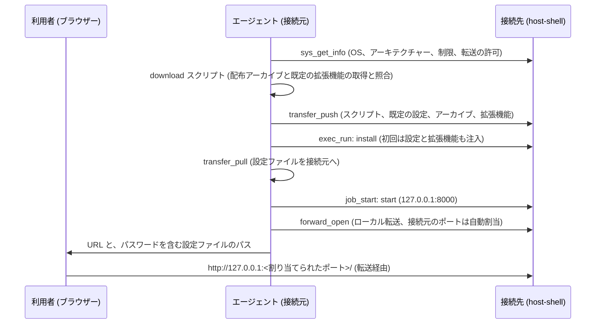

<!--
生成元: agree-before-implement スキル
文書種別: 最終仕様 (design)
最終更新エージェント: claude code / セッション ID: session_01KJc53UTLFzqXyXoZpjPqCE
上流文書: 261101-code-server-discussion.md (検討用 Markdown)。削除されている場合があります。
下流文書: 261101-code-server-backlog.md (残課題一覧)。未作成の場合や、削除されている場合があります。
再開手順: このファイルを開いたエージェントは、作業の前に /home/user/c-modernization-kit/app/general/.agents/skills/agree-before-implement/SKILL.md を読み込んでください。上流文書が存在する場合は、上流文書の再開手順に従って進行位置を確認し、判断の経緯を上流文書の Q&A で確認します。存在しない場合は、この文書を単体の最終仕様として扱います。最終更新エージェントのセッション情報が参照可能であれば再開時のコンテキストとして利用し、別エージェントからの引き継ぎや担当変更によりセッションが見つからない場合も異常とせず、文書の記載から継続してください。
-->

# 接続先への code-server の注入 最終仕様

検討 ID: 261101-code-server

版: 2

状態: 承認済み

## 1. 目的と構成

閉鎖環境の接続先へ host-shell 経由で code-server を注入・起動し、ポート転送で接続元のブラウザーから開く手順を、このリポジトリに用意します。初回の導入では、スキルに同梱した既定の設定と拡張機能も注入します。

| 成果物 | 読み手 | 内容 |
| --- | --- | --- |
| スキル `host-shell-code-server` (`.agents/skills/host-shell-code-server/`) | エージェント | 手順 (英語の `SKILL.md`) と、接続元・接続先で実行するスクリプト |
| 正本文書 `docs/ja/code-server.md`、`docs/en/code-server.md` | 人 | 前提、登録コマンドの準備、手順の概要、パスワードの扱い、拡張機能、セキュリティ上の注意、所要時間 |

Table: 成果物



CodeBlock: 注入から利用までの流れ

> [!NOTE]
> 既定の設定と拡張機能の一覧は、code-server-container (`src/code-server-defaults/`、コミット 45d799d) の `User/settings.json`、`Machine/settings.json`、`extensions.txt` と同じ内容です (設定のコメントは英語に改めます)。

> [!NOTE]
> スクリプトは [Hondarer/code-server-launcher](https://github.com/Hondarer/code-server-launcher) (コミット f91d089、MIT License) の download、install、start、uninstall と共通処理を複写し、本件のために拡張したものです。停止、状態の表示、パスワードの再生成、常駐は複写しません (停止は job_stop、状態の確認は job_read で行います)。

## 2. 対象

| 接続先 | 配布アーカイブ | 確認 |
| --- | --- | --- |
| Linux x86_64 | `code-server-4.144.0-linux-amd64.tar.gz` | 実機確認 |
| Linux arm64 (aarch64) | `code-server-4.144.0-linux-arm64.tar.gz` | 取得・照合・選択だけを確認 (実機未確認) |
| Windows amd64 | `code-server-4.144.0-windows-amd64.tar.gz` | 実機確認 |

Table: 対象の接続先

Windows arm64 とその他のアーキテクチャーは対象外です (code-server の公式リリースに配布物がありません)。接続元 (エージェントと bridge が動く側) は Linux、macOS、Windows です。

## 3. スキルの構成

```text
.agents/skills/host-shell-code-server/
+-- SKILL.md                 エージェントの手順 (英語)
+-- version.env              版、VS Code の版、待受ポート、3 つの配布アーカイブの SHA-256
+-- defaults/                初回に注入する既定の設定と拡張機能の一覧
|   +-- User/settings.json
|   +-- Machine/settings.json
|   \-- extensions.txt
+-- packages/                接続元で取得した配布アーカイブと拡張機能 (Git 管理外、.gitkeep だけを管理)
\-- scripts/
    +-- lib/common.sh        Linux スクリプトの共通処理
    +-- lib/resolve_extensions.py
    |                        接続元 (Linux、macOS): Open VSX からの拡張機能の解決と取得
    +-- linux/
    |   +-- download.sh      接続元 (Linux、macOS): 配布アーカイブの取得と照合
    |   +-- install.sh       接続先: 導入、設定ファイルの作成、拡張機能の導入
    |   +-- start.sh         接続先: フォアグラウンドでの起動 (job_start)
    |   \-- uninstall.sh     接続先: 削除
    \-- windows/
        +-- common.ps1
        +-- download.ps1     接続元 (Windows)
        +-- install.ps1
        +-- start.ps1
        \-- uninstall.ps1
```

`version.env` の内容は次のとおりです。SHA-256 は GitHub Releases の配布物の digest です。

```sh
CODE_SERVER_VERSION=4.144.0
CODE_SERVER_VSCODE_VERSION=1.144.0
CODE_SERVER_PORT=8000
CODE_SERVER_LINUX_AMD64_SHA256=710f749c40a0f3d0ab3be09c0de65314e5c2907cc50646f5fbc0f24c0e8fba2d
CODE_SERVER_LINUX_ARM64_SHA256=4404c784f541bd56a2a8d6e2a9474ed0b4e37bc8502aa3a247898ca933434482
CODE_SERVER_WINDOWS_AMD64_SHA256=324b7e31a2fb60c4e50202fdeae5e5cc5615878647973963874dea61d73ad9f7
```

- スクリプトと既定の設定のコメントと出力は英語で、内容は ASCII 文字だけとします (PowerShell 5.1 で BOM なしでも読めます)。
- リポジトリの `.gitignore` で `/.agents/skills/host-shell-code-server/packages/` の `.gitkeep` 以外を除外します。リリースのアーカイブには、スキルのスクリプトと既定の設定が `git archive` で含まれ、配布アーカイブと VSIX は含まれません。

`packages/` の構成は次のとおりです。

```text
packages/
+-- code-server-4.144.0-linux-amd64.tar.gz
\-- extensions/
    \-- linux-amd64/                     (接続先の種別ごと)
        +-- resolved-extensions.txt      解決結果 (1 行に 1 件、飛ばしたものはコメント行)
        \-- <ID>-<版>[@<プラットフォーム>].vsix
```

```text
# resolved-extensions.txt の例
ms-python.debugpy@2026.6.0 linux-x64 <SHA-256> ms-python.debugpy-2026.6.0@linux-x64.vsix
ms-vscode.cpptools-themes@2.0.0 universal <SHA-256> ms-vscode.cpptools-themes-2.0.0.vsix
# skipped example.ext: no version compatible with VS Code 1.144.0 for linux-arm64
```

## 4. スクリプトの仕様

### 4.1. 接続先の配置

| 用途 | Linux | Windows |
| --- | --- | --- |
| スクリプト一式 (kit) | `~/.local/share/host-shell-code-server/kit/` | `%LOCALAPPDATA%\host-shell-code-server\kit\` |
| 本体 | `~/.local/lib/host-shell-code-server/code-server-<版>/` | `%LOCALAPPDATA%\host-shell-code-server\code-server-<版>\` |
| 設定 | `~/.config/host-shell-code-server/config.yaml` | `%USERPROFILE%\.config\host-shell-code-server\config.yaml` |
| ユーザー データ | `~/.local/share/host-shell-code-server/user-data/` | `%LOCALAPPDATA%\host-shell-code-server\user-data\` |
| 拡張機能 | `~/.local/share/host-shell-code-server/extensions/` | `%LOCALAPPDATA%\host-shell-code-server\extensions\` |
| 既定の拡張機能の導入済みの目印 | `~/.local/share/host-shell-code-server/user-data/.host-shell-code-server-defaults` | `%LOCALAPPDATA%\host-shell-code-server\user-data\.host-shell-code-server-defaults` |

Table: 接続先の配置

kit には `version.env`、`defaults/`、`scripts/` (接続先の OS の分だけ)、`packages/` (接続先の配布アーカイブ 1 つと、接続先の種別の `extensions/<種別>/`) を送ります。launcher の配置 (`code-server-launcher`) とは名前を分け、互いに影響しません。

### 4.2. download (接続元)

```sh
scripts/linux/download.sh TYPE...      # TYPE: linux-amd64、linux-arm64、windows-amd64
```

```powershell
powershell -NoProfile -ExecutionPolicy Bypass -File scripts\windows\download.ps1 TYPE...
```

- 指定した種別の配布アーカイブを GitHub Releases から `packages/` へ取得し、`version.env` の SHA-256 と照合して一致した場合だけ配置します。照合済みのアーカイブがあれば取得しません。
- 続けて、種別ごとに `defaults/extensions.txt` の拡張機能を Open VSX から解決・取得し、`packages/extensions/<種別>/` に VSIX と `resolved-extensions.txt` を作ります。
    1. Open VSX の `/api/-/query?extensionId=<ID>&includeAllVersions=true&targetPlatform=<プラットフォーム>` で、接続先のプラットフォーム (`linux-x64`、`linux-arm64`、`win32-x64`) 向けの版を得ます。該当がなければ `universal` で同じ問い合わせをします。
    2. プレリリースを除き、版の指定 (`@version`) があればその版、なければ `engines.vscode` が `CODE_SERVER_VSCODE_VERSION` を満たす最新版を選びます。`engines.vscode` の範囲は、`^`、`~`、`>=`、`*`、完全一致の書き方を解釈します。
    3. VSIX を取得し、Open VSX の SHA-256 と照合してから配置します。照合済みの VSIX があれば取得しません。
    4. 解決できない拡張機能は飛ばし、警告を表示して、`resolved-extensions.txt` にコメント行で理由を残します。
- Linux と macOS の接続元で使います。SHA-256 は `sha256sum`、なければ `shasum -a 256` で算出します。取得には `curl`、拡張機能の解決には `python3` (`scripts/lib/resolve_extensions.py`) を使います。Windows の接続元の `download.ps1` は、同じ処理を PowerShell (`ConvertFrom-Json`) で行います。

### 4.3. install (接続先)

```sh
bash kit/scripts/linux/install.sh [--extension FILE.vsix|ID]
```

```powershell
powershell -NoProfile -ExecutionPolicy Bypass -File kit\scripts\windows\install.ps1 [-Extension FILE.vsix|ID]
```

1. アーキテクチャーを確認し、配布物を選びます。Linux は `uname -m` が `x86_64` なら linux-amd64、`aarch64` なら linux-arm64 で、それ以外はエラーです。Windows は amd64 以外がエラーです。
2. 必要なコマンドを確認します。Linux は `bash`、`tar`、`gzip`、`sha256sum`、`od`、`uname` です (`python3`、`openssl`、`ss`、`curl` は使いません)。Windows は OS 標準の `tar.exe` です。
3. kit の `packages/` の配布アーカイブを SHA-256 で照合して展開します。ネットワークには接続しません。アーカイブがない、または照合に失敗した場合はエラーです。導入済み (同じ版) の場合は展開を省きます。
4. 設定ファイルがなければ作成します。パスワードは 48 桁の 16 進文字列で、Linux は `/dev/urandom` と `od`、Windows は `RandomNumberGenerator` で生成します。権限は利用者だけ (Linux はファイル 600、フォルダー 700。Windows は継承を無効にして実行ユーザーだけ) とします。既存の設定ファイルは変更しません。

   ```yaml
   bind-addr: 127.0.0.1:8000
   auth: password
   password: <生成したパスワード>
   cert: false
   disable-telemetry: true
   disable-update-check: true
   ```

5. 既定の設定を注入します。kit の `defaults/User/settings.json` と `defaults/Machine/settings.json` を、ユーザー データの `User/settings.json` と `Machine/settings.json` へ、**ファイルごとに配置先にない場合だけ**写します。既存のファイルは変更しません。
6. 既定の拡張機能を注入します。目印のファイルがなければ、kit の `resolved-extensions.txt` の各行について、未導入 (`--list-extensions` で ID を大文字小文字を区別せずに照合) のものを SHA-256 で照合してから `--install-extension <VSIX> --force` で導入します。すべての拡張機能が導入されたことを確かめてから目印のファイルを作ります。目印があれば何もしません。導入や照合に失敗した場合は目印を作らずにエラーで終了し、次の install で再び試みます。`resolved-extensions.txt` がない場合もエラーです (download を先に実行します)。
7. 導入先、設定ファイルのパス、`code-server --version`、注入した設定と拡張機能を表示します。**パスワードは表示しません。**
8. `--extension` (`-Extension`) を指定した場合は、導入の後に、本件の設定・ユーザー データ・拡張機能のフォルダーを指定して `code-server --install-extension` を実行します。

> [!NOTE]
> 設定はファイルごとに、既定の拡張機能は目印のファイルで、初回だけ注入します。利用者が画面で変えた設定や削除した拡張機能は、install を再び実行しても戻りません。既定に戻す場合は、該当する設定ファイルや目印のファイルを削除してから install を実行します。

### 4.4. start (接続先、job_start で起動)

```sh
CODE_SERVER_WORKSPACE=<開くフォルダー> bash kit/scripts/linux/start.sh
```

```powershell
powershell -NoProfile -ExecutionPolicy Bypass -File kit\scripts\windows\start.ps1   # CODE_SERVER_WORKSPACE は環境変数
```

- 待受は `127.0.0.1:<CODE_SERVER_PORT>` に固定します (既定 8000、環境変数 `CODE_SERVER_PORT` で変更可)。`0.0.0.0` では待ち受けません。
- 開くフォルダーは環境変数 `CODE_SERVER_WORKSPACE`、未指定時はホーム フォルダーです。
- 起動前に、導入済みであること、フォルダーがあること、設定ファイルがあること、ポートが使われていないことを確認します。ポートの確認は、Linux は bash の `/dev/tcp`、Windows は `Get-NetTCPConnection` で行います。
- `VSCODE_IPC_HOOK_CLI` と `ELECTRON_RUN_AS_NODE` を除いてから、フォアグラウンドで起動します (Linux は `exec`、Windows は同梱の `node.exe`)。起動の引数は launcher と同じく `--config`、`--bind-addr`、`--auth password`、`--ignore-last-opened`、`--user-data-dir`、`--extensions-dir`、フォルダーです。
- job_start の環境 (クライアント経由 HTTP プロキシが有効なら HTTP_PROXY/HTTPS_PROXY を含む) を受け継ぎます。

### 4.5. uninstall (接続先)

```sh
bash kit/scripts/linux/uninstall.sh [--purge]
```

- 本件の設定ファイルで動いている code-server があれば、停止を促して終了します (エージェントは job_stop で止めてから実行します)。
- 本体を削除します。`--purge` (`-Purge`) では、設定、ユーザー データ、拡張機能、kit (配布アーカイブを含む) と、code-server が既定の場所に出力する `coder-logs` と `heartbeat` も削除します。

## 5. エージェントの手順 (SKILL.md)

### 5.1. 前提の確認

1. sys_get_info で接続先の OS とアーキテクチャーを確認します。対象外 ([2.](#2-対象)) の場合は中止して利用者に知らせます。
2. sys_get_info の `forward_local` と、bridge の forward_open の有無を確認します。どちらかが欠ける場合は中止し、登録コマンドの変更 (接続先の `--allow-forward-local`、bridge の `--forward-allow-local 127.0.0.1:8000`) と再接続を利用者に案内します。
3. sys_get_info の `restrictions` が空でなければ、code-server の端末とファイル操作は host-shell の制限と監査ログを通らないことを示し、利用者の明示の承認を得てから進めます。承認がなければ中止します。
4. 開くフォルダーを利用者に確認します (既定はホーム フォルダー)。

### 5.2. 導入から利用まで

1. 接続元で download スクリプトを実行し、接続先の種別の配布アーカイブと既定の拡張機能を取得します。飛ばした拡張機能があれば利用者に示します。
2. transfer_push で、kit (`version.env`、`defaults/`、接続先の OS の `scripts/`、配布アーカイブ、接続先の種別の `extensions/`) を接続先の kit のフォルダーへ送ります。
3. exec_run で install を実行します。必要なコマンドの不足などのエラーは、そのまま利用者に示します。
4. transfer_pull で設定ファイルを接続元の `~/.config/host-shell-code-server/<接続先の名前>/config.yaml` (Windows の接続元は `%USERPROFILE%\.config\host-shell-code-server\<接続先の名前>\config.yaml`) へ写し、Linux と macOS では権限を 600 にします。**エージェントはこのファイルを読みません。**
5. job_start で start を起動し、job_read で待受の開始 (ログの `HTTP server listening on`) を確認します。
6. forward_open (`direction: local`、`host: 127.0.0.1`、`port: 8000`、`listen_port` は省略して自動割当) で転送を開きます。
7. 利用者に URL (`http://127.0.0.1:<割り当てられたポート>/`) と設定ファイルのパスを示します。パスワードは会話に出しません。

### 5.3. 終了と削除

- 終了: forward_close と job_stop を行います。MCP セッションの終了でも両方が止まります。
- 削除: job_stop の後に uninstall (`--purge` は利用者の希望がある場合) を実行します。

### 5.4. 拡張機能

- .vsix: 利用者が接続元に用意した .vsix を transfer_push で kit へ送り、`install --extension <ファイル>` で導入します。
- クライアント経由 HTTP プロキシ: 実機で、code-server がマーケットプレースへの接続に HTTPS_PROXY を使うかを確認します。使える場合は、必要な `--proxy-allow-host` の宛先と、`install --extension <ID>` または画面からの導入を文書に記載します。使えない場合は、その結果を記載し、.vsix の方法だけを案内します。

## 6. 正本文書と既存文書の更新

| 対象 | 変更内容 |
| --- | --- |
| `docs/ja/code-server.md`、`docs/en/code-server.md` (新規) | 概要、対象、前提 (登録コマンドの例)、手順の概要、パスワードの扱い、既定の設定と拡張機能 (内容、項目ごとの前提、初回だけの注入、既定に戻す方法、一覧の編集)、個別の拡張機能の導入、終了と削除、セキュリティ上の注意 (制限と監査ログを通らないこと、接続元の待受が認証しないこと)、送付量と transfer_push の所要時間の実測値、Linux arm64 は実機未確認であること |
| `docs/README.md` | 文書一覧に code-server の行を追加 |
| `docs/ja/port-forward.md`、`docs/en/port-forward.md` | ローカル転送の利用例として code-server の文書を案内 |
| `docs/ja/development.md`、`docs/en/development.md` | ディレクトリ構成にスキルを追加。スキルのスクリプトと既定値の由来 (launcher と code-server-container から複写) と、版の更新手順 |
| `.agents/skills/host-shell-connect/SKILL.md` | code-server を求められた場合に新しいスキルを使う旨の 1 行 |
| `.gitignore` | `packages/` の配布アーカイブと拡張機能を除外 |

Table: 文書の更新

版の更新手順は、`version.env` の版、VS Code の版 (code-server のリリース ノートの `Code` の版)、3 つの SHA-256 を更新し、Linux と Windows で実機確認する、とします。

## 7. 実機での確認方法

作業環境 (WSL) で、SSH の代わりに bridge から接続先の host-shell を直接起動して確認します。

| 接続先 | 起動 | 作業環境の保全 |
| --- | --- | --- |
| Linux | `host-shell bridge --forward-allow-local 127.0.0.1:8000 -- host-shell --mcp --allow-forward-local --no-log` | exec_run・job_start の `env` で HOME を作業用の一時フォルダーに向けます |
| Windows | 同上で、接続先に `/mnt/c/.../host-shell.exe` (WSL の相互運用) | `env` で LOCALAPPDATA と USERPROFILE を Windows 側の一時フォルダーに向けます |

Table: 実機での確認の構成

- エージェントの代わりに、スクリプトで MCP のツールを呼び出す確認用のクライアント (作業用の一時フォルダーに置き、リポジトリには含めません) で、[5.](#5-エージェントの手順-skillmd) の手順をたどります。
- 接続元のブラウザーの代わりに、作業環境のヘッドレスの Chrome でログイン画面を開いてログインし、エディターの画面 (WebSocket) が表示されること、既定の設定とカラー テーマが反映されていることを確認します。
- 確認後に一時フォルダーを削除し、作業環境の既存の導入 (`~/.local/lib/code-server-4.140.0`) と、利用者の Windows のプロファイルに変更がないことを確認します。

## 8. 知見の反映計画

| 反映先 | 内容 |
| --- | --- |
| `docs/*/code-server.md` | [6.](#6-正本文書と既存文書の更新) のとおり |
| `docs/*/development.md` | スキルのスクリプトの由来と版の更新手順 |
| スクリプトのコメント | 待受を 127.0.0.1 に固定する理由 (転送だけで使う)、パスワードを表示しない理由 (ツールの結果が会話に残る)、接続先で `python3` などを使わない理由 (最小構成の閉鎖環境)、環境変数を除く理由 (launcher と同じ)、初回だけ注入する理由 (利用者の変更を戻さない)、目印を最後に作る理由 (失敗時の再試行) |
| `SKILL.md` | 手順、前提の確認、パスワードを読まないこと、制限のある接続先での承認 |

Table: 知見の反映計画

## 9. 作業の進め方

前回の案件と同じ運用です。main から `claude/code-server` を作成し、最初のプッシュで main 向けのドラフト PR を作成します。受入条件をすべて満たし全 OS の CI が成功した時点で、検討記録を `docs/prompts/past/` へ移してから、エージェントがマージ コミットでマージします。成果物の承認の記録は、承認後に main へ直接コミット・プッシュします。

## 10. 受入条件

1. スキルの手順に従い、Linux x86_64 と Windows amd64 の接続先で、取得、送付、導入、起動、転送を行い、接続元から HTTP でログイン画面が開け、ログイン後にエディターの画面 (WebSocket) が動くことを確認します。transfer_push の所要時間を測定して文書に記載します。
2. Linux arm64 は、配布アーカイブの取得と SHA-256 の照合、および install スクリプトの配布物の選択を確認し、実機未確認であることを文書と残課題一覧に記載します。
3. 前提の確認 (OS とアーキテクチャー、Linux の必要なコマンド、転送の許可、制限のある接続先での承認) で、対象外や不足を検出して利用者に知らせることを確認します。
4. パスワードが会話 (ツールの結果) に現れず、接続元に写した設定ファイルが利用者だけの権限であることを確認します。
5. 拡張機能の導入 (.vsix の送付と、HTTP プロキシ経由のマーケットプレース) を確認し、結果を文書に記載します。
6. 削除 (uninstall) で接続先の導入先と一時ファイルが消えることを確認します。
7. 確認で作業環境の既存の導入 (`~/.local/lib/code-server-4.140.0`) や利用者の設定を変えず、確認後に一時ファイルを削除したことを確認します。
8. 複写したスクリプトのコメントが英語であること、日英の正本文書の内容が一致し、既存文書から案内されていることを確認します。
9. make、6 ターゲットのクロスビルド、全 OS の CI を確認します。
10. Linux と Windows の接続先で、初回の install により `User/settings.json` と `Machine/settings.json` が本件のユーザー データのフォルダーへ配置され、code-server の画面に設定 (フォントの大きさ、空白の表示など) が反映されることを確認します。配置先にファイルがある状態で install を再び実行しても、そのファイルが変更されないことを確認します。
11. 接続元の download で、Linux x86_64、Linux arm64、Windows amd64 のそれぞれについて既定の拡張機能の VSIX を解決・取得し、解決した版と SHA-256 が記録されることを確認します。解決できない拡張機能が警告されることを確認します。
12. Linux x86_64 と Windows amd64 の接続先で、初回の install により、ネットワークに接続せずに既定の拡張機能が照合・導入され、カラー テーマ (`Visual Studio Dark - C++`) が画面に反映されることを確認します。目印がある状態で install を再び実行しても、拡張機能が導入し直されないことを確認します。
13. 拡張機能の VSIX の送付量と transfer_push の所要時間を測定して文書に記載します。
