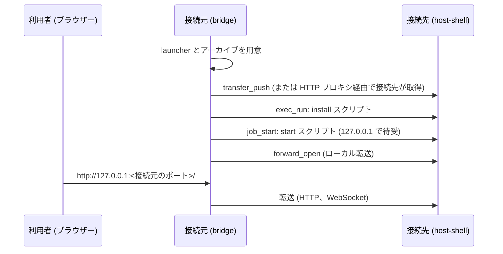

<!--
生成元: agree-before-implement スキル
文書種別: 検討用 Markdown (discussion)
最終更新エージェント: claude code / セッション ID: session_01KJc53UTLFzqXyXoZpjPqCE
下流文書: 261101-code-server-design.md (最終仕様)、261101-code-server-backlog.md (残課題一覧)。未作成の場合や、削除されている場合があります。
再開手順: このファイルを開いたエージェントは、作業の前に /home/user/c-modernization-kit/app/general/.agents/skills/agree-before-implement/SKILL.md を読み込んでください。ユーザーが編集した最新版を読み直し、作業 WBS の `← **CURRENT**` の項目から再開します。最終更新エージェントのセッション情報が参照可能であれば再開時のコンテキストとして利用し、別エージェントからの引き継ぎや担当変更によりセッションが見つからない場合も異常とせず、文書の記載から継続してください。`← **CURRENT**` の項目は処理が中止された項目である場合があり、どこまで進んでいたかは文書だけでは分かりません。対象成果物の内容を確認して実施済みの範囲を特定してから、作業を再開してください。`← **CURRENT**` がなく、作業 WBS がすべて完了 (✅) であれば、この案件の合意フローは完了しています。
-->

# 接続先への code-server の注入手順の検討

## 検討の識別

検討 ID: 261101-code-server

版: 6

状態: 合意済み

## 作業 WBS と進捗管理

この検討用 Markdown が管理する作業 WBS です。Q&A のターンごとに必要に応じて見直します。見送りの決定や範囲外の気付きは、生じた時点で `261101-code-server-backlog.md` に追記します。

凡例: ⏸️ 未着手、🔄 実施中、🚫 ブロック中、⚠️ 要注意、✅ 完了。現在取り組んでいる項目の末尾に `← **CURRENT**` を付けます。

- ✅ 1. 検討用 Markdown のための情報収集と質問の実施
    - ✅ 1.1. 前提条件と要求事項の調査 (code-server-launcher のコミット f91d089、code-server の配布物、bridge の transfer_push・job_start・ポート転送・HTTP プロキシ、host-shell-connect スキル、開発規約)
    - ✅ 1.2. 第 1 群の確認項目 ([Q-001](#q-001-成果物の形態)〜[Q-013](#q-013-受入条件)) の作成
    - ✅ 1.3. 第 1 群の回答の受付と記録
    - ✅ 1.4. 第 2 群の確認項目 ([Q-015](#q-015-q-002-の回答の解釈)〜[Q-023](#q-023-導入先のフォルダー名)) の作成
    - ✅ 1.5. 第 2 群の回答の受付と記録
    - ✅ 1.6. 最終仕様 (版 1) への追加の要求 (設定の注入) の記録と、第 3 群の確認項目 ([Q-024](#q-024-同梱する設定の内容)〜[Q-028](#q-028-受入条件-設定の注入の追加)) の作成
    - ✅ 1.7. 第 3 群の回答の受付と記録
    - ✅ 1.8. 第 4 群の確認項目 ([Q-029](#q-029-既定の拡張機能の一覧)〜[Q-034](#q-034-受入条件-既定の拡張機能の追加)) の作成
    - ✅ 1.9. 第 4 群の回答の受付と記録
- ✅ 2. 前提合意と残懸念の解消 (第 1 ゲート: 最終仕様作成への着手。版 3 で一度通過し、追加の要求により再確認)
    - ✅ 2.1. 全論点に対する未解決事項および質問の解消確認
    - ✅ 2.2. 方針・前提条件の合意確定 (懸念がないことをもってフェーズ 2 へ着手、合意版: 版 6)
- ✅ 3. 最終決定事項 (最終仕様) の作成と承認の受付
    - ✅ 3.1. `261101-code-server-design.md` の改版 (版 2。版 1 は承認前に設定の注入の要求を受けて改版)
    - ✅ 3.2. 最終仕様における受入条件と整合性の確認
    - ✅ 3.3. 対話セッションにおける最終仕様の承認の受付 (第 2 ゲート: 作業着手の合意、Tetsuo Honda が対話「承認」で版 2 を承認、確認日時: 2026-11-01 09:17:42 JST)
- 🔄 4. 承認された最終仕様に従った作業の実施
    - ✅ 4.1. 作業ブランチの準備 ([Q-012](#q-012-ブランチと-pr-とマージの運用))
    - ✅ 4.2. スキルの作成 (`.agents/skills/host-shell-code-server/SKILL.md`) ([Q-001](#q-001-成果物の形態)、[Q-011](#q-011-スキルの名前)、[Q-014](#q-014-制限のある接続先での扱い))
    - ✅ 4.3. launcher から複写したスクリプトの配置と拡張 (Linux arm64、待受、依存コマンド、パスワード、導入先の名前、設定と既定の拡張機能の注入 [Q-024](#q-024-同梱する設定の内容)〜[Q-033](#q-033-解決できない拡張機能の扱い)) ([Q-015](#q-015-q-002-の回答の解釈)〜[Q-020](#q-020-ログイン-パスワードの受け渡し)、[Q-023](#q-023-導入先のフォルダー名))
    - ✅ 4.4. 日英正本文書の作成と既存文書からの案内 (`docs/ja/`、`docs/en/`、README、host-shell-connect スキル) ([Q-001](#q-001-成果物の形態))
    - ✅ 4.5. 開発文書・リリース梱包への反映 (`docs/*/development.md`、Makefile の要否)
    - ✅ 4.6. 実機での通し確認 ([Q-010](#q-010-実機での確認範囲)、[Q-021](#q-021-linux-arm64-の確認方法))
    - 🔄 4.7. make、6 ターゲットのクロスビルド、全 OS CI の実行 ← **CURRENT**
    - ⏸️ 4.8. 受入条件への適合確認 (全完確認)
    - ⏸️ 4.9. 残課題一覧 (`261101-code-server-backlog.md`) の再構築と整理 (残渣がなければ作成しない)
    - ⏸️ 4.10. 検討記録の `docs/prompts/past/` への移動、全 OS の CI の成功の確認とマージ ([Q-012](#q-012-ブランチと-pr-とマージの運用))
- ⏸️ 5. 成果物の承認の受付 (第 3 ゲート)
    - ⏸️ 5.1. 成果物・検証結果・残課題の提示
    - ⏸️ 5.2. 対話セッションにおける成果物の承認の受付 (「承認」または「完了」の受領によるスキル完了)

## 対象と参照資料

対象成果物: 閉鎖環境の接続先へ host-shell 経由で code-server を注入・起動し、ポート転送で接続元のブラウザーから開く手順 (スキルまたは文書)。

今回の対象範囲: 手順の成果物の作成と、その実機での確認。host-shell 本体 (Go のコード) の変更は想定していません。必要が判明した場合は改めて確認します。

書き込み可能な検討用 Markdown: この文書 (`docs/prompts/261101-code-server-discussion.md`)

参照資料と版: このリポジトリの main (コミット ba6c0f8) と、[Hondarer/code-server-launcher](https://github.com/Hondarer/code-server-launcher) のコミット f91d089 を調査基準とします。

- code-server-launcher: code-server を Linux (x86_64) と Windows (amd64) のユーザー領域へ導入するスクリプト集です (MIT License)。
    - `version.env` で版 (4.140.0) と配布アーカイブの SHA-256 を固定し、照合してから展開します。
    - `download` スクリプトで `packages/` へ事前に取得すると、`install` スクリプトはネットワークに接続せずに導入します (オフライン導入)。
    - `start` スクリプトはフォアグラウンドで起動し、待受は `CODE_SERVER_BIND_HOST` (既定 `0.0.0.0`) と `CODE_SERVER_PORT` (既定 8000) で変えられます。パスワード認証の設定ファイルを生成します。
    - Linux の導入・起動には `tar`、`sha256sum`、`python3`、`openssl`、`ss` が必要です。Windows は PowerShell 5.1 と OS 標準の `tar.exe`、`curl.exe` を使います。
    - code-server の公式文書は Windows を配布対象として案内していませんが、公式リリースには `windows-amd64` の配布物があり、launcher はそれを使います。
- code-server 4.140.0 の配布アーカイブの大きさ: linux-amd64 は 228,732,609 バイト、windows-amd64 は 208,924,361 バイトです (GitHub Releases)。最新版は 4.144.0 (2026-10-29) です。
- [bridge の transfer_push](../en/reference.md): 1 MiB ずつ base64 で `fs_write` し、SHA-256 を照合してから正式な名前に変えます。並列化はファイル単位で、1 ファイルは逐次です。シンボリック リンクと空のディレクトリは送りません。
- [ジョブ](../ja/reference.md): `job_start` で起動したプロセスは、host-shell の終了 (SSH の切断) ですべて停止します。
- [ポート転送](../ja/port-forward.md): ローカル転送 (接続元で待ち受け、接続先から接続) には、接続先の `--allow-forward-local` と、bridge の常設 `--forward-local` または `--forward-allow-local` の規則 (forward_open 用) が必要です。転送は無通信で切れません。同時接続はセッションあたり 64 です。
- [クライアント経由 HTTP プロキシ](../ja/client-proxy.md): 接続先の `job_start` と `exec_run` は HTTP_PROXY/HTTPS_PROXY を受け継ぎます。宛先は bridge の `--proxy-allow-host` で許可します。
- [host-shell-connect スキル](../../.agents/skills/host-shell-connect/SKILL.md): 接続先への host-shell の配置と登録コマンドの準備を扱います。スキルは英語で記述する規約です ([開発規約](../ja/development.md))。
- 作業環境 (WSL) には、code-server-launcher の導入先 `~/.local/lib/code-server-4.140.0` がすでにあります (設定ファイルとユーザー データはありません)。

## ユーザーが明示した要求

本対話の依頼 (2026-11-01、Tetsuo Honda) を根拠とします。

> スキルをもう一つ用意するか、ドキュメントに手順をまとめる方式で、code-serverを注入する手順をこのリポジトリに用意したい。  
> また、code-serverは、最新ではWindowsも対応している。https://github.com/Hondarer/code-server-launcher を参考にすること。

- code-server を接続先へ注入する手順を、このリポジトリに用意します。形態はスキルの追加、または文書への手順のまとめです ([Q-001](#q-001-成果物の形態))。
- 直前の対話の構成 (host-shell の注入、code-server の注入、ポート転送で接続元から開く) を前提とします。
- Windows の接続先も対象とします ([Q-008](#q-008-対象の-os-とアーキテクチャー))。

最終仕様 (版 1) の提示に対する追加の要求 (2026-11-01、Tetsuo Honda) を根拠とします。

> 導入時、設定を注入したい。  
> サンプルとしては、/home/user/code-server-container/src/code-server-defaults/Machine/settings.json, src/code-server-defaults/User/settings.json  
> skill のサブフォルダにこれらを用意し、初回注入時に流し込むようにできるか？

- スキルのサブフォルダーに code-server の設定ファイル (User と Machine の `settings.json`) を用意し、初回の導入時に接続先の code-server へ配置します。
- 内容は code-server-container の 2 ファイルをサンプルとします ([Q-024](#q-024-同梱する設定の内容))。
- code-server-launcher を参考にします。参考の仕方は [Q-002](#q-002-code-server-launcher-の使い方) で確認します。

## 現行の合意内容

第 1 群 ([Q-001](#q-001-成果物の形態)〜[Q-014](#q-014-制限のある接続先での扱い)) の回答 (2026-11-01、Tetsuo Honda) による合意内容です。第 2 群 ([Q-015](#q-015-q-002-の回答の解釈)〜[Q-023](#q-023-導入先のフォルダー名)) の回答も反映しています。版 3 で第 1 ゲートを通過しましたが、最終仕様 (版 1) の提示に対する追加の要求 (設定の注入) を受けて第 3 群 ([Q-024](#q-024-同梱する設定の内容)〜[Q-028](#q-028-受入条件-設定の注入の追加)) を確認しました。設定は code-server-container のサンプルを内容のまま (コメントは英語) 同梱し、ファイルごとに配置先にない場合だけ配置します。既定の拡張機能も本件で扱い、第 4 群 ([Q-029](#q-029-既定の拡張機能の一覧)〜[Q-034](#q-034-受入条件-既定の拡張機能の追加)) で確定しました。すべての質問が解決済みです (合意版: 版 6)。

- 設定: `defaults/User/settings.json`、`defaults/Machine/settings.json` (コメントは英語) を、ファイルごとに配置先にない場合だけ配置します ([Q-024](#q-024-同梱する設定の内容)〜[Q-026](#q-026-初回の判定))。
- 既定の拡張機能: `defaults/extensions.txt` (code-server-container と同じ 20 件) を、接続元の download で Open VSX から接続先向けに解決・取得 (python3 を使用) し、接続先の install が照合してから、目印のファイルがない初回だけ導入します。解決できないものは飛ばして警告します ([Q-027](#q-027-既定の拡張機能)、[Q-029](#q-029-既定の拡張機能の一覧)〜[Q-033](#q-033-解決できない拡張機能の扱い))。
- 受入条件: [Q-022](#q-022-受入条件-改訂) の 1〜9 に、[Q-028](#q-028-受入条件-設定の注入の追加) の 10 と [Q-034](#q-034-受入条件-既定の拡張機能の追加) の 11〜13 を加えます。

- スクリプト: launcher から download、install、start、uninstall と共通処理を複写し、スキルの中に置きます。拡張は、Linux arm64、待受 127.0.0.1、Linux の `python3`・`openssl`・`ss` を不要にすること、パスワードを表示しないこと、導入先の名前 `host-shell-code-server` です ([Q-015](#q-015-q-002-の回答の解釈)〜[Q-018](#q-018-linux-の依存コマンドの削減)、[Q-020](#q-020-ログイン-パスワードの受け渡し)、[Q-023](#q-023-導入先のフォルダー名))。
- 版: code-server 4.144.0 ([Q-019](#q-019-code-server-の版))。
- パスワード: 会話に出さず、transfer_pull で写した設定ファイルのパスを示します ([Q-020](#q-020-ログイン-パスワードの受け渡し))。
- Linux arm64: 実機未確認とし、取得・照合・選択を確認します ([Q-021](#q-021-linux-arm64-の確認方法))。
- 受入条件: [Q-022](#q-022-受入条件-改訂) のとおりです。

- 成果物: スキル `host-shell-code-server` (英語) と、日英の正本文書 ([Q-001](#q-001-成果物の形態)、[Q-011](#q-011-スキルの名前))。
- 持ち込み: 接続元で配布アーカイブを取得し、transfer_push で送ります ([Q-004](#q-004-アーカイブの持ち込み経路))。
- 起動: job_start でフォアグラウンド起動し、待受は 127.0.0.1 です ([Q-005](#q-005-code-server-の起動方法))。
- 転送: 登録に `--forward-allow-local` の規則を加え、エージェントが forward_open で開きます。接続元のポートは自動割当で、エージェントが URL を示します ([Q-006](#q-006-接続元の待受ポート)、[Q-007](#q-007-転送の設定方法))。
- 対象: Linux x86_64、Linux arm64、Windows amd64 ([Q-008](#q-008-対象の-os-とアーキテクチャー))。
- 拡張機能: .vsix の送付を案内し、HTTP プロキシ経由のマーケットプレースは実機で確認できた場合だけ案内します ([Q-009](#q-009-拡張機能の扱い))。
- 確認: Linux と Windows (WSL の相互運用) で通しで確認します ([Q-010](#q-010-実機での確認範囲))。
- 制限のある接続先: 制限を回避することを示し、利用者の承認を得てから進めます ([Q-014](#q-014-制限のある接続先での扱い))。
- 運用: 前回と同じで、ブランチは `claude/code-server` です ([Q-012](#q-012-ブランチと-pr-とマージの運用))。

## 調査結果

### code-server-container の既定設定

`/home/user/code-server-container` (コミット 45d799d) は、コンテナー イメージに既定の設定と拡張機能を同梱し、初回起動時に展開します。

| ファイル | 内容 | 配置先 (code-server のユーザー データ) |
| --- | --- | --- |
| `src/code-server-defaults/User/settings.json` | ワークスペースの信頼の無効化、カラー テーマ (`Visual Studio Dark - C++`)、フォント (`UDEV Gothic HSRFJPDOCEM`、15px)、git の自動フェッチ、空白の表示、diff の行末空白、Markdown Preview Enhanced の PlantUML JAR のパス (`${env:PLANTUML_HOME}/plantuml.jar`) | `User/settings.json` |
| `src/code-server-defaults/Machine/settings.json` | PlantUML 拡張の JAR のパス (`/usr/local/bin/plantuml.jar`) | `Machine/settings.json` |
| `src/code-server-defaults/extensions.txt` | 初期拡張機能 20 件 (日本語 Language Pack、C/C++ Themes、PlantUML など)。イメージの構築時に Open VSX から VSIX を取得して同梱 | (拡張機能のフォルダー) |

Table: code-server-container の既定設定

- 2 つの `settings.json` は JSONC (コメントと末尾のカンマを含む) で、コメントは日本語です。
- コンテナーは `User/settings.json` の有無を初期化済みの目印とし、なければ拡張機能の導入と検証の後に Machine、最後に User を配置します。既存の利用者の設定は変更しません。
- カラー テーマ `Visual Studio Dark - C++` は拡張機能 `ms-vscode.cpptools-themes` が提供します。PlantUML の 2 つのパスは、接続先にその JAR と拡張機能がある場合だけ意味を持ちます。フォントは接続元のブラウザーで解決されます。いずれも、対象がない場合は既定の動作に戻るだけで、エラーにはなりません。

### 想定する手順の全体像



CodeBlock: code-server の注入から利用までの流れ

### 注意すべき性質

- code-server の内蔵端末とファイル操作は、host-shell の制限 (`--read-only`、`--allow-command`、`--allow-path` など) を通りません。host-shell の監査ログにも残りません。接続先の監査ログに残るのは、転送の接続 (`forward_connect`) だけです。
- 接続元の待受は認証しないため、接続元の他のユーザーも接続できます。code-server のパスワード認証が必要です。
- `job_start` で起動した code-server と転送は、MCP セッションの終了で止まります。

## 観点別の確認

| 観点 | 状態 | 根拠・関連 Q |
| --- | --- | --- |
| 目的・利用者 | 確認済み | [Q-001](#q-001-成果物の形態) |
| 範囲・境界 | 確認済み | 設定の注入の内容と既定の拡張機能は [Q-024](#q-024-同梱する設定の内容)、[Q-027](#q-027-既定の拡張機能)、[Q-029](#q-029-既定の拡張機能の一覧) で確認済み。[Q-001](#q-001-成果物の形態)、[Q-008](#q-008-対象の-os-とアーキテクチャー)、[Q-009](#q-009-拡張機能の扱い) で確認済み。複写の範囲は [Q-016](#q-016-複写するスクリプトの範囲) で確認 |
| 入力・根拠 | 確認済み | [Q-002](#q-002-code-server-launcher-の使い方) の選択肢と補足の不一致を [Q-015](#q-015-q-002-の回答の解釈) で確認。版は [Q-019](#q-019-code-server-の版) で確認 |
| 整合性・依存関係 | 確認済み | [Q-011](#q-011-スキルの名前)、[Q-012](#q-012-ブランチと-pr-とマージの運用) で確認済み。複写したスクリプトの配置と導入先の名前は [Q-017](#q-017-複写したスクリプトの配置)、[Q-023](#q-023-導入先のフォルダー名) で確認 |
| 実現性・例外 | 確認済み | [Q-004](#q-004-アーカイブの持ち込み経路)〜[Q-007](#q-007-転送の設定方法)、[Q-010](#q-010-実機での確認範囲)、[Q-014](#q-014-制限のある接続先での扱い) で確認済み。依存コマンド、パスワード、arm64 は [Q-018](#q-018-linux-の依存コマンドの削減)、[Q-020](#q-020-ログイン-パスワードの受け渡し)、[Q-021](#q-021-linux-arm64-の確認方法) で確認 |
| 受入条件・検証 | 確認済み | 設定の注入と既定の拡張機能は [Q-028](#q-028-受入条件-設定の注入の追加)、[Q-034](#q-034-受入条件-既定の拡張機能の追加) で確認済み。[Q-022](#q-022-受入条件-改訂) で確認 |

## 質問一覧

| Q-ID | 論点 | 状態 | 依存・関連 |
| --- | --- | --- | --- |
| [Q-001](#q-001-成果物の形態) | 成果物の形態 | 解決済み | なし |
| [Q-002](#q-002-code-server-launcher-の使い方) | code-server-launcher の使い方 | 解決済み | なし |
| [Q-003](#q-003-code-server-launcher-の入手元) | code-server-launcher の入手元 | 解決済み | [Q-002](#q-002-code-server-launcher-の使い方) |
| [Q-004](#q-004-アーカイブの持ち込み経路) | アーカイブの持ち込み経路 | 解決済み | [Q-002](#q-002-code-server-launcher-の使い方) |
| [Q-005](#q-005-code-server-の起動方法) | code-server の起動方法 | 解決済み | [Q-002](#q-002-code-server-launcher-の使い方) |
| [Q-006](#q-006-接続元の待受ポート) | 接続元の待受ポート | 解決済み | [Q-007](#q-007-転送の設定方法) |
| [Q-007](#q-007-転送の設定方法) | 転送の設定方法 | 解決済み | なし |
| [Q-008](#q-008-対象の-os-とアーキテクチャー) | 対象の OS とアーキテクチャー | 解決済み | [Q-002](#q-002-code-server-launcher-の使い方) |
| [Q-009](#q-009-拡張機能の扱い) | 拡張機能の扱い | 解決済み | なし |
| [Q-010](#q-010-実機での確認範囲) | 実機での確認範囲 | 解決済み | [Q-008](#q-008-対象の-os-とアーキテクチャー) |
| [Q-011](#q-011-スキルの名前) | スキルの名前 | 解決済み | [Q-001](#q-001-成果物の形態) |
| [Q-012](#q-012-ブランチと-pr-とマージの運用) | ブランチと PR とマージの運用 | 解決済み | なし |
| [Q-013](#q-013-受入条件) | 受入条件 | 解決済み | [Q-001](#q-001-成果物の形態)〜[Q-012](#q-012-ブランチと-pr-とマージの運用)、[Q-014](#q-014-制限のある接続先での扱い) |
| [Q-014](#q-014-制限のある接続先での扱い) | 制限のある接続先での扱い | 解決済み | なし |
| [Q-015](#q-015-q-002-の回答の解釈) | Q-002 の回答の解釈 | 解決済み | [Q-002](#q-002-code-server-launcher-の使い方) |
| [Q-016](#q-016-複写するスクリプトの範囲) | 複写するスクリプトの範囲 | 解決済み | [Q-015](#q-015-q-002-の回答の解釈) |
| [Q-017](#q-017-複写したスクリプトの配置) | 複写したスクリプトの配置 | 解決済み | [Q-015](#q-015-q-002-の回答の解釈) |
| [Q-018](#q-018-linux-の依存コマンドの削減) | Linux の依存コマンドの削減 | 解決済み | [Q-015](#q-015-q-002-の回答の解釈) |
| [Q-019](#q-019-code-server-の版) | code-server の版 | 解決済み | [Q-015](#q-015-q-002-の回答の解釈) |
| [Q-020](#q-020-ログイン-パスワードの受け渡し) | ログイン パスワードの受け渡し | 解決済み | [Q-015](#q-015-q-002-の回答の解釈) |
| [Q-021](#q-021-linux-arm64-の確認方法) | Linux arm64 の確認方法 | 解決済み | [Q-008](#q-008-対象の-os-とアーキテクチャー) |
| [Q-022](#q-022-受入条件-改訂) | 受入条件 (改訂) | 解決済み | [Q-013](#q-013-受入条件)、[Q-015](#q-015-q-002-の回答の解釈)〜[Q-021](#q-021-linux-arm64-の確認方法)、[Q-023](#q-023-導入先のフォルダー名) |
| [Q-023](#q-023-導入先のフォルダー名) | 導入先のフォルダー名 | 解決済み | [Q-015](#q-015-q-002-の回答の解釈) |
| [Q-024](#q-024-同梱する設定の内容) | 同梱する設定の内容 | 解決済み | なし |
| [Q-025](#q-025-設定ファイルのコメントの言語) | 設定ファイルのコメントの言語 | 解決済み | [Q-024](#q-024-同梱する設定の内容) |
| [Q-026](#q-026-初回の判定) | 初回の判定 | 解決済み | なし |
| [Q-027](#q-027-既定の拡張機能) | 既定の拡張機能 | 解決済み | [Q-024](#q-024-同梱する設定の内容) |
| [Q-028](#q-028-受入条件-設定の注入の追加) | 受入条件 (設定の注入の追加) | 解決済み | [Q-022](#q-022-受入条件-改訂)、[Q-024](#q-024-同梱する設定の内容)〜[Q-027](#q-027-既定の拡張機能) |
| [Q-029](#q-029-既定の拡張機能の一覧) | 既定の拡張機能の一覧 | 解決済み | [Q-027](#q-027-既定の拡張機能) |
| [Q-030](#q-030-拡張機能の版の解決) | 拡張機能の版の解決 | 解決済み | [Q-027](#q-027-既定の拡張機能) |
| [Q-031](#q-031-接続元の-linux-と-macos-の依存) | 接続元の Linux と macOS の依存 | 解決済み | [Q-030](#q-030-拡張機能の版の解決) |
| [Q-032](#q-032-拡張機能の初回の判定) | 拡張機能の初回の判定 | 解決済み | [Q-026](#q-026-初回の判定) |
| [Q-033](#q-033-解決できない拡張機能の扱い) | 解決できない拡張機能の扱い | 解決済み | [Q-030](#q-030-拡張機能の版の解決) |
| [Q-034](#q-034-受入条件-既定の拡張機能の追加) | 受入条件 (既定の拡張機能の追加) | 解決済み | [Q-028](#q-028-受入条件-設定の注入の追加)、[Q-029](#q-029-既定の拡張機能の一覧)〜[Q-033](#q-033-解決できない拡張機能の扱い) |

## 明確化のための確認項目

### Q-001 成果物の形態

**Status**

解決済み

**Question**

手順の成果物を、どの形態で用意しますか？

**Context**

手順を実行するのはエージェントです。接続先への送付 (transfer_push)、導入 (exec_run)、起動 (job_start)、転送 (forward_open) は、いずれも MCP のツールで行います。一方、事前に人が決めて設定する事項があります。MCP サーバーの登録コマンドに書く転送の許可オプションと、セキュリティ上の注意です。

既存の host-shell-connect スキルは、エージェント向けの手順 (英語の `SKILL.md`) と補助スクリプトで構成されています。ポート転送の詳細は正本文書 (`docs/en/port-forward.md`) を参照させています。

```text
案 A: スキルと日英の正本文書の両方
  .agents/skills/<スキル名>/SKILL.md   エージェントが実行する手順 (英語)
  docs/ja/code-server.md、docs/en/code-server.md
                                       前提、登録コマンドの例、セキュリティ上の注意、手動での手順
案 B: スキルだけ
案 C: 日英の正本文書だけ (エージェントには文書を読ませる)
```

**Answer**

選択方式: 単一選択

- [x] A: (推奨) スキルと日英の正本文書の両方を用意します。
- [ ] B: スキルだけを用意します。
- [ ] C: 日英の正本文書だけを用意します。
- [ ] D: その他
- [ ] X: 意図不明 (詳細な質問内容に再生成すること)

その他の回答 / 補足:

回答者: Tetsuo Honda (文書内のチェック。対話「書いた」で通知)

回答確認日時: 2026-11-01 08:58:02 JST (ファイルの保存日時は 2026-11-01 08:57:54 JST、記入日時は未取得)

**Assessment**

A の単一選択を確認しました。エージェント向けのスキル (英語) と、日英の正本文書 (`docs/ja/code-server.md`、`docs/en/code-server.md`) の両方を用意します。

**Recommendation**

推奨: A  
理由: 実行手順はエージェントがスキルとして呼び出せる形にし、登録コマンドの準備やセキュリティ上の判断は人が読む正本文書に置くと、それぞれの読み手に合うためです。host-shell-connect スキルと正本文書の分担とも一致します。

**Related**

[Q-011](#q-011-スキルの名前)

### Q-002 code-server-launcher の使い方

**Status**

解決済み

**Question**

code-server-launcher を、手順の中でどのように使いますか？

**Context**

launcher は、版と SHA-256 の固定、オフライン導入、Windows 固有の起動方法 (同梱の `node.exe`、OS 標準の `tar.exe`)、パスワード付きの設定ファイルの生成、VS Code 内蔵端末の環境変数の除去などを扱っています。一方、Linux の接続先には `python3`、`openssl`、`ss` が必要です (最小構成の閉鎖環境にない場合があります)。

```text
案 A: launcher 一式 (scripts、version.env、packages/) を接続先へ送り、その install と start を実行します。
      このリポジトリには launcher を取り込まず、手順から参照します。
      exec_run: ./scripts/linux/install.sh
      job_start: CODE_SERVER_BIND_HOST=127.0.0.1 ./scripts/linux/start.sh
案 B: このリポジトリに独自の最小手順を書きます (アーカイブの展開と code-server の直接起動)。
      python3 などは不要ですが、Windows の起動方法やパスワードの生成を自前で扱います。
案 C: launcher のスクリプトをこのリポジトリに複製し、案 A と同じく使います。
```

**Answer**

選択方式: 単一選択

- [ ] A: (推奨) launcher 一式を接続先へ送り、その install と start を使います。
- [x] B: このリポジトリに独自の最小手順を書きます。
- [ ] C: launcher のスクリプトをこのリポジトリに複製します。
- [ ] D: その他
- [ ] X: 意図不明 (詳細な質問内容に再生成すること)

その他の回答 / 補足: オリジナルから複写してこのリポジトリに必要な拡張をするのが簡便と判断している

回答者: Tetsuo Honda (文書内のチェック。対話「書いた」で通知)

回答確認日時: 2026-11-01 08:58:02 JST (ファイルの保存日時は 2026-11-01 08:57:54 JST、記入日時は未取得)

**Assessment**

B の単一選択と、補足「オリジナルから複写してこのリポジトリに必要な拡張をするのが簡便と判断している」を確認しました。選択肢 B は launcher のコードを使わずに独自の最小手順を書く案であり、補足の「オリジナルから複写」は選択肢 C (launcher のスクリプトをこのリポジトリに複製) に近い内容です。選択肢と補足が一致しないため、[Q-015](#q-015-q-002-の回答の解釈) で確認します。複写して拡張する場合の範囲、配置、依存コマンド、版、導入先の名前は [Q-016](#q-016-複写するスクリプトの範囲)〜[Q-019](#q-019-code-server-の版)、[Q-023](#q-023-導入先のフォルダー名) で確認します。

**Recommendation**

推奨: A  
理由: 版の固定、SHA-256 の照合、Windows 対応を launcher に一本化でき、launcher の改良をそのまま使えるためです。接続先に `python3` などがない場合は、前提の確認で検出して利用者に知らせます。

**History**

- 2026-11-01 09:03:27 JST: [Q-015](#q-015-q-002-の回答の解釈) の回答で、「launcher のスクリプトを複写し、拡張を加える」と確定しました。

**Related**

[Q-003](#q-003-code-server-launcher-の入手元)、[Q-004](#q-004-アーカイブの持ち込み経路)、[Q-005](#q-005-code-server-の起動方法)、[Q-008](#q-008-対象の-os-とアーキテクチャー)、[Q-015](#q-015-q-002-の回答の解釈)

### Q-003 code-server-launcher の入手元

**Status**

解決済み

**Question**

エージェントは launcher をどこから入手しますか？

**Context**

[Q-002](#q-002-code-server-launcher-の使い方) で B を選んだ場合は、この質問への回答は不要です (選択肢 D を選んでください)。

接続元はインターネットに接続できる前提とします (接続先だけが閉鎖環境)。launcher の版と code-server の版は `version.env` で決まるため、どの版の launcher を使うかで導入される code-server の版が変わります。

```text
案 A: 利用者が接続元に用意したクローンのパスを指定してもらいます。
      指定がなければ、GitHub から main を clone することを提案し、承認を得て実行します。
案 B: スキルに固定したコミットを、GitHub から clone します。
      手順を確認した版と同じ launcher を常に使えますが、launcher の更新にはスキルの更新が必要です。
```

**Answer**

選択方式: 単一選択

- [ ] A: (推奨) 利用者が用意したクローンを使い、なければ main の clone を提案します。
- [ ] B: スキルに固定したコミットを clone します。
- [ ] C: その他
- [x] D: 回答不要 ([Q-002](#q-002-code-server-launcher-の使い方) で B を選んだ)
- [ ] X: 意図不明 (詳細な質問内容に再生成すること)

その他の回答 / 補足:

回答者: Tetsuo Honda (文書内のチェック。対話「書いた」で通知)

回答確認日時: 2026-11-01 08:58:02 JST (ファイルの保存日時は 2026-11-01 08:57:54 JST、記入日時は未取得)

**Assessment**

D (回答不要) を確認しました。[Q-002](#q-002-code-server-launcher-の使い方) の補足のとおり launcher から複写する場合も、スクリプトはこのリポジトリに含まれるため、エージェントが launcher を入手する必要はありません。

**Recommendation**

推奨: A  
理由: launcher は利用者自身が管理するリポジトリであり、手元の版 (オフライン導入用に取得済みの `packages/` を含む) をそのまま使えるためです。

**Related**

[Q-002](#q-002-code-server-launcher-の使い方)

### Q-004 アーカイブの持ち込み経路

**Status**

解決済み

**Question**

code-server の配布アーカイブ (約 210〜230 MB) を、どの経路で接続先へ持ち込みますか？

**Context**

```text
案 A: 接続元で launcher の download スクリプトを実行して packages/ に取得し、launcher 一式ごと transfer_push で送ります。
      追加の設定は不要です。1 MiB ずつの逐次転送で、所要時間は未測定です。
案 B: 接続先の install スクリプトに、クライアント経由 HTTP プロキシで GitHub から取得させます。
      接続先の --client-proxy と、bridge の --proxy と --proxy-allow-host
      (github.com:443 と、ダウンロードの転送先のホスト) が必要です。
案 C: 案 A を標準とし、HTTP プロキシを有効にしている場合は案 B も使えることを案内します。
```

**Answer**

選択方式: 単一選択

- [x] A: (推奨) transfer_push で送ります。
- [ ] B: クライアント経由 HTTP プロキシで接続先に取得させます。
- [ ] C: 案 A を標準とし、案 B も案内します。
- [ ] D: その他
- [ ] X: 意図不明 (詳細な質問内容に再生成すること)

その他の回答 / 補足:

回答者: Tetsuo Honda (文書内のチェック。対話「書いた」で通知)

回答確認日時: 2026-11-01 08:58:02 JST (ファイルの保存日時は 2026-11-01 08:57:54 JST、記入日時は未取得)

**Assessment**

A の単一選択を確認しました。接続元で配布アーカイブを取得し、スクリプトとともに transfer_push で送ります。所要時間は実機確認で測定して文書に記載します。

**Recommendation**

推奨: A  
理由: 登録コマンドに追加の許可が要らず、launcher のオフライン導入の手順にそのまま乗るためです。案 B は HTTP プロキシの許可先の追加と、リダイレクト先のホストの確認が必要になり、手順が増えます。所要時間は [Q-010](#q-010-実機での確認範囲) の確認で測定して文書に記載します。

**Related**

[Q-002](#q-002-code-server-launcher-の使い方)、[Q-009](#q-009-拡張機能の扱い)

### Q-005 code-server の起動方法

**Status**

解決済み

**Question**

接続先の code-server を、どの方法で起動しますか？

**Context**

```text
案 A: job_start で start スクリプトをフォアグラウンドで起動します (待受は 127.0.0.1)。
      MCP セッションの終了で code-server も止まります。転送も同じ寿命です。
案 B: 常駐させます (Linux は systemd ユーザー サービス、Windows は WinSW のサービス)。
      セッションを越えて動き続けますが、Windows は管理者権限が必要で、停止の管理も別に必要です。
```

**Answer**

選択方式: 単一選択

- [x] A: (推奨) job_start でフォアグラウンド起動します。
- [ ] B: 常駐させます。
- [ ] C: その他
- [ ] X: 意図不明 (詳細な質問内容に再生成すること)

その他の回答 / 補足:

回答者: Tetsuo Honda (文書内のチェック。対話「書いた」で通知)

回答確認日時: 2026-11-01 08:58:02 JST (ファイルの保存日時は 2026-11-01 08:57:54 JST、記入日時は未取得)

**Assessment**

A の単一選択を確認しました。job_start で start スクリプトをフォアグラウンドで起動し、待受は 127.0.0.1 とします。

**Recommendation**

推奨: A  
理由: 転送が MCP セッションと同じ寿命であるため、code-server だけが残っても接続元からは使えないからです。セッションの終了で確実に止まり、閉鎖環境に動き続けるサービスを残しません。常駐が必要な場合は launcher の README の応用手順を参照するよう案内します。

**Related**

[Q-002](#q-002-code-server-launcher-の使い方)

### Q-006 接続元の待受ポート

**Status**

解決済み

**Question**

接続元でブラウザーが接続するポート番号を、どう決めますか？

**Context**

接続先の code-server は launcher の既定の 8000 番で、`127.0.0.1` だけで待ち受けます。接続元の 8000 番は、利用者が手元で launcher を使っている場合に重なります。

```text
案 A: 自動割当 (forward_open の listen_port 0) とし、エージェントが URL (http://127.0.0.1:<割り当てられたポート>/) を示します。
案 B: 8000 番に固定します。使用中なら失敗します。
案 C: 利用者が指定し、指定がなければ 18000 番とします。
```

**Answer**

選択方式: 単一選択

- [x] A: (推奨) 自動割当とし、URL を示します。
- [ ] B: 8000 番に固定します。
- [ ] C: 利用者の指定、既定は 18000 番とします。
- [ ] D: その他
- [ ] X: 意図不明 (詳細な質問内容に再生成すること)

その他の回答 / 補足:

回答者: Tetsuo Honda (文書内のチェック。対話「書いた」で通知)

回答確認日時: 2026-11-01 08:58:02 JST (ファイルの保存日時は 2026-11-01 08:57:54 JST、記入日時は未取得)

**Assessment**

A の単一選択を確認しました。接続元の待受ポートは自動割当とし、エージェントが URL を示します。

**Recommendation**

推奨: A  
理由: 接続元のポートの重なりを避けられ、利用者が番号を決める必要がないためです。ただし、ブラウザーのログイン状態 (Cookie) はポートごとに分かれるため、セッションのたびにログインし直す場合があります。[Q-007](#q-007-転送の設定方法) で常設の転送を選んだ場合は、固定のポートが必要です。

**Related**

[Q-007](#q-007-転送の設定方法)

### Q-007 転送の設定方法

**Status**

解決済み

**Question**

ローカル転送を、どの方法で設定しますか？

**Context**

いずれの案も、接続先の host-shell に `--allow-forward-local` が必要です (接続先に `--allow-host` がある場合は 127.0.0.1:8000 の許可も必要です)。bridge のオプションは MCP サーバーの登録コマンドに書くため、後から変えると登録の変更と再接続が必要です。

```text
案 A: 登録に --forward-allow-local 127.0.0.1:8000 を加え、code-server の起動後にエージェントが forward_open で開きます。
      host-shell bridge --forward-allow-local 127.0.0.1:8000 -- ssh -T target .../host-shell --mcp --allow-forward-local
案 B: 登録に常設の --forward-local <接続元のポート>:127.0.0.1:8000 を加えます。
      host-shell bridge --forward-local 18000:127.0.0.1:8000 -- ssh -T target .../host-shell --mcp --allow-forward-local
      セッションの開始から待ち受け、code-server の起動前の接続は失敗します。
```

**Answer**

選択方式: 単一選択

- [x] A: (推奨) forward_open の許可規則を登録し、エージェントが開きます。
- [ ] B: 常設のローカル転送を登録します。
- [ ] C: その他
- [ ] X: 意図不明 (詳細な質問内容に再生成すること)

その他の回答 / 補足:

回答者: Tetsuo Honda (文書内のチェック。対話「書いた」で通知)

回答確認日時: 2026-11-01 08:58:02 JST (ファイルの保存日時は 2026-11-01 08:57:54 JST、記入日時は未取得)

**Assessment**

A の単一選択を確認しました。登録コマンドに `--forward-allow-local 127.0.0.1:<接続先のポート>` を加え、code-server の起動後にエージェントが forward_open で開きます。

**Recommendation**

推奨: A  
理由: code-server を使うときだけ転送を開き、使い終われば閉じられるためです。許可規則が宛先を 127.0.0.1:8000 に限るため、エージェントが他の宛先への転送を開くことはできません。

**Related**

[Q-006](#q-006-接続元の待受ポート)

### Q-008 対象の OS とアーキテクチャー

**Status**

解決済み

**Question**

手順の対象とする接続先の OS とアーキテクチャーをどうしますか？

**Context**

host-shell の接続先は Linux と Windows (amd64、arm64) です。launcher は Linux x86_64 と Windows amd64 に対応しています。code-server の公式リリースには linux-arm64 もありますが、windows-arm64 はありません。

**Answer**

選択方式: 単一選択

- [ ] A: (推奨) launcher と同じ Linux x86_64 と Windows amd64 とします。
- [x] B: Linux arm64 も対象とします (launcher の対応が別に必要です)。
- [ ] C: その他
- [ ] X: 意図不明 (詳細な質問内容に再生成すること)

その他の回答 / 補足:

回答者: Tetsuo Honda (文書内のチェック。対話「書いた」で通知)

回答確認日時: 2026-11-01 08:58:02 JST (ファイルの保存日時は 2026-11-01 08:57:54 JST、記入日時は未取得)

**Assessment**

B の単一選択を確認しました。Linux x86_64、Linux arm64、Windows amd64 を対象とします。launcher は Linux arm64 に対応していないため、複写したスクリプトで対応を加えます。code-server の公式リリースに windows-arm64 はないため、Windows arm64 は対象外のままです。Linux arm64 の実機確認は、作業環境に arm64 の環境とエミュレーター (qemu) がないため、[Q-021](#q-021-linux-arm64-の確認方法) で確認します。

**Recommendation**

推奨: A  
理由: [Q-002](#q-002-code-server-launcher-の使い方) で launcher を使う場合、launcher の対応範囲がそのまま手順の対応範囲になるためです。対象外の接続先は、前提の確認で検出して利用者に知らせます。

**Related**

[Q-002](#q-002-code-server-launcher-の使い方)、[Q-010](#q-010-実機での確認範囲)、[Q-021](#q-021-linux-arm64-の確認方法)

### Q-009 拡張機能の扱い

**Status**

解決済み

**Question**

閉鎖環境での code-server の拡張機能の導入を、手順でどう扱いますか？

**Context**

閉鎖環境の code-server は、拡張機能のマーケットプレース (Open VSX) に接続できません。

```text
案 A: 2 つの方法を案内します。
      (1) 接続元で取得した .vsix を transfer_push で送り、code-server --install-extension で導入する
      (2) クライアント経由 HTTP プロキシを有効にしている場合、code-server がマーケットプレースを使えるか
          (HTTPS_PROXY を使うか) を実機で確認し、使える場合はその設定を案内する
案 B: (1) だけを案内します。
案 C: 拡張機能は扱いません (後の課題とします)。
```

**Answer**

選択方式: 単一選択

- [x] A: (推奨) 2 つの方法を案内します ((2) は実機で確認できた場合だけ)。
- [ ] B: .vsix の送付だけを案内します。
- [ ] C: 扱いません。
- [ ] D: その他
- [ ] X: 意図不明 (詳細な質問内容に再生成すること)

その他の回答 / 補足:

回答者: Tetsuo Honda (文書内のチェック。対話「書いた」で通知)

回答確認日時: 2026-11-01 08:58:02 JST (ファイルの保存日時は 2026-11-01 08:57:54 JST、記入日時は未取得)

**Assessment**

A の単一選択を確認しました。.vsix の送付と導入を案内し、HTTP プロキシ経由のマーケットプレースは実機で使えると確認できた場合だけ案内します。

**Recommendation**

推奨: A  
理由: 開発環境として使うには拡張機能がほぼ必要であり、(1) は確実に使え、(2) は使えれば手間が大きく減るためです。(2) が使えなかった場合は、その結果を記載して (1) だけを案内します。

**Related**

[Q-004](#q-004-アーカイブの持ち込み経路)

### Q-010 実機での確認範囲

**Status**

解決済み

**Question**

作成した手順を、どの範囲で実機確認しますか？

**Context**

作業環境は WSL (Linux) と、その Windows ホストです。bridge は SSH の代わりに任意のコマンドを起動できるため、次の構成で SSH なしに確認できる見込みです。

```text
Linux の接続先:   host-shell bridge ... -- /path/to/host-shell --mcp --allow-forward-local
Windows の接続先: host-shell bridge ... -- /mnt/c/.../host-shell.exe --mcp --allow-forward-local
                  (WSL の相互運用で Windows 版を起動)
```

確認は、送付、導入、起動、転送、HTTP 応答とログイン、WebSocket (エディターの画面が開くこと) までとします。

作業環境には launcher の導入先 `~/.local/lib/code-server-4.140.0` がすでにあります。確認では HOME (Windows は LOCALAPPDATA と USERPROFILE) を作業用の一時フォルダーに向け、既存の導入や利用者の設定を変えないようにします。Windows の確認では、確認用のファイルを Windows 側の一時フォルダーに置き、終了後に削除します。

**Answer**

選択方式: 単一選択

- [x] A: (推奨) Linux と Windows (WSL の相互運用) の両方で通しで確認します。
- [ ] B: Linux だけで確認します。
- [ ] C: 実機確認は行いません (文書とスキルの作成だけ)。
- [ ] D: その他
- [ ] X: 意図不明 (詳細な質問内容に再生成すること)

その他の回答 / 補足:

回答者: Tetsuo Honda (文書内のチェック。対話「書いた」で通知)

回答確認日時: 2026-11-01 08:58:02 JST (ファイルの保存日時は 2026-11-01 08:57:54 JST、記入日時は未取得)

**Assessment**

A の単一選択を確認しました。Linux (WSL) と Windows (WSL の相互運用) の両方で通しで確認します。Linux arm64 の扱いは [Q-021](#q-021-linux-arm64-の確認方法) で確認します。

**Recommendation**

推奨: A  
理由: Windows の code-server は上流の CI で自動テストされておらず、launcher の README も版ごとの実機確認を求めているためです。実 SSH の経路は既存の host-shell の確認で担保されており、本件で確かめるべきは注入から利用までの手順です。

**Related**

[Q-008](#q-008-対象の-os-とアーキテクチャー)

### Q-011 スキルの名前

**Status**

解決済み

**Question**

[Q-001](#q-001-成果物の形態) でスキルを用意する場合、スキルの名前を `host-shell-code-server` としますか？

**Context**

[Q-001](#q-001-成果物の形態) で C (文書だけ) を選んだ場合は、この質問への回答は不要です (選択肢 C を選んでください)。既存のスキルは `host-shell-connect` です。

**Answer**

選択方式: 単一選択

- [x] A: (推奨) `host-shell-code-server` とします。
- [ ] B: その他の名前とします (補足に記入)。
- [ ] C: 回答不要 ([Q-001](#q-001-成果物の形態) で C を選んだ)
- [ ] X: 意図不明 (詳細な質問内容に再生成すること)

その他の回答 / 補足:

回答者: Tetsuo Honda (文書内のチェック。対話「書いた」で通知)

回答確認日時: 2026-11-01 08:58:02 JST (ファイルの保存日時は 2026-11-01 08:57:54 JST、記入日時は未取得)

**Assessment**

A の単一選択を確認しました。スキルの名前は `host-shell-code-server` とします。

**Recommendation**

推奨: A  
理由: 既存の `host-shell-connect` と同じ接頭辞で、何を扱うスキルかが名前から分かるためです。

**Related**

[Q-001](#q-001-成果物の形態)

### Q-012 ブランチと PR とマージの運用

**Status**

解決済み

**Question**

作業ブランチ、PR、マージ、検討記録の扱いを、前回の案件 (261031-forward-followup) と同じ運用にしますか？

**Context**

前回の案件の運用は次のとおりです。

- main から `claude/<内容>` のブランチを作り、最初のプッシュで main 向けのドラフト PR を作成する
- 受入条件をすべて満たし全 OS の CI が成功した時点で、第 3 ゲートを待たずにエージェントがマージ コミットでマージする
- マージ前に検討記録を `docs/prompts/past/` へ移し、第 3 ゲートの承認の記録は承認後に main へ直接コミット・プッシュする

```text
案 A: 同じ運用とし、ブランチ名は claude/code-server とします。
案 B: 同じ運用とするが、マージは第 3 ゲートの承認後に行います。
```

**Answer**

選択方式: 単一選択

- [x] A: (推奨) 前回と同じ運用とし、ブランチ名は `claude/code-server` とします。
- [ ] B: 前回と同じだが、マージは第 3 ゲートの承認後とします。
- [ ] C: その他
- [ ] X: 意図不明 (詳細な質問内容に再生成すること)

その他の回答 / 補足:

回答者: Tetsuo Honda (文書内のチェック。対話「書いた」で通知)

回答確認日時: 2026-11-01 08:58:02 JST (ファイルの保存日時は 2026-11-01 08:57:54 JST、記入日時は未取得)

**Assessment**

A の単一選択を確認しました。前回と同じ運用とし、ブランチ名は `claude/code-server` とします。

**Recommendation**

推奨: A  
理由: 前回の回答で示された運用であり、利用者の確認の手間が最も少ないためです。本件は文書とスキルが中心で、host-shell 本体の動作を変えない見込みです。

### Q-013 受入条件

**Status**

解決済み

**Question**

次の受入条件でよいですか？

**Context**

各質問の推奨案を前提とした案です。回答が推奨案と異なる場合は、該当する条件を改めます。

1. スキルの手順に従い、Linux と Windows の接続先で、送付、導入、起動、転送を行い、接続元から HTTP でログイン画面が開け、ログイン後にエディターの画面 (WebSocket) が動くことを確認します。transfer_push の所要時間を測定して文書に記載します。
2. 前提の確認 (OS とアーキテクチャー、Linux の `python3`・`openssl`・`ss`、転送の許可、制限のある接続先) で、対象外や不足を検出して利用者に知らせることを確認します。
3. 拡張機能の導入 (.vsix の送付と、HTTP プロキシ経由のマーケットプレース) を確認し、結果を文書に記載します。
4. 確認で作業環境の既存の導入や利用者の設定を変えず、確認後に一時ファイルを削除したことを確認します。
5. 日英の正本文書の内容が一致し、既存文書から案内されていることを確認します。
6. make、6 ターゲットのクロスビルド、全 OS の CI を確認します (スキルと文書の追加で既存のテストが維持されること)。

**Answer**

選択方式: 単一選択

- [x] A: (推奨) 上記の受入条件とします。
- [ ] B: 追加・変更します (補足に記入)。
- [ ] C: その他
- [ ] X: 意図不明 (詳細な質問内容に再生成すること)

その他の回答 / 補足:

回答者: Tetsuo Honda (文書内のチェック。対話「書いた」で通知)

回答確認日時: 2026-11-01 08:58:02 JST (ファイルの保存日時は 2026-11-01 08:57:54 JST、記入日時は未取得)

**Assessment**

A の単一選択を確認しました。ただし、受入条件の案は各質問の推奨案を前提としており、[Q-002](#q-002-code-server-launcher-の使い方) と [Q-008](#q-008-対象の-os-とアーキテクチャー) の回答が推奨案と異なります。改訂した受入条件を [Q-022](#q-022-受入条件-改訂) で確認します。

**Recommendation**

推奨: A  
理由: 手順の各段階と、Windows を含む対象の接続先を実機で確かめられるためです。

**History**

- 2026-11-01 09:03:27 JST: [Q-022](#q-022-受入条件-改訂) で改訂した受入条件に置き換えました。

**Related**

[Q-001](#q-001-成果物の形態)〜[Q-012](#q-012-ブランチと-pr-とマージの運用)、[Q-014](#q-014-制限のある接続先での扱い)、[Q-022](#q-022-受入条件-改訂)

### Q-014 制限のある接続先での扱い

**Status**

解決済み

**Question**

host-shell の制限 (`--read-only`、`--allow-command`、`--allow-path` など) がある接続先で、スキルはどう振る舞いますか？

**Context**

[調査結果](#注意すべき性質) のとおり、code-server の内蔵端末とファイル操作は host-shell の制限と監査ログを通りません。制限は sys_get_info の `restrictions` で確認できます。接続先の管理者が制限を設けている場合、code-server の注入はその制限を事実上外すことになります。

```text
案 A: sys_get_info の restrictions が空でなければ、制限を回避することになる旨を示し、利用者の明示の承認を得てから進めます。
案 B: 制限がある接続先では注入しません。
案 C: 制限に関わらず進めます (文書で注意するだけ)。
```

**Answer**

選択方式: 単一選択

- [x] A: (推奨) 制限を回避することを示し、利用者の承認を得てから進めます。
- [ ] B: 制限がある接続先では注入しません。
- [ ] C: 制限に関わらず進めます。
- [ ] D: その他
- [ ] X: 意図不明 (詳細な質問内容に再生成すること)

その他の回答 / 補足:

回答者: Tetsuo Honda (文書内のチェック。対話「書いた」で通知)

回答確認日時: 2026-11-01 08:58:02 JST (ファイルの保存日時は 2026-11-01 08:57:54 JST、記入日時は未取得)

**Assessment**

A の単一選択を確認しました。sys_get_info の restrictions が空でなければ、制限を回避することになる旨を示し、利用者の明示の承認を得てから進めます。

**Recommendation**

推奨: A  
理由: 制限の目的 (誤操作の防止か、管理者による境界か) はエージェントには分からないため、判断を利用者に委ねるのが適切だからです。ただし、`--allow-forward-local` の許可自体が接続先の管理者の判断であり、許可がなければ転送は使えません。

**Related**

[Q-013](#q-013-受入条件)

### Q-015 Q-002 の回答の解釈

**Status**

解決済み

**Question**

[Q-002](#q-002-code-server-launcher-の使い方) の回答を、「launcher のスクリプトをこのリポジトリに複写し、本件に必要な拡張を加える」と解釈してよいですか？

**Context**

[Q-002](#q-002-code-server-launcher-の使い方) では選択肢 B (launcher のコードを使わない独自の最小手順) が選ばれ、補足に「オリジナルから複写してこのリポジトリに必要な拡張をするのが簡便と判断している」と記入されています。補足は選択肢 C (複製) に近い内容です。両者の違いは次のとおりです。

```text
解釈 A: launcher のスクリプトを複写し、拡張を加えます (選択肢 C に拡張を加えたもの)。
        版と SHA-256 の固定、Windows の起動方法、設定ファイルの生成などは launcher の実装を引き継ぎます。
        加える拡張の例: Linux arm64 (Q-008)、待受を 127.0.0.1 に固定、依存コマンドの削減 (Q-018)、
                        パスワードを表示しない (Q-020)、導入先の名前 (Q-023)
解釈 B: launcher を参考にしつつ、複写せずに最小の手順を書き起こします (選択肢 B の文言どおり)。
```

両者の実装元は同じ著作権者 (Tetsuo Honda、MIT License) です。開発規約により、複写したスクリプトのコメントは英語に改めます ([開発規約](../ja/development.md) の「コード コメントの英語統一」)。

**Answer**

選択方式: 単一選択

- [x] A: (推奨) launcher のスクリプトを複写し、拡張を加えます。
- [ ] B: 複写せずに、最小の手順を書き起こします。
- [ ] C: その他
- [ ] X: 意図不明 (詳細な質問内容に再生成すること)

その他の回答 / 補足:

回答者: Tetsuo Honda (文書内のチェック。対話「書いた」で通知)

回答確認日時: 2026-11-01 09:03:27 JST (ファイルの保存日時は 2026-11-01 09:03:18 JST、記入日時は未取得)

**Assessment**

A の単一選択を確認しました。[Q-002](#q-002-code-server-launcher-の使い方) の補足と一致します。launcher のスクリプトを複写し、本件に必要な拡張を加えます。

**Recommendation**

推奨: A  
理由: 補足の記述と一致し、launcher で実機確認済みの処理 (特に Windows) を引き継げるためです。

**Related**

[Q-002](#q-002-code-server-launcher-の使い方)、[Q-016](#q-016-複写するスクリプトの範囲)〜[Q-020](#q-020-ログイン-パスワードの受け渡し)、[Q-023](#q-023-導入先のフォルダー名)

### Q-016 複写するスクリプトの範囲

**Status**

解決済み

**Question**

[Q-015](#q-015-q-002-の回答の解釈) で A を選んだ場合、launcher のどのスクリプトを複写しますか？

**Context**

[Q-015](#q-015-q-002-の回答の解釈) で B を選んだ場合は、この質問への回答は不要です (選択肢 D を選んでください)。

注入の手順で使う操作と、launcher のスクリプトの対応は次のとおりです。

| 操作 | 実行場所 | launcher のスクリプト | 推奨 |
| --- | --- | --- | --- |
| 配布アーカイブの取得と照合 | 接続元 | `download.sh`、`download.ps1` | 複写 |
| 導入と設定ファイルの作成 | 接続先 | `install.sh`、`install.ps1` | 複写 |
| フォアグラウンドでの起動 | 接続先 (job_start) | `start.sh`、`start.ps1` | 複写 |
| 削除 (閉鎖環境に約 200 MB を残さない) | 接続先 | `uninstall.sh`、`uninstall.ps1` | 複写 |
| 共通処理 | — | `lib/common.sh`、`common.ps1`、`version.env` | 複写 |
| 停止 | 接続先 | `stop.sh`、`stop.ps1` | 複写しない (job_stop で停止) |
| 状態の表示 | 接続先 | `status.sh`、`status.ps1` | 複写しない (job_read のログで診断) |
| パスワードの再生成 | 接続先 | `reset-password.sh`、`reset-password.ps1` | 複写しない |
| 常駐 | 接続先 | `user-service.sh` | 複写しない ([Q-005](#q-005-code-server-の起動方法)) |

Table: 注入の手順と launcher のスクリプト

**Answer**

選択方式: 単一選択

- [x] A: (推奨) 表の「複写」の行 (download、install、start、uninstall と共通処理) を複写します。
- [ ] B: launcher のスクリプトをすべて複写します。
- [ ] C: その他 (補足に記入)
- [ ] D: 回答不要 ([Q-015](#q-015-q-002-の回答の解釈) で B を選んだ)
- [ ] X: 意図不明 (詳細な質問内容に再生成すること)

その他の回答 / 補足:

回答者: Tetsuo Honda (文書内のチェック。対話「書いた」で通知)

回答確認日時: 2026-11-01 09:03:27 JST (ファイルの保存日時は 2026-11-01 09:03:18 JST、記入日時は未取得)

**Assessment**

A の単一選択を確認しました。download、install、start、uninstall と共通処理 (`lib/common.sh`、`common.ps1`、`version.env`) を複写します。停止は job_stop、状態の確認は job_read で行います。

**Recommendation**

推奨: A  
理由: 注入の手順で使う操作だけに絞ると、保守する量と、英語化・拡張の対象が減るためです。停止と状態の確認は host-shell のジョブのツールで代わりが利きます。

**Related**

[Q-015](#q-015-q-002-の回答の解釈)

### Q-017 複写したスクリプトの配置

**Status**

解決済み

**Question**

[Q-015](#q-015-q-002-の回答の解釈) で A を選んだ場合、複写したスクリプトをリポジトリのどこに置きますか？

**Context**

[Q-015](#q-015-q-002-の回答の解釈) で B を選んだ場合は、この質問への回答は不要です (選択肢 C を選んでください)。

リリースのアーカイブ (`host-shell-mcp-<版>-bin.zip`) は `git archive` でリポジトリ全体を含むため、どちらの配置でも配布されます。

```text
案 A: スキルの中に置きます。
      .agents/skills/host-shell-code-server/
        SKILL.md
        version.env
        scripts/lib/common.sh、scripts/linux/*.sh、scripts/windows/*.ps1
        packages/         (接続元で取得したアーカイブ。Git 管理外)
案 B: リポジトリ直下の別フォルダーに置き、スキルと文書から参照します。
      tools/code-server/...
```

**Answer**

選択方式: 単一選択

- [x] A: (推奨) スキルの中に置きます。
- [ ] B: リポジトリ直下の別フォルダーに置きます。
- [ ] C: 回答不要 ([Q-015](#q-015-q-002-の回答の解釈) で B を選んだ)
- [ ] D: その他
- [ ] X: 意図不明 (詳細な質問内容に再生成すること)

その他の回答 / 補足:

回答者: Tetsuo Honda (文書内のチェック。対話「書いた」で通知)

回答確認日時: 2026-11-01 09:03:27 JST (ファイルの保存日時は 2026-11-01 09:03:18 JST、記入日時は未取得)

**Assessment**

A の単一選択を確認しました。複写したスクリプトは `.agents/skills/host-shell-code-server/` の中に置きます。

**Recommendation**

推奨: A  
理由: host-shell-connect スキルが `scripts/` と `bin/` を持つ構成と一致し、スキルのフォルダーだけで手順が完結するためです。

**Related**

[Q-015](#q-015-q-002-の回答の解釈)

### Q-018 Linux の依存コマンドの削減

**Status**

解決済み

**Question**

[Q-015](#q-015-q-002-の回答の解釈) で A を選んだ場合、Linux の接続先で launcher が必要とする `python3`、`openssl`、`ss` を不要にしますか？

**Context**

[Q-015](#q-015-q-002-の回答の解釈) で B を選んだ場合は、この質問への回答は不要です (選択肢 C を選んでください)。

launcher は、設定ファイルの作成・更新に `python3`、パスワードの生成に `openssl`、ポートの使用状況の確認に `ss` を使います。最小構成の閉鎖環境 (コンテナーや最小インストールの RHEL 系など) では、`python3` がない場合があります。

```text
案 A: 不要にします。
      設定ファイルは sh で書き出し、パスワードは /dev/urandom と od で生成し、
      ポートの確認は bash の /dev/tcp で行います。必要なコマンドは bash、tar、gzip、sha256sum、od です。
案 B: launcher のまま必要とします。前提の確認で不足を検出して利用者に知らせます。
```

**Answer**

選択方式: 単一選択

- [x] A: (推奨) 不要にします。
- [ ] B: launcher のまま必要とします。
- [ ] C: 回答不要 ([Q-015](#q-015-q-002-の回答の解釈) で B を選んだ)
- [ ] D: その他
- [ ] X: 意図不明 (詳細な質問内容に再生成すること)

その他の回答 / 補足:

回答者: Tetsuo Honda (文書内のチェック。対話「書いた」で通知)

回答確認日時: 2026-11-01 09:03:27 JST (ファイルの保存日時は 2026-11-01 09:03:18 JST、記入日時は未取得)

**Assessment**

A の単一選択を確認しました。Linux の接続先で `python3`、`openssl`、`ss` を不要にします。必要なコマンドは bash、tar、gzip、sha256sum、od です。

**Recommendation**

推奨: A  
理由: 閉鎖環境では不足するコマンドを後から入れられないことが多いためです。本件は設定ファイルを新規に作るだけでよく、launcher のように既存の設定を書き換える処理は不要です (待受は起動の引数で指定します)。

**Related**

[Q-015](#q-015-q-002-の回答の解釈)

### Q-019 code-server の版

**Status**

解決済み

**Question**

導入する code-server の版をどうしますか？

**Context**

launcher は 4.140.0 (2026-10-01) を固定し、Windows で実機確認しています。最新版は 4.144.0 (2026-10-29) です。いずれの版でも、本件で Linux と Windows の実機確認を行います ([Q-010](#q-010-実機での確認範囲))。Linux arm64 の SHA-256 は、どちらの版でも新たに算出します。

**Answer**

選択方式: 単一選択

- [ ] A: (推奨) launcher と同じ 4.140.0 とします。
- [x] B: 最新の 4.144.0 とします。
- [ ] C: その他
- [ ] X: 意図不明 (詳細な質問内容に再生成すること)

その他の回答 / 補足:

回答者: Tetsuo Honda (文書内のチェック。対話「書いた」で通知)

回答確認日時: 2026-11-01 09:03:27 JST (ファイルの保存日時は 2026-11-01 09:03:18 JST、記入日時は未取得)

**Assessment**

B の単一選択を確認しました。最新の 4.144.0 とします。launcher の 4.140.0 とは版が異なるため、Windows を含む実機確認 ([Q-010](#q-010-実機での確認範囲)) が 4.144.0 の動作確認を兼ねます。3 つの配布アーカイブ (linux-amd64、linux-arm64、windows-amd64) の SHA-256 は新たに取得して `version.env` に記載します。

**Recommendation**

推奨: A  
理由: launcher と版がそろい、利用者の手元の code-server と同じ版になるためです。更新は `version.env` の変更と実機確認で行えます。

**Related**

[Q-015](#q-015-q-002-の回答の解釈)

### Q-020 ログイン パスワードの受け渡し

**Status**

解決済み

**Question**

code-server のログイン パスワードを、利用者へどのように渡しますか？

**Context**

launcher の install スクリプトは、生成したパスワードを標準出力に表示します。エージェントが exec_run で実行すると、パスワードはツールの結果として会話に残ります。bridge の transfer_pull は、接続先のファイルを接続元のファイルへ直接写すため、内容は会話に現れません。

```text
案 A: install はパスワードを表示しません。エージェントは transfer_pull で設定ファイルを接続元へ写し、
      そのパス (利用者だけが読める権限) を示します。パスワードは会話に出しません。
案 B: エージェントが会話でパスワードを示します (launcher と同じ)。
```

**Answer**

選択方式: 単一選択

- [x] A: (推奨) 設定ファイルを接続元へ写し、パスを示します。
- [ ] B: エージェントが会話でパスワードを示します。
- [ ] C: その他
- [ ] X: 意図不明 (詳細な質問内容に再生成すること)

その他の回答 / 補足:

回答者: Tetsuo Honda (文書内のチェック。対話「書いた」で通知)

回答確認日時: 2026-11-01 09:03:27 JST (ファイルの保存日時は 2026-11-01 09:03:18 JST、記入日時は未取得)

**Assessment**

A の単一選択を確認しました。install はパスワードを表示せず、エージェントは transfer_pull で設定ファイルを接続元へ写してパスを示します。

**Recommendation**

推奨: A  
理由: 会話の記録やモデルへの入力にパスワードを残さずに済むためです。code-server の端末は接続先のシェルを操作できるため、パスワードは接続先のアカウントに準じて扱う必要があります。

**Related**

[Q-015](#q-015-q-002-の回答の解釈)

### Q-021 Linux arm64 の確認方法

**Status**

解決済み

**Question**

Linux arm64 の対応を、どのように確認しますか？

**Context**

作業環境は x86_64 の WSL で、arm64 の実機も、arm64 のプログラムを動かすエミュレーター (qemu-user) もありません。エミュレーターの導入には、作業環境への管理者権限でのパッケージ追加が必要です。

```text
案 A: 実機確認は行いません。arm64 の配布アーカイブの取得と SHA-256 の照合、
      および install スクリプトがアーキテクチャー (uname -m の aarch64) で配布物を選ぶことを確認し、
      文書には「arm64 は実機未確認」と記載します。
案 B: 利用者が arm64 の環境を用意し、通しで確認します。
案 C: 作業環境に qemu-user-static を導入し、arm64 の code-server の起動まで確認します。
```

**Answer**

選択方式: 単一選択

- [x] A: (推奨) 実機確認は行わず、取得・照合・選択の確認と、未確認の記載とします。
- [ ] B: 利用者が arm64 の環境を用意します。
- [ ] C: 作業環境に qemu-user-static を導入して確認します。
- [ ] D: その他
- [ ] X: 意図不明 (詳細な質問内容に再生成すること)

その他の回答 / 補足:

回答者: Tetsuo Honda (文書内のチェック。対話「書いた」で通知)

回答確認日時: 2026-11-01 09:03:27 JST (ファイルの保存日時は 2026-11-01 09:03:18 JST、記入日時は未取得)

**Assessment**

A の単一選択を確認しました。Linux arm64 は取得・照合・配布物の選択を確認し、実機未確認であることを文書と残課題一覧に記載します。

**Recommendation**

推奨: A  
理由: arm64 と amd64 の違いは配布アーカイブの選択だけで、スクリプトの他の処理は共通であるためです。作業環境を変えずに済みます。未確認であることは文書と残課題一覧に明記します。

**Related**

[Q-008](#q-008-対象の-os-とアーキテクチャー)、[Q-010](#q-010-実機での確認範囲)

### Q-022 受入条件 (改訂)

**Status**

解決済み

**Question**

[Q-013](#q-013-受入条件) の受入条件を、次のとおり改訂してよいですか？

**Context**

[Q-002](#q-002-code-server-launcher-の使い方) の補足 (launcher から複写して拡張) と [Q-008](#q-008-対象の-os-とアーキテクチャー) の回答 (Linux arm64 を対象に追加) を反映した案です。第 2 群の各質問の推奨案を前提とし、回答が推奨案と異なる場合は該当する条件を改めます。

1. スキルの手順に従い、Linux x86_64 と Windows amd64 の接続先で、取得、送付、導入、起動、転送を行い、接続元から HTTP でログイン画面が開け、ログイン後にエディターの画面 (WebSocket) が動くことを確認します。transfer_push の所要時間を測定して文書に記載します。
2. Linux arm64 は、配布アーカイブの取得と SHA-256 の照合、および install スクリプトの配布物の選択を確認し、実機未確認であることを文書と残課題一覧に記載します。
3. 前提の確認 (OS とアーキテクチャー、Linux の必要なコマンド、転送の許可、制限のある接続先での承認) で、対象外や不足を検出して利用者に知らせることを確認します。
4. パスワードが会話 (ツールの結果) に現れず、接続元に写した設定ファイルが利用者だけの権限であることを確認します。
5. 拡張機能の導入 (.vsix の送付と、HTTP プロキシ経由のマーケットプレース) を確認し、結果を文書に記載します。
6. 削除 (uninstall) で接続先の導入先と一時ファイルが消えることを確認します。
7. 確認で作業環境の既存の導入 (`~/.local/lib/code-server-4.140.0`) や利用者の設定を変えず、確認後に一時ファイルを削除したことを確認します。
8. 複写したスクリプトのコメントが英語であること、日英の正本文書の内容が一致し、既存文書から案内されていることを確認します。
9. make、6 ターゲットのクロスビルド、全 OS の CI を確認します。

**Answer**

選択方式: 単一選択

- [x] A: (推奨) 上記の受入条件とします。
- [ ] B: 追加・変更します (補足に記入)。
- [ ] C: その他
- [ ] X: 意図不明 (詳細な質問内容に再生成すること)

その他の回答 / 補足:

回答者: Tetsuo Honda (文書内のチェック。対話「書いた」で通知)

回答確認日時: 2026-11-01 09:03:27 JST (ファイルの保存日時は 2026-11-01 09:03:18 JST、記入日時は未取得)

**Assessment**

A の単一選択を確認しました。第 2 群の回答のうち [Q-019](#q-019-code-server-の版) だけが推奨案と異なりますが、受入条件 7 の既存の導入 (`~/.local/lib/code-server-4.140.0`) は作業環境の事実であり、導入する版とは関係しないため、改訂は不要です。

**Recommendation**

推奨: A  
理由: 手順の各段階、対象の 3 つの環境、パスワードの扱い、作業環境の保全を、それぞれ確認できるためです。

**Related**

[Q-013](#q-013-受入条件)、[Q-015](#q-015-q-002-の回答の解釈)〜[Q-021](#q-021-linux-arm64-の確認方法)、[Q-023](#q-023-導入先のフォルダー名)

### Q-023 導入先のフォルダー名

**Status**

解決済み

**Question**

[Q-015](#q-015-q-002-の回答の解釈) で A を選んだ場合、接続先の導入先・設定・データのフォルダー名を、launcher と分けますか？

**Context**

[Q-015](#q-015-q-002-の回答の解釈) で B を選んだ場合は、この質問への回答は不要です (選択肢 C を選んでください)。

launcher は `code-server-launcher` の名前で、`~/.local/lib/code-server-<版>`、`~/.config/code-server-launcher/`、`~/.local/share/code-server-launcher/` (Windows は `%LOCALAPPDATA%\code-server-launcher\` など) を使います。接続先に利用者が launcher で導入した code-server がある場合、同じ名前を使うと設定 (待受 `0.0.0.0` を含む) や拡張機能を共有し、本件の uninstall が launcher の導入を消します。

```text
案 A: 分けます。名前は host-shell-code-server とします。
      ~/.local/lib/host-shell-code-server/code-server-<版>、~/.config/host-shell-code-server/、
      ~/.local/share/host-shell-code-server/ (Windows は %LOCALAPPDATA%\host-shell-code-server\)
案 B: launcher と同じ名前を使い、導入と設定を共用します。
```

**Answer**

選択方式: 単一選択

- [x] A: (推奨) 分けます (名前は `host-shell-code-server`)。
- [ ] B: launcher と同じ名前を使います。
- [ ] C: 回答不要 ([Q-015](#q-015-q-002-の回答の解釈) で B を選んだ)
- [ ] D: その他
- [ ] X: 意図不明 (詳細な質問内容に再生成すること)

その他の回答 / 補足:

回答者: Tetsuo Honda (文書内のチェック。対話「書いた」で通知)

回答確認日時: 2026-11-01 09:03:27 JST (ファイルの保存日時は 2026-11-01 09:03:18 JST、記入日時は未取得)

**Assessment**

A の単一選択を確認しました。接続先の導入先・設定・データのフォルダー名は `host-shell-code-server` とし、launcher と分けます。

**Recommendation**

推奨: A  
理由: 本件の導入・削除が、接続先で利用者が launcher で行った導入に影響しないためです。設定 (待受 127.0.0.1) も独立に保てます。

**Related**

[Q-015](#q-015-q-002-の回答の解釈)

### Q-024 同梱する設定の内容

**Status**

解決済み

**Question**

スキルのサブフォルダーに同梱する 2 つの `settings.json` の内容を、どうしますか？

**Context**

[調査結果](#code-server-container-の既定設定) のとおり、サンプルには接続先の環境に依存する項目 (PlantUML の JAR のパス 2 件) と、拡張機能に依存する項目 (カラー テーマ) が含まれます。対象 (JAR や拡張機能) がない接続先では、その項目が効かないだけで、エラーにはなりません。

配置先のフォルダー構成は次のとおりです (Windows の接続先も同じ構成です)。

```text
.agents/skills/host-shell-code-server/defaults/User/settings.json     → <ユーザー データ>/User/settings.json
.agents/skills/host-shell-code-server/defaults/Machine/settings.json  → <ユーザー データ>/Machine/settings.json
```

```text
案 A: サンプルの 2 ファイルを内容のまま同梱します。
案 B: 環境に依存する項目 (PlantUML の 2 つのパス) を除いて同梱します。
      Machine/settings.json は空のオブジェクト ({}) になります。
```

**Answer**

選択方式: 単一選択

- [x] A: (推奨) サンプルの内容のまま同梱します。
- [ ] B: 環境に依存する項目を除いて同梱します。
- [ ] C: その他 (補足に記入)
- [ ] X: 意図不明 (詳細な質問内容に再生成すること)

その他の回答 / 補足:

回答者: Tetsuo Honda (文書内のチェック。対話「書いた」で通知)

回答確認日時: 2026-11-01 09:11:49 JST (ファイルの保存日時は 2026-11-01 09:11:43 JST、記入日時は未取得)

**Assessment**

A の単一選択を確認しました。code-server-container の 2 つの `settings.json` を内容のまま同梱します (コメントの言語は [Q-025](#q-025-設定ファイルのコメントの言語) のとおり英語に改めます)。

**Recommendation**

推奨: A  
理由: 利用者が示したサンプルであり、対象のない接続先でも害がないためです。利用者は同梱のファイルを編集して自分の既定値にでき、文書にはその旨と、項目ごとの前提 (JAR、拡張機能、フォント) を記載します。

**Related**

[Q-025](#q-025-設定ファイルのコメントの言語)、[Q-027](#q-027-既定の拡張機能)

### Q-025 設定ファイルのコメントの言語

**Status**

解決済み

**Question**

同梱する `settings.json` のコメントを、何語で書きますか？

**Context**

サンプルのコメントは日本語です。[開発規約](../ja/development.md) は、Go コード、シェル スクリプト、Makefile、ワークフローのコメントとスキル (`SKILL.md`) を英語で書くと定めています。`settings.json` は規約に明記されていませんが、スキルのフォルダーの中で日本語を含む唯一のファイルになります。code-server はコメントを読み飛ばすため、動作には影響しません。

**Answer**

選択方式: 単一選択

- [x] A: (推奨) 英語に改めます。
- [ ] B: サンプルのまま日本語とします。
- [ ] C: その他
- [ ] X: 意図不明 (詳細な質問内容に再生成すること)

その他の回答 / 補足:

回答者: Tetsuo Honda (文書内のチェック。対話「書いた」で通知)

回答確認日時: 2026-11-01 09:11:49 JST (ファイルの保存日時は 2026-11-01 09:11:43 JST、記入日時は未取得)

**Assessment**

A の単一選択を確認しました。同梱する `settings.json` のコメントは英語に改めます。

**Recommendation**

推奨: A  
理由: スキルのフォルダーの内容を英語にそろえる規約の趣旨と一致するためです。スクリプトも ASCII 文字だけとしており、Windows の PowerShell 5.1 で文字コードの問題を考えずに済みます。

**Related**

[Q-024](#q-024-同梱する設定の内容)

### Q-026 初回の判定

**Status**

解決済み

**Question**

「初回注入時」を、どの条件で判定しますか？

**Context**

install は、導入済みの接続先で再び実行される場合があります (版の更新、拡張機能の導入)。利用者が code-server の画面で設定を変えた後に上書きすると、その変更が失われます。

```text
案 A: ファイルごとに、配置先にファイルがない場合だけ配置します。既存のファイルは変更しません。
案 B: User/settings.json の有無で 2 ファイルをまとめて判定します (code-server-container と同じ)。
      User がなければ Machine を配置してから User を配置し、User があれば両方とも変更しません。
案 C: install のたびに上書きします。
```

**Answer**

選択方式: 単一選択

- [x] A: (推奨) ファイルごとに、ない場合だけ配置します。
- [ ] B: User/settings.json の有無でまとめて判定します。
- [ ] C: install のたびに上書きします。
- [ ] D: その他
- [ ] X: 意図不明 (詳細な質問内容に再生成すること)

その他の回答 / 補足:

回答者: Tetsuo Honda (文書内のチェック。対話「書いた」で通知)

回答確認日時: 2026-11-01 09:11:49 JST (ファイルの保存日時は 2026-11-01 09:11:43 JST、記入日時は未取得)

**Assessment**

A の単一選択を確認しました。設定ファイルは、ファイルごとに配置先にない場合だけ配置し、既存のファイルは変更しません。

**Recommendation**

推奨: A  
理由: 本件は拡張機能の導入と組み合わせないため、2 ファイルを一体で扱う必要がなく、利用者の設定を上書きしない点では B と同じだからです。利用者が片方だけを削除した場合に、その片方だけを既定値に戻せます。

### Q-027 既定の拡張機能

**Status**

解決済み

**Question**

code-server-container の既定の拡張機能 (`extensions.txt` と VSIX の同梱) も、本件で扱いますか？

**Context**

設定のうちカラー テーマ (`Visual Studio Dark - C++`) は拡張機能 `ms-vscode.cpptools-themes` が提供し、拡張機能がなければ既定のテーマで表示されます。code-server-container は 20 件の拡張機能を構築時に Open VSX から取得して同梱しています。本件で扱う場合は、接続元で VSIX を取得して接続先へ送り、初回に導入する仕組み (版の解決、SHA-256 の記録、送付量の増加) が加わります。

```text
案 A: 本件では扱いません。拡張機能は .vsix の個別の導入 (Q-009) で行い、既定の拡張機能の注入は残課題に記録します。
案 B: 本件で扱います (拡張機能の一覧、接続元での VSIX の取得、送付、初回の導入)。
```

**Answer**

選択方式: 単一選択

- [ ] A: (推奨) 本件では扱わず、残課題に記録します。
- [x] B: 本件で扱います。
- [ ] C: その他
- [ ] X: 意図不明 (詳細な質問内容に再生成すること)

その他の回答 / 補足:

回答者: Tetsuo Honda (文書内のチェック。対話「書いた」で通知)

回答確認日時: 2026-11-01 09:11:49 JST (ファイルの保存日時は 2026-11-01 09:11:43 JST、記入日時は未取得)

**Assessment**

B の単一選択を確認しました。既定の拡張機能の注入も本件で扱います。拡張機能の一覧、版の解決、接続元の依存、初回の判定、解決できない場合の扱いを [Q-029](#q-029-既定の拡張機能の一覧)〜[Q-033](#q-033-解決できない拡張機能の扱い) で、受入条件の追加を [Q-034](#q-034-受入条件-既定の拡張機能の追加) で確認します。

事実: Open VSX の API は、拡張機能の版ごとに、対応するプラットフォーム (`linux-x64`、`linux-arm64`、`win32-x64`、`universal` など) 別の VSIX、SHA-256、対応する VS Code の版 (`engines.vscode`) を返します。code-server 4.144.0 は Code 1.144.0 です。`ms-python.debugpy` のように、プラットフォーム別の VSIX を持つ拡張機能があります。

**Recommendation**

推奨: A  
理由: 依頼は設定の注入であり、拡張機能の一括注入は版の解決や送付量など別の設計が必要になるためです。設定だけでも、拡張機能を後から入れれば設定が有効になります。

**History**

- 2026-11-01 09:15:07 JST: [Q-029](#q-029-既定の拡張機能の一覧)〜[Q-033](#q-033-解決できない拡張機能の扱い) の回答で、一覧、版の解決、接続元の依存、初回の判定、解決できない場合の扱いが確定しました。

**Related**

[Q-009](#q-009-拡張機能の扱い)、[Q-024](#q-024-同梱する設定の内容)、[Q-029](#q-029-既定の拡張機能の一覧)〜[Q-034](#q-034-受入条件-既定の拡張機能の追加)

### Q-028 受入条件 (設定の注入の追加)

**Status**

解決済み

**Question**

[Q-022](#q-022-受入条件-改訂) の受入条件に、次の条件を加えてよいですか？

**Context**

第 3 群の各質問の推奨案を前提とした案です。

10. Linux と Windows の接続先で、初回の install により `User/settings.json` と `Machine/settings.json` が本件のユーザー データのフォルダーへ配置され、code-server の画面に設定 (フォントの大きさ、空白の表示など) が反映されることを確認します。配置先にファイルがある状態で install を再び実行しても、そのファイルが変更されないことを確認します。

**Answer**

選択方式: 単一選択

- [x] A: (推奨) 上記の条件を加えます。
- [ ] B: 追加・変更します (補足に記入)。
- [ ] C: その他
- [ ] X: 意図不明 (詳細な質問内容に再生成すること)

その他の回答 / 補足:

回答者: Tetsuo Honda (文書内のチェック。対話「書いた」で通知)

回答確認日時: 2026-11-01 09:11:49 JST (ファイルの保存日時は 2026-11-01 09:11:43 JST、記入日時は未取得)

**Assessment**

A の単一選択を確認しました。受入条件 10 (設定の初回配置と既存の維持) を加えます。[Q-027](#q-027-既定の拡張機能) の回答により、既定の拡張機能についての条件を [Q-034](#q-034-受入条件-既定の拡張機能の追加) で確認します。

**Recommendation**

推奨: A  
理由: 初回の配置と、既存の設定を保つことの両方を確認できるためです。

**History**

- 2026-11-01 09:15:07 JST: [Q-034](#q-034-受入条件-既定の拡張機能の追加) の回答で、受入条件 11〜13 を加えました。

**Related**

[Q-022](#q-022-受入条件-改訂)、[Q-024](#q-024-同梱する設定の内容)〜[Q-027](#q-027-既定の拡張機能)、[Q-034](#q-034-受入条件-既定の拡張機能の追加)

### Q-029 既定の拡張機能の一覧

**Status**

解決済み

**Question**

スキルに同梱する既定の拡張機能の一覧を、どうしますか？

**Context**

code-server-container の `extensions.txt` は、1 行に 1 件の拡張機能 ID (`publisher.name` または `publisher.name@version`) を書き、`#` 以降をコメントとする形式です。20 件 (日本語 Language Pack、C/C++ Themes、markdownlint、EditorConfig、Draw.io、PlantUML、clangd、Marp、Python、Python Debugger、Python Environments、CMake Tools、Hex Editor、Makefile Tools、YAML、Markdown Preview Enhanced、Debug Params、vscode-multilang-md、TODO Highlight、Native Debug) が記載されています。

```text
.agents/skills/host-shell-code-server/defaults/extensions.txt
```

**Answer**

選択方式: 単一選択

- [x] A: (推奨) code-server-container の `extensions.txt` を、同じ形式・内容のまま同梱します。
- [ ] B: 一部だけを同梱します (補足に記入)。
- [ ] C: その他
- [ ] X: 意図不明 (詳細な質問内容に再生成すること)

その他の回答 / 補足:

回答者: Tetsuo Honda (文書内のチェック。対話「書いた」で通知)

回答確認日時: 2026-11-01 09:15:07 JST (ファイルの保存日時は 2026-11-01 09:15:00 JST、記入日時は未取得)

**Assessment**

A の単一選択を確認しました。code-server-container の `extensions.txt` (20 件) を、同じ形式・内容のまま `defaults/extensions.txt` として同梱します (コメントはもとから英語です)。

**Recommendation**

推奨: A  
理由: [Q-024](#q-024-同梱する設定の内容) の設定と同じ出典で、設定 (テーマ、PlantUML、Markdown Preview Enhanced) が前提とする拡張機能がそろうためです。利用者は同梱の一覧を編集して変えられます。

**Related**

[Q-027](#q-027-既定の拡張機能)

### Q-030 拡張機能の版の解決

**Status**

解決済み

**Question**

既定の拡張機能の版と VSIX を、いつ、どのように決めますか？

**Context**

拡張機能には、code-server の VS Code の版 (1.144.0) と互換でない新しい版や、プラットフォーム別の VSIX を持つものがあります。code-server-container は、イメージの構築時に code-server 自身で互換版を決め、VSIX と SHA-256 を記録しています。本件の接続先はインターネットに接続できず、接続元では code-server が動くとは限りません (接続元と接続先の OS が異なる場合)。

```text
案 A: 接続元の download で、Open VSX の API から接続先のプラットフォーム向けの VSIX を解決して取得します。
      版の指定がなければ、engines.vscode が 1.144.0 を満たす最新版を選びます。
      解決した版と SHA-256 を packages/ の一覧に記録し、接続先の install はその一覧で照合してから導入します。
案 B: 版と SHA-256 をスキルの一覧に固定して記録します (version.env と同様)。
      取得のたびに同じ版になりますが、版の更新は一覧の更新作業 (スクリプトで補助) で行います。
```

**Answer**

選択方式: 単一選択

- [x] A: (推奨) 接続元の download で、互換な版を解決して記録します。
- [ ] B: 版と SHA-256 をスキルの一覧に固定します。
- [ ] C: その他
- [ ] X: 意図不明 (詳細な質問内容に再生成すること)

その他の回答 / 補足:

回答者: Tetsuo Honda (文書内のチェック。対話「書いた」で通知)

回答確認日時: 2026-11-01 09:15:07 JST (ファイルの保存日時は 2026-11-01 09:15:00 JST、記入日時は未取得)

**Assessment**

A の単一選択を確認しました。接続元の download で、Open VSX の API から接続先のプラットフォーム向けの VSIX を解決・取得し、版の指定がなければ VS Code 1.144.0 と互換な最新版を選びます。解決した版と SHA-256 を `packages/` に記録し、接続先の install はそれで照合してから導入します。

**Recommendation**

推奨: A  
理由: code-server-container と同じく、一覧には ID (必要なら版) だけを書き、取得の時点で互換な版に決まるためです。取得したものは一覧と SHA-256 で固定されるため、接続先での導入はネットワークなしで照合できます。版を固定したい拡張機能は `@version` で指定できます。

**Related**

[Q-031](#q-031-接続元の-linux-と-macos-の依存)、[Q-033](#q-033-解決できない拡張機能の扱い)

### Q-031 接続元の Linux と macOS の依存

**Status**

解決済み

**Question**

[Q-030](#q-030-拡張機能の版の解決) で A を選んだ場合、Linux と macOS の接続元で、Open VSX の応答 (JSON) の解析と版の互換性の判定に `python3` を使ってよいですか？

**Context**

[Q-030](#q-030-拡張機能の版の解決) で B を選んだ場合は、この質問への回答は不要です (選択肢 C を選んでください)。

[Q-018](#q-018-linux-の依存コマンドの削減) で不要にした `python3` は、接続先 (閉鎖環境) についての判断です。接続元はエージェントと bridge が動く利用者の作業環境です。Windows の接続元は PowerShell の `ConvertFrom-Json` で解析できます。

```text
案 A: 接続元の download.sh は、拡張機能の解決に python3 を使います (設定と code-server の取得には不要)。
案 B: python3 を使わず、jq を必要とします。
案 C: bash と sed などだけで解析します (JSON の構造の変化に弱くなります)。
```

**Answer**

選択方式: 単一選択

- [x] A: (推奨) 接続元の拡張機能の解決に python3 を使います。
- [ ] B: jq を必要とします。
- [ ] C: 回答不要 ([Q-030](#q-030-拡張機能の版の解決) で B を選んだ)
- [ ] D: その他
- [ ] X: 意図不明 (詳細な質問内容に再生成すること)

その他の回答 / 補足:

回答者: Tetsuo Honda (文書内のチェック。対話「書いた」で通知)

回答確認日時: 2026-11-01 09:15:07 JST (ファイルの保存日時は 2026-11-01 09:15:00 JST、記入日時は未取得)

**Assessment**

A の単一選択を確認しました。Linux と macOS の接続元では、拡張機能の解決に `python3` を使います。接続先の依存 ([Q-018](#q-018-linux-の依存コマンドの削減)) は変わりません。

**Recommendation**

推奨: A  
理由: 開発者の作業環境 (Linux、macOS) では python3 が一般的に使え、JSON の解析と版の範囲 (`^1.92.0` など) の判定を確実に書けるためです。

**Related**

[Q-018](#q-018-linux-の依存コマンドの削減)、[Q-030](#q-030-拡張機能の版の解決)

### Q-032 拡張機能の初回の判定

**Status**

解決済み

**Question**

既定の拡張機能を導入する「初回」を、どの条件で判定しますか？

**Context**

[Q-026](#q-026-初回の判定) で、設定ファイルはファイルごとに配置先にない場合だけ配置すると決めました。拡張機能は、利用者が画面で削除する場合があります。

```text
案 A: 本件のユーザー データに目印のファイル (例: .host-shell-code-server-defaults) がない場合だけ、一覧の拡張機能のうち未導入のものを導入し、
      すべての導入と確認が済んだら目印を作ります。目印があれば何もしません。
      利用者が削除した拡張機能は再び導入されません。目印を削除すれば再適用できます。
案 B: install のたびに、一覧の拡張機能のうち未導入のものを導入します。
      利用者が削除した拡張機能も、次の install で再び導入されます。
```

**Answer**

選択方式: 単一選択

- [x] A: (推奨) 目印のファイルで初回だけ導入します。
- [ ] B: install のたびに未導入のものを導入します。
- [ ] C: その他
- [ ] X: 意図不明 (詳細な質問内容に再生成すること)

その他の回答 / 補足:

回答者: Tetsuo Honda (文書内のチェック。対話「書いた」で通知)

回答確認日時: 2026-11-01 09:15:07 JST (ファイルの保存日時は 2026-11-01 09:15:00 JST、記入日時は未取得)

**Assessment**

A の単一選択を確認しました。本件のユーザー データに目印のファイルがない場合だけ、未導入の既定の拡張機能を導入し、すべての導入と確認の後に目印を作ります。

**Recommendation**

推奨: A  
理由: 利用者が削除した拡張機能を勝手に戻さない点で、設定の扱い ([Q-026](#q-026-初回の判定)) と code-server-container の動作に合うためです。導入に失敗した場合は目印を作らないため、次の install で再び試みます。

**Related**

[Q-026](#q-026-初回の判定)

### Q-033 解決できない拡張機能の扱い

**Status**

解決済み

**Question**

接続先のプラットフォーム向けの VSIX や互換な版が見つからない拡張機能を、どう扱いますか？

**Context**

例えば、Linux arm64 や Windows 向けの VSIX がない拡張機能や、すべての版が code-server の VS Code の版より新しい版を要求する拡張機能が考えられます。code-server-container は、解決できなければ構築を失敗させます。

```text
案 A: その拡張機能を飛ばして警告し、他の拡張機能は取得・導入します。飛ばしたものは一覧の結果と利用者への報告に示します。
案 B: download 全体を失敗させます。利用者が一覧を直してから再実行します。
```

**Answer**

選択方式: 単一選択

- [x] A: (推奨) 飛ばして警告し、他は導入します。
- [ ] B: download 全体を失敗させます。
- [ ] C: その他
- [ ] X: 意図不明 (詳細な質問内容に再生成すること)

その他の回答 / 補足:

回答者: Tetsuo Honda (文書内のチェック。対話「書いた」で通知)

回答確認日時: 2026-11-01 09:15:07 JST (ファイルの保存日時は 2026-11-01 09:15:00 JST、記入日時は未取得)

**Assessment**

A の単一選択を確認しました。解決できない拡張機能は飛ばして警告し、他は取得・導入します。補足の記入がないため、`@version` で版を指定した拡張機能が解決できない場合も同じく飛ばして警告します。

**Recommendation**

推奨: A  
理由: 接続先の OS やアーキテクチャーが変わっても、一覧を分けずに使えるためです。版を `@version` で指定した拡張機能が解決できない場合は、指定の誤りの可能性が高いため、失敗として扱うことも考えられます (その場合は補足に記入してください)。

**Related**

[Q-030](#q-030-拡張機能の版の解決)

### Q-034 受入条件 (既定の拡張機能の追加)

**Status**

解決済み

**Question**

受入条件に、次の条件を加えてよいですか？

**Context**

第 4 群の各質問の推奨案を前提とした案です。

11. 接続元の download で、Linux x86_64、Linux arm64、Windows amd64 のそれぞれについて既定の拡張機能の VSIX を解決・取得し、解決した版と SHA-256 が記録されることを確認します。解決できない拡張機能が警告されることを確認します。
12. Linux x86_64 と Windows amd64 の接続先で、初回の install により、ネットワークに接続せずに既定の拡張機能が照合・導入され、カラー テーマ (`Visual Studio Dark - C++`) が画面に反映されることを確認します。目印がある状態で install を再び実行しても、拡張機能が導入し直されないことを確認します。
13. 拡張機能の VSIX の送付量と transfer_push の所要時間を測定して文書に記載します。

**Answer**

選択方式: 単一選択

- [x] A: (推奨) 上記の条件を加えます。
- [ ] B: 追加・変更します (補足に記入)。
- [ ] C: その他
- [ ] X: 意図不明 (詳細な質問内容に再生成すること)

その他の回答 / 補足:

回答者: Tetsuo Honda (文書内のチェック。対話「書いた」で通知)

回答確認日時: 2026-11-01 09:15:07 JST (ファイルの保存日時は 2026-11-01 09:15:00 JST、記入日時は未取得)

**Assessment**

A の単一選択を確認しました。受入条件 11〜13 を加えます。

**Recommendation**

推奨: A  
理由: 解決、取得、オフラインの導入、初回の判定、送付の負担を、それぞれ確認できるためです。

**Related**

[Q-028](#q-028-受入条件-設定の注入の追加)、[Q-029](#q-029-既定の拡張機能の一覧)〜[Q-033](#q-033-解決できない拡張機能の扱い)

## 対象成果物と合意版

最終決定事項 (最終仕様) の設計書: `docs/prompts/261101-code-server-design.md`

検討用 Markdown の合意版 (第 1 ゲート): 版 6 (2026-11-01、[Q-001](#q-001-成果物の形態)〜[Q-034](#q-034-受入条件-既定の拡張機能の追加) がすべて解決済み)

最終仕様 (design.md) の合意版 (第 2 ゲート): 版 2 (2026-11-01 09:17:42 JST、Tetsuo Honda が対話「承認」で承認)

更新予定の成果物: `.agents/skills/host-shell-code-server/` (SKILL.md、version.env、scripts/)、`docs/ja/code-server.md`、`docs/en/code-server.md`、`docs/README.md`、`docs/*/port-forward.md`、`docs/*/development.md`、`.agents/skills/host-shell-connect/SKILL.md`、`.gitignore`

受入条件: [Q-022](#q-022-受入条件-改訂) の 1〜9、[Q-028](#q-028-受入条件-設定の注入の追加) の 10、[Q-034](#q-034-受入条件-既定の拡張機能の追加) の 11〜13 です。

## 反映と検証の記録

未着手。
