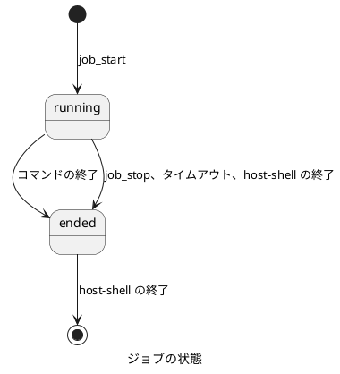

# host-shell リファレンス

この文書は、`host-shell` の起動オプション、MCP サーバーとしての振る舞い、各ツールの入出力、プロセスと操作ログの扱いを定義します。  
導入と使い方は [利用ガイド](user-guide.md)、安全な運用の方法は [運用ガイド](operations.md) を参照してください。

## 目次

- [起動](#起動)
- [MCP サーバーとしての振る舞い](#mcp-サーバーとしての振る舞い)
- [全ツール共通の仕様](#全ツール共通の仕様)
- [文字コードと改行](#文字コードと改行)
- [ツール一覧](#ツール一覧)
- [使い方の案内](#使い方の案内)
- [コマンド実行](#コマンド実行)
- [長時間の実行 (ジョブ)](#長時間の実行-ジョブ)
- [ファイル操作](#ファイル操作)
- [検索](#検索)
- [差分の確認](#差分の確認)
- [特権実行](#特権実行)
- [環境情報](#環境情報)
- [プロセスの起動と終了](#プロセスの起動と終了)
- [操作ログ](#操作ログ)
- [制限事項](#制限事項)

## 起動

### 書式

```text
host-shell --mcp [options]
host-shell --version
```

`--mcp` を指定したときだけ、MCP サーバーとして標準入出力で待ち受けます。  
`--mcp` も `--version` も指定しない場合は、使い方を標準エラーに出力し、終了コード 2 で終了します。

### オプション

| オプション | 値 | 既定値 | 内容 |
|---|---|---|---|
| `--mcp` | なし | | MCP サーバーとして標準入出力で待ち受ける |
| `--version` | なし | | バージョンを標準出力に出力して終了する |
| `--log-file` | パス | 下記の [操作ログ](#操作ログ) を参照 | 操作ログの出力先 |
| `--no-log` | なし | | 操作ログを記録しない。`--log-file` より優先する |
| `--max-output` | バイト数 (1024 以上) | `65536` | 1 つの出力の上限 |
| `--timeout` | 時間 (例: `90s`、`5m`) | `1m` | コマンドのタイムアウトの既定値 |
| `--max-timeout` | 時間 | `30m` | ツールの引数で指定できるタイムアウトの上限。`--timeout` 以上にする |
| `--windows-shell` | `cmd`、`powershell`、`pwsh` | `powershell` | Windows で `shell` を省略したときに使うシェル |

Table: 起動オプション

オプションは `-mcp` のようにハイフン 1 つでも指定できます。  
未知のオプションや、型の合わない値 (数値の位置に文字列など) を指定した場合は、使い方を標準エラーに出力し、終了コード 2 で終了します。  
値の範囲が不正な場合 (`--max-output` が 1024 未満など) は、理由を標準エラーに出力し、終了コード 1 で終了します。

### 入出力と終了

| 項目 | 振る舞い |
|---|---|
| 標準入力 | MCP の JSON-RPC メッセージを 1 行に 1 つずつ受け取る |
| 標準出力 | MCP の JSON-RPC メッセージだけを出力する。それ以外は一切出力しない |
| 標準エラー | 起動の失敗などの診断メッセージを出力する |
| 作業ディレクトリ | 起動したときのディレクトリ。SSH 経由の場合は通常、接続したユーザーのホーム ディレクトリ |
| 正常な終了 | 標準入力が閉じられた (SSH が切断された) とき、または SIGINT、SIGTERM を受けたとき。終了コード 0 |
| 終了時の後始末 | 実行中のジョブをすべて停止する |

Table: 入出力と終了

SSH の 1 つのセッションが 1 つの `host-shell` プロセスに対応します。  
複数のエージェントから同時に接続した場合は、それぞれ独立したプロセスとして動き、ジョブなどの状態は共有しません。

## MCP サーバーとしての振る舞い

| 項目 | 内容 |
|---|---|
| 通信方式 | stdio (改行区切りの JSON-RPC 2.0) |
| プロトコル バージョン | `2024-11-05`、`2025-03-26`、`2025-06-18`、`2025-11-25`、`2026-07-28`。クライアントの要求に合わせて選ぶ |
| サーバー名 | `host-shell` |
| 機能 (capabilities) | `tools`、`resources`、`logging` |
| 受信メッセージの上限 | 1 メッセージ 16 MiB |
| 実装 | [modelcontextprotocol/go-sdk](https://github.com/modelcontextprotocol/go-sdk) v1.8.0 |

Table: MCP サーバーの仕様

### エージェントへの案内

エージェントが、ほかの文書を読まずに MCP の情報だけで使い方を把握できるよう、次の 4 つの層で案内します。

| 層 | 内容 | エージェントが受け取る時点 |
|---|---|---|
| 初期化の応答の `instructions` | 接続先のホスト名、OS とアーキテクチャ、作業ディレクトリ、既定のシェルと文字コード、出力の上限とタイムアウト。ツールの選び方と、守るべき約束 (呼び出しごとに新しいプロセスであることなど) | 接続したとき |
| ツールの `title` と `description` | 何をするか、いつ使うか、何と組み合わせるか | ツールの一覧を取得したとき |
| 引数と出力のスキーマの `description` | 各引数の意味、既定値、続きの読み方 | ツールの一覧を取得したとき |
| [`help`](#help) ツールとリソース | 作業の手順、ツールの選び方、引数の例、Windows での注意、上限 | 必要なときに呼ぶ |

Table: エージェントへの案内

案内はエージェントが読むものなので、英語で書いています。  
`help` の内容は、MCP のリソース (`host-shell://help/<topic>`、`text/markdown`) としても公開します。リソースに対応したクライアントでは、利用者が会話に添付することもできます。

エラーの説明も、エージェントが次に何をすればよいかが分かるように書いています。  
たとえば `fs_edit` で置換する文字列が複数の箇所に一致した場合は、その行番号と、文脈を加えるか `replace_all` を指定するよう返します。

## 全ツール共通の仕様

### 結果の形式

ツールの結果は、`structuredContent` に JSON のオブジェクトとして返します。  
同じ JSON を文字列にしたものを、`content` のテキストとしても返します。  
各ツールの出力の形は、`tools/list` の `outputSchema` で公開しています。  
例外として、`help` は Markdown のテキストだけを `content` に返し、`outputSchema` を持ちません。

### エラー

次の場合は、結果の `isError` を `true` にし、`content` のテキストに理由を返します。

- 引数がスキーマに合わない (必須の引数がない、型が違う、定義にない引数がある)
- ファイルが存在しない、権限がないなど、操作そのものが失敗した
- コマンドを起動できなかった (プログラムが見つからない、シェルがこの OS で使えないなど)

コマンドが起動したあとで 0 以外の終了コードで終わった場合は、エラーではありません。  
結果の `exit_code` で判断してください。

### パスの解釈

パスは接続先のマシン上で解釈します。  
相対パスは、`host-shell` の作業ディレクトリ (通常はホーム ディレクトリ) からの相対です。  
Windows では、`C:/work/a.txt` と `C:\work\a.txt` のどちらの書き方も使えます。  
結果に含めるパスは、特に記載がない限り絶対パスに変換したものです。

### 出力の上限

すべてのツールは、出力の大きさに上限を設けています。  
上限の既定値は 64 KiB で、`--max-output` で変更できます。

| ツール | 上限の単位 | 超えた場合 |
|---|---|---|
| `exec_run`、`sudo_run` | 標準出力と標準エラーのそれぞれ | 先頭と末尾を半分ずつ残し、間に省略の印を入れる。`stdout_truncated` などを `true` にする |
| `job_read` | 1 回の読み取り | `next_offset` から続きを読む |
| `fs_read` | 1 回の読み取り | `truncated` を `true` にし、続きの位置を返す |
| `sys_processes` | 出力全体 | 先頭と末尾を残して省略の印を入れる |
| `fs_list`、`search_*`、`fs_manifest` | 件数 (引数で指定) | `truncated` を `true` にする |

Table: 出力の上限

省略の印は次の形式です。

```text

... [host-shell: 123456 bytes omitted] ...

```

### 文字コード

ツールの入出力のテキストは、常に UTF-8 です。  
接続先のコマンドの出力やファイルが UTF-8 以外の場合は、`host-shell` が UTF-8 との間で変換します。詳しくは [文字コードと改行](#文字コードと改行) を参照してください。

### ツールの注釈

各ツールに、MCP のツール注釈を付けています。  
エージェント側で、承認を必須にするツールを選ぶ目安になります。

| 注釈 | 対象のツール |
|---|---|
| `readOnlyHint: true` | `help`、`job_read`、`job_list`、`fs_list`、`fs_stat`、`fs_read`、`search_grep`、`search_files`、`fs_manifest`、`sys_info`、`sys_processes` |
| `destructiveHint: false`、`idempotentHint: true` | `fs_mkdir` |
| `destructiveHint: true` | `exec_run`、`job_start`、`job_write`、`job_stop`、`fs_edit`、`fs_write`、`fs_move`、`fs_copy`、`fs_remove`、`sudo_run` |

Table: ツールの注釈

すべてのツールで `openWorldHint` は `false` です。

## 文字コードと改行

MCP の通信は常に UTF-8 です。  
`host-shell` は、接続先の文字コード (Shift_JIS、EUC-JP、UTF-16 など) と UTF-8 の違い、改行の違いを、接続先の側で吸収します。

### 接続先の既定の文字コード

自動判定と `system` の指定では、接続先の既定の文字コードを使います。用途によって 2 種類あります。

| 種類 | 使う場面 | Windows | Linux |
|---|---|---|---|
| コンソール | コマンドの出力と標準入力 | OEM コード ページ (`GetOEMCP`) | ロケールの文字コード |
| ファイル | テキスト ファイルの読み書きと検索 | ANSI コード ページ (`GetACP`) | ロケールの文字コード |

Table: 接続先の既定の文字コード

日本語の Windows では、どちらも Shift_JIS (コード ページ 932) です。  
Windows で「ベータ: ワールドワイド言語サポートで Unicode UTF-8 を使用」を有効にしている場合は UTF-8 です。  
Linux では、環境変数 `LC_ALL`、`LC_CTYPE`、`LANG` の順に最初に設定されているものから、`.` の後ろの文字コードを使います (例: `ja_JP.eucJP` なら EUC-JP)。文字コードの部分がない場合 (`C`、`POSIX` など) と、どれも設定されていない場合は UTF-8 です。  
実際の値は、[`sys_info`](#sys_info) の `console_encoding` と `file_encoding` で確かめられます。

### 文字コードの指定

文字コードを指定する引数 (`output_encoding`、`stdin_encoding`、`charset`) には、次の値を指定できます。

| 値 | 意味 |
|---|---|
| `auto` | 自動判定 (下記)。読み取りの引数だけで使え、省略時の既定 |
| `utf-8` | UTF-8。変換しない |
| `system` | 接続先の既定の文字コード (上記) |
| 文字コードの名前 | `shift_jis`、`euc-jp`、`iso-2022-jp`、`utf-16le`、`utf-16be`、`gbk`、`gb18030`、`big5`、`euc-kr`、`windows-1252` など |
| コード ページの番号 | `cp932`、`932`、`cp437`、`cp65001` など |

Table: 文字コードの指定

名前は大文字と小文字を区別しません。[WHATWG Encoding Standard](https://encoding.spec.whatwg.org/#names-and-labels) の名前と別名 (`sjis`、`windows-31j`、`latin1` など) と、`eucjp`、`ujis` などのよく使われる別名を受け付けます。  
`shift_jis` は Windows のコード ページ 932 (CP932、Windows-31J) と同じ文字の集合です。

### 自動判定

読み取りの自動判定は、次の順に行います。

1. ファイルの先頭に BOM (UTF-8、UTF-16LE、UTF-16BE) があれば、その文字コードとします。BOM は内容に含めません。
2. UTF-8 として正しければ、UTF-8 とします。
3. 正しくなければ、接続先の既定の文字コードとします。

コマンドの出力 (`exec_run`、`job_start`、`sudo_run`) と、`search_grep`、`fs_read` の行の範囲では、2 と 3 の判定を **行ごと** に行います。  
UTF-8 の出力と Shift_JIS の出力が混ざっていても、それぞれの行を正しく変換できます。  
`fs_read` のバイトの範囲では、読み取った範囲全体で判定します。

変換に使った文字コードは、結果の `stdout_encoding`、`charset` などで返します。  
UTF-8 として正しくないバイト列のうち、どの文字コードとしても解釈できない部分は、置換文字 (U+FFFD) になります。

### 文字の分断の防止

範囲を区切って読むツールは、範囲の末尾で文字を分断しません。  
末尾の不完全な文字は返さずに、次の読み取りの位置 (`next_offset`) に含めます。  
`exec_run` の出力を切り詰めた場合も、境界で分断された文字は取り除いてから省略の印を入れます。

### 改行

改行は、読み取りでは変換しません。CRLF も LF もそのまま返します。  
`fs_read` は、返した内容に含まれる改行の種類を `newline` (`lf`、`crlf`、`cr`、`mixed`) で返します。  
`fs_write` の `newline` に `lf` または `crlf` を指定すると、書き込む前に改行をそろえます。

既存のファイルを書き換えるときは、`fs_read` が返した `charset`、`bom`、`newline` を `fs_write` に渡すと、元の文字コードと改行を保てます。

### 変換の対象

| ツール | 引数 | 既定 |
|---|---|---|
| `exec_run`、`job_start`、`sudo_run` | `output_encoding` (標準出力と標準エラー) | `auto` (コンソール) |
| | `stdin_encoding` (標準入力) | `utf-8` |
| `job_write` | `job_start` の `stdin_encoding` | `utf-8` |
| `sys_processes` | なし | `auto` (コンソール) |
| `fs_read` (`text`) | `charset` | `auto` (ファイル) |
| `fs_edit` | `charset` | `auto` (ファイル)。読んだときの文字コード、BOM、改行で書き戻す |
| `fs_write` (`text`) | `charset`、`newline`、`bom` | `utf-8`、変換しない、BOM なし |
| `search_grep` | `charset` | `auto` (ファイル) |

Table: 文字コードの変換の対象

`base64` で読み書きする場合は、文字コードも改行も変換しません。

## ツール一覧

| 分類 | ツール | 内容 |
|---|---|---|
| 使い方の案内 | [`help`](#help) | 使い方の説明を返す |
| コマンド実行 | [`exec_run`](#exec_run) | コマンドを実行し、終了を待って結果を返す |
| 長時間の実行 | [`job_start`](#job_start) | コマンドをバックグラウンドで開始する |
| | [`job_read`](#job_read) | ジョブの出力と状態を取得する |
| | [`job_write`](#job_write) | ジョブの標準入力に送る |
| | [`job_stop`](#job_stop) | ジョブを停止する |
| | [`job_list`](#job_list) | ジョブの一覧を取得する |
| ファイル操作 | [`fs_list`](#fs_list) | ディレクトリの一覧を取得する |
| | [`fs_stat`](#fs_stat) | ファイルの属性を取得する |
| | [`fs_read`](#fs_read) | ファイルを読む |
| | [`fs_edit`](#fs_edit) | ファイルの一部を置換する |
| | [`fs_write`](#fs_write) | ファイルを書く |
| | [`fs_mkdir`](#fs_mkdir) | ディレクトリを作る |
| | [`fs_move`](#fs_move) | 移動する、名前を変える |
| | [`fs_copy`](#fs_copy) | コピーする |
| | [`fs_remove`](#fs_remove) | 削除する |
| 検索 | [`search_grep`](#search_grep) | ファイルの内容を正規表現で検索する |
| | [`search_files`](#search_files) | ファイル名やパスの glob で検索する |
| 差分の確認 | [`fs_manifest`](#fs_manifest) | ファイルのハッシュの一覧を取得する |
| 特権実行 | [`sudo_run`](#sudo_run) | sudo でコマンドを実行する (Linux のみ) |
| 環境情報 | [`sys_info`](#sys_info) | 接続先の環境を取得する |
| | [`sys_processes`](#sys_processes) | プロセスの一覧を取得する |

Table: ツール一覧

以降の表で、「必須」の列が空の引数は省略できます。

## 使い方の案内

### help

エージェント向けの使い方の説明を、Markdown のテキストで返します。

| 引数 | 型 | 必須 | 内容 |
|---|---|---|---|
| `topic` | string | | 説明の主題。省略時は `overview`。`all` ですべてをつなげて返す |

Table: help の引数

| topic | 内容 |
|---|---|
| `overview` | 仕組み、ツールの早見表、推奨する作業の手順。先頭に接続先の情報 (下記) を付ける |
| `files` | `fs_read` の読み方、`fs_write` のモード、ファイル操作のツール、`fs_manifest` |
| `edit` | `fs_edit` の使い方と規則 |
| `search` | glob の構文、`search_grep` の出力モード、`search_files` |
| `commands` | `exec_run`、`sudo_run`、ツールの選び方 |
| `jobs` | ジョブの使い方と、`job_write` による入力 |
| `encoding` | 文字コードと改行 |
| `windows` | Windows の接続先での注意 |
| `limits` | 出力の上限、タイムアウト、エラー、操作ログ。先頭に接続先の情報を付ける |

Table: help の topic

接続先の情報は、ホスト名、OS とアーキテクチャ、ユーザー、作業ディレクトリ、既定のシェル、既定の文字コード、出力の上限、タイムアウトの表です。  
未知の `topic` を指定した場合は、指定できる値を示してエラーにします。

各 topic は、リソース `host-shell://help/<topic>` としても読めます。内容は `help` の結果と同じです。

## コマンド実行

### exec_run

コマンドを実行し、終了を待って結果を返します。  
シェルのコマンド行を渡す `command` と、シェルを介さずにプログラムを起動する `argv` のどちらか一方を指定します。

| 引数 | 型 | 必須 | 内容 |
|---|---|---|---|
| `command` | string | ※ | シェルに渡すコマンド行 |
| `argv` | string[] | ※ | シェルを介さずに起動するプログラムと引数。先頭がプログラム |
| `shell` | string | | `command` を解釈するシェル。省略時は OS の既定 ([シェル](#シェル) を参照) |
| `cwd` | string | | 作業ディレクトリ。省略時は `host-shell` の作業ディレクトリ |
| `env` | object | | 追加、上書きする環境変数 (名前と値の組) |
| `stdin` | string | | 標準入力に渡すテキスト。渡したあとに閉じる。省略時は空の入力 |
| `timeout_sec` | integer | | タイムアウト (秒)。省略時は `--timeout`、上限は `--max-timeout` |
| `output_encoding` | string | | 標準出力と標準エラーの文字コード。省略時は `auto` ([文字コードの指定](#文字コードの指定)) |
| `stdin_encoding` | string | | `stdin` を変換する文字コード。省略時は `utf-8`。`auto` は指定できない |

Table: exec_run の引数 (※ command と argv のどちらか一方が必須)

呼び出しごとに新しいプロセスを起動します。前の呼び出しの `cd` や環境変数の設定は引き継ぎません。`cwd` と `env` で指定してください。

| 出力 | 型 | 内容 |
|---|---|---|
| `exit_code` | integer | 終了コード。シグナルで終了した場合などは -1 |
| `stdout` | string | 標準出力 |
| `stderr` | string | 標準エラー |
| `stdout_truncated` | boolean | 標準出力を切り詰めた場合に `true` |
| `stderr_truncated` | boolean | 標準エラーを切り詰めた場合に `true` |
| `stdout_encoding` | string | 標準出力を UTF-8 以外から変換した場合に、その文字コード |
| `stderr_encoding` | string | 標準エラーを UTF-8 以外から変換した場合に、その文字コード |
| `timed_out` | boolean | タイムアウトで停止した場合に `true` |
| `duration_ms` | integer | 実行にかかった時間 (ミリ秒) |

Table: exec_run の出力

タイムアウトになると、コマンドを子孫のプロセスも含めて強制終了し、それまでの出力を返します。  
このときの `exit_code` は OS によって異なります (Linux では -1)。`timed_out` で判断してください。

```json
{"command": "systemctl status nginx --no-pager", "timeout_sec": 10}
```

```json
{"argv": ["git", "-C", "/srv/app", "log", "-5", "--oneline"]}
```

```json
{"command": "Get-Service | Where-Object Status -eq Running", "shell": "powershell"}
```

```json
{"command": "dir C:\\work", "shell": "cmd"}
```

日本語の Windows の cmd の出力は Shift_JIS ですが、`output_encoding` の既定の `auto` により UTF-8 に変換して返し、`stdout_encoding` は `shift_jis` になります。

## 長時間の実行 (ジョブ)

ビルドやログの監視など、終了を待つと時間がかかるコマンドは、ジョブとしてバックグラウンドで実行します。



ジョブの仕様は次のとおりです。

- 識別子は `job-1`、`job-2` のように、`host-shell` のプロセスごとに 1 から振ります。
- 標準出力と標準エラーは、1 つのストリームにまとめ、UTF-8 に変換してから保持します。`offset` や `output_bytes` は、変換後の UTF-8 のバイト数で数えます。
- 出力は、直近の少なくとも `--max-output` の 4 倍 (既定で 256 KiB) を保持し、それより古い部分は破棄します。
- 終了したジョブも、`host-shell` が終了するまで一覧に残ります。
- `host-shell` が終了する (SSH が切断される) と、実行中のジョブはすべて停止します。切断後も動かし続けたい処理には、`nohup` やサービスとしての登録など、OS の仕組みを使ってください。

### job_start

コマンドをバックグラウンドで開始し、すぐにジョブの状態を返します。  
引数は [`exec_run`](#exec_run) の引数に、次の 1 つを加えたものです。  
ただし、`timeout_sec` を省略した場合は時間制限なしで実行し、指定した場合も `--max-timeout` で制限しません。

| 引数 | 型 | 必須 | 内容 |
|---|---|---|---|
| `stdin_open` | boolean | | 標準入力を開いたままにし、[`job_write`](#job_write) で後から送れるようにする。`stdin` を指定した場合は、それを最初に送る |

Table: job_start に固有の引数

`stdin_open` を指定しない場合、標準入力は `exec_run` と同じく、`stdin` を渡したあとに閉じるか、空の入力です。

出力は、後述の [ジョブの状態](#ジョブの状態) です。

### job_read

ジョブの出力を、指定した位置から読みます。ジョブの状態も一緒に返します。

| 引数 | 型 | 必須 | 内容 |
|---|---|---|---|
| `id` | string | ○ | ジョブの識別子 |
| `offset` | integer | | 読み始める位置 (ジョブの開始からのバイト数)。前回の `next_offset` を指定する |
| `max_bytes` | integer | | 読み取る最大のバイト数。省略時と、`--max-output` を超える場合は `--max-output` |
| `wait_sec` | integer | | `offset` より後の出力が届くか、ジョブが終了するまで待つ秒数 (最大 30) |

Table: job_read の引数

| 出力 | 型 | 内容 |
|---|---|---|
| `status` | object | [ジョブの状態](#ジョブの状態) |
| `output` | string | 読み取った出力 |
| `next_offset` | integer | 次に読み始める位置 |
| `more` | boolean | `next_offset` より後の出力がすでにある場合に `true`。待たずに続けて読める |
| `dropped` | integer | `offset` の位置がすでに破棄されていて、読めなかったバイト数 |

Table: job_read の出力

出力を最後まで読むには、`next_offset` を渡しながら繰り返し呼び、`status.running` が `false` で `output` が空になったら終わります。  
`wait_sec` を指定すると、出力がない間に繰り返し呼ぶ回数を減らせます。

### job_write

`stdin_open` を指定して開始したジョブの標準入力に、テキストを送ります。標準入力を閉じることもできます。

| 引数 | 型 | 必須 | 内容 |
|---|---|---|---|
| `id` | string | ○ | ジョブの識別子 |
| `input` | string | | 送るテキスト。改行は自動では付けない。行を送るときは末尾に `\n` を含める |
| `close` | boolean | | `input` を送ったあとに標準入力を閉じる (入力の終わりを伝える。端末の Ctrl-D に相当) |

Table: job_write の引数 (input と close の少なくとも一方が必須)

| 出力 | 型 | 内容 |
|---|---|---|
| `status` | object | [ジョブの状態](#ジョブの状態) |
| `bytes_written` | integer | 送ったバイト数 (文字コードの変換後) |

Table: job_write の出力

`input` は、`job_start` の `stdin_encoding` で変換してから送ります。  
子プロセスが入力を読まず、10 秒以内に送り終わらない場合はエラーを返します。送り残した分は裏で送り続けます。  
標準入力が開いていない場合 (`stdin_open` を指定していない、閉じた、ジョブが終了した) はエラーにします。

疑似端末を使わないため、端末でないと問い合わせをしないプログラムや、出力をためこむプログラムがあります。非対話のオプションがあればそちらを使ってください。

```json
{"id": "job-3", "input": "y\n"}
```

### job_stop

ジョブを子孫のプロセスも含めて強制終了し、終了を最大 5 秒待ってから状態を返します。

| 引数 | 型 | 必須 | 内容 |
|---|---|---|---|
| `id` | string | ○ | ジョブの識別子 |

Table: job_stop の引数

すでに終了したジョブに対して呼んでも、エラーにはなりません。

### job_list

このセッションで開始したすべてのジョブの状態を、開始した順に返します。引数はありません。

| 出力 | 型 | 内容 |
|---|---|---|
| `jobs` | object[] | [ジョブの状態](#ジョブの状態) の配列 |

Table: job_list の出力

### ジョブの状態

| 項目 | 型 | 内容 |
|---|---|---|
| `id` | string | ジョブの識別子 |
| `command` | string | 実行したコマンド (`argv` の場合は空白でつないだもの) |
| `pid` | integer | プロセス ID |
| `running` | boolean | 実行中の場合に `true` |
| `stdin_open` | boolean | 標準入力が開いていて、`job_write` で送れる場合に `true` |
| `exit_code` | integer | 終了コード。終了した場合だけ含める |
| `output_encoding` | string | 出力を UTF-8 以外から変換した場合に、その文字コード |
| `error` | string | 終了を待つ処理で起きたエラー。通常は含めない |
| `started_at` | string | 開始した時刻 (RFC 3339) |
| `ended_at` | string | 終了した時刻 (RFC 3339)。終了した場合だけ含める |
| `output_bytes` | integer | これまでに出力された合計のバイト数 |

Table: ジョブの状態

## ファイル操作

### fs_list

ディレクトリの中の項目を、名前の順に返します。

| 引数 | 型 | 必須 | 内容 |
|---|---|---|---|
| `path` | string | | ディレクトリのパス。省略時は作業ディレクトリ |
| `max_entries` | integer | | 返す項目の最大数。省略時は 1000 |

Table: fs_list の引数

| 出力 | 型 | 内容 |
|---|---|---|
| `path` | string | ディレクトリの絶対パス |
| `entries` | object[] | 項目の配列 (下記) |
| `truncated` | boolean | `max_entries` で打ち切った場合に `true` |

Table: fs_list の出力

各項目は次の形です。シンボリック リンクはたどらず、リンクそのものの情報を返します。

| 項目 | 型 | 内容 |
|---|---|---|
| `name` | string | 名前 |
| `type` | string | `file`、`dir`、`symlink`、`other` のいずれか |
| `size` | integer | サイズ (バイト) |
| `mode` | string | 権限の表記 (例: `-rw-r--r--`、`drwxr-xr-x`) |
| `mod_time` | string | 更新時刻 (RFC 3339) |

Table: ディレクトリの項目

### fs_stat

ファイルまたはディレクトリの属性を返します。  
パスの最後がシンボリック リンクの場合は、リンクそのものの属性と、リンク先を返します。

| 引数 | 型 | 必須 | 内容 |
|---|---|---|---|
| `path` | string | ○ | パス |

Table: fs_stat の引数

| 出力 | 型 | 内容 |
|---|---|---|
| `path` | string | 絶対パス |
| `entry` | object | 属性 ([fs_list](#fs_list) の項目と同じ形) |
| `link_target` | string | シンボリック リンクの場合のリンク先 |

Table: fs_stat の出力

### fs_read

ファイルを読みます。読み方は次の 3 とおりです。

| 読み方 | 指定 | 用途 |
|---|---|---|
| 行の範囲 | `line_start` を指定する (`encoding` は `text`) | ソース コードやログの一部を読む |
| バイトの範囲 (テキスト) | `line_start` を省略する | 先頭から順に読む |
| バイトの範囲 (base64) | `encoding` に `base64` を指定する | バイナリ ファイルを読む。バイト列をそのまま扱う |

Table: fs_read の読み方

| 引数 | 型 | 必須 | 内容 |
|---|---|---|---|
| `path` | string | ○ | ファイルのパス |
| `encoding` | string | | `text` (既定) または `base64` |
| `charset` | string | | `text` の場合のファイルの文字コード。省略時は `auto` ([文字コードの指定](#文字コードの指定)) |
| `line_start` | integer | | 読み始める行 (1 から数える)。指定すると `offset` と `length` は無視する |
| `line_count` | integer | | 読む行数。省略時は 2000 |
| `line_numbers` | boolean | | 行の範囲の場合に、各行の先頭に行番号とタブを付ける (`cat -n` と同じ形)。`line_start` が必要 |
| `offset` | integer | | 読み始める位置 (バイト)。省略時は 0 |
| `length` | integer | | 読む最大のバイト数。省略時は上限まで |

Table: fs_read の引数

| 出力 | 型 | 内容 |
|---|---|---|
| `path` | string | 絶対パス |
| `size` | integer | ファイルのサイズ (バイト) |
| `encoding` | string | `text` または `base64` |
| `charset` | string | `text` の場合に、変換に使った文字コード。`fs_write` の `charset` に渡すと文字コードを保てる |
| `bom` | boolean | ファイルの先頭に BOM がある場合に `true`。BOM は `content` に含めない |
| `newline` | string | `content` に含まれる改行の種類 (`lf`、`crlf`、`cr`、`mixed`)。改行がなければ含めない |
| `content` | string | 読み取った内容 |
| `eof` | boolean | ファイルの末尾まで読んだ場合に `true` |
| `next_offset` | integer | バイトの範囲の場合に、続きを読む位置 |
| `next_line` | integer | 行の範囲の場合に、続きを読む行。末尾まで読んだ場合は含めない |
| `truncated` | boolean | 要求した範囲より前に上限に達した場合に `true` |

Table: fs_read の出力

1 回に読む量の上限は次のとおりです。

- テキストは、UTF-8 に変換した後の大きさで `--max-output` まで読みます。行の範囲では、上限を超える前の行までを返します。1 行だけで上限を超える場合は、その行を切り詰めて返し、次の行へ進めます。
- base64 は、変換後の大きさが `--max-output` に収まるよう、その 4 分の 3 (既定で 48 KiB) まで読みます。

行の内容は改行文字を含めてそのまま返します。CRLF も変換しません。  
`line_numbers` を指定すると、各行を `     12\t内容` のように、6 桁に右寄せした行番号とタブで始めます。この接頭辞はファイルの内容ではないため、`fs_edit` や `fs_write` に渡さないでください。  
バイトの範囲をテキストで読む場合、`offset` と `next_offset` はファイルのバイト数です。範囲の末尾で分断された文字は、次の読み取りに回します。`offset` に文字の途中を指定した場合、その文字は置換文字になります。  
`offset` が 0 のときに BOM がある場合は、BOM の後ろから読みます。

```json
{"path": "/var/log/nginx/error.log", "line_start": 1, "line_count": 200}
```

```json
{"path": "C:/work/legacy.bat", "charset": "shift_jis", "line_start": 1}
```

```json
{"path": "C:/tools/app.exe", "encoding": "base64", "offset": 0}
```

### fs_write

ファイルを書きます。

| 引数 | 型 | 必須 | 内容 |
|---|---|---|---|
| `path` | string | ○ | ファイルのパス |
| `content` | string | ○ | 書き込む内容 |
| `encoding` | string | | `content` の形式。`text` (既定) または `base64` |
| `charset` | string | | `text` の場合に書き込む文字コード。省略時は `utf-8`。`auto` は指定できない |
| `newline` | string | | `text` の場合の改行の変換。`keep` (既定、変換しない)、`lf`、`crlf` |
| `bom` | boolean | | `text` の場合に、先頭に BOM を付ける。`utf-8`、`utf-16le`、`utf-16be` だけで使え、ファイルの先頭に書く場合 (`append` でなく、`offset` が 0 または省略) に限る |
| `mode` | string | | `overwrite` (既定)、`append`、`create` のいずれか (下記) |
| `offset` | integer | | この位置 (バイト) から書き込む。ファイルを切り詰めず、書き込んだ範囲だけを置き換える (下記) |
| `make_dirs` | boolean | | 親ディレクトリがない場合に作る (権限は `0755`) |
| `perm` | string | | 新しく作るファイルの権限を 8 進数で指定する (例: `0600`)。既定は `0644`。umask の影響を受ける。Windows では無視する |

Table: fs_write の引数

| mode | 振る舞い |
|---|---|
| `overwrite` | ファイルがなければ作り、あれば内容を置き換える |
| `append` | ファイルがなければ作り、あれば末尾に追加する |
| `create` | ファイルがなければ作る。すでにある場合はエラーにする |

Table: fs_write の mode

`offset` を指定した場合の振る舞いは次のとおりです。

| mode | offset を指定したときの振る舞い |
|---|---|
| `overwrite` (既定) | ファイルがなければ作る。切り詰めずに、`offset` から `content` の長さの範囲だけを置き換える。それ以外の部分は変わらない |
| `append` | 指定できない (エラー) |
| `create` | ファイルがなければ作り、`offset` から書き込む。すでにある場合はエラーにする |

Table: fs_write の offset

`offset` は 0 以上です。`0` を指定した場合も、省略した場合と違ってファイルを切り詰めません。  
ファイルの末尾より後ろの位置を指定すると、末尾から `offset` までの間は 0 のバイトで埋まります (ファイル システムによっては疎なファイルになります)。

| 出力 | 型 | 内容 |
|---|---|---|
| `path` | string | 絶対パス |
| `bytes_written` | integer | 書き込んだバイト数 |
| `size` | integer | 書き込んだ後のファイルのサイズ (バイト) |

Table: fs_write の出力

`text` の場合は、改行の変換、文字コードの変換、BOM の付加の順に処理します。  
`charset` で表せない文字 (Shift_JIS に絵文字など) が含まれる場合は、文字と位置を示してエラーにし、何も書き込みません。  
`base64` の場合に `charset`、`newline`、`bom` を指定するとエラーになります。

`offset` を省略した `overwrite` は、既存のファイルをその場で書き換えます。所有者と権限は維持しますが、書き込みの途中で失敗すると内容が不完全になります。  
1 回の呼び出しで送れる大きさは、MCP の受信メッセージの上限 (16 MiB) に収まる範囲です。大きなファイルは `offset` か `append` で分割して送ってください。

```json
{"path": "/srv/data/image.bin", "content": "AAECAw==", "encoding": "base64", "offset": 1048576}
```

```json
{"path": "C:/work/run.bat", "content": "@echo off\necho 完了\n", "charset": "shift_jis", "newline": "crlf"}
```

既存のファイルの一部を変更する場合は、ファイル全体を送り直す `fs_write` より、[`fs_edit`](#fs_edit) を使ってください。

### fs_edit

既存のファイルの中の文字列を、完全に一致する箇所だけ置換します。  
ファイルの文字コード、BOM、改行を判定し、置換したあとも同じ形式で書き戻します。

置換の指定は、`old_string` と `new_string` (1 つの置換) か、`edits` (複数の置換) のどちらか一方で行います。

| 引数 | 型 | 必須 | 内容 |
|---|---|---|---|
| `path` | string | ○ | ファイルのパス |
| `old_string` | string | ※ | 置換する文字列。空白、インデント、改行を含めて完全に一致させる |
| `new_string` | string | | 置換後の文字列。空の場合は `old_string` を削除する |
| `replace_all` | boolean | | 一致するすべての箇所を置換する。省略時は、一致する箇所がちょうど 1 つでなければエラー |
| `edits` | object[] | ※ | 複数の置換。各要素は `old_string`、`new_string`、`replace_all`。順に適用し、各置換は前の置換の結果に対して行う |
| `charset` | string | | ファイルの文字コード。省略時は `auto` ([自動判定](#自動判定)) |
| `dry_run` | boolean | | 置換を確かめて結果を返し、ファイルには書き込まない |

Table: fs_edit の引数 (※ old_string と edits のどちらか一方が必須)

| 出力 | 型 | 内容 |
|---|---|---|
| `path` | string | 絶対パス |
| `replacements` | integer | 置換した箇所の合計 |
| `lines` | integer[] | 置換した箇所が始まる行 (置換後のファイルの行番号)。最大 50 件 |
| `snippet` | string | 置換した範囲と前後 2 行を、行番号付きで返す (最大 80 行)。離れた範囲の間は `...` |
| `charset` | string | 読み書きに使った文字コード |
| `bom` | boolean | ファイルに BOM がある場合に `true` (そのまま残す) |
| `newline` | string | 置換後のファイルの改行の種類 |
| `size` | integer | 置換後のファイルのサイズ (バイト) |
| `sha256` | string | 置換後のファイルの SHA-256 |
| `dry_run` | boolean | `dry_run` を指定した場合に `true` |

Table: fs_edit の出力

置換の規則は次のとおりです。

- 1 つでも置換に失敗した場合は、ファイルに何も書き込みません。
- `old_string` が見つからない場合は、エラーにします。各行の前後の空白を無視すると一致する箇所があれば、その行番号もエラーの説明に含めます。
- `old_string` が複数の箇所に一致し、`replace_all` を指定していない場合は、一致した行番号 (最大 10 件) を示してエラーにします。
- 改行が CRLF のファイルでは、`old_string` と `new_string` の LF を CRLF とみなして照合し、CRLF で書き込みます。エージェントは改行を LF で書けます。
- `old_string` と `new_string` が同じ場合はエラーにします。

文字コードは、BOM があればそれを使い、なければ UTF-8 として正しいかを調べ、正しくなければ接続先の既定の文字コードとみなします。  
`fs_read` と違い、行ごとではなくファイル全体で 1 つの文字コードに決めます。  
判定した文字コードで読んで書き戻したときに元のバイト列を再現できない場合は、文字コードの判定が誤っているとみなしてエラーにします。`charset` を指定してください。  
置換後の文字列が、その文字コードで表せない文字を含む場合もエラーにします。

扱えるファイルの大きさは 32 MiB までです。これより大きいファイルは、`fs_write` の `offset` で書き換えてください。  
ファイルはその場で書き換えます。所有者と権限は維持します。

```json
{"path": "/etc/app/config.yml", "old_string": "  port: 8080\n", "new_string": "  port: 9090\n"}
```

```json
{"path": "src/main.c", "edits": [
  {"old_string": "#include <stdio.h>\n", "new_string": "#include <stdio.h>\n#include <string.h>\n"},
  {"old_string": "MAX_LEN 64", "new_string": "MAX_LEN 256", "replace_all": true}
]}
```

### fs_mkdir

ディレクトリを作ります。親のディレクトリがなければ、それも作ります (権限は `0755`)。

| 引数 | 型 | 必須 | 内容 |
|---|---|---|---|
| `path` | string | ○ | 作るディレクトリのパス |

Table: fs_mkdir の引数

| 出力 | 型 | 内容 |
|---|---|---|
| `path` | string | 絶対パス |
| `created` | boolean | 作った場合に `true`。すでにあった場合は `false` |

Table: fs_mkdir の出力

ディレクトリがすでにある場合はエラーにしません。同じ名前のファイルがある場合はエラーにします。

### fs_move

ファイルやディレクトリを移動します。名前の変更にも使います。

| 引数 | 型 | 必須 | 内容 |
|---|---|---|---|
| `source` | string | ○ | 移動するファイルまたはディレクトリ |
| `destination` | string | ○ | 移動先のパス。移動先のディレクトリではなく、移動後のパスそのものを指定する |
| `overwrite` | boolean | | 移動先にファイルがある場合に置き換える。移動先がディレクトリの場合は指定してもエラー |
| `make_dirs` | boolean | | 移動先の親のディレクトリがなければ作る |

Table: fs_move の引数

| 出力 | 型 | 内容 |
|---|---|---|
| `source` | string | 移動元の絶対パス |
| `destination` | string | 移動先の絶対パス |
| `copied` | boolean | ファイル システムをまたいだため、コピーしてから移動元を削除した場合に `true` |

Table: fs_move の出力

移動先の親のディレクトリがない場合は、`make_dirs` を指定しない限りエラーにします。  
ファイル システム (Windows ではドライブ) をまたぐ移動は、コピーしてから移動元を削除します。コピーの途中で失敗した場合、移動元は残します。

### fs_copy

ファイルをコピーします。`recursive` を指定すると、ディレクトリを中身ごとコピーします。

| 引数 | 型 | 必須 | 内容 |
|---|---|---|---|
| `source` | string | ○ | コピーするファイルまたはディレクトリ |
| `destination` | string | ○ | コピー先のパス。コピー先のディレクトリではなく、コピーそのもののパスを指定する |
| `recursive` | boolean | | ディレクトリをコピーする場合に必要 |
| `overwrite` | boolean | | コピー先にファイルがある場合に置き換える。ディレクトリどうしの場合は中身を統合する |
| `make_dirs` | boolean | | コピー先の親のディレクトリがなければ作る |

Table: fs_copy の引数

| 出力 | 型 | 内容 |
|---|---|---|
| `source` | string | コピー元の絶対パス |
| `destination` | string | コピー先の絶対パス |
| `files` | integer | コピーしたファイルの数 |
| `dirs` | integer | 作ったディレクトリの数 |
| `symlinks` | integer | 作り直したシンボリック リンクの数 |
| `bytes` | integer | コピーしたバイト数 |

Table: fs_copy の出力

コピーの仕様は次のとおりです。

- ファイルの権限と更新時刻を引き継ぎます。所有者は引き継ぎません (コピーしたユーザーになります)。
- シンボリック リンクはたどらず、同じリンク先を指すリンクを作ります。
- 通常のファイル、ディレクトリ、シンボリック リンク以外 (デバイスなど) は飛ばします。
- コピー先がコピー元のディレクトリの中にある場合は、エラーにします。
- 途中で失敗した場合は、それまでにコピーしたものを残し、コピーしたファイルの数をエラーの説明に含めます。

### fs_remove

ファイル、シンボリック リンク、ディレクトリを削除します。

| 引数 | 型 | 必須 | 内容 |
|---|---|---|---|
| `path` | string | ○ | 削除するパス。シンボリック リンクは、リンク先ではなくリンクそのものを削除する |
| `recursive` | boolean | | 空でないディレクトリを、中身ごと削除する場合に必要 |
| `missing_ok` | boolean | | パスが存在しない場合もエラーにしない |

Table: fs_remove の引数

| 出力 | 型 | 内容 |
|---|---|---|
| `path` | string | 絶対パス |
| `removed` | boolean | 削除した場合に `true`。`missing_ok` でパスがなかった場合は `false` |
| `type` | string | 削除したものの種類 (`file`、`dir`、`symlink`、`other`) |

Table: fs_remove の出力

ファイル システムのルート (`/`、`C:\` など) と、`host-shell` を実行しているユーザーのホーム ディレクトリは削除しません。エラーにします。  
これは誤操作を防ぐためのもので、権限による制限の代わりにはなりません。

## 検索

`search_grep`、`search_files`、`fs_manifest` は、指定したディレクトリの下を再帰的にたどります。共通の仕様は次のとおりです。

- 名前の順にたどります。
- シンボリック リンクはたどりません。
- `exclude_dirs` に挙げた名前のディレクトリには降りません。省略時は `.git`、`.hg`、`.svn` です。空の配列を指定すると、どのディレクトリも除外しません。
- 権限がないなどで読めなかった項目は飛ばし、その数を `skipped` に返します。
- 結果のパスは、`path` に指定したパスにつなげたものです。`path` が相対パスなら、結果も相対パスです。

### glob

`search_grep` と `fs_manifest` の `include`、`search_files` の `pattern` は、次の glob です。

| 書き方 | 意味 |
|---|---|
| `/` を含まない (`*.go`) | 項目の名前 (パスの最後の要素) と照合する |
| `/` を含む (`src/**/*.ts`) | `path` からの相対パス (区切りは `/`) と照合する。先頭の `./` は無視する |
| `*`、`?` | パスの 1 つの要素の中の、任意の文字列と任意の 1 文字 |
| `**` | 0 個以上のディレクトリ。`/` で区切った要素として書く (`**/test/*.py`) |
| `[abc]`、`[a-z]` | 文字の集合 |
| `{a,b}` | いずれかの文字列 (`*.{yml,yaml}`)。入れ子にはできない |

Table: glob の構文

Windows の接続先では、大文字と小文字を区別せずに照合し、`\` も区切りとして受け付けます。  
不正な glob (閉じていない `[` など) はエラーにします。

### search_grep

ファイルの内容を、行ごとに正規表現で検索します。

| 引数 | 型 | 必須 | 内容 |
|---|---|---|---|
| `pattern` | string | ○ | 正規表現 ([RE2 の構文](https://github.com/google/re2/wiki/Syntax))。後方参照と先読みは使えない |
| `path` | string | | 検索するディレクトリまたはファイル。省略時は作業ディレクトリ |
| `include` | string | | 対象のファイルの [glob](#glob) (例: `*.go`、`src/**/*.ts`) |
| `exclude_dirs` | string[] | | 降りないディレクトリの名前 |
| `ignore_case` | boolean | | 大文字と小文字を区別しない |
| `literal` | boolean | | `pattern` を正規表現ではなく、そのままの文字列として検索する |
| `output_mode` | string | | `content` (既定、一致した行)、`files` (一致したファイルのパスだけ)、`count` (ファイルごとの一致した行の数) |
| `context` | integer | | `content` の場合に、一致した行の前後に返す行数 (`grep -C` と同じ) |
| `before` | integer | | `content` の場合に、一致した行の前に返す行数。`context` より優先する (`grep -B`) |
| `after` | integer | | `content` の場合に、一致した行の後に返す行数。`context` より優先する (`grep -A`) |
| `max_matches` | integer | | 返す最大数。`content` では行の数、`files` と `count` ではファイルの数。省略時は 200 |
| `max_file_bytes` | integer | | これより大きいファイルを飛ばす。省略時は 10 MiB |
| `charset` | string | | ファイルの文字コード。省略時は `auto` ([文字コードの指定](#文字コードの指定)) |

Table: search_grep の引数

| 出力 | 型 | 内容 |
|---|---|---|
| `matches` | object[] | `content` の場合に、一致した行の配列 (下記)。一致がなければ含めない |
| `files` | object[] | `files` と `count` の場合に、一致したファイルの配列。各要素は `path` と、`count` の場合の `count` (一致した行の数) |
| `files_scanned` | integer | 検索したファイルの数 |
| `files_matched` | integer | 一致があったファイルの数 |
| `skipped` | integer | 読めなかった項目の数 |
| `truncated` | boolean | `max_matches` で打ち切った場合に `true` |

Table: search_grep の出力

| 項目 | 型 | 内容 |
|---|---|---|
| `path` | string | ファイルのパス |
| `line` | integer | 行番号 (1 から数える) |
| `text` | string | UTF-8 に変換した行の内容。改行は含めない |
| `before` | string[] | 前の行 (古い順)。`context` か `before` を指定した場合 |
| `after` | string[] | 後の行。`context` か `after` を指定した場合 |
| `charset` | string | 行を UTF-8 以外から変換した場合に、その文字コード |

Table: search_grep の一致

前後の行が別の一致と重なる場合も、まとめずにそれぞれの一致に含めます。  
`files` と `count` の場合は前後の行を返しません。`files` は、ファイルの最初の一致で次のファイルに進むため、`content` より速く終わります。

次のファイルは検索しません。

- 通常のファイル以外 (シンボリック リンク、デバイスなど)
- 先頭 8000 バイトに NUL を含むファイル (バイナリとみなす)。ただし、UTF-16 の BOM があるファイルと、`charset` に UTF-16 を指定した場合は検索する
- `max_file_bytes` より大きいファイル

1 MiB を超える行があるファイルは、その行の手前までを検索します。  
正規表現は、UTF-8 に変換した後の行に対して照合します。日本語のパターンで、Shift_JIS や EUC-JP のファイルも検索できます。  
`text`、`before`、`after` は、行が 500 バイトを超える場合に先頭 500 バイト (文字の境界まで) に切り詰めます。

```json
{"pattern": "TODO", "path": "/srv/app", "include": "*.{c,h}", "output_mode": "count"}
```

```json
{"pattern": "connect(", "literal": true, "path": "/srv/app/src", "context": 3}
```

### search_files

名前やパスが [glob](#glob) に一致するファイルやディレクトリを探します。

| 引数 | 型 | 必須 | 内容 |
|---|---|---|---|
| `pattern` | string | | glob (例: `*.log`、`**/test/*.py`)。省略時はすべて |
| `path` | string | | 探すディレクトリ。省略時は作業ディレクトリ |
| `type` | string | | `file` (ディレクトリ以外)、`dir`、または省略 (両方) |
| `exclude_dirs` | string[] | | 降りないディレクトリの名前 |
| `sort` | string | | `path` (既定、たどった順) または `mtime` (更新時刻の新しい順) |
| `max_results` | integer | | 返すパスの最大数。省略時は 1000 |

Table: search_files の引数

| 出力 | 型 | 内容 |
|---|---|---|
| `paths` | string[] | 一致したパス。`path` 自身は含めない |
| `skipped` | integer | 読めなかった項目の数 |
| `truncated` | boolean | `max_results` で打ち切った場合に `true` |

Table: search_files の出力

`sort` に `mtime` を指定した場合は、一致したものを最大 10 万件まで集めてから並べ、先頭の `max_results` 件を返します。10 万件を超えた場合は `truncated` を `true` にします。

## 差分の確認

### fs_manifest

ディレクトリの下の通常のファイルについて、相対パス、サイズ、SHA-256 の一覧を返します。  
手元に同じ構成のソースがある場合に、ハッシュを比べて差分のあるファイルだけを `fs_read` で読むために使います。

| 引数 | 型 | 必須 | 内容 |
|---|---|---|---|
| `path` | string | | 基準のディレクトリ。省略時は作業ディレクトリ |
| `include` | string | | 対象のファイルの [glob](#glob) (例: `*.c`、`src/**/*.h`) |
| `exclude_dirs` | string[] | | 降りないディレクトリの名前 |
| `max_files` | integer | | 返すファイルの最大数。省略時は 2000 |

Table: fs_manifest の引数

| 出力 | 型 | 内容 |
|---|---|---|
| `root` | string | 基準のディレクトリの絶対パス |
| `files` | object[] | 各要素は `path` (基準からの相対パス。区切りは常に `/`)、`size`、`sha256` (16 進数の小文字) |
| `skipped` | integer | 読めなかった項目の数 |
| `truncated` | boolean | `max_files` で打ち切った場合に `true` |

Table: fs_manifest の出力

区切りを常に `/` にするため、Windows の接続先の結果も、Linux の手元のファイルと同じ形で比べられます。

## 特権実行

### sudo_run

Linux の接続先で、コマンドを sudo で実行します。Windows の接続先では、このツールは登録されません。

| 引数 | 型 | 必須 | 内容 |
|---|---|---|---|
| `command` | string | ○ | 実行するコマンド行 |
| `user` | string | | 実行するユーザー。省略時は root |
| `cwd` | string | | 作業ディレクトリ |
| `stdin` | string | | コマンドの標準入力に渡すテキスト |
| `timeout_sec` | integer | | タイムアウト (秒)。省略時は `--timeout`、上限は `--max-timeout` |
| `output_encoding` | string | | 出力の文字コード。[`exec_run`](#exec_run) と同じ |
| `stdin_encoding` | string | | 標準入力の文字コード。[`exec_run`](#exec_run) と同じ |

Table: sudo_run の引数

出力は [`exec_run`](#exec_run) と同じです。

実際には次のコマンドを実行します。

```text
sudo -n [-u <user>] -- sh -c '<command>'
```

`-n` を指定するため、sudo はパスワードを尋ねません。パスワードが必要な設定の場合は、sudo がエラーで終了し、その内容が `stderr` に入ります。  
このツールを使うには、sudoers で `sh` の実行を `NOPASSWD` で許可する必要があります。これは実質的にすべてのコマンドの実行を許可することになります。  
許可するコマンドを絞る場合は、`sudo_run` を使わずに、`exec_run` の `argv` で `sudo -n` を呼んでください。設定の例は [運用ガイド](operations.md#sudo-の設定) にあります。

```json
{"argv": ["sudo", "-n", "/usr/bin/systemctl", "restart", "nginx"]}
```

`env` は指定できません。sudo は既定で環境変数を初期化します。

## 環境情報

### sys_info

接続先の環境を返します。引数はありません。  
接続した直後に呼び、OS、既定のシェル、ホーム ディレクトリを確かめてから操作することを推奨します。

| 出力 | 型 | 内容 |
|---|---|---|
| `os` | string | `linux` または `windows` |
| `arch` | string | `amd64` または `arm64` |
| `hostname` | string | ホスト名 |
| `user` | string | ユーザー名 (Windows では `ドメイン\ユーザー`) |
| `uid` | string | ユーザー ID (Windows では SID) |
| `home` | string | ホーム ディレクトリ |
| `cwd` | string | `host-shell` の作業ディレクトリ |
| `path_separator` | string | パスの区切り文字 (`/` または `\`) |
| `default_shell` | string | `exec_run` の既定のシェル |
| `console_encoding` | string | コマンドの入出力の既定の文字コード ([接続先の既定の文字コード](#接続先の既定の文字コード)) |
| `file_encoding` | string | テキスト ファイルの既定の文字コード |
| `num_cpu` | integer | 論理 CPU の数 |
| `pid` | integer | `host-shell` のプロセス ID |
| `executable` | string | `host-shell` の実行ファイルのパス |
| `version` | string | `host-shell` のバージョン |
| `go_version` | string | ビルドに使った Go のバージョン |

Table: sys_info の出力

### sys_processes

プロセスの一覧を、OS の標準のコマンドで取得して返します。

| 引数 | 型 | 必須 | 内容 |
|---|---|---|---|
| `filter` | string | | この文字列を含む行 (大文字と小文字を区別しない) と、見出しの行だけを返す |

Table: sys_processes の引数

| 出力 | 型 | 内容 |
|---|---|---|
| `text` | string | コマンドの出力 |
| `truncated` | boolean | 上限で切り詰めた場合に `true` |

Table: sys_processes の出力

| OS | 実行するコマンド | 形式 |
|---|---|---|
| Linux | `ps -eo pid,ppid,user,stat,etime,args` | 空白区切りの表 |
| Windows | `tasklist /fo csv` | CSV |

Table: sys_processes のコマンド

出力は、コマンドの出力と同じく自動判定で UTF-8 に変換します。

## プロセスの起動と終了

### シェル

`command` は、`shell` で選んだシェルに次の形で渡します。

| shell | OS | 起動の形 |
|---|---|---|
| `sh` | Linux (既定) | `sh -c '<command>'` |
| `bash` | Linux | `bash -c '<command>'` |
| `cmd` | Windows | `"%ComSpec%" /d /s /c "<command>"` |
| `powershell` | Windows (既定) | `powershell.exe -NoProfile -NonInteractive -ExecutionPolicy Bypass -EncodedCommand <base64>` |
| `pwsh` | Windows、Linux | `pwsh -NoProfile -NonInteractive -ExecutionPolicy Bypass -EncodedCommand <base64>` |

Table: シェルの起動の形

Windows の既定のシェルは `--windows-shell` で変更できます。  
その OS で使えないシェルを指定した場合はエラーになります。

PowerShell には、コマンド行を UTF-16LE の base64 にして `-EncodedCommand` で渡します。  
このため、エージェントは cmd や SSH を経由する引用符の解釈を気にせずに、PowerShell の構文だけで書けます。  
また、コマンドの前後に次の処理を加えます。

- 前: `[Console]::OutputEncoding` を UTF-8 にし、PowerShell の出力を UTF-8 にそろえる
- 後: 最後に実行したネイティブ コマンドの終了コード (`$LASTEXITCODE`) が 0 以外なら、それを終了コードにする

コマンドレットのエラーだけでは、終了コードが 0 のままになる場合があります。`stderr` もあわせて確認してください。  
PowerShell の出力は UTF-8 になるため、`output_encoding` の自動判定では変換しません。  
PowerShell から呼んだネイティブ コマンドの出力は、PowerShell が受け取って出力し直す場合があります。Shift_JIS を出力するコマンドが文字化けする場合は、`"shell": "cmd"` で実行してください。

cmd には、Go の引数のエスケープを通さずに、コマンド行をそのまま渡します。`/d` により、レジストリの AutoRun は実行しません。

### argv による起動

`argv` を指定した場合は、シェルを介さずにプログラムを起動します。  
プログラム名にパスの区切りがない場合は、環境変数 `PATH` から探します。  
Windows では、各引数を Windows の標準の規則 (MSVC の規則) でエスケープしてコマンド行を組み立てます。

### 環境変数と標準入力

子プロセスは `host-shell` の環境変数を引き継ぎます。SSH 経由の場合は、sshd が用意したセッションの環境変数です。  
`env` を指定すると、同じ名前の環境変数を上書きし、ない名前は追加します。Windows では、名前の大文字と小文字を区別しません。

`stdin` を省略した場合、子プロセスの標準入力は空 (Linux の `/dev/null`、Windows の `NUL`) です。  
`job_start` で `stdin_open` を指定した場合だけ、標準入力をパイプにして開いたままにします。  
子プロセスが `host-shell` 自身の標準入出力 (MCP の通信路) を受け継ぐことはありません。

### 終了のさせ方

タイムアウト、`job_stop`、`host-shell` の終了のときは、コマンドを子孫のプロセスも含めて強制終了します。

| OS | 方法 | 終了させられないもの |
|---|---|---|
| Linux | コマンドを新しいプロセス グループで起動し、グループ全体に SIGKILL を送る | 自分で別のプロセス グループやセッションに移ったプロセス (`setsid`、デーモン化したプロセスなど) |
| Windows | `taskkill /T /F` でプロセス ツリーを終了させる | 親プロセスがすでに終了していて、ツリーから外れた子孫のプロセス |

Table: 終了のさせ方

コマンドが終了したあとも子孫のプロセスが出力のパイプを開いたままの場合は、最大 2 秒待ってからパイプを閉じ、結果を返します。  
Windows では、コンソール ウィンドウを作らずに起動します。

## 操作ログ

`host-shell` は、すべてのツールの呼び出しを、接続先のログ ファイルに 1 行ずつ JSON で記録します (JSON Lines)。

### 保存先

| OS | 既定の保存先 |
|---|---|
| Linux | `$XDG_STATE_HOME/host-shell/audit.log`。`XDG_STATE_HOME` がない場合は `~/.local/state/host-shell/audit.log` |
| Windows | `%LOCALAPPDATA%\host-shell\audit.log` |

Table: 操作ログの既定の保存先

ディレクトリがなければ権限 `0700` で作り、ファイルは権限 `0600` で作って追記します。  
ログ ファイルを開けない場合、`host-shell` は起動に失敗します。  
複数のセッションが同じファイルに追記します。ローテーションは行いません。

### 形式

```json
{"time":"2026-10-30T08:15:42.42+09:00","level":"INFO","msg":"tool_call","tool":"fs_read","args":{"path":"/nonexistent"},"duration_ms":0,"is_error":true,"error":"open /nonexistent: no such file or directory"}
```

| msg | 記録する時点 | 項目 |
|---|---|---|
| `server_start` | 起動したとき | `version`、`pid` |
| `tool_call` | ツールの呼び出しが終わったとき | `tool`、`args`、`duration_ms`、`is_error`、`error` (エラーの場合) |
| `server_stop` | 終了するとき | `error` (正常な終了では `<nil>`) |

Table: 操作ログの記録

すべての行に、`time` (RFC 3339) と `level` を含めます。

### 記録しない値

`args` には、ツールの引数をそのまま記録します。ただし次の値は置き換えます。

| ツール | 引数 | 記録する値 |
|---|---|---|
| `exec_run`、`job_start`、`sudo_run` | `stdin` | `<N chars>` (N は長さ) |
| `job_write` | `input` | `<N chars>` |
| `fs_edit` | `old_string`、`new_string` (`edits` の中も) | `<N chars>` |
| `fs_write` | `content` | `<N chars, sha256 ...>` (N は長さ、続けて内容の SHA-256) |

Table: 操作ログで置き換える値

`command` と `argv` は、そのまま記録します。パスワードなどの秘密の値をコマンド行に含めないでください。  
秘密の値を渡す必要がある場合は、`stdin` を使ってください。

## 制限事項

- 疑似端末を使わないため、端末を必要とするコマンド (パスワードの入力、`vi`、`top` など) は使えません。非対話のオプション (`-y`、`--batch` など) を指定するか、`stdin` か `job_write` で入力を渡してください。
- `search_grep` と `search_files` は `.gitignore` を解釈しません。`node_modules` などは `exclude_dirs` で除外してください。
- `search_grep` は行ごとに照合します。複数の行にまたがる正規表現は一致しません。
- `sudo` は `-n` (パスワードなし) だけに対応します。`sudo -S` によるパスワードの受け渡しには対応しません。
- 文字コードの自動判定は、UTF-8 として正しいかどうかと BOM だけで行います。UTF-8 以外の文字コードどうし (Shift_JIS と EUC-JP など) は区別しません。接続先の既定と異なる文字コードのファイルは、`charset` で指定してください。
- まれに、UTF-8 以外の短い文字列が、UTF-8 としても正しいバイト列になることがあります。その場合は UTF-8 とみなすため、文字化けします。`output_encoding` や `charset` を明示してください。
- BOM のない UTF-16 は自動判定しません。`charset` に `utf-16le` などを指定してください。
- `host-shell` は PowerShell の標準入力の文字コードを設定しません。日本語を `stdin` で PowerShell に渡して文字化けする場合は、`stdin_encoding` に `system` を指定してください。
- 終了したジョブは、`host-shell` が終了するまで破棄しません。
- 操作ログのローテーションは行いません。
- 動作する OS は、Go 1.25 の要件により、Windows 10 / Windows Server 2016 以降と、Linux カーネル 3.2 以降です。
