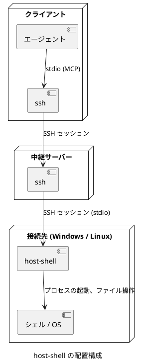
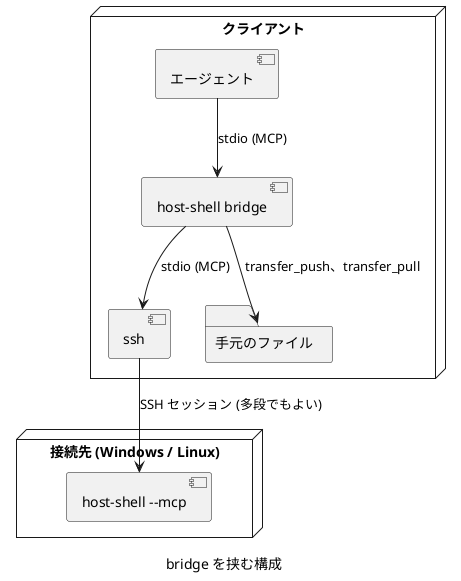

# host-shell 利用ガイド

この文書は、`host-shell` を接続先に配置し、エージェントから使えるようにするまでの手順と、日常の使い方を説明します。  
各ツールの引数と出力の詳細は [リファレンス](reference.md)、安全な運用の方法は [運用ガイド](operations.md) を参照してください。

## 目次

- [仕組み](#仕組み)
- [必要なもの](#必要なもの)
- [実行ファイルの入手](#実行ファイルの入手)
- [接続先への配置](#接続先への配置)
- [SSH の経路の確認](#ssh-の経路の確認)
- [エージェントへの登録](#エージェントへの登録)
- [動作の確認](#動作の確認)
- [使い方](#使い方)
- [トラブルシューティング](#トラブルシューティング)

## 仕組み

`host-shell` は、操作の対象となるマシン (接続先) に置く MCP サーバーです。  
エージェントは「SSH で `host-shell` を起動するコマンド」を MCP の stdio サーバーとして登録します。  
MCP の stdio 方式は、子プロセスの標準入出力で JSON-RPC をやり取りするだけなので、SSH のセッションの標準入出力がそのまま通信路になります。



中継サーバーを経由する場合も、ポート転送 (`-L`、`-R`、`-D`、ProxyJump、`-W`) は使いません。  
中継サーバーの上で次の `ssh` を起動する「入れ子」の形でつなぐため、sshd の `AllowTcpForwarding no` の影響を受けません。  
SFTP も使いません。

この構成には、次の利点があります。

- MCP のセッションの間、SSH の接続を 1 本のまま使い続けるため、多段の接続でもツールを呼ぶたびに接続し直す遅延がありません。
- Windows と Linux の違い (シェル、引用符、パスの書き方) を `host-shell` が吸収するため、エージェントは同じツールを同じ形で呼べます。
- 出力の上限、タイムアウト、操作ログを接続先で一元的に扱えます。

### bridge を挟む構成

手元のマシンで `host-shell bridge` を挟むと、手元と接続先の間でファイルを送れるようになります。



bridge は、接続先の host-shell のツールをそのまま中継し、`transfer_push` (手元から接続先へ) と `transfer_pull` (接続先から手元へ) を加えます。  
送る内容は bridge と接続先の host-shell の間で直接やり取りし、エージェントの文脈を通りません。そのため、大きなファイルやディレクトリの全体も送れます。  
bridge は、接続先と同じ実行ファイルの `bridge` サブコマンドです。手元の OS (Linux、Windows、macOS) 用の実行ファイルを使います。

## 必要なもの

| 場所 | 必要なもの |
|---|---|
| クライアント | MCP の stdio サーバーに対応したエージェント (Claude Code、VS Code の GitHub Copilot など) と、OpenSSH クライアント。bridge を使う場合は、手元の OS 用の `host-shell` (Linux、Windows、macOS 12 以降) |
| 中継サーバー | OpenSSH のクライアントとサーバー。次の段へ接続するための認証手段 (鍵など) |
| 接続先 | OpenSSH サーバー。Windows 10 / Windows Server 2016 以降、または Linux カーネル 3.2 以降 (amd64 または arm64) |

Table: 必要なもの

各段の SSH の認証は、パスワードの入力なしで通る必要があります (公開鍵、ssh-agent など)。  
エージェントが起動する `ssh` は、パスワードの問い合わせに応答できないためです。

## 実行ファイルの入手

OS とアーキテクチャごとに、依存のない実行ファイルが 1 つずつあります。

| OS とアーキテクチャ | ファイル | 使う場所 |
|---|---|---|
| Linux (x86_64) | `host-shell-linux-amd64` | 接続先、手元 (bridge) |
| Linux (aarch64) | `host-shell-linux-arm64` | 接続先、手元 (bridge) |
| Windows (x64) | `host-shell-windows-amd64.exe` | 接続先、手元 (bridge) |
| Windows (ARM64) | `host-shell-windows-arm64.exe` | 接続先、手元 (bridge) |
| macOS (Intel) | `host-shell-darwin-amd64` | 手元 (bridge) |
| macOS (Apple シリコン) | `host-shell-darwin-arm64` | 手元 (bridge) |

Table: 実行ファイル

同じ実行ファイルが、接続先では `--mcp` で MCP サーバーとして、手元では `bridge` サブコマンドで中継として動きます。  
ソースからビルドする場合は、Go 1.26 以降で次を実行します。`dist/` に上の 6 つのファイルができます。

```bash
make dist
```

詳しくは [開発ガイド](development.md) を参照してください。

## 接続先への配置

実行ファイルは、接続先のシステムを汚さないよう、接続に使うユーザーのものである場所に置きます。次の順に選ぶのを推奨します。

| 接続先 | 1. 一時的な場所 (推奨) | 2. ホーム ディレクトリ |
|---|---|---|
| Linux | `/tmp/host-shell-<uid>/host-shell` | `.local/bin/host-shell` (ホーム ディレクトリからの相対パス) |
| Windows | `%TEMP%/host-shell/host-shell.exe` | `%LOCALAPPDATA%/Programs/host-shell/host-shell.exe` |

Table: 配置する場所

- `<uid>` は接続先のユーザーの番号 (`id -u`) です。以降の説明では `/tmp/host-shell-1000/host-shell` と、`%TEMP%` が `C:/Users/alice/AppData/Local/Temp` の場合の `C:/Users/alice/AppData/Local/Temp/host-shell/host-shell.exe` を使います。
- `/tmp` が noexec でマウントされている場合や、Windows の実行の制限 (AppLocker など) で一時的な場所から起動できない場合は、2 番目の場所に置きます。
- `/tmp` のディレクトリは、ほかの利用者が実行ファイルを差し替えられないよう、自分が持ち主で、権限が 700 のものにします。
- `/tmp` と `%TEMP%` の中身は、再起動や定期的な掃除で消えることがあります。消えたら置き直してください。エージェントへの登録はそのまま使えます。
- Linux の `/tmp` の配置先が消えている間は、接続先のほかの利用者が同じ名前のディレクトリを作り、偽の実行ファイルを置けます。登録したコマンドはそれを自分の権限で起動してしまいます。信頼できない利用者もログインできる接続先では、2 番目の場所を使ってください。
- `/opt` などのシステムの場所は、管理者が専用のユーザーを用意して運用する場合に使います ([運用ガイド](operations.md))。
- 空白を含まないパスにします。SSH の各段でコマンド行が解釈し直されるため、空白を含むパスは引用符の扱いが複雑になります。
- Linux の 2 番目の場所は、sshd がホーム ディレクトリでコマンドを始めるため、相対パスのまま使えます。`~` は手元のシェルが展開してしまうため使いません。

エージェントの skill (`.agents/skills/host-shell-connect`) の `scripts/deploy.sh` は、この順に試し、安全の確認、ハッシュの照合、起動の確認までを行います。

### SSH だけで送る

SFTP やポート転送が使えなくても、SSH のセッションの標準入力でファイルを送れます。  
送ったあとは、必ずハッシュを手元と比べてください。

Linux の接続先 (直接):

```bash
ssh target id -u
ssh target 'mkdir -m 700 /tmp/host-shell-1000 && cat > /tmp/host-shell-1000/host-shell && chmod 755 /tmp/host-shell-1000/host-shell' \
    < dist/host-shell-linux-amd64
ssh target sha256sum /tmp/host-shell-1000/host-shell
sha256sum dist/host-shell-linux-amd64
```

`mkdir -m 700` は、ディレクトリがすでにあると失敗します。置き直すときは、`ls -ld /tmp/host-shell-1000` で自分が持ち主で `drwx------` であることを確かめてから、`mkdir` を除いて送ってください。

Linux の接続先 (中継サーバーを経由):

```bash
ssh hop1 "ssh target 'mkdir -m 700 /tmp/host-shell-1000 && cat > /tmp/host-shell-1000/host-shell && chmod 755 /tmp/host-shell-1000/host-shell'" \
    < dist/host-shell-linux-amd64
ssh hop1 "ssh target sha256sum /tmp/host-shell-1000/host-shell"
```

外側の `"..."` は手元のシェルが外し、内側の `'...'` は中継サーバーのシェルが外します。  
リダイレクト (`>`) が接続先で解釈されるよう、引用符の中に入れてください。

Windows の接続先 (sshd の既定のシェルが cmd の場合):

```bash
ssh target "echo %TEMP%"
ssh target "powershell -NoProfile -Command \"New-Item -ItemType Directory -Force C:/Users/alice/AppData/Local/Temp/host-shell | Out-Null; \$i=[Console]::OpenStandardInput(); \$o=[IO.File]::Create('C:/Users/alice/AppData/Local/Temp/host-shell/host-shell.exe'); \$i.CopyTo(\$o); \$o.Close()\"" \
    < dist/host-shell-windows-amd64.exe
ssh target "powershell -NoProfile -Command \"(Get-FileHash C:/Users/alice/AppData/Local/Temp/host-shell/host-shell.exe).Hash\""
sha256sum dist/host-shell-windows-amd64.exe
```

接続先の cmd には `powershell -NoProfile -Command "..."` の形で届き、PowerShell が標準入力のバイト列をそのままファイルに書きます。  
ハッシュが一致しない場合は、sshd の既定のシェルの設定 (`DefaultShell`) を確認してください。

一度 `host-shell` を配置したあとは、新しい版を `fs_write` の `base64` と `offset` で分割して送り、`exec_run` で置き換えることもできます。  
実行中の `host-shell.exe` は Windows では上書きできないため、別の名前で送ってから、次の接続の前に名前を変えてください。

### 取り除く

配置したディレクトリ (`/tmp/host-shell-1000/`、`%TEMP%/host-shell/` など) を消します。  
操作ログを残している場合は、ログ (Linux は `~/.local/state/host-shell/`、Windows は `%LOCALAPPDATA%/host-shell/`) も消します。

### 接続先の確認

配置したら、SSH 経由で起動できることを確かめます。

```bash
ssh -T target /tmp/host-shell-1000/host-shell --version
ssh -T target C:/Users/alice/AppData/Local/Temp/host-shell/host-shell.exe --version
```

`host-shell <バージョン>` と表示されれば配置は完了です。

## SSH の経路の確認

### 疑似端末を割り当てない

各段で `-T` を指定し、疑似端末を割り当てないでください。  
疑似端末が入ると、改行の変換やエコーで JSON-RPC の通信が壊れます。  
`~/.ssh/config` で `RequestTTY` を `yes` や `force` にしている場合も同じです。

### 接続先のシェルが余計な出力をしない

sshd はコマンドを接続先のユーザーのシェルで起動します。  
シェルの初期化ファイル (`.bashrc`、`.profile` など) が、非対話のときに標準出力へ何かを出力すると、通信が壊れます。  
次のコマンドで何も表示されないことを確かめてください。

```bash
ssh -T target true | od -c | head
ssh -T hop1 ssh -T target true | od -c | head
```

何か表示される場合は、その出力を非対話のときに出さないよう、初期化ファイルを直してください。  
bash では、`.bashrc` の先頭に次の行を置くのが一般的です。

```bash
case $- in *i*) ;; *) return;; esac
```

### 中継サーバーの認証

入れ子の形では、中継サーバーの上の `ssh` が次の段へ接続します。  
そのため、各中継サーバーに次の段へ接続するための鍵が必要です。  
手元の ssh-agent を使う場合は、各段で `-A` を指定します。この場合、各中継サーバーの sshd で `AllowAgentForwarding` が許可されている必要があります (`AllowTcpForwarding` とは別の設定です)。

### 接続用のスクリプト

段数が多い場合や、オプションが長い場合は、手元に接続用のスクリプトを置き、それをエージェントに登録すると管理しやすくなります。

```{.bash caption="~/bin/host-shell-target (Linux、macOS のクライアント)"}
#!/bin/sh
# target への host-shell の接続。hop1 を経由する。
exec ssh -T -o BatchMode=yes -o ServerAliveInterval=30 hop1 \
    ssh -T -o BatchMode=yes -o ServerAliveInterval=30 target \
    /tmp/host-shell-1000/host-shell --mcp
```

```{.bat caption="C:\Users\me\bin\host-shell-target.cmd (Windows のクライアント)"}
@echo off
rem target への host-shell の接続。hop1 を経由する。
ssh -T -o BatchMode=yes -o ServerAliveInterval=30 hop1 ssh -T -o BatchMode=yes -o ServerAliveInterval=30 target C:/Users/alice/AppData/Local/Temp/host-shell/host-shell.exe --mcp
```

`BatchMode=yes` は、認証に失敗したときにパスワードを尋ねて止まるのではなく、すぐにエラーで終了させます。  
`ServerAliveInterval` は、無通信の間に途中の機器が接続を切るのを防ぎます。

`host-shell` のオプションは、コマンドの後ろに続けて指定します。

```text
/tmp/host-shell-1000/host-shell --mcp --max-output 131072 --timeout 2m
C:/Users/alice/AppData/Local/Temp/host-shell/host-shell.exe --mcp --windows-shell cmd
```

## エージェントへの登録

### Claude Code

bridge を挟む場合 (推奨):

```bash
claude mcp add host-shell -- ~/.local/bin/host-shell bridge -- ssh -T hop1 ssh -T target /tmp/host-shell-1000/host-shell --mcp
```

bridge を挟まない場合:

```bash
claude mcp add host-shell -- ssh -T hop1 ssh -T target /tmp/host-shell-1000/host-shell --mcp
```

`~/.local/bin/host-shell` は、手元の OS 用の実行ファイル (例: macOS の Apple シリコンなら `host-shell-darwin-arm64`) を置いた場所です。  
制限のオプション ([運用ガイド](operations.md#制限のオプション)) は、接続先の `--mcp` の後ろに付けます。手元で転送してよい場所を限る場合は、`bridge` の後ろに `--allow-local-path DIR` を付けます。

接続用のスクリプトを使う場合:

```bash
claude mcp add host-shell -- ~/bin/host-shell-target
```

`--scope project` を付けると、設定をプロジェクトの `.mcp.json` に保存し、チームで共有できます。  
複数の接続先を使う場合は、`host-shell-web01`、`host-shell-db01` のように接続先ごとに名前を変えて登録します。

Claude Code では、MCP のツールを初めて使うときに承認を求められます。  
読み取りのツールだけを自動で許可する場合は、`.claude/settings.json` に次のように書きます。

```{.json caption=".claude/settings.json"}
{
  "permissions": {
    "allow": [
      "mcp__host-shell__help",
      "mcp__host-shell__sys_info",
      "mcp__host-shell__sys_processes",
      "mcp__host-shell__sys_disks",
      "mcp__host-shell__svc_list",
      "mcp__host-shell__log_query",
      "mcp__host-shell__net_check",
      "mcp__host-shell__net_listen",
      "mcp__host-shell__net_interfaces",
      "mcp__host-shell__fs_list",
      "mcp__host-shell__fs_stat",
      "mcp__host-shell__fs_read",
      "mcp__host-shell__search_grep",
      "mcp__host-shell__search_files",
      "mcp__host-shell__fs_manifest",
      "mcp__host-shell__job_read",
      "mcp__host-shell__job_list"
    ]
  }
}
```

### VS Code

```{.json caption=".vscode/mcp.json"}
{
  "servers": {
    "host-shell": {
      "type": "stdio",
      "command": "C:/Users/alice/AppData/Local/Programs/host-shell/host-shell.exe",
      "args": ["bridge", "--", "ssh", "-T", "hop1", "ssh", "-T", "target", "C:/Users/alice/AppData/Local/Temp/host-shell/host-shell.exe", "--mcp"]
    }
  }
}
```

bridge を挟まない場合は、`command` を `ssh` にし、`args` を `["-T", "hop1", "ssh", "-T", "target", "C:/Users/alice/AppData/Local/Temp/host-shell/host-shell.exe", "--mcp"]` にします。

接続用のスクリプトを使う場合は、`command` にスクリプトのパスを指定し、`args` を空にします。

### そのほかのエージェント

MCP の stdio サーバーに対応したエージェントなら、同じように「コマンドと引数」を登録すれば使えます。  
登録するのは、手元で `host-shell bridge -- ssh ... host-shell --mcp` (または `ssh ... host-shell --mcp`) を実行するコマンドです。

## 動作の確認

### エージェントを使わずに確かめる

初期化の要求を 1 つ送り、応答が返ることを確かめます。  
標準入力をすぐに閉じると応答の前に終了するため、`sleep` で少し待ちます。

```bash
(printf '%s\n' '{"jsonrpc":"2.0","id":1,"method":"initialize","params":{"protocolVersion":"2025-06-18","capabilities":{},"clientInfo":{"name":"check","version":"0"}}}'; sleep 2) \
    | ssh -T hop1 ssh -T target /tmp/host-shell-1000/host-shell --mcp
```

`{"jsonrpc":"2.0","id":1,"result":{...,"serverInfo":{"name":"host-shell",...}}}` の 1 行が返れば、経路と `host-shell` は正常です。  
この行の前に別の文字列が出る場合は、[接続先のシェルが余計な出力をしない](#接続先のシェルが余計な出力をしない) を確認してください。

[MCP Inspector](https://github.com/modelcontextprotocol/inspector) を使うと、ツールを画面から呼んで確かめられます。

```bash
npx @modelcontextprotocol/inspector ssh -T hop1 ssh -T target /tmp/host-shell-1000/host-shell --mcp
```

### エージェントから確かめる

エージェントに「host-shell の sys_info を呼んで、接続先の OS とホスト名を教えて」と頼みます。  
接続先のホスト名が返れば完了です。

## 使い方

エージェントは、初期化の応答の案内、ツールの説明、`help` ツールを読んで、自分でツールを選びます。  
利用者が `host-shell` の使い方をエージェントに教える必要はありません。  
ここでは、エージェントへの頼み方の例と、そのときに使われるツールを示します。

### エージェントへの案内

`host-shell` は、エージェントが MCP の情報だけで使い方を把握できるよう、次のものを提供します。

- 初期化の応答の案内: 接続先のホスト、OS、既定のシェルと文字コード、出力の上限と、ツールの選び方。
- ツールと引数の説明: 何をするか、いつ使うか、続きの読み方など。
- `help` ツール: 作業の手順、引数の例、Windows での注意などを、主題 (`files`、`edit`、`search`、`jobs`、`network`、`admin`、`transfer`、`policy` など) ごとに返します。同じ内容を MCP のリソース `host-shell://help/<topic>` としても公開します。
- 制限: 接続先で制限のオプションを指定している場合は、その内容を案内に含めます。エージェントは制限の範囲で作業します。

エージェントの使い方がうまくいかないときは、「host-shell の help を読んでから作業して」と頼んでください。  
Claude Code では、`@` でリソースを選んで会話に添付することもできます。

### 調査する

| 頼み方の例 | 主に使われるツール |
|---|---|
| 接続先の OS、ディスクの空き、動いているサービスを調べて | `sys_info`、`sys_disks`、`svc_list` |
| nginx が 1 時間以内に出した警告を見せて | `log_query` (`unit`、`since`、`priority`) |
| 接続先の localhost:8080 の /health を叩いて | `net_http` |
| DB サーバーの 5432 番につながるか、証明書の期限はいつか調べて | `net_check` (`tls`) |
| 8080 番を使っているプロセスはどれか | `net_listen` |
| `/var/log/app` の中で、今日の ERROR を含む行を探して | `search_files` (`sort: mtime`)、`search_grep` |
| `nginx.conf` の `server` ブロックを読んで説明して | `search_grep` (`context`)、`fs_read` |
| このリポジトリで `connect(` を呼んでいる C のファイルを数えて | `search_grep` (`literal`、`output_mode: count`) |
| Java のプロセスが何本動いているか確認して | `sys_processes` |

Table: 調査の例

大きなファイルは、`fs_read` の `line_start` と `line_count` で必要な範囲だけを読みます。  
エージェントには「ログの末尾 200 行を読んで」のように、範囲を示して頼むと効率的です。

### 手元のソースと比べる

手元に、接続先と同じ構成のソースがある場合は、`fs_manifest` で差分のあるファイルだけを見つけられます。  
エージェントに次のように頼みます。

```text
接続先の /srv/app/src の fs_manifest を取り、手元の ./src の SHA-256 と比べて、
違うファイルだけを fs_read で読んで、差分を説明して。
```

エージェントは手元で `sha256sum` などを使ってハッシュを計算し、結果と照合します。  
`fs_manifest` のパスは区切りが常に `/` のため、Windows の接続先でも同じ形で比べられます。

### 変更する

| 頼み方の例 | 主に使われるツール |
|---|---|
| 設定ファイルの `max_connections` を 200 に変えて | `fs_read`、`fs_edit` |
| 関数の名前を、ソースの全体で置き換えて | `search_grep` (`output_mode: files`)、`fs_edit` (`replace_all`) |
| サービスを再起動して、状態を確認して | `svc_control` (`restart`、Linux では `sudo`) |
| 暴走しているプロセスを止めて | `sys_processes`、`proc_kill` |
| レジストリの設定を変えて (Windows) | `reg_read`、`reg_write` |
| このスクリプトを接続先の `/opt/tools/` に置いて、実行権限を付けて | `fs_mkdir`、`fs_write` (`perm`) |
| 古いログを `archive` に移して、1 年前より古いものは消して | `search_files`、`fs_move`、`fs_remove` |

Table: 変更の例

既存のファイルの変更には `fs_edit` が使われます。変更する箇所の文字列だけを送るので、大きなファイルでも通信量が少なく、文字コード、BOM、改行も元のまま保たれます。  
変更した範囲は行番号付きの抜粋で返るため、エージェントは読み直さずに結果を確かめられます。  
ファイルの移動、コピー、削除は、`rm` や `Remove-Item` ではなく `fs_move`、`fs_copy`、`fs_remove` で行われるため、Linux と Windows で同じように動きます。

変更を伴うツールには `destructiveHint` の注釈が付いています。  
エージェント側で、これらのツールは実行の前に承認するよう設定することを推奨します。

### 時間のかかる処理

ビルド、テスト、大きなファイルのコピーなど、数十秒以上かかる処理はジョブとして実行します。  
エージェントに「ジョブとして実行して、終わるまで出力を追いかけて」と頼むと、`job_start` で開始し、`job_read` の `wait_sec` で出力を待ちながら読み進めます。  
`exec_run` で実行した場合も、エージェントが対応していれば、実行中の進み具合 (経過時間と出力の最後の行) が通知され、取り消すとコマンドが止まります。

```text
job_start   {"command": "make -C /srv/app test"}             -> {"id": "job-1", "running": true, ...}
job_read    {"id": "job-1", "offset": 0, "wait_sec": 20}     -> {"output": "...", "next_offset": 4096, ...}
job_read    {"id": "job-1", "offset": 4096, "wait_sec": 20}  -> {"output": "", "status": {"running": false, "exit_code": 0}}
```

対話的に入力を求めるプログラムは、`job_start` の `stdin_open` で標準入力を開いたまま起動し、`job_write` で入力を送ります。  
端末でないと動かないプログラム (パスワードを尋ねる `sudo` や `ssh`、`python` や `psql` の REPL など) は、`pty` で疑似端末につないで起動します。エージェントは、`job_read` の `until` でプロンプトを待ってから入力を送ります。

```text
job_start  {"command": "psql -h db.internal app", "pty": true}       -> {"id": "job-2", "pty": true, ...}
job_read   {"id": "job-2", "wait_sec": 20, "until": "Password.*: $"}  -> {"matched": true, ...}
job_write  {"id": "job-2", "input": "********\n"}
job_read   {"id": "job-2", "wait_sec": 20, "until": "app=> $"}        -> {"matched": true, ...}
job_write  {"id": "job-2", "input": "select count(*) from users;\n"}
job_read   {"id": "job-2", "wait_sec": 20, "idle_ms": 500}            -> {"output": " count \n-------\n  4213\n..."}
```

`job_stop` は、既定でジョブを強制終了します。Linux では `signal` に `interrupt` などを指定して穏やかに止められます。`pty` のジョブでは、`interrupt` で Ctrl-C を送ります。

SSH が切断されると、実行中のジョブは停止します。  
切断後も続けたい処理は、`nohup` や `systemd-run`、Windows のタスク スケジューラーなどで、OS の側で起動してください。

### ファイルを転送する

bridge を挟んで登録している場合は、エージェントに「手元の `dist/` を接続先の `/srv/app/dist` に送って」「接続先の `/var/log/app` を手元の `logs/` に持ってきて」と頼みます。`transfer_push`、`transfer_pull` が使われます。

- 内容はエージェントの文脈を通らないため、大きなファイルやディレクトリの全体も送れます。1 MiB ずつ送り、SHA-256 で照合してから正しい名前にします。
- 送り先に同じ内容のファイルがあれば送りません。繰り返し送ると、変わったファイルだけを送る同期になります。
- 送り先に内容の違うファイルがある場合は、`overwrite` がないと置き換えません。`exclude` で `.git` や `node_modules` などを除けます。
- 実行の権限 (Linux) は保ちます。

接続先から届く場所にあるファイルは、`net_http` の `save_to` で接続先に直接ダウンロードすることもできます。

bridge を挟んでいない場合も、MCP のツールでファイルをやり取りできます。ただし、内容がエージェントの文脈を通ります。

- 取り出す: `fs_read` の `base64` で、`offset` を進めながら読みます。1 回に既定で 48 KiB です。
- 送り込む: `fs_write` の `base64` で、各回の `offset` に書き込む位置を指定して書きます。
- 一部を書き換える: `fs_write` の `offset` で、ファイルの残りを変えずに指定した範囲だけを置き換えます。

`offset` を指定した書き込みは、同じ位置に何度書いても結果が同じです。  
転送が途中で止まった場合は、`fs_stat` か `fs_write` の結果の `size` で書けた位置を確かめ、その位置から再開できます。  
`append` は、同じ内容を 2 回送ると重複するため、再開には向きません。

エージェントに転送を頼むときは、最後に両側で SHA-256 を比べるよう指示してください。  
`fs_manifest` または `exec_run` (`sha256sum`、`Get-FileHash`) で接続先のハッシュを確かめられます。  
大量のデータの転送には向きません。目安として数 MB までにしてください。大きなデータは bridge を使ってください。

### 文字コードと改行

接続先が Shift_JIS や EUC-JP の環境でも、エージェントは UTF-8 のまま読み書きできます。`host-shell` が接続先の側で変換します。

- コマンドの出力、ファイルの読み取り、検索は、UTF-8 かどうかを自動で判定し、UTF-8 でなければ接続先の既定の文字コードとして UTF-8 に変換します。
- ファイルを書くときは、既定で UTF-8 で書きます。Shift_JIS などで書く場合は `charset` を、CRLF にそろえる場合は `newline` を指定します。
- `fs_edit` で一部を書き換える場合は、元のファイルの文字コード、BOM、改行を自動で保ちます。
- `fs_write` でファイル全体を書き換える場合は、`fs_read` が返した `charset`、`bom`、`newline` を渡すと、元の形式を保てます。

### Windows の接続先

- `exec_run` と `job_start` の既定のシェルは PowerShell です。cmd の構文で書く場合は、呼び出しごとに `"shell": "cmd"` を指定します。既定そのものを cmd にするには、登録のコマンドで `host-shell` に `--windows-shell cmd` を付けます。
- PowerShell のコマンドは引用符をそのまま書けます。SSH や cmd による引用符の解釈は `host-shell` が回避します。
- cmd やネイティブ コマンドの Shift_JIS の出力は、自動で UTF-8 に変換して受け取れます。結果の `stdout_encoding` に、変換元の文字コードが入ります。
- `sudo_run` はありません。管理者の権限が必要な操作は、管理者のアカウントで接続した `host-shell` で行います。
- サービス (`svc_list`、`svc_control`)、イベント ログ (`log_query`)、レジストリ (`reg_read`、`reg_write`、`reg_delete`) を、ツールで直接扱えます。サービスの変更や HKLM への書き込みには、管理者の権限が必要です。
- `pty` のジョブは ConPTY を使います (Windows 10 1809 / Windows Server 2019 以降)。

## トラブルシューティング

| 症状 | 原因と対処 |
|---|---|
| エージェントが「接続できない」「サーバーが終了した」と表示する | 手元で同じコマンドに `--version` を付けて実行し、経路と配置を確かめる。`--mcp` の付け忘れも確認する |
| 初期化で JSON の解析エラーになる | 接続先のシェルの初期化ファイルが何か出力している。[確認の方法](#接続先のシェルが余計な出力をしない) を参照 |
| 接続が止まったまま応答しない | 途中の段でパスワードやホスト鍵の確認を待っている。手元で一度 `ssh hop1 ssh target` を実行してホスト鍵を登録し、`BatchMode=yes` を指定する |
| 疑似端末に関する警告が出る、改行が崩れる | 各段に `-T` を指定する。`RequestTTY` の設定を確認する |
| 起動直後に `open audit log` のエラーで終了する | 操作ログの保存先に書き込めない。`--log-file` で書き込める場所を指定する。記録が不要なら `--no-log` |
| `sudo: a password is required` | sudoers に `NOPASSWD` の規則がない。[運用ガイド](operations.md#sudo-の設定) を参照。利用者がパスワードを教える場合は、`sudo_run` の `password` に渡す |
| ツールが `policy:` で始まるエラーを返す | 接続先の制限のオプションで拒まれた。`sys_info` の `restrictions` で内容を確かめ、必要なら接続先の管理者に制限の変更を頼む |
| `--confirm` の対象のツールが「cannot ask the user」で失敗する | エージェントが MCP の elicitation に対応していない。`--confirm` を外し、エージェント側の承認を使う |
| `transfer_push`、`transfer_pull` が一覧にない | bridge を挟まずに登録している。または接続先で `files` の組を公開していない (bridge の起動時にエラーになる) |
| bridge が「remote host-shell disconnected」で終了する | 接続先との SSH が切れた。bridge の標準エラー (エージェントの MCP のログ) に ssh のエラーが出ている |
| コマンドが `timed_out` で止まる | `timeout_sec` を大きくするか、ジョブとして実行する。上限は `--max-timeout` |
| 日本語が文字化けする | `sys_info` の `console_encoding` と `file_encoding` を確かめる。接続先の既定と違う文字コードの場合は、`output_encoding` や `charset` で明示する ([リファレンスの文字コードと改行](reference.md#文字コードと改行)) |
| Windows で `host-shell.exe` が削除される、起動できない | ウイルス対策ソフトの誤検知の可能性がある。除外の設定またはコード署名を検討する |
| Windows の管理者のアカウントで鍵の認証が通らない | Windows の OpenSSH サーバーは、Administrators グループのユーザーの公開鍵を `C:\ProgramData\ssh\administrators_authorized_keys` から読む |

Table: トラブルシューティング

原因がわからない場合は、接続先の操作ログ ([リファレンスの操作ログ](reference.md#操作ログ)) で、どのツールがどのエラーを返したかを確認してください。
